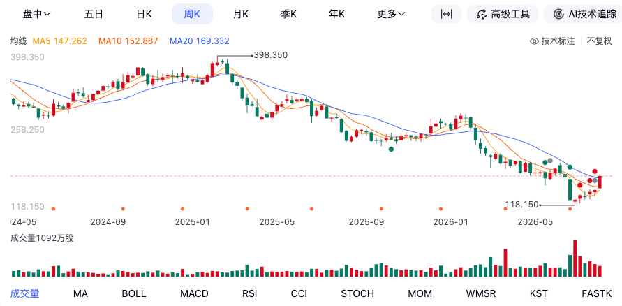
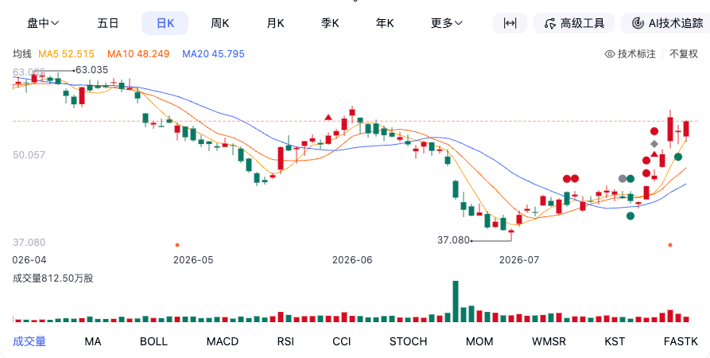
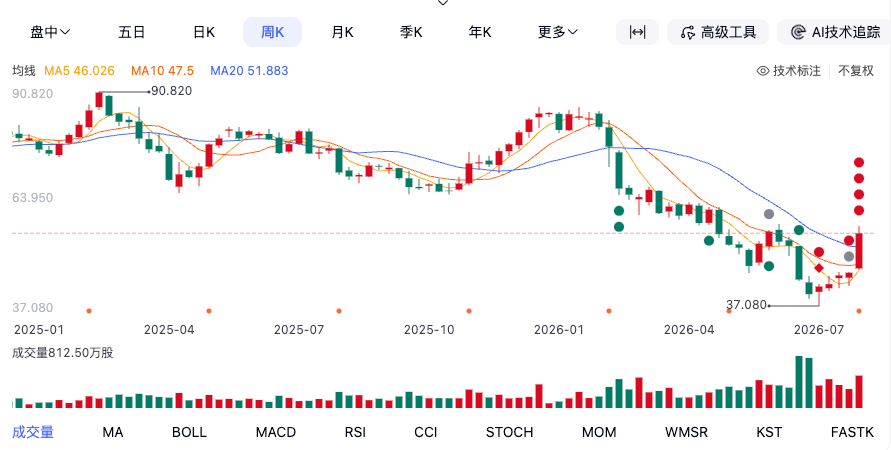

# 埃森哲（ACN）研究笔记

> 2026-08-14 由 ACN 文件夹全部分散笔记（含参考资料）合并整理而成，为唯一保留文档。
> 口径约定：除特别注明外，金额单位为美元；ACN 财年为每年 9 月 1 日至次年 8 月 31 日（FY2025 截至 2025/8/31，最新季度 FY2026 Q3 截至 2026/5/31）。

## 目录

1. 公司概览
2. 业务模块（咨询 vs 管理服务 / 服务线）
3. 营收情况
4. 盈利与负债
5. 估值和股价
6. 专题：AI 对 ACN 的冲击
7. 竞争对手（含同行对比）
8. 竞争对手深度笔记（TCS / Cognizant）
9. 我的看法【我的推演】
10. 跳过的模块及原因
11. 后续研究方向
12. 数据来源与核实记录

---

## 1. 公司概览

埃森哲（Accenture）常被简单归类为"咨询公司"，但这远不能概括它的全貌。它更像一个庞大的"企业转型服务综合体"，业务已从传统的管理咨询，延伸到了技术实施和日常运营外包。

收入模式 = **咨询项目 + 系统实施 + 长期运营服务**。它不是卖软件或硬件，而是帮大型企业做转型、实施系统、并长期运营 IT 与业务流程。

### 客户

埃森哲服务约 **9,000 个客户**，最大特点是**客户高度分散**——没有单一客户占收入 20% 以上的风险。

| 行业 | 代表客户 | 收入占比 | 特点 |
| --- | --- | --- | --- |
| **科技/通信/媒体** | Microsoft、NVIDIA、Vodafone | 增长最快 | 最直接面对云、AI、数据 |
| **金融服务** | HSBC、Bank of America、JPMorgan | ~20% | 系统复杂、替换供应商困难、合同周期长 |
| **制造业/汽车** | BMW、Mercedes-Benz、Unilever | ~30% | ACN 核心市场 |
| **零售/消费品** | Walmart、Coca-Cola | — | 供应链、数据分析 |
| **医疗/生命科学** | Pfizer | — | 临床研发数字化 |
| **政府** | 美国联邦机构、欧洲政府 | ~8%全球/16%美洲 | IT现代化、云迁移 |

**关键优势**：ACN 的客户集中在**"最需要 AI 转型、但自己最难完成转型"的大型企业**。这些行业不是简单买 ChatGPT 就能完成 AI 转型——需要系统集成、数据治理、流程改造，这正是 ACN 的护城河。

### 员工数量

| 财年末 | 员工人数 | 同比变化 |
| --- | --- | --- |
| **FY2023**（2023/8/31） | **733,000** | +1.66% |
| **FY2024**（2024/8/31） | **774,000** | **+5.59%** |
| **FY2025**（2025/8/31） | **779,000** | +0.65% |
| **FY2026 Q3**（2026/5/31） | **799,000** | **+2.57%（较财年末）** |

- **FY2023–FY2024**：员工数从 73.3 万跃升至 77.4 万，一年净增 **4.1 万人**（+5.59%），是近三年扩张最猛的时期。
- **FY2024–FY2025**：增速骤降至 **0.65%**，全年仅净增 5,000 人。
- **FY2026**：截至 Q3 员工数已反弹至 **799,000 人**，较 FY2025 年末净增 **2 万人**。

**AI 专业人才：从 4 万到 8 万**

| 时间点 | AI 与数据专业人才 | 变化 |
| --- | --- | --- |
| **FY2023** | 约 **40,000** 人 | — |
| **FY2025** | 约 **77,000** 人 | **+92.5%** |
| **FY2026 目标** | **80,000** 人 | 尚差约 3,000 人 |

> 埃森哲正在经历一场大规模的人才结构调整——裁撤无法适应 AI 转型的岗位，同时大举招聘 AI 与数据专业人才。CEO Julie Sweet 明确表示，公司正在裁撤那些无法向 AI 相关工作转型的员工。2025 财年的约 2.2 万人裁员中，相当一部分属于"技能不匹配"的结构性裁员。

---

## 2. 业务模块

要深入理解埃森哲的业务，可以按"**业务类型 *Type of Work***"和"**服务线 *Service Groups***"两个维度来拆解，前者是财报的核心分类，后者则反映了其最新的战略方向。

### 2.1 维度一：按业务类型划分（财报核心分类）

#### 咨询 *Consulting*

- **业务模式**：按项目签约，帮助客户解决特定的战略或技术问题。
- **Q3 FY2026 业绩**：营收 **93.3 亿美元**；同比增速美元计 **+4%**、本币计 **+1%**。
- **近期表现**：Q3 新订单 **102.6 亿美元**。业务受宏观因素影响较大，例如中东冲突对咨询业务造成约 1 亿美元的收入冲击。

#### 管理服务 *Managed Services*

- **业务模式**：签订多年长期合同，直接为客户**运营**其部分 IT 系统或业务流程。
- **细分驱动**：增长由**技术服务**（中个位数增长）和**运营服务**（高个位数增长）共同驱动。
- **Q3 FY2026 业绩**：营收 **93.9 亿美元**；同比增速美元计 **+8%**、本币计 **+5%**。
- **近期表现**：Q3 新订单 **90.6 亿美元**。

#### 增长趋势对比：咨询 vs 管理服务

| 时间点 | 咨询业务营收 *TTM* | 管理服务营收 *TTM* | 趋势解读 |
| --- | --- | --- | --- |
| **2024年Q3** | ~331 亿美元 | ~313 亿美元 | 咨询领先 |
| **2025年Q3** | ~346 亿美元 | ~339 亿美元 | 差距缩小 |
| **2026年Q3** | **~364 亿美元** | **~367 亿美元** | **管理服务反超** |

管理服务合同因其稳定性和可预测性，正成为越来越重要的收入支柱。

### 2.2 维度二：按服务线与战略板块划分

埃森哲内部按能力和解决方案划分了更细的"服务线 *Service Groups*"。近年来，公司将这些能力整合为"**重塑服务 *Reinvention Services***"推向市场。

| 服务线 *Service Group* | 核心业务描述 | 所属"重塑服务"板块 |
| --- | --- | --- |
| **战略与咨询 *Strategy & Consulting*** | 管理咨询、企业战略、数字化转型规划 | **战略与咨询** |
| **技术服务 *Technology*** | 系统集成、云基础设施、数据与 AI 平台、网络安全 | **数字核心 *Digital Core*** |
| **智能运营 *Operations*** | 接手并运营客户的部分业务流程（BPO），如财务、人力资源 | **行业与企业 *Industry and Enterprise*** |
| **工业X *Industry X*** | 利用数字技术（IoT、AI）帮助制造业、能源等行业数字化转型 | **行业与企业 *Industry and Enterprise*** |
| **Accenture Song** | 品牌设计、数字营销和客户体验优化 | **Song** *客户增长* |

> **注**：服务线是能力集合，而"重塑服务"是将这些能力打包，针对客户特定需求（如网络安全、财务转型等）提供的综合解决方案。

### 2.3 两大业务的进一步拆解

ACN 的两个大业务不是传统意义上的"咨询"和"外包"这么简单，而是一条完整链条：**帮企业设计数字化战略 → 实施系统 → 部署技术 → 长期运营维护**，覆盖企业 IT 全生命周期。

**Consulting（咨询，FY2025 约 350 亿美元、占约 50%）**——项目型业务，毛利率较高、波动较大、与企业资本开支相关。内部结构：

- **Strategy & Consulting（战略与管理咨询）**：Consulting 最大的入口。① 企业战略——如帮一家银行制定数字银行战略、AI 战略、云战略；② 业务流程重构——如把保险公司"客户提交理赔 → 人工审核 → 7 天完成"改造为"上传照片 → AI 识别 → 风险模型 → 自动赔付"；③ 组织转型——重新设计组织结构、培训员工、建立数字团队。
- **Technology Consulting（技术咨询）**：ACN 最核心的能力，占 Consulting 很大比例。围绕云计算（与 AWS/Azure/Google Cloud 合作，负责架构设计、数据迁移、应用改造）、ERP 系统（SAP/Oracle/Salesforce，传统优势）、数据与 AI（数据平台、数据治理、模型部署、企业 AI 应用）。
- **Industry X（工业数字化）**：近几年重点发展，帮制造业数字化——智能工厂、工业 IoT、数字孪生、产品设计。

**Managed Services（托管服务，FY2025 约 346 亿美元、占约 50%）**——ACN 最容易被低估的业务。咨询是"帮我改造系统"，托管是"改造完以后，你长期帮我运营"。内部结构：

- **Cloud Operations（云运营）**：增长最快之一。企业迁移上云后每天需要系统监控、安全管理、性能优化、故障处理，ACN 收长期服务费（如 5 年期、数十亿美元合同）。
- **Application Managed Services（应用维护）**：SAP/Oracle/Salesforce 上线后的更新、修 bug、功能开发。特点：稳定、续约率高、现金流强。
- **Security Services（网络安全）**：威胁检测、安全运营中心 SOC、身份管理、风险管理——企业越来越不可能自建完整安全团队。
- **Business Process Outsourcing（业务流程外包）**：贷款审核、理赔处理、智能客服——ACN 甚至帮客户运营部分业务流程。

**护城河（该资料观点）**：主要不是技术，而是① 企业关系（财富 500 强、全球政府、大型银行，更换供应商成本极高）；② 人才规模（约 78 万员工可同时做全球 ERP、云迁移、AI 项目，小公司无法复制）；③ 知识库（几十年企业数字化积累的行业流程、模板、最佳实践）。

**投资视角**：Managed Services 决定收入稳定性、FCF、估值底部（类似"软件订阅收入"）；Consulting 决定增长弹性（AI、云、数字化浪潮来了，企业首先找咨询）。ACN 的投资逻辑可简化为：

```text
Consulting → 获得客户 → 实施项目 → 转入 Managed Services → 多年持续收费
```

---

## 3. 营收情况

### 3.1 年度营收总额（FY2023 – FY2025）

FY2026 尚未结束，目前仅有部分季度数据。

| 财年 | 营收 | 同比增速 | 咨询占比 | 管理服务占比 |
| --- | --- | --- | --- | --- |
| **FY2023**（截至2023/8/31） | **641.1 亿美元** | +4.09% | 52.4% | 47.6% |
| **FY2024**（截至2024/8/31） | **649.0 亿美元** | +1.22% | 51.2% | 48.8% |
| **FY2025**（截至2025/8/31） | **696.7 亿美元** | **+7.36%** | 50.4% | 49.6% |
| **FY2026** 全年营收指引 | **717.6 – 724.6 亿美元** | 约 3%–4%（本币） | — | — |

FY2024 增速明显放缓（仅 +1.22%），FY2025 大幅提速至 7.36%，新增营收近 50 亿美元。

### 3.2 业务板块拆分

**按业务类型（咨询 vs 管理服务）**

| 业务板块 | FY2024 | FY2025 | 说明 |
| --- | --- | --- | --- |
| **咨询 *Consulting*** | 332 亿美元 | 约 350 亿美元（估算） | FY2024 占 51% |
| **管理服务 *Managed Services*** | 317 亿美元 | 约 347 亿美元（估算） | FY2024 占 49% |

FY2025 财报未单独披露两项具体数字，但两者体量已基本持平。

**按区域市场**

| 区域 | FY2024 | FY2025（TTM，截至2026/5） | 说明 |
| --- | --- | --- | --- |
| **美洲** | 307.4 亿美元 | 359.2 亿美元 | 最大市场 |
| **EMEA**（欧洲/中东/非洲） | 228.2 亿美元 | 265.7 亿美元 | 增速最快 |
| **成长型市场**（含亚太） | 113.4 亿美元 | 106.1 亿美元 | 包括中国市场 |

**按行业**

| 行业 | FY2023→FY2024 | FY2024→FY2025 | 最新趋势（FY2026 Q3 TTM） | 解读 |
| --- | --- | --- | --- | --- |
| **产品** | +2.40% | +8.40% | +5.00% | 最大板块，持续稳健增长 |
| **健康与公共服务** | +10.20% | +6.60% | +0.80% | 增速明显放缓，受美国联邦业务拖累 |
| **金融服务** | -4.30% | +10.00% | +8.10% | FY2024 萎缩后强劲反弹 |
| **通信/媒体/科技** | -5.30% | +5.60% | +8.00% | FY2024 唯一萎缩的行业，现为增长最快板块 |
| **资源** | +2.10% | +4.80% | +3.40% | 稳定低速增长 |

### 3.3 FY2026 季度进展（咨询 vs 管理服务 TTM 差距）

| 季度 | 咨询营收（TTM） | 管理服务营收（TTM） | 管理服务-咨询差距 |
| --- | --- | --- | --- |
| **FY2024 Q4**（2024/9/30） | 332.0 亿 | 317.0 亿 | 咨询领先 15.0 亿 |
| **FY2025 Q1**（2024/12/31） | 337.8 亿 | 325.8 亿 | 咨询领先 12.0 亿 |
| **FY2025 Q2**（2025/3/31） | 340.4 亿 | 331.8 亿 | 咨询领先 8.6 亿 |
| **FY2025 Q3**（2025/6/30） | 345.9 亿 | 338.9 亿 | 咨询领先 7.0 亿 |
| **FY2025 Q4**（2025/9/30） | 351.1 亿 | 345.7 亿 | 咨询领先 5.4 亿 |
| **FY2026 Q1**（2025/12/31） | 354.8 亿 | 352.5 亿 | 咨询领先 2.3 亿 |
| **FY2026 Q2**（2026/3/31） | 360.5 亿 | 360.6 亿 | 管理服务反超 0.1 亿 |
| **FY2026 Q3**（2026/6/30） | 363.7 亿 | 367.3 亿 | **管理服务领先 3.6 亿** |

### 3.4 Bookings（新订单）

Bookings 指客户已签署合同、未来将交付并确认收入的金额，可以大致看出未来一段时间的营收。

| 财年季度 | 财报发布日期 | 新订单 *亿美元* | 同比变化 *美元* | 同比变化 *本币* |
| --- | --- | --- | --- | --- |
| **FY2024 Q1** | 2023-12-19 | **184** | **+14%** | **+12%** |
| **FY2024 Q2** | 2024-03-21 | **216** | **-2%** | **-2%** |
| **FY2024 Q3** | 2024-06-20 | **211** | **+22%** | **+26%** |
| **FY2024 Q4** | 2024-09-26 | **201** | **+21%** | **+24%** |
| **FY2025 Q1** | 2024-12-19 | **187** | **+1%** | **+1%** |
| **FY2025 Q2** | 2025-03-20 | **209** | **-3%** | **持平** |
| **FY2025 Q3** | 2025-06-20 | **197** | **-6%** | **-7%** |
| **FY2025 Q4** | 2025-09-25 | **213** | **+6%** | **+3%** |
| **FY2026 Q1** | 2025-12-18 | **209** | **+12%** | **+10%** |
| **FY2026 Q2** | 2026-03-19 | **221** | **+6%** | **+1%** |
| **FY2026 Q3** | 2026-06-18 | **193** | **-2%** | **-3%** |

> **注**：FY2024 Q4 数据来源于第三方财经报道，其余季度均来自埃森哲官方新闻稿或 SEC 文件。FY2025 全年 Bookings 合计 806 亿美元。

**增长与订单的分化**（FY2026 Q3）：

| 业务线 | Q3 新订单 | 同比变化 |
| :--- | :--- | :--- |
| 咨询 | 103 亿美元 | +13% |
| 管理服务 | 91 亿美元 | -15% |

| 指标 | 趋势 | 信号含义 |
| :--- | :--- | :--- |
| 总营收 | +6%（美元计） | 还在增长 |
| 员工总数 | +2%（环比 Q2）→ 79.9 万 | 正在"换血"回补 AI 人才 |
| 咨询订单 | +13% | AI 相关咨询需求强劲 |
| 管理服务订单 | -15% | 长期大单被推迟，客户观望 |

营收还在增长——因为过去签的订单还在交付；员工还在扩张——因为公司正在战略性囤积 AI 人才；订单却在下降——因为客户在 AI 时代变得犹豫，不敢轻易签长期大单。

这三件事放在一起，指向同一个结论：埃森哲正处于新旧动能切换的"青黄不接"期——AI 带来了新的咨询需求（咨询订单 +13%），但也让客户对长期承诺变得更加谨慎（管理服务订单 -15%）。公司在用更多、更贵的 AI 人才去赌一个尚未完全兑现的未来。—— DeepSeek

### 3.5 其他值得关注的营收数据

1. **生成式 AI 收入**：FY2025 全年来自生成式 AI 的营收达 **27 亿美元**，是 FY2024 的 3 倍；生成式 AI 订单达 59 亿美元。
2. **生态伙伴业务**：FY2025 合作生态业务营收占总营收 **60%**，同比增长 9%，增速高于公司整体。
3. **FY2026 全年指引**：公司预计本币营收增速 **3%–4%**，较 FY2025 的 7% 有所放缓。

---

## 4. 盈利与负债

### 4.1 盈利能力（Q3 FY2026）

| 指标 | 数据 | 关键信号 |
| --- | --- | --- |
| **营收** | 187.2 亿美元 | +6%（美元）/ +3%（本币） |
| **净利润** | 23.39 亿美元 | +6% |
| **摊薄 EPS** | 3.80 美元 | **+9%**，超预期 |
| **营业利润率** | 17.0% | 同比扩张 20 个基点 |
| **前三季度营收** | 555.0 亿美元 | +7% |
| **前三季度净利润** | 63.76 亿美元 | — |

### 4.2 资产负债表（截至 2026/5/31）

| 指标 | 金额 | 解读 |
| --- | --- | --- |
| **总资产** | 688.07 亿美元 | — |
| **现金及等价物** | 101.65 亿美元 | — |
| **总债务** | 约 83.5 亿美元 | — |
| **净现金头寸** | 约 10.6 亿美元 | **现金大于债务** |
| **债务/权益比** | 0.27 | 极低 |
| **利息保障倍数** | 44.74 倍 | 偿息能力极强 |

### 4.3 现金流与股东回报

| 指标 | 数据 |
| --- | --- |
| **全年自由现金流指引（FY2026）** | 108–115 亿美元 |
| **FY2025 自由现金流** | 109 亿美元 |
| **FY2025 返还股东合计（回购 46 亿 + 分红约 37 亿）** | **83 亿美元**（占 FCF 约 **76%**） |
| **FY2026 计划返还股东（回购+分红）** | **至少 93 亿美元**（同比约 +12%） |
| **股息率** | 约 3%（Yahoo 追踪口径 ~3.96%，见第 5 章） |
| **ROE（TTM）** | 25% |
| **ROIC（TTM）** | 16.99% |

> **一句话**：埃森哲**盈利在增长、现金流极其强劲、几乎没有净债务**——财务基本面非常扎实。增长放缓和订单下滑更多体现在增长前景上，而非财务健康层面。而且它不是"FCF 很高但现金趴在账上"的公司——相当大比例的现金持续返还股东。

#### 回购：长期、持续，FY2026 明显加速

| 财年 | 回购金额 | 回购股数 | 备注 |
| --- | ---: | ---: | --- |
| FY2022 | 约 **41 亿美元** | 1,220 万股 | 持续回购 |
| FY2023 | **43 亿美元** | 1,530 万股 | 稳定 |
| FY2024 | **45 亿美元** | 1,400 万股 | 稳定（Q4 回购均价约 303 美元） |
| FY2025 | **46 亿美元** | 1,410 万股 | 稳定 |
| FY2026 Q1–Q3 | **约 52 亿美元** | **约 2,230 万股** | **明显加速** |

FY2026 分季度：Q1 回购/赎回 **23 亿美元、950 万股**（均价约 **245 美元/股**）；Q2 **17 亿美元、680 万股**；Q3 **12 亿美元、600 万股**。前三季度合计约 52 亿美元——**还没到财年结束，回购金额已超过 FY2025 全年**。公司此前每年稳定花 40–46 亿美元回购，2026 年股价跌到低位后，同样的现金可以买回更多股票（FY2024 Q4 均价约 303 美元 → FY2026 Q1 约 245 美元），**估值下来之后回购的资本配置效率明显比前几年更高**。

#### 关键细节：回购 ≠ 股数等比例减少

- FY2025 年末约 **6.22 亿股** → FY2026 Q3 末约 **6.12 亿股**：前三季度回购/赎回约 2,230 万股，**净流通股只减少约 1,000 万股**——原因是员工股票薪酬、股权计划等会重新发行股票。
- 稀释加权平均股数：FY2026 前三季度 **6.213 亿股** vs 上年同期 6.331 亿股，下降约 **1.9%**。公司明确披露，FY2026 前三季度 EPS 增长中约 **$0.20/股**来自更低的股数。
- 所以真正有效的回购收益约为**每年给 EPS 贡献 2% 左右的增厚**，而不是"花 50 亿美元回购、市值就直接减少 50 亿美元"这么简单。

#### 资本回报模型

> **业务增长 + 约 2% 的净股数减少 + 约 3% 左右股息率**

可继续测算的方向：按当前市值，回购收益率 + 股息率合计能给股东贡献多少"静态年化收益"。

---

## 5. 估值和股价

埃森哲股价从 2026 年初约 **259 美元**跌至近期约 **125–140 美元**区间，跌幅超过 **50%**。市值从逾 2,000 亿美元缩水至约 **1,060 亿美元**。6 月 18 日财报公布后单日暴跌 **18%**，创历史最大单日跌幅。

### 核心估值指标变化

| 指标 | 2025/5/31 | 2026/5/31 | 当前（约2026/7月） | 变化 |
| --- | --- | --- | --- | --- |
| **市值** | 1,983 亿美元 | 1,149 亿美元 | ~1,060 亿美元 | -46% |
| **Trailing P/E** | 26.12x | 15.33x | **~13.2x** | 腰斩 |
| **Forward P/E** | 23.04x | 12.50x | **~11.1x** | — |
| **Price/Sales** | 2.99x | 1.63x | **~1.40x** | — |
| **Price/Book** | 6.75x | 3.68x | **~3.16x** | — |
| **股息率** | — | — | **~3.96%** | — |

> 关键观察：Trailing P/E 从 2025 年 5 月的 26 倍压缩至当前的约 13 倍，估值收缩幅度超过 50%。当前 PE 处于近 5–10 年低位。

### 股价暴跌的三重冲击

1. **AI 颠覆"卖人头"模式**："按结果付费"合同占比首次追平"按人头付费"，客户不再愿意为工时买单。
2. **地缘政治双重打击**：伊朗冲突累计冲击中东销售 4 亿美元；DOGE（政府效率部）导致联邦合同放缓，影响全球收入约 1 个百分点。
3. **AI 支出"叫好不叫座"**：企业 IT 预算总量并未增加，AI 支出正在挤压传统 IT 服务支出。2026 年 IT 服务预算同比增速仅约 2%。

### 订单信号

| 指标 | 数据 | 问题 |
| --- | --- | --- |
| Q3 新订单 | 193 亿美元 | **同比下降 2%**（本币计 -3%） |
| 全年增速指引 | 3%–4%（本币） | 从 3%–5% **进一步收窄** |

### 5.1 估值指标季度追踪（2025/5 – 2026/5）

反映过去一年多估值从高位持续压缩的过程：

| 估值指标 | 2025/5/31 | 2025/8/31 | 2025/11/30 | 2026/2/28 | 2026/5/31 | 当前（约7/30） |
| --- | --- | --- | --- | --- | --- | --- |
| **市值** | 1,983 亿 | 1,619 亿 | 1,550 亿 | 1,284 亿 | 1,149 亿 | ~1,060 亿 |
| **Trailing P/E** | 26.12x | 20.68x | 20.58x | 17.25x | 15.33x | **~13.2x** |
| **Forward P/E** | 23.04x | 18.45x | 18.05x | 15.22x | 12.50x | **~11.1x** |
| **PEG（5年预期）** | 2.48 | 2.00 | 1.94 | 1.62 | 1.32 | **1.20** |
| **Price/Sales** | 2.99x | 2.40x | 2.27x | 1.86x | 1.63x | **~1.40x** |
| **Price/Book** | 6.75x | 5.29x | 4.93x | 4.16x | 3.68x | **~3.16x** |
| **EV/EBITDA** | 17.18x | 13.49x | 12.79x | 10.66x | 9.39x | **~8.0x** |



### 5.2 年度估值历史（FY2021 – FY2025，财年末口径）

| 财年 | 财年结束日 | Trailing P/E | Price/Sales | Price/Book | 说明 |
| --- | --- | --- | --- | --- | --- |
| **FY2021** | 2021/8/31 | **36.9x**（峰值） | 5.09x | 13.54x | 疫情后科技股泡沫高点 |
| **FY2022** | 2022/8/31 | **27.5x** | 2.62x | 8.11x | 估值大幅回落（-25.5%） |
| **FY2023** | 2023/8/31 | **28.5x** | 3.29x | 8.98x | 小幅反弹（+3.6%） |
| **FY2024** | 2024/8/31 | **30.8x** | 3.87x | 8.47x | 继续回升（+8.0%） |
| **FY2025** | 2025/8/31 | **20.4x**（5年低点） | 2.24x | 5.88x | 暴跌（-33.9%） |

**PB 季度细节**：2023–2024 年多数时间维持 7.4–8.6x 高位（2024 Q4 周期高点 8.59x）→ 2025 Q1 快速下滑至 5.78x → 2025 Q3 触及 5.09x → 当前（2026/7）约 3.16x。

### 5.3 当前估值水平（截至 2026/7/30 附近）

| 指标 | 当前值 | 数据来源 |
| --- | --- | --- |
| **Trailing P/E** | ~13.2x | Yahoo Finance |
| **Forward P/E** | ~11.1x | Yahoo Finance |
| **PEG** | 1.20 | Yahoo Finance |
| **Price/Sales** | ~1.40x | Yahoo Finance |
| **Price/Book** | ~3.16x | Yahoo Finance |
| **EV/EBITDA** | ~8.0x | Yahoo Finance |
| **市值** | ~1,060 亿美元 | StockAnalysis |
| **股息率** | ~3.96%（追踪） | Yahoo Finance |

需要关注的几个点：

1. **估值处于历史低位**：当前 Trailing P/E 约 13 倍，较 FY2021 的 36.9 倍峰值收缩约 65%，也远低于 FY2023–2024 的 28–30 倍区间。
2. **PB 已跌破 3.5 倍**：近年来罕见。Gurufocus 指出当前市净率、市盈率、市销率均接近 10 年低点。
3. **估值收缩的双重驱动**：EPS 仍在增长（Q3 FY2026 同比 +9%），股价大幅下跌（52 周约 -37%），两者共同推动估值倍数快速压缩。
4. **Forward P/E 低于 Trailing P/E**（11.1x vs 13.2x）：市场预期未来盈利继续增长——当前估值已隐含较为悲观的预期。
5. **PEG 降至 1.20**：从一年前的 2.48 降至 1.20，已进入相对合理区间。

**总结**：埃森哲过去三年经历了**估值从极度乐观（FY2021 PE 37x）到极度悲观（当前 PE ~13x）的完整周期**。当前估值处于近 5–10 年低位，但这是"价值洼地"还是"价值陷阱"，取决于盈利增长能否兑现、AI 支出能否如期转化为收入，以及地缘政治风险是否会进一步冲击业绩。

### 5.4 股价为什么会跌：完整逻辑链

如果只看公司质量——全球 IT 服务龙头、700 亿美元收入、78 万员工、FCF 超 100 亿美元、ROE 很高——它不像一家"坏公司"。股价回落的核心不是**公司变差**，而是**市场给它的预期发生了变化**，可分五个阶段：

**第一阶段（2021 年以前）：市场把 ACN 当成长股。** 企业数字化 = 长期增长 = Accenture 持续受益（云计算、SAP 数字化、ERP 升级、IT 外包、全球化几大趋势叠加），市场愿意给 **25–35 倍 PE**——收入增长 5%–10%、利润增长 8%–12%、现金流稳定，按科技股估值。

**第二阶段（2022–2023）：宏观打击 IT 服务。** 企业控制成本、延迟 IT 项目、减少咨询预算，大型数字化项目（如 20 亿美元的 ERP 改造）可能延期两年。ACN 不是卖软件——微软客户买 Azure、Adobe 客户买订阅，但 ACN 的客户需要主动决定"要不要启动一个大型转型项目"，所以经济周期影响更明显。

**第三阶段：市场最大的担忧——AI 会不会摧毁咨询行业。** 过去一个 SAP 项目需要 100 个顾问做 18 个月、收入几千万美元；未来 AI 工具自动写代码、生成文档、配置系统，可能 30 个人完成，客户为什么还支付那么高费用？咨询本质是卖人的时间——Senior Consultant $3000/天，AI 辅助效率提升 3 倍，客户就会要求降价。Consulting 受影响最明显。

**第四阶段：收入增长下降，估值被重新定价。** 以前市场预期收入增长 8%–10%、利润增长 10%+；现在收入中个位数增长，FY2026 指引约 2%–5%（本币）。估值模型从"增长公司 PE 30x"变为"成熟服务公司 PE 12–15x"。最重要的心理变化是**从科技股变成价值股**：以前市场看"Accenture = 数字化增长公司"，现在看"Accenture = 人力服务公司"。

**第五阶段：Bookings 让市场担忧。** 咨询公司最重要指标不是收入而是新订单（订单 → 未来收入）；部分季度 Bookings 下滑引发担忧——今天的收入增长可能来自过去的订单，未来看新订单。次要因素还有：美国政府业务预算收紧、美元上涨压低换算收入。

**矛盾点（投资机会所在）**：市场担心 AI 伤害 ACN，但 ACN 自己的数据显示 AI 业务正在增长——FY2025 Gen AI 收入约 27 亿美元、订单约 59 亿美元，全年收入约 697 亿美元（+7%）。所以问题不是"AI 有没有需求"（有），而是：**AI 带来的新增收入，能不能抵消传统咨询业务的价格下降？**

**投资框架**：当前定价已包含三个悲观假设（所以 PE 被压缩）。如果未来证明 AI 并没有减少咨询需求——企业需要更多 AI 实施、数据治理需求增加、云迁移继续、自动化项目增加——ACN 可能重新获得 18–20 倍 PE。下一步最值得看的不是财务，而是 Consulting 和 Managed Services 两个业务在 AI 时代分别会发生什么变化，尤其是：**Managed Services 会不会成为 AI 时代的新护城河**——这决定 ACN 是"被 AI 淘汰的人力公司"，还是"帮助企业实施 AI 的基础设施公司"。

---

## 6. 专题：AI 对 ACN 的冲击

AI 不会简单地"替代"埃森哲，而是在**冲击其"卖人头、算人天"的传统商业模式**，同时创造新的需求。

### 6.1 四重冲击

**冲击一：初级咨询人员首当其冲。** ACN 大量 Analyst、Associate Consultant、Developer 负责写报告、做 PPT、数据整理、写代码、测试——这些任务非常容易被 AI 辅助。以前 3 天整理 50 页行业报告，现在 AI 几十分钟完成初稿，客户自然会问：**"为什么我要支付这么多初级顾问费用？"**

**冲击二：项目周期缩短。** 以前一个 Salesforce 实施需要 12 个月，AI 工具能自动生成配置方案、测试案例、文档，可能 6 个月就完成。收入公式 = 人数 × 时间 × 单价，**人数和时间同时下降，收入自然承压**。

**冲击三：价格下降压力。** 以前 10 个顾问收费 100 万美元，未来 3 个顾问 + AI，客户可能只愿意付 60 万。这不是"没人找 ACN"，而是**同样项目，客户愿意支付的钱减少了**。

**冲击四：低端软件实施业务。** SAP、Oracle、ERP 应用开发中的重复性工作（数据迁移、API 接口、测试、文档生成）非常适合 AI，这部分利润率可能持续下降。

### 6.2 但 AI 同时创造了新业务

企业真正部署 AI 非常复杂，不是买 ChatGPT 企业版就结束：

| 新需求 | 说明 | ACN 的角色 |
| --- | --- | --- |
| **数据治理** | 垃圾数据→垃圾结果，需要数据清理、架构设计、权限管理 | 核心能力 |
| **AI 系统集成** | 银行 AI 客服需连接 CRM、核心系统、风控、数据仓库 | 系统集成 |
| **企业 AI 转型** | 不是技术问题，而是业务流程怎么改变、风险怎么控制 | 咨询优势 |

### 6.3 核心结论：一把双刃剑

| 确定的损失 | 不确定的收益 |
| --- | --- |
| 初级顾问效率提高→项目人数减少 | AI 转型需求到底有多大？没人知道 |
| 传统咨询价格面临下行压力 | Managed Services 能否成为新增长引擎？ |

资本市场通常先交易确定性，所以**确定的利润压力→PE 下降**，而未来可能的 AI 收益尚未完全反映。

> 三种可能：A（最差）客户获得全部收益，ACN 收入下降；B（中性）客户和 ACN 分享收益，收入稳定；C（最好）AI 让数字化需求爆发，ACN 从"卖顾问"变成"AI 转型基础设施供应商"。
>
> 当前低估值，本质是市场在押注"AI 更可能伤害 ACN 而非帮助它"。

### 6.4 为什么 ACN 的营收还在增长

既然 AI 在冲击传统咨询业务，为什么营收没有降？答案是：**增长主要来自 Managed Services，而非 Consulting**。

FY2026 Q3 单季度同比增量拆分：

| 业务 | 增量 | 占比 |
| --- | --- | --- |
| Consulting | ~3.2 亿美元 | ~1/3 |
| Managed Services | ~6.7 亿美元 | ~2/3 |

**Managed Services 的增长逻辑**：客户不是在说"请 ACN 给我做一个 PPT"，而是在说"请 ACN 帮我长期运营 IT 系统"——云基础设施运营、应用维护、ERP 运维、网络安全运营、企业流程外包。AI 越复杂，系统数量反而增加（AI Agent、数据平台、自动化流程、模型治理），**这些都需要长期运营**。

行业维度上，FY2026 Q3 CMT（通信/媒体/科技）行业增长 **+9%**，是最接近 AI 投资的客户群。

ACN 的真实变化路径：

```text
过去：咨询项目 + 系统实施
现在：AI/云/数据转型 → 实施 → 长期运营服务 → Managed Services
```

传统 Consulting 增速确实在放缓（Q3 本币仅 +1%），但 Managed Services（本币 +5%）抵消了压力。市场担心 Consulting 增速下降，但还没有完全确认 Managed Services 能否成为 AI 时代新的增长引擎。

---

## 7. 竞争对手

### 7.1 竞争格局总览

ACN 的竞争不是单一类型，而是分四类：

| 梯队 | 代表公司 | 核心特点 | 与 ACN 的关系 |
| --- | --- | --- | --- |
| **印度外包巨头** | TCS（~300 亿收入）、Infosys（~180 亿）、Wipro | 人力成本低、工程师规模大 | 直接竞争 IT 外包，但高端战略咨询弱于 ACN |
| **传统咨询巨头** | Deloitte（~600 亿）、PwC、McKinsey | CEO 关系强、财务咨询入口 | Deloitte 是最大竞争；McKinsey 偏战略、ACN 偏实施 |
| **云厂商** | Microsoft Azure、AWS、Google Cloud | 拥有平台和 AI 能力 | 既是合作伙伴也是潜在威胁——若直接提供 AI 咨询+实施，会分流 ACN |
| **软件公司自有团队** | SAP、Salesforce | 加强自有咨询服务 | 希望控制客户关系，减少对外部实施的依赖 |

**AI 时代最大变量**：过去竞争"谁拥有更多工程师"，未来竞争"谁拥有更强 AI 工具 + 行业知识 + 企业关系"。真正威胁 ACN 的可能是 **Microsoft + Azure AI、AWS、SAP、Deloitte**——因为它们同时拥有平台、软件和客户入口。

ACN 最大优势：全球交付能力（跨国同步实施）、行业经验积累、80 万人才规模。

### 7.2 同行财务对比总表（最新完整财年）

| 指标 | ACN（FY2025） | TCS（FY2026） | Capgemini（FY2025） | Cognizant（FY2025） |
| --- | ---: | ---: | ---: | ---: |
| Revenue | $697 亿 | $300 亿 | €224.7 亿 | $211 亿 |
| 营收增速 | +7.4% | -0.5%（美元） | +1.7% | +7.0% |
| Operating Margin | 15.6%（调整后） | 25.0% | 13.3% | 16.1% |
| Net Margin | ~10% | 19.8% | 7.1% | 10.6% |
| 订单 | Bookings $806 亿 | TCV $407 亿 | €244 亿（Book-to-Bill 1.08） | TTM Bookings $291 亿（~1.3x） |
| FCF | $109 亿 | ₹4,795 亿（FCF/NI 97%） | €19.5 亿 | $26 亿 |
| 员工 | 80 万 | 58.5 万 | 42 万 | ~34 万 |
| Revenue / Employee | ~$87k | ~$50k | ~€53k | ~$62k |

> 口径注意：各家财年、订单定义（Bookings vs TCV）和业务分类不同，订单金额不应直接横向比较绝对规模。Cognizant FY2025 营收已按 10-K 口径修正为 $211.1 亿（早期笔记误记为 $198.4 亿，见第 12 节核实记录）。

### 7.3 ACN vs TCS

> 口径：ACN 完整年度为 FY2025（截至 2025/8/31），最新季度 FY2026 Q3（截至 2026/5/31）；TCS 完整年度为 FY2026（截至 2026/3/31），最新季度 FY2027 Q1（截至 2026/6/30）。

**结论先行**：ACN 与 TCS 都受益于企业把 AI、云、数据和安全能力嵌入核心系统，但获益路径不同。

- **ACN** 更接近企业"重塑"决策与复杂系统整合。若 AI 项目从试点走向全企业流程改造，ACN 的咨询、数据治理、技术实施和托管服务都有扩张空间；但它对大型转型项目、企业预算和美国政府业务更敏感，订单波动也更明显。
- **TCS** 的优势在于长期 IT 运营、应用维护和成本效率。它的利润率更高、订单储备强，适合验证"AI 是否把外包从卖人头转为卖效率"；但若客户将 AI 带来的生产率全部要求以降价返还，传统外包合同的收入增长仍会受压。

一句话：**ACN 的弹性更依赖企业转型支出回暖，TCS 的防御性更依赖高效交付和长期客户关系。**

**核心财务快照**

| 指标 | ACN | TCS | 解读 |
| --- | ---: | ---: | --- |
| 最新完整财年营收 | FY2025：$697 亿 | FY2026：$300 亿 | ACN 规模约为 TCS 的 2.3 倍 |
| 营收增速 | +7% | -0.5%（美元口径） | TCS 本币/固定汇率与美元口径差异较大 |
| 营业利润率 | 15.6%（调整后） | 25.0%（剔除一次性项目） | TCS 交付效率和成本结构更强 |
| 净利润 | — | $59.4 亿 | TCS FY2026 净利率 19.8% |
| 订单 | Bookings $806 亿 | TCV $407 亿 | 定义与合同期限不同，不宜比较绝对规模 |
| 最新季度营收 | FY2026 Q3：$187 亿 | FY2027 Q1：$76.24 亿 | ACN +6%；TCS +2.7% |
| 最新季度订单 | Bookings $193 亿 | TCV $95 亿 | 双方仍有稳定大额签约能力 |

**在企业价值链中的位置**

| 企业需求 | ACN 的相对位置 | TCS 的相对位置 |
| --- | --- | --- |
| 战略、流程与 operating model 重塑 | 强 | 参与但非核心标签 |
| 数据治理、AI 路线图与平台选择 | 强 | 强 |
| 云迁移、系统集成和现代化 | 强 | 强 |
| 应用开发与工程交付 | 强 | 强 |
| 基础设施、应用与业务流程的长期运营 | 强 | 很强 |

这不是"ACN 只做上游、TCS 只做后端"的二分法：两家公司都覆盖实施和托管服务。差异在于 ACN 更擅长把战略、创意、行业知识与技术实施打包为大型转型项目；TCS 更强调规模化工程交付、持续运营和成本效率。企业面对 AI 的常见合作链条是：先定义业务目标、数据与流程改造，再选择和集成平台，最后持续运营优化——ACN 在前两段更具品牌和咨询优势，TCS 在后两段更具交付和运营优势；在云、数据、AI 和安全领域，两者直接竞争。

**订单质量：重点不是金额，而是可转化性**

- ACN 的 Bookings 反映大型转型项目的预算意愿。FY2026 Q3 总订单 $193 亿低于上年同期 $197 亿；咨询订单保持增长，托管服务订单承压，反映客户对长期大单更谨慎。应跟踪：总 Bookings 与营收的关系、咨询与托管订单的分化、生成式 AI 从订单到收入的转化、美国联邦业务影响。
- TCS 的 TCV 体现长期运营合同储备。FY2026 全年 TCV $407 亿、Q1 FY2027 TCV $95 亿。应跟踪：TCV 能否持续维持在营收之上、大客户数量和续约质量、固定汇率收入增长是否恢复、AI 效率收益是保留为利润还是降价让渡给客户。

**AI 的影响：都面对"需求创造"和"价格压缩"**

| 维度 | ACN | TCS |
| --- | --- | --- |
| AI 创造的需求 | 战略设计、数据治理、流程重塑、系统集成、变革管理 | AI 驱动的现代化、IT 运营自动化、软件工程和托管服务 |
| 最直接的机会 | 企业级 AI 转型项目扩大服务范围 | 以更少人力交付更高可靠性，提升利润率和客户黏性 |
| 主要风险 | 大型项目延后；客户减少长期承诺；咨询工作被工具化 | 客户将生产率收益转化为降价要求；人力密集型收入承压 |
| 当前验证指标 | 咨询订单、AI Bookings、托管服务订单、利润率 | TCV、固定汇率营收、AI 年化收入、员工/营收效率 |

当前数据尚不足以证明"AI 会摧毁 IT 服务外包"。TCS 年化 AI 收入已从 FY2026 Q4 的超 $23 亿提升至 FY2027 Q1 的 $26 亿；ACN FY2025 生成式 AI 新订单 $59 亿。但这也不等于 AI 自动带来收入加速——真正决定赢家的是谁能把效率收益转化为更大规模的业务成果、平台化服务或更高利润率。

**客户结构与护城河**

| 维度 | ACN | TCS |
| --- | --- | --- |
| 客户关系的核心 | 企业转型、技术与运营能力的综合供应商 | 长期 IT 运营、现代化与效率提升伙伴 |
| 典型优势行业 | 金融服务、产品、通信媒体科技、公共服务 | BFSI 最大（FY2026 约 32%），另覆盖消费、医疗、制造 |
| 核心护城河 | 高层客户关系、跨能力整合、生态伙伴与全球交付 | 规模化交付、成本效率、长期合同、对客户系统的深度嵌入 |

TCS 利润率更高并不自动代表"客户质量"更高，更多反映印度交付基地、服务组合和运营杠杆；ACN 较低的利润率也不必然是劣势，其较多的咨询、创意和转型项目意味着更高的项目波动和更广的价值链覆盖。

**投资判断框架**

| 问题 | 当前更有优势的一方 | 原因 |
| --- | --- | --- |
| 经营利润率与现金流防御性 | TCS | 长期约 25% 营业利润率，交付效率突出 |
| 企业 AI 转型支出回暖时的上行弹性 | ACN | 更贴近战略、数据、流程和大型整合项目 |
| 长期运营合同的稳定性 | TCS | 订单以长期技术与运营合同为主，TCV 仍强 |
| 端到端企业重塑能力 | ACN | 咨询、技术实施与托管服务覆盖广 |
| AI 导致"卖人头"模式承压的风险 | TCS 略高 | 人力密集型运营收入的定价更直接受效率提升影响 |
| 大型项目延后和预算波动的风险 | ACN 略高 | 转型项目和咨询支出更具可选消费属性 |

**最终判断**：若看重高利润率、长期合同、成本纪律和现金流韧性，TCS 是更偏防御型的选择；若看重企业 AI 重塑、咨询与系统整合需求复苏带来的经营弹性，ACN 的上行空间更值得跟踪。核心分歧不在于"AI 会不会取代 IT 服务商"，而在于 AI 带来的生产率收益由谁获得。

### 7.4 ACN vs Capgemini

Capgemini（CAP.PA，Euronext Paris）是 ACN 最接近的欧洲竞争对手，也是目前最接近 ACN 商业模式的公开公司。数据为 FY2025 完整财年 + Q1 2026。

**核心财务数据**

| 指标 | FY2024 | FY2025 | YoY |
| --- | ---: | ---: | ---: |
| Revenue | €223.0 亿 | **€224.7 亿** | +0.8%（固定汇率 +3.4%） |
| Operating Profit | €23.6 亿 | **€22.0 亿** | -6.7% |
| Operating Margin | 13.3% | **13.3%** | 持平 |
| Net Income | €16.7 亿 | **€16.0 亿** | -4.2% |
| Net Margin | 7.5% | **7.1%** | ↓ |
| Diluted EPS | €9.82 | **€9.46** | -3.7% |
| Free Cash Flow | €19.6 亿 | **€19.5 亿** | 基本持平（FCF Margin 8.7%） |

**资产负债表（FY2025）**：Cash ~€33 亿、Net Debt ~€50 亿、Net Debt/EBITDA ~1.0x、Equity ~€160 亿、Goodwill 较高（收购驱动）。典型轻资产 IT 服务公司：CapEx 低、现金流稳定、主要资本投入是并购。

**订单**：FY2025 Bookings €244 亿、Book-to-Bill **1.08**、Bookings 增长 +3.9%（CC）——订单增长略高于收入增长，健康。Q1 2026：Revenue €59.4 亿（+7% reported，+11% CC）、Bookings €60.5 亿。

**地区收入（FY2025）**：Europe ~52%、North America ~31%、APAC/拉美 ~17%。

**员工与效率**：员工约 42 万人；Revenue/Employee 约 €53.5k（ACN 约 $87k、TCS 约 $50k）。

**近三年趋势**

| 指标 | FY2023 | FY2024 | FY2025 |
| --- | ---: | ---: | ---: |
| Revenue | €229 亿左右 | €223 亿 | €225 亿 |
| Revenue Growth | +5% 左右 | -2% 左右 | +0.8% |
| Operating Margin | 13.3% | 13.3% | 13.3% |

收入增长停滞、利润率稳定、现金流稳定——**高质量成熟 IT 服务公司，而非高速成长公司**。利润率三年持平说明没有明显价格压力，AI 暂未造成利润恶化。

**与 ACN 快速比较**

| 指标 | Accenture | Capgemini |
| --- | ---: | ---: |
| Revenue | 约 $697 亿 | €224.7 亿 |
| 员工 | 约 80 万 | 约 42 万 |
| Operating Margin | 15.6% 左右 | 13.3% |
| Bookings | $806 亿 | €244 亿 |
| 业务规模 | 全球第一 | 欧洲强势 |

（来源：Capgemini Investors — FY 2025 Results、Q1 2026 revenues）

### 7.5 ACN vs Cognizant

Cognizant（CTSH）是 ACN 重要的美股可比公司，业务模式偏 IT Consulting + Technology Services + Outsourcing，定位介于 ACN（咨询+转型）和 TCS（印度外包）之间——比 TCS 更靠近美国客户，比 ACN 更偏技术实施和运营。（完整深度笔记见第 8.2 节；注意本节早期数据已被 10-K 口径修正。）

**核心财务（10-K 修正口径）**

| 指标 | FY2024 | FY2025 | YoY |
| --- | ---: | ---: | ---: |
| Revenue | $197.4 亿 | **$211.1 亿** | **+7.0%**（固定汇率 +6.4%） |
| Operating Margin（GAAP） | 14.7% | **16.1%**（+140bps） | ↑ |
| Net Income | $22.4 亿 | **$22.3 亿** | -0.45%（一次性税费拖累） |
| 调整后 EPS | $4.75 | **$5.28** | **+11%** |

**结构特点**：北美收入占约 75%（非常美国化）；行业上 Health Sciences ~30%、Financial Services ~28%——医疗和金融占比高于 ACN。员工约 34 万人，Revenue/Employee ~$62k。

**定位差异**

| | ACN | Cognizant |
| --- | --- | --- |
| 收入规模 | 全球第一 | 美国大型 IT 服务商（约 ACN 的 1/3） |
| 增长 | 更稳定 | 恢复阶段（2023–24 停滞，2025 加速） |
| 利润率 | 15.6% | 16.1% |
| 客户入口 | CEO/CIO 战略需求（企业转型预算） | CIO/IT 部门需求（IT 预算） |
| 咨询能力 | 更强 | 偏技术实施 |
| 估值 | 更高 | 更低（Forward PE ~9.5x vs ACN ~11x） |

从财务数据看，Cognizant 是很有价值的 ACN 对标：利润率接近 ACN、美国客户比例更高、规模小很多、增长恢复较晚。下一步值得研究的问题是**为什么 Cognizant 的估值长期低于 ACN**——这直接关系到 ACN 的溢价到底来自"规模"，还是来自"商业模式和客户质量"（预算入口不同是市场给 ACN 更高估值的原因之一）。

### 7.6 潜在威胁：数据平台厂商向上扩张

（来自《企业AI落地_原始资料》的要点，原文已并入本文档后删除）

Snowflake、Databricks、Palantir 三家公司都在向"数据 + 语义层 + AI Agent + 应用"扩张，争夺企业架构中的控制点：Snowflake 想控制数据在哪里存、在哪里算；Databricks 想控制数据如何加工、模型如何训练、AI 产品如何开发治理；Palantir 想控制企业如何定义业务对象、如何做决策、AI 如何进入工作流并执行动作。

对 ACN 的含义：企业已有 Snowflake 或 Databricks 后，可能利用现有数据平台 + 内部团队 + 系统集成商自行搭建语义层、Agent 和业务应用，减少对外部咨询/实施的依赖——这与"云厂商既合作又潜在威胁"的判断相互印证，是 ACN 在 AI 时代需要持续跟踪的结构性风险。

---

## 8. 竞争对手深度笔记

### 8.1 TCS 深度笔记：财务数据 + 客户订单分析

> 核心问题：如果 AI 可以替代大量低端程序员和外包工作，为什么 TCS 的订单没有崩？谁还在给 TCS 下订单？
>
> 结论先行：**TCS 的主要客户不是为了"买程序员"，而是在买"企业 IT 系统运营能力"。AI 当前替代的是部分人力，而不是企业对 IT 服务商的需求。**

TCS 财年为每年 4 月 1 日至次年 3 月 31 日。

#### 8.1.1 核心财务数据（美元计价）

**年度营收与利润（FY2025 – FY2026）**

| 指标 | FY2025（截至2025/3/31） | FY2026（截至2026/3/31） | 变化 |
| --- | --- | --- | --- |
| **全年营收** | **$301.79 亿** | **$300.17 亿** | **-0.5%** |
| **营收（固定汇率）** | +4.2% | -2.4% | — |
| **营业利润率** | 24.3% | 25.0% | **+70 bps** |
| **净利润率** | ~19% | 19.8% | **+80 bps** |

> **FY2026 是 TCS 有史以来第一次出现美元营收年度下滑**。即使在新冠疫情期间（FY2021），TCS 美元营收仍保持了 0.6% 的正增长。

**季度营收追踪（FY2025 Q4 – FY2026 Q4）**

| 季度 | 营收 | 环比变化 | 同比变化 |
| --- | --- | --- | --- |
| **FY2025 Q4**（2025/1–3月） | $74.65 亿 | -1.0% | +1.4% |
| **FY2026 Q1**（2025/4–6月） | $74.21 亿 | **-0.6%** | **-1.1%** |
| **FY2026 Q2**（2025/7–9月） | $74.66 亿 | +0.6% | -2.7% |
| **FY2026 Q3**（2025/10–12月） | $75.09 亿 | +0.6% | -0.4% |
| **FY2026 Q4**（2026/1–3月） | **$76.21 亿** | **+1.5%** | **+2.1%** |

FY2026 呈现**逐季改善**趋势，Q4 营收达全年峰值，主要受英国（+2.4%）和北美（+1.4%）市场驱动。

**最新季度：Q1 FY2027（2026年4–6月，2026/7/9 发布）**

| 指标 | Q1 FY2027 | 变化 |
| --- | --- | --- |
| **营收** | **$76.24 亿** | 环比持平，**同比 +2.7%** |
| **净利润** | $14.60 亿 | 净利率 **19.2%** |
| **营业利润率** | **24.0%** | — |
| **年化 AI 收入** | **26 亿美元** | 环比 +13.6% |

Q1 FY2027 美元营收**同比恢复正增长（+2.7%）**，结束了 FY2026 全年的下滑趋势。

**FY26 年报 vs Q1 FY27 季报对比**

| 指标 | FY26 单季均值（年报 ÷ 4） | Q1 FY27（实际） | 对比 |
| --- | ---: | ---: | --- |
| 收入 | $75.04 亿 | $76.24 亿 | 高于季度均值约 +1.6% |
| 同比增长 | -0.5%（FY26 全年口径） | +2.7%（美元） | 增速转正 |
| 订单 TCV | $101.75 亿 | $95 亿 | 略低于季度均值 |
| ├ 其中：北美订单 | —（年报未拆） | $47 亿 | 约占一半 |
| └ 其中：BFSI 订单 | —（年报未拆） | $25 亿 | — |
| 营业利润率 | 25%（全年口径，不可拆分） | 24.0% | 环比约 -100bps |
| $100M+ 客户 | 66 个（年末存量） | — | — |
| $50M+ 客户 | 139 个（年末存量） | — | — |
| $1M+ 客户 | 1397 个（年末存量） | — | — |

> 注：收入、TCV 为流量指标可按 4 个季度均摊；利润率是比率、客户数量是年末时点存量，不做拆分。Q1 FY27 收入高于 FY26 季度均值且同比转正，但 TCV 略低于 FY26 季度均值，值得后续跟踪。

**订单（TCV）表现**

| 指标 | FY2025 | FY2026 | Q1 FY2027 |
| --- | --- | --- | --- |
| **总合同价值（TCV）** | ~$394 亿（全年） | **$407 亿（全年）** | **$95 亿（单季）** |
| **Q4 单季 TCV** | $122 亿 | $120 亿 | — |

FY2026 订单创**历史新高**（407 亿美元，含 5 笔 mega 交易）。订单在营收下滑的同时逆势增长，说明**需求并未消失，只是转化为收入的速度在放慢**。Q1 FY2027 单季 TCV 95 亿美元低于 FY2026 季度均值和 Q4 峰值，但 Q4 通常是大单集中签约的季节性高点，单季回落尚不能说明需求转弱，需观察 Q2 FY2027 是否回升。

**估值与市场数据（截至 2026年7月）**

| 指标 | 当前值（2026/7/8） | FY2026 末 | FY2025 末 |
| --- | --- | --- | --- |
| **Market Cap** | **~7.44 万亿卢比** | 8.53 万亿卢比 | 13.05 万亿卢比 |
| **PE (TTM)** | **15.13x** | 17.34x | 26.87x |
| **Forward PE** | 13.26x | 15.29x | 25.03x |
| **PS** | 2.79x | 3.20x | 5.11x |
| **PB** | 6.85x | 7.86x | 13.62x |

TCS 的 PE 从 FY2025 末的 **26.87x** 压缩至当前的 **15.13x**，估值收缩超 **40%**，处于历史最低区间；股价自 2024 年 9 月高点已回调约 **30%**。

**回报率、现金流与资产负债表（FY2023 – FY2026，INR 口径）**

| 指标 | FY2023 | FY2024 | FY2025 | FY2026 | 趋势 |
| --- | ---: | ---: | ---: | ---: | --- |
| **Operating Cash Flow（亿卢比）** | 4,196 | 4,434 | 4,891 | 5,209 | ↑ |
| **CapEx（亿卢比）** | -310 | -267 | -394 | -415 | → |
| **FCF（亿卢比）** | 3,886 | 4,166 | 4,497 | **4,795** | ↑ |
| **FCF / Net Income** | 92% | 91% | 93% | **97%** | ↑ |
| **ROE** | — | 50.8% | 52.4% | **48.7%** | 高位略降 |
| **ROIC** | — | — | 53.3% | **49.8%** | 高位略降 |
| **Net Cash（亿卢比）** | 3,743 | 3,588 | 3,234 | **3,009** | ↓ |

> 口径说明（来源：Yahoo Finance — TCS.NS 年度财务报表，FY 截至各年 3 月 31 日）：Net Cash = 现金及等价物 + 短期投资 − Total Debt（主要为租赁负债，基本无有息借款）；FCF 常年覆盖净利润 90%+；Net Cash 连降主因是高分红 + 回购（FY26 分红支付 3,944 亿卢比），而非经营恶化。TTM 至 Q1 FY27：ROE 47.7%、ROA 24.5%、Operating Margin 24.0%、FCF 约 3,972 亿卢比。

**区域收入分布（Q1 FY2027）**

| 区域 | 收入占比 | 同比（固定汇率） |
| --- | ---: | ---: |
| **North America** | 48.3% | +2.0% |
| **UK** | 17.2% | -0.6% |
| **Continental Europe** | 15.4% | +4.3% |
| **Asia Pacific** | 8.4% | +2.5% |
| **India** | 6.2% | **+22.9%** |
| **MEA** | 2.5% | +7.6% |
| **Latin America** | 2.0% | -2.1% |

北美仍占近一半收入但增长仅 +2.0%；最大亮点是 India +22.9%；UK 是唯一收缩的主要市场。

**Backlog 说明**：TCS **不直接披露 Backlog**，官方口径以 TCV 作为订单簿代理指标。

#### 8.1.2 客户与订单分析

**1. AI 并没有导致订单崩塌**：如果 AI 直接摧毁外包需求，最先受影响的应该是 TCS。但目前大客户数量继续增加、大合同仍然签订、AI 收入反而增长。

**2. 谁在给 TCS 下订单？最大客户群是银行和金融（BFSI）**

| 行业 | 占比 |
| --- | ---: |
| BFSI 银行金融保险 | 约 32% |
| Consumer Business | 约 15% |
| Healthcare/Life Science | 约 10% |
| Manufacturing | 约 9% |
| Technology | 约 8% |

最大的客户不是互联网公司，而是银行、保险公司、信用卡公司、金融机构。一家全球银行过去几十年积累的核心银行系统 + 支付系统 + 客户数据库 + 风险系统 + 监管系统，运行 20 年以上、几百万行代码、不能停止。银行不会说"AI 出来了，我们不用 IT 供应商了"。AI 来了以后，需求反而变成更长的链条：

```text
旧系统 → 数据整理 → AI模型接入 → 安全审核 → 监管合规 → 持续维护
```

**3. TCS 公布过具体客户吗？** 会公布部分客户案例，但不会公布完整客户名单（保密协议）。公开案例：Lloyds Banking Group（AI 银行转型）、Air France-KLM（数据和 AI 转型）、Telefonica Germany（网络自动化）、大型制造企业（供应链数字化）。真实客户数量：$100M+ 客户 66 个、$50M+ 客户 139 个。

**4. AI 到底替代了什么？**

| 业务 | 占比 | AI 替代风险 |
| --- | ---: | --- |
| Application Development | 较高 | 中 |
| Maintenance | 较高 | 中高 |
| Cloud | 增长 | 低 |
| AI/Data | 增长 | 低 |

以前客户要改一个网页接口 → 5 个工程师、3 个月；现在 AI 辅助 → 2 个工程师、1 个月。这个会发生。但 TCS 收入主要来自大型长期合同（如某银行 10 年合同：维护核心系统 + 云迁移 + 安全 + 数据 + AI 升级），客户买的是"**结果**"，不是"多少工程师"。

**5. 为什么 TCS 反而推出 AI 服务？** AI 不是减少订单，而是改变订单内容：维护系统→AI 改造系统、写代码→AI Agent 开发、人工测试→自动化测试、传统 ERP→智能 ERP。TCS FY26 AI 相关收入年化超 23 亿美元；Q1 FY27 年化 AI 收入已达 26 亿美元。

**6. 市场的担心有没有道理？** 有。真正的风险不是"AI 让客户不用 TCS"，而是 **AI 让客户需要更少的人，所以合同价格下降**——过去 1000 名工程师、合同 10 亿美元 → 未来 500 名工程师 + AI 工具、合同 7 亿美元。

**7. 现在看数据，有没有这种迹象？** 有一点。员工数量 FY25 约 61 万人 → FY26 58.5 万人。员工减少但收入没有大幅下降，说明目前发生的是**人效提升，而不是需求消失**。

**8. 对 ACN 的启示**

```text
低端编码 ↓    普通维护 ↓
AI咨询 ↑    系统改造 ↑    数据工程 ↑    云迁移 ↑
```

| 公司 | AI 影响 |
| --- | --- |
| 低端外包公司 | 压力最大 |
| TCS | 中性偏正 |
| ACN | 偏正 |

**9. 客户为什么选择 TCS：成本还是能力？** 这直接决定 TCS 的护城河是"低成本"还是"能力壁垒"。**结论：TCS 的客户选择它，过去是"成本 + 能力"的组合，而不是单纯成本。**

| 因素 | 重要程度 | 说明 |
| --- | --- | --- |
| 成本优势 | ★★★★★ | 印度交付模式核心优势 |
| 技术能力 | ★★★★ | 大型企业系统经验 |
| 长期关系 | ★★★★★ | 多年合同形成粘性 |
| 行业知识 | ★★★★ | 金融、制造等领域积累 |
| 品牌信任 | ★★★★ | Tata 集团背书 |

三个证据：① 客户结构不是"低价客户"——最大客户群 BFSI（32%）系统复杂、合规要求高、切换成本高；② 替换成本高——涉及应用维护、历史代码理解、业务流程知识、合规、全球支持，供应商粘性极强；③ 利润率证明不是价格竞争——TCS 利润率是同行最高的。

| 公司 | 营业利润率 |
| --- | ---: |
| TCS | 约 25% |
| Infosys | 约 21% |
| Accenture | 约 15-16% |
| Cognizant | 约 15-16% |

**为什么 TCS 比 ACN 便宜？商业模式不同**：

| | TCS | ACN |
| --- | --- | --- |
| 主要卖 | 技术交付 | 咨询+转型 |
| 人员结构 | 印度工程师 | 全球顾问 |
| 成本 | 低 | 高 |
| 利润率 | 高 | 中 |
| 客户入口 | CIO/IT 部门 | CEO/CIO |

**最终判断**：TCS 过去的成功 ≈ 50% 成本优势 + 30% 技术交付能力 + 20% 客户关系和行业经验。但成本优势的重要性在下降，AI 实施能力、行业知识、客户关系、系统经验的重要性在上升。

> TCS 不是一个纯劳动力套利公司，而是一个以低成本起家、逐渐积累企业 IT 知识资产的服务公司——这也是 AI 目前没有造成订单崩塌的原因。

#### 8.1.3 总结与投资判断框架

| 维度 | 核心结论 |
| --- | --- |
| **营收** | FY2026 首次美元营收年度下滑（-0.5%），但 Q4 已连续三个季度环比改善，Q1 FY2027 恢复同比 +2.7% |
| **盈利能力** | 利润率逆势扩张——营业利润率 25%（+70bps）、净利率 19.8%（+80bps），均为**四年最高** |
| **订单** | TCV 达 **407 亿美元**创历史新高，需求基本面未恶化 |
| **估值** | PE 从 26.87x 压缩至 **15.13x**，处于**历史最低区间** |
| **AI 业务** | 年化 AI 收入 **26 亿美元**（Q1 FY27），环比 +13.6%，正成为新增长引擎 |

**未来 12-24 个月的观察指标**

| 指标 | 如果下降 | 说明 |
| --- | --- | --- |
| $100M 客户数量 | 下降 | 大客户流失 |
| TCV 订单 | 下降 | 需求减少 |
| 利润率 | 下降 | 价格压力 |
| 员工/收入比例 | 持续下降 | AI 提升效率 |

目前 TCV 仍强、大客户数量增加、AI 收入增加，**暂时不能证明 AI 正在破坏 TCS 模式**。

**与 ACN 的对比**：TCS 与埃森哲面临相似的挑战——AI 冲击下的业务转型阵痛，但 TCS 凭借**更高的利润率（25% vs ACN 的 17%）**和**创纪录的订单水平**，在行业下行周期中展现了更强的盈利韧性。FY2026 首次美元营收下滑是值得警惕的信号，但 Q1 FY2027 已恢复正增长。

**待深入的关键问题**：~~"TCS 的客户到底是因为成本选择它，还是因为能力选择它？"~~ 已解答（是"成本 + 能力"的组合，且能力权重在上升）。下一个关键问题：

**"TCS 的合同模式是否允许它把 AI 提升的人效转化成利润，而不是被客户拿走？"** 这决定了未来几年 TCS 的利润率还能不能维持 25% 左右——如果客户通过压价拿走效率红利，会出现"500 名工程师 + AI 工具、合同金额下降"的情形；如果合同以结果定价，人效提升将直接转化为利润率扩张。

#### 8.1.4 附录：TCS 年度财务报表摘要（INR 口径，单位：亿卢比）

来源：Yahoo Finance — TCS.NS 年度财务报表，FY 截至各年 3 月 31 日。

| 项目 | FY2023 | FY2024 | FY2025 | FY2026 |
| --- | ---: | ---: | ---: | ---: |
| Revenue | 22,546 | 24,089 | 25,532 | 26,702 |
| EBIT | 5,769 | 6,278 | 6,613 | 6,671 |
| Net Income | 4,215 | 4,591 | 4,855 | 4,921 |
| 实际税率 | 25.7% | 25.6% | 25.3% | 24.6% |
| Total Assets | 14,365 | 14,645 | 15,963 | 18,237 |
| Stockholders Equity | 9,042 | 9,049 | 9,476 | 10,724 |
| Cash + 短期投资 | 4,512 | 4,390 | 4,173 | 4,137 |
| Total Debt（主要为租赁负债） | 769 | 802 | 939 | 1,128 |
| **Net Cash** | **3,743** | **3,588** | **3,234** | **3,009** |
| Operating Cash Flow | 4,196 | 4,434 | 4,891 | 5,209 |
| CapEx | -310 | -267 | -394 | -415 |
| **Free Cash Flow** | **3,886** | **4,166** | **4,497** | **4,795** |

> TTM（截至 Q1 FY27，Yahoo Finance 口径）：Revenue ~27,586 亿卢比、FCF ~3,972 亿卢比、ROE 47.7%、ROA 24.5%。

### 8.2 Cognizant（CTSH）深度笔记

> 数据范围：FY2023 – FY2025（财年截至 12 月 31 日）、Q1/Q2 2026（Q2 于 2026年7月29日发布）。单位：美元。

#### 8.2.1 CTSH 是做什么的

Cognizant（高知特，NASDAQ: CTSH）本质是一家**美国企业 IT 服务供应商**，业务介于 Accenture（咨询+转型）和 TCS（印度外包）之间——比 TCS 更靠近美国客户，比 ACN 更偏技术实施和运营。

| 项目 | 数据 |
| --- | --- |
| 股票代码 | CTSH（纳斯达克100 + 标普500 成分股） |
| 总部 | 美国新泽西州 Teaneck |
| 成立/上市 | 1994 年成立（原为 Dun & Bradstreet IT 部门，1996 年分拆），1998 年上市 |
| 员工数量 | 约 35.7 万人（约 70% 在印度，Yahoo Finance 2026/8 口径） |
| 全球覆盖 | 40+ 国家 |
| 财富 500 强 | 2026 年排名第 216 位 |

四大业务板块：**金融服务（FS）**、**健康科学（HS）**、**产品和资源（P&R）**、**通信/媒体/科技（CMT）**，覆盖"咨询 + 技术实施 + 运维"三个层面。

| 服务 | 内容 | 特点 |
| --- | --- | --- |
| Application Services | 应用开发、应用现代化 | 最大收入来源 |
| Infrastructure Services | IT 运营维护 | 稳定现金流 |
| Cloud / Data & AI | 云迁移、数据与人工智能 | 增长方向 |
| Enterprise Applications | SAP / Oracle 实施 | — |
| Engineering Services | 软件工程 | — |

**与 ACN 的入口差异**：ACN 从 CEO/CIO 战略需求切入（咨询 → 实施），CTSH 从 CIO/IT 部门需求切入（系统升级 → 维护运营）。两者竞争领域高度重叠（云迁移、应用现代化、Data/AI、Healthcare/Financial IT、ERP），但预算来源不同——ACN 更多拿到企业转型预算，CTSH 更多拿到 IT 预算，这是市场给 ACN 更高估值的原因之一。

#### 8.2.2 营收数据

**年度财务表现（FY2023 – FY2025）**

| 指标 | FY2023 | FY2024 | FY2025 |
| --- | ---: | ---: | ---: |
| Revenue | $193.5 亿 | $197.4 亿 | **$211.1 亿** |
| YoY Growth | -0.4% | +2.0% | **+7.0%**（固定汇率 +6.4%） |
| Operating Income（GAAP） | $26.9 亿 | $28.9 亿 | **$33.9 亿** |
| Operating Margin（GAAP） | 13.9% | 14.7% | **16.1%**（+140bps，调整后 15.8%） |
| Net Income（GAAP） | $21.3 亿 | $22.4 亿 | **$22.3 亿**（-0.45%） |
| Net Margin | 11.0% | 11.3% | 10.6% |
| Diluted EPS（GAAP） | $4.21 | $4.51 | $4.56 |
| 调整后 EPS | — | $4.75 | **$5.28**（**+11%**） |

（来源：Cognizant 2025 Form 10-K）

> 注意：FY2025 GAAP 净利润表面持平，主因是**一次性非现金所得税费用（约 $0.80/股）**拖累；剔除后调整后 EPS 同比 +11%。FY2025 营收 +7.0% 中，Belcan 并购贡献约 260bps。

**增长趋势**：2023 微降（宏观逆风）→ 2024 恢复 +2.0% → **2025 加速至 +7.0%** → 2026 指引回落至 +4.0–5.5%。

> **过去停滞的复盘**：2023–2024 的低增长主要是**行业周期**而非客户流失——同期 ACN / TCS / Infosys / Capgemini 全线放缓，且 CTSH 的大客户数量持续增加。真正的压力来自传统维护合同的**降价**。FY2025 起加速、叠加 2026 上半年订单强劲，说明需求周期已转向。

**季度财务表现（2026）**

| 指标 | Q1 2026 | Q2 2026 |
| --- | ---: | ---: |
| Revenue | $50.9 亿 | **$54.81 亿** |
| YoY Growth | +7.2% | +4.5%（固定汇率 +4.1%） |
| Operating Margin（GAAP） | 15.9% | 15.9%（+30bps） |
| 调整后 Operating Margin | — | 16.0%（+40bps） |
| Net Income | $6.5 亿 | $6.36 亿（同比 -1.4%） |
| Diluted EPS（GAAP） | $1.35 | $1.36（+3.8%） |
| 调整后 EPS | — | $1.37（+4.6%） |

**2026 全年指引（2026年7月29日更新）**：Revenue $220.4 – $223.5 亿（固定汇率 +4.0%–5.5%）；调整后 Operating Margin 16.0%–16.2%（+20–40bps）；调整后 EPS $5.70–$5.82（+8%–10%）。

#### 8.2.3 收入结构

**按行业（FY2025）**

| 业务领域 | 收入占比 | 收入规模（约） |
| --- | ---: | ---: |
| Health Sciences | ~30% | ~$59 亿 |
| Financial Services | ~28% | ~$55 亿 |
| Products & Resources | ~26% | ~$51 亿 |
| Communications, Media & Technology | ~16% | ~$32 亿 |

Q2 2026 亮点：**金融服务板块**固定汇率营收同比增长近 **12%**，连续两个季度增速超 10%。

**Healthcare 是 CTSH 最大的差异化优势和护城河**（约 30% 收入，最大垂直行业）：

- **历史基因**：公司出身 Dun & Bradstreet 内部 IT 部门，早期客户集中在金融、医疗和信息服务，天然贴近美国企业客户
- **行业特性**：美国医疗 IT 系统复杂、监管严格（HIPAA）、数据敏感、并购频繁 → 系统整合与维护需求持续；客户预算大头是系统维护、数据管理、云迁移、电子病历和理赔系统
- **替换成本极高**：理赔、会员、医生网络、支付、合规等核心系统一旦由某家供应商运行 10 年，换供应商风险极高 → **供应商粘性极强**
- **客户选型逻辑**：大客户选 IT 供应商不是"谁便宜选谁"，行业经验和长期合作历史权重最高；理赔系统维护更可能找 CTSH，集团级数字战略才找 ACN，纯降本则找 TCS/Infosys
- **对 AI 的含义**：AI 进入医疗需要医疗数据整理、合规 AI、流程自动化，反而可能增加 CTSH 的需求；真正的风险不是客户消失，而是 AI 压缩传统维护所需的人力数量

**按地区（FY2025）**：North America **约 75%**、Europe 约 18%、Other 约 7%。高度依赖美国市场——这是它与 TCS/Infosys 最大的定位差异。

#### 8.2.4 盈利能力、现金流与资产负债表

**利润率趋势**

| 指标 | FY2024 | FY2025 | Q1 2026 | Q2 2026 |
| --- | ---: | ---: | ---: | ---: |
| Operating Margin（GAAP） | 14.7% | **16.1%**（+140bps） | 15.9% | 15.9%（调整后 16.0%） |
| Net Margin | 11.3% | 10.6%（一次性税费拖累） | 约 12.8% | — |

**现金流**

| 指标 | FY2023 | FY2024 | FY2025 |
| --- | ---: | ---: | ---: |
| Operating Cash Flow | $23.3 亿 | $21.2 亿 | **$28.8 亿** |
| CapEx | -$3.2 亿 | -$3.0 亿 | -$2.9 亿 |
| Free Cash Flow | $20.1 亿 | $18.3 亿 | **$26.0 亿** |
| FCF Margin | 10.4% | 9.3% | **12.3%** |
| FCF / Net Income | 95% | 82% | **116%** |

（来源：Yahoo Finance — CTSH 年度现金流量表）FY2025 的 OCF/FCF 是**恢复并创新高**——FY2023–24 经历两年下滑后反超 FY2022 水平（OCF $25.7 亿 / FCF $22.4 亿）。

**股东回报（回购 + 分红）**

| 指标 | FY2022 | FY2023 | FY2024 | FY2025 |
| --- | ---: | ---: | ---: | ---: |
| 股票回购 | $14.2 亿 | $10.6 亿 | $6.1 亿 | **$13.8 亿** |
| 现金分红 | $5.6 亿 | $5.9 亿 | $6.0 亿 | $6.1 亿 |
| **合计返还股东** | **$19.8 亿** | **$16.6 亿** | **$12.1 亿** | **$19.9 亿** |

稀释股本从 FY2022 的 **5.19 亿股**降至 FY2025 的 **4.89 亿股**（约 -6%）；FY2024 返还较少是因为现金主要用于 Belcan 收购（投资支出 $16.2 亿）。

**回报率**：ROE 约 15.2%（FY2025）；ROIC 约 14.5%–17%；ROA 约 10.7%（Yahoo TTM 口径，截至 2026/8）。

**资产负债表（FY2025 末）**

| 项目 | 情况 |
| --- | ---: |
| Cash & Short-term Investments | $19.1 亿 |
| Total Debt | $11.5 亿 |
| **Net Cash** | **+$7.6 亿** |
| Debt/EBITDA | ~0.28x |
| Total Assets | $206.9 亿 |
| 股东权益 | $150.2 亿 |
| Goodwill & 无形资产 | $85.2 亿（其中 Goodwill $71.1 亿） |
| 应收账款 | $44.4 亿 |

低杠杆、净现金、CapEx 仅占收入 ~1.4%。注意两点：**Net Cash 较前几年收窄**（回购分红 + 收购支出增加）；**Goodwill 占总资产约 1/3**（Belcan、3Cloud、Astreya 等持续收购）——若整合不及预期存在商誉减值风险，是报表上最需要留意的科目。

#### 8.2.5 估值和股价

截至 2026年7月31日：股价 **$55.35**。**2026 年股价承压明显**：年初至今下跌约 **35%**（同期标普500 +8.7%）；过去一年 -26.7%。市场在用脚投票——认为 CTSH 的传统模式直接受到 AI 正面冲击（与 ACN 处境相同）。

| 估值指标 | 数据 |
| --- | --- |
| Forward PE | **约 9.5 – 9.7x**（7 月低点 $41 时曾不到 8x） |
| Trailing PE | 约 11.9x |
| PS（TTM） | 约 1.21x |
| PB | 约 1.73x |
| Beta | 0.86 |
| Dividend Yield | 约 2.4%（Payout Ratio 仅 27%） |

（估值数据来源：Yahoo Finance — CTSH，截至 2026/8/3）

**K 线图（截至 2026 年 7 月末）**：日K——4–6 月自 $63 附近一路下行，7 月初触及低点 **$37.08**；Q2 财报（7月29日）后放量大阳线反弹至 $55+。周K——2025 年初高点 **$90.82**，此后一年多下跌通道，累计回撤约 -59%；最近一根周K 为放量长阳，是下跌通道中首次强势反转信号，但仍在 MA20 附近，趋势反转尚待确认。





#### 8.2.6 AI 对 CTSH 的冲击与转型

市场砸估值的逻辑和 ACN 一样：AI 直接冲击按人天计费的传统 IT 服务模式。但营收没有崩——和 ACN、TCS 一样，AI 同时创造了新的企业转型需求。

| 业务 | AI 影响 |
| --- | --- |
| 传统开发 / 测试 / 维护 | 承压（AI 直接替代人力） |
| 云迁移 / 数据工程 | 受益（AI 落地的前置需求） |
| AI 实施 / 行业 AI 方案 | 受益（新增需求） |

转型的紧迫性来自三面夹击：**"AI 通缩"**把数周的分析工作压缩到数天，直接侵蚀按人天计费的模式；**模型厂商下场**——OpenAI、Anthropic 也开始做企业部署服务，从上游挤压传统 IT 服务商；**估值惩罚**——股价低点时市销率一度只有约 0.97x（5 年均值 1.80x），市值一度跌破年营收。CEO Ravi Kumar 把公司战略定义为解决企业的**"AI 落地鸿沟"**：客户已经在 AI 基础设施上花了钱，但还没产出商业价值，CTSH 要做的是把这最后一公里接上。

CTSH 的应对是向 **"AI Builder"（AI 构建者）** 转型：

- **AI 项目规模**：已开展**超过 8,000 个 AI 项目**，超 40% 的软件开发实现 AI 辅助
- **人才投资**：2026 年计划在美招聘 1,500 名大学毕业生；目标 5,000 名 Frontier 认证工程师 + 10,000 名 Frontier 业务运营人员；超 30,000 名员工已接受 Claude 模型培训
- **生态联盟**：与 Google Cloud（Gemini Enterprise）、Anthropic、OpenAI 深度合作，走"模型无关"集成路线
- **并购与资本配置**：收购 Astreya（数据中心/网络）；Q2 回购超 $11 亿，年初至今返还股东 $19 亿，新宣布 $20 亿回购计划

**AI 业务到底卖什么？** 公司**没有披露独立的 AI Segment，也没有披露 AI 收入金额**——"8,000 个 AI 项目"是项目数量口径，不是收入口径。实际销售的 AI 相关服务分四类：

| 业务 | 内容 | 现状 |
| --- | --- | --- |
| GenAI / AI Engineering | 企业内部 Copilot / Agent 开发、AI 系统集成、私有模型部署、流程自动化 | 最直接的新业务 |
| Cloud + AI Migration | AWS/Azure 迁移、数据平台、AI 基础设施、云安全 | 目前最现实的收入来源 |
| Data & Analytics | 数据清洗、数据湖、数据治理——AI 落地的前置条件 | 长期存在 |
| 行业 AI 解决方案 | Healthcare（理赔自动审核）、FS（风控、反欺诈、合规审核） | CTSH 最大的差异化优势所在 |

收入逻辑：客户做 AI 之前必须先完成数据上云与治理，所以 **Cloud + Data 是 AI 收入的前奏**；而纯 AI 服务的收入规模公司至今未披露——这正是"转型是否兑现"最关键的空白数据。

**但转型是真金白银，还是嘴上功夫？** 拆过去三年的支出结构（2025 Form 10-K），结论是：**从财报支出结构里看不出转型花了多少钱**——最大支出永远是交付成本（员工工资，约占收入 66%），SG&A 不增反降（16.8% → 15.3%）；没有巨额 AI 基建 CapEx（仅占收入 ~1.4%），也没有单独披露的大额 R&D；钱的主要去向是累计约 **$20 亿收购**（Belcan ~$13 亿、3Cloud ~$7.4 亿、Mobica ~$1.5 亿、Thirdera 数亿美元）+ 每年约 **$20 亿回购分红**。

这说明 CTSH 的路线是**用现有 35 万员工和客户关系把 AI 服务卖出去**，而不是重金投入 AI 能力本身。优点是不烧钱、FCF 强；隐忧是——**如果 AI 服务市场真的爆发，它的投入是否足够，目前无法从财务数据验证**。判断它是不是"嘴上喊转型"，最终要看 AI/Data 收入占比能否起来。

#### 8.2.7 订单（Bookings）与收入转化

| 时间点 | TTM Bookings | Book-to-Bill |
| --- | --- | --- |
| 2025 年底 | $284 亿 | 1.3x |
| 2026 年 Q1 | **$296 亿**（+11%） | ~1.4x |
| 2026 年 Q2 | **$291 亿**（+5%） | ~1.3x |

- 2025 全年签下 **28 笔**超 $1 亿大额合同（含 2 笔超 $5 亿）；2026 上半年已签 **14 笔**
- 大额合同 TCV 同比 +70%；约 30% 订单来自 TCV 超 $5000 万的交易
- 分板块：**金融服务需求最旺**（连续两位数增长）；**健康科学稳定**；**CMT 持续疲软**；**P&R 有机增长乏力**（增长主要来自 Belcan 并购）

**关键矛盾：订单强劲（+5~11%）但收入转化滞后（+4%）**——大额合同交付周期长、仍在收入确认早期；叠加客户 discretionary spending 谨慎。分析师（如 Wedbush）预计 **2026 下半年开始转化为收入**——**下半年订单→收入的转化速度，是判断拐点的关键观察指标**。

#### 8.2.8 员工与效率

| 年份 | 员工数量 | Revenue | Revenue / Employee |
| --- | ---: | ---: | ---: |
| FY2021 | 约 33.6 万 | $185 亿 | 约 $55.0k |
| FY2022 | 约 35.5 万 | $194 亿 | 约 $54.6k |
| FY2023 | 约 34.7 万 | $193.5 亿 | 约 $55.8k |
| FY2024 | 约 33.6 万 | $197.4 亿 | 约 $58.8k |
| FY2025 | 约 34.0 万 | $211.1 亿 | **约 $62.1k** |

（当前口径：2026 年约 35.7 万人，含 Belcan 等并购并入的员工）

- 2019–2022 是扩张期；**2023 起员工数量基本停在 33.6 万 – 34.7 万区间**，但收入恢复增长 → Revenue/Employee 温和提升
- **含义：AI 已开始提升人效，但幅度温和。** 如果 AI 已大规模替代工程师，应该看到员工快速下降 + 人效大幅跳升，目前只是温和改善——与"转型仍在早期"的判断一致
- 这个指标是验证"AI Builder"叙事的硬数据之一

#### 8.2.9 竞争对手与分析师观点

CTSH 与 **Accenture、Infosys、TCS、IBM、Capgemini、Wipro** 共同构成全球 IT 服务产业核心层。企业 AI 服务市场的差异化因素日益转向**治理和数据主权**，而非单纯的模型能力。公司在 ITSM 领域被 Everest Group 评为**领导者**，拥有 ServiceNow 全球精英合作伙伴身份。

分析师：29 位分析师共识评级 **"买入"**，平均目标价 **$63.10**（较当前约 +14% 上行空间），区间 $42 – $84。Susquehanna 买入 $82、摩根大通买入 $67、高盛持有 $70、Baird 持有 $68、TD Cowen $54（上调）。摩根士丹利：随着**推理成本下降**，CTSH 正为向"应用层（上下文、治理、工作流重构和业务流程）"的价值转移做好准备。

#### 8.2.10 风险与挑战

1. **宏观经济不确定性**：客户 discretionary spending 谨慎，2026 指引较 2025 年的 +7% 回落
2. **股价大幅下跌**：2026 年已跌约 35%，市场情绪承压
3. **竞争激烈**：与 ACN、TCS 等巨头的竞争持续加剧
4. **AI 转型执行风险**：转型需要大量投入（如 Q2 的 Project Leap 成本 $8,400 万）
5. **地缘政治与供应链**：产品和资源板块客户面临地缘政治不确定性和供应链中断压力

#### 8.2.11 投资结论

| 维度 | 评价 |
| --- | --- |
| 收入规模 | 全球大型 IT 服务商 |
| 增长能力 | 2023 微降，2024 +2.0%，**2025 加速至 +7.0%**，2026 指引回落至 +4.0–5.5% |
| 盈利能力 | 改善中（FY2025 Operating Margin 16.1%，+140bps） |
| 现金流 | 优秀（FY2025 FCF $26.0 亿，FCF Margin 12.3%，FCF/净利润 116%） |
| 资产负债 | 健康（Net Cash，Debt/EBITDA <1x） |
| 客户结构 | 美国大型企业为主（北美占 75%） |
| 行业优势 | Healthcare、Financial Services |
| AI 影响 | 短期压力，长期机会 |

Cognizant 是一家：**低增长、高现金流、利润稳定、美国企业客户占比较高的 IT 服务公司，正处于从传统外包向 AI 驱动型服务商转型的关键时期。**

相比 ACN：**优势**——估值更低（Forward PE ~9.5x）、美国客户深度高、Healthcare 壁垒明显；**劣势**——咨询品牌弱于 ACN、增长速度低于 ACN、全球规模较小。

基本面稳健（Q2 营收、利润率均超预期），估值处于历史低位（股价从高点回撤约 -59% 后放量反弹），分析师共识目标价 $63.1。从价值投资角度，CTSH 的核心研究点不是"能不能继续增长"，而是：**市场是否低估了它从传统 IT 外包向 AI + 云 + 行业解决方案转型的能力。**

但反过来的风险也要记住：支出结构里看不到真金白银的转型投入，所以"AI 转型"目前更多体现在叙事和订单结构上。**最终验证标准不是公司宣称的 AI 项目数量，而是 AI/Data 收入占比能否真正起来。**

**估值逻辑的切换条件**（多空分歧的核心）：如果出现以下三件事中的两件——AI 相关收入达到 **10 亿美元级**、营收增速回到 **5–7%**、Operating Margin 继续提升——市场会按"AI 转型服务商"重新定价，估值有向 ACN 收敛的空间（即"低估版 ACN"的修复逻辑）；如果迟迟不出现，CTSH 长期就是一只"高现金流、低增长、低估值"的现金牛，当前的低估值就是合理定价而非错杀。

**投资观察重点**

| 指标 | 意义 |
| --- | --- |
| Revenue Growth | 需求恢复情况 |
| Healthcare 增长 | 核心竞争优势 |
| AI/Data 收入 | 转型能力 |
| Operating Margin | 成本控制 |
| 员工数量变化 | AI 提升效率程度 |
| Bookings / 大型合同转化 | 订单→收入的时滞何时消除 |

---

## 9. 我的看法【我的推演】

> 整篇为【我的推演】，是被事实笔记纠正的对象。修订时逐条对照前文事实笔记。

### 9.1 关于 AI 的能力（原始思考，保留原文）

**AI 的本质**：AI 的本质是从自己的知识库里面进行抽卡——随机性，不确定性。

**AI 写代码——AI 能写的部分到底是什么部分**：一份代码产出之后，距离交付还有多远，主要取决于业务复杂度，以及过去相关代码的开源程度。

**复杂度**：产出的代码包含两部分复杂度，一部分是技术复杂度，一部分是业务复杂度。

目前各家大厂秀肌肉的操作——什么写操作系统、写浏览器内核——我觉得都是在解决纯粹的技术复杂度。因为这些东西首先确实很复杂，但是有不少开源项目可以参考，而且这些开源项目的代码质量都非常高，可以说是开源项目中代码质量最高的一种项目。那么 AI 有了这么优质的数据进行训练，自然也可以在这样的项目产出优质的代码。

那么市面上有没有特别优质的开源项目用来解决某一些业务问题？几乎没有。因为当你能解决某个业务问题，那么大概率你就可以用这个东西来赚钱。很少有人和组织会把自己赚钱的东西开源。

现在市面上有一门生意，就是购买倒闭的 IT 公司的代码库。其实就是那些大模型公司在收购代码用于训练。这些代码可能写得没有那些开源软件质量高，但是这些代码一定是解决了某个业务问题，因为公司雇佣程序员写代码一定是为了处理业务。但是，既然这家公司倒闭了，那么多半业务不太好。那些业务最好的公司，不太会把自己的代码开源——不确定会不会用来训练，但我觉得不太会，因为这违反了商业逻辑。

所以，但凡一个业务里面、或者一件事里面，业务复杂度很高，那么 AI 往往解决不了。**AI 未来能力的进步，取决于训练数据里面有多少高质量的业务数据。**

**数据产业**：我觉得这是非常值得关注的一个产业。关系到人类到底怎么把自己的能力分门别类整理出来，然后变成 AI 可以用来训练的数据集。

### 9.2 对 ACN 的含义（推演）

- 如果"AI 解决不了高业务复杂度的问题"成立，那么 ACN 恰恰卡位在业务复杂度最高的环节——数据治理、流程改造、跨系统集成、合规与变革管理。这些不是开源代码能训练出来的能力，而是 80 万人才 + 行业经验 + 客户关系的积累。这是支持第 6 节"情景 B/C"的逻辑基础。
- 反过来说，ACN 业务中"技术复杂度高、业务复杂度低"的部分（标准化实施、测试、数据迁移、文档生成）正是 AI 最先侵蚀的部分——与第 6.1 节的四重冲击一致。
- 数据产业的判断与 ACN 的直接关联：企业私有业务数据（高质量业务数据的最大存量）要变成 AI 可用的训练数据，需要清洗、治理、权限管理——这正是 ACN 数据治理业务的需求来源，也与 CTSH 笔记中"Cloud + Data 是 AI 收入的前奏"的观察互相印证。

### 9.3 当前的核心判断

- 市场在用"AI 摧毁卖人头模式"给整个 IT 服务行业重新定价（ACN PE 26x→13x、TCS 27x→15x、CTSH Forward PE 不到 10x），但三家公司的订单都没有崩——TCS TCV 创历史新高、CTSH Book-to-Bill 1.3x、ACN 咨询订单 +13%。**订单与估值的背离是当前最核心的研究线索。**
- ACN 的关键问题不是"AI 会不会杀死它"，而是"Managed Services 能否接棒 Consulting 成为 AI 时代的增长引擎"——目前 TTM 口径管理服务已反超咨询（第 3.3 节），但管理服务订单 -15% 是隐忧。
- 三种情景（第 6.3 节 A/B/C）中，当前数据更接近 B（中性）：营收仍在增长、利润率在扩张、但订单结构分化，市场定价却在押注 A。

---

## 10. 跳过的模块及原因

- **护城河（单独成篇）：跳过**。相关内容已分散在第 1 章（客户结构与替换成本）、第 7 章（各竞争对手护城河对比）和第 8 章（CTSH 的 Healthcare 壁垒、TCS 的"成本+能力"组合），单独成篇会重复。
- **数据库财务深扒：暂未启用**。本笔记数据全部来自财报新闻稿、10-K、SEC 文件与 Yahoo Finance 等外部来源，尚未用 stock_data 数据库逐项核对——列为后续研究方向的第一项。
- **Capgemini 深度笔记：跳过**。Capgemini 只做财务画像对比（第 7.4 节），不做单独深挖——其与 ACN 的估值差异主要由区域和规模解释，研究优先级低于 TCS/CTSH。

---

## 11. 后续研究方向

1. **用 stock_data 数据库核对本笔记关键财务数据**（营收、利润率、FCF、订单），统一为数据库口径并修正偏差。
2. ACN FY2026 Q4 财报（预计 2026 年 9 月下旬）：重点看管理服务订单是否止跌、FY2027 指引。
3. Managed Services 能否接棒：跟踪管理服务订单 vs 咨询订单的分化走向。
4. 生成式 AI 从订单到营收/利润的转化速度（FY2025：订单 $59 亿 → 营收 $27 亿）。
5. 美国联邦业务（DOGE 影响）与中东地缘冲击的后续量化。
6. TCS 待答问题：合同模式能否把 AI 人效提升转化为利润而非被客户压价拿走（决定 25% 利润率的可持续性）。
7. CTSH 待验证：AI/Data 收入占比能否真正起来（估值逻辑切换的三个条件，见 8.2.11）。
8. 为什么 Cognizant 的估值长期低于 ACN——ACN 的溢价来自"规模"还是"商业模式和客户质量"。
9. 数据平台厂商（Snowflake/Databricks/Palantir）向上扩张对 ACN 咨询+实施业务的分流是否真实发生（第 7.6 节）。
10. Capgemini 在 AI 服务上的进展与其利润率能否维持。

---

## 12. 数据来源与核实记录

### 来源清单

**ACN 主体**
- Accenture 官方财报新闻稿及 SEC 文件（各季度 Bookings，FY2024 Q1 – FY2026 Q3）
- [Accenture FY2025 全年业绩](https://newsroom.accenture.com/news/2025/accenture-reports-fourth-quarter-and-full-year-fiscal-2025-results)
- [Accenture FY2026 Q3 业绩](https://newsroom.accenture.com/news/2026/accenture-reports-third-quarter-fiscal-2026-results)
- 回购与分红（第 4.3 节）：SEC 8-K 附件（[FY23 Q4](https://www.sec.gov/Archives/edgar/data/1467373/000146737323000303/fy23q4plc8-kexhibit.htm)、[Q2 FY26](https://www.sec.gov/Archives/edgar/data/1467373/000146737326000013/q2fy26earnings8-kexhibit.htm)、[Q3 FY26](https://www.sec.gov/Archives/edgar/data/1467373/000146737326000031/q3fy26earnings8-kexhibit.htm)、[Q4 FY25](https://www.sec.gov/Archives/edgar/data/1467373/000146737325000213/q4fy25earnings8-kexhibit.htm)）、[FY2026 Q3 10-Q](https://www.sec.gov/Archives/edgar/data/1467373/000146737326000032/acn-20260531.htm)、公司 IR 电话会纪要（[Q1 FY26](https://investor.accenture.com/~/media/Files/A/accenture-v4/investors/earnings-reports/2026/accenture-first-quarter-fiscal-2026-conference-call-transcript.pdf)、[Q4 FY25](https://investor.accenture.com/~/media/Files/A/accenture-v4/investors/earnings-reports/2025/accenture-fourth-quarter-fiscal-2025-conference-call-transcript-updated-10-8-2025.pdf)、[Q4 FY24](https://investor.accenture.com/~/media/Files/A/Accenture-IR-V3/quarterly-earnings/2024/q4fy24/accenture-fourth-quarter-fiscal-2024-conference-call-transcript.pdf)）、[2025 致股东信](https://investor.accenture.com/~/media/Files/A/accenture-v4/investors/home/accenture-2025-letter-to-shareholders.pdf)
- ACN 估值数据来源：Yahoo Finance、StockAnalysis、Gurufocus（历史估值数据，第 5 章）

**TCS**
- [TCS Q4 FY2026 财报（全年数据）](https://www.tcs.com/who-we-are/newsroom/press-release/tcs-financial-results-q4-fy-2026)
- [TCS Q1 FY2027 财报新闻稿](https://www.tcs.com/who-we-are/newsroom/press-release/tcs-financial-results-q1-fy-2027)
- [TCS Q1 FY2027 Fact Sheet](https://www.tcs.com/content/dam/tcs/investor-relations/financial-statements/2026-27/q1/Presentations/Q1%202026-27%20Fact%20Sheet.pdf)
- [TCS Integrated Report 2026](https://www.ar.tcs.com/) 及 Q1–Q3 FY2026 各季度财报
- Yahoo Finance — TCS.NS：年度财务报表（FY2023–FY2026，INR 口径）及 TTM 指标（截至 2026/8/3）

**Cognizant**
- Cognizant 2025 Form 10-K（年度财务数据、支出结构与收购明细）
- Cognizant Q2 2026 财报（2026/7/29 发布）及全年指引
- Yahoo Finance — CTSH：年度财务报表（FY2022–FY2025）、TTM 指标与估值数据（截至 2026/8/3）
- 分析师评级与目标价：29 位分析师共识（2026/7/30 前后报道）

**Capgemini**
- [Capgemini FY 2025 Results](https://investors.capgemini.com/en/publication/fy-2025-results/)
- [Capgemini Q1 2026 revenues](https://investors.capgemini.com/en/publication/q1-2026-revenues/)

**其他**
- DeepSeek 分析（"增长与订单的分化"段落，第 3.4 节）
- 《企业AI落地_原始资料》（Snowflake/Databricks/Palantir 竞争格局，要点已并入第 7.6 节；原文引用的官方文档：[Snowflake Data Engineering](https://www.snowflake.com/en/product/data-engineering/)、[Snowflake AI Data Cloud](https://www.snowflake.com/en/why-snowflake/what-is-data-cloud/)、[Palantir Foundry Connectors](https://palantir.com/docs/foundry/available-connectors/snowflake/)、[Palantir Ontology 概览](https://www.palantir.com/docs/foundry/ontology/overview)、[Databricks Unity Catalog](https://docs.databricks.com/aws/en/data-governance/unity-catalog/)）
- 《关于 AI 的能力》（个人推演原文，第 9.1 节）

### 核实与整合记录

| 日期 | 操作 | 改动点 |
| --- | --- | --- |
| 2026-08-02 ~ 08-05 | 各原始笔记分别成文 | 原始文件已于 2026-08-14 并入本文档后删除 |
| 2026-08-14 | 合并整理 | 将 8 份分散笔记（埃森哲分析报告、ACN vs Capgemini、ACN vs Cognizant、ACN vs TCS、CTSH 分析报告、TCS 研究笔记、关于 AI 的能力、企业AI落地_原始资料）按模板合并为本文档 |
| 2026-08-14 | 数据口径修正 | ① Cognizant FY2025 营收统一按 10-K 口径修正为 $211.1 亿 / +7.0%（早期《ACN vs Cognizant》笔记误记为 $198.4 亿 / +2.3%）；② Capgemini FY2024 营收取 €223.0 亿口径（早期两版草稿间 €220.96 亿 / €223.0 亿不一致）；③ 员工表 FY2025 年末日期笔误（2024/8/31 → 2025/8/31）已修正；④ TCS 财务数据单位由 $Mn 统一换算为亿美元 |
| 2026-08-14 | 结构调整 | 新增第 7.2 节同行对比总表（数据来自各家深度笔记汇总）；第 9 章《我的看法》整篇标【我的推演】，其中 9.1 为原文保留、9.2/9.3 为本次整理时的推演归纳 |
| 2026-08-14 | 二次合并（只保留一个文档） | 将 `ACN 参考资料/` 中剩余 3 份资料并入本文档后删除原文件夹：①《过去三年的估值数据》→ 第 5.1–5.3 节（配图移至 `images/ACN_估值数据.png`）；②《ACN 股价为什么会跌》→ 第 5.4 节（压缩为五阶段逻辑链）；③《对 Accenture 两个大业务的拆解-ChatGPT》→ 第 2.3 节（压缩保留结构、护城河与投资逻辑）。《企业AI落地_原始资料》全文未并入（内容为 Snowflake/Databricks/Palantir 竞争格局，与 PLTR 研究更相关），要点见第 7.6 节、来源链接保留在上方清单 |
| 2026-08-14 | 新资料整合 | 用户补充《ACN 回购分红》资料，并入第 4.3 节：新增 FY2022–FY2026 回购明细表、FY2026 分季度回购、"回购≠股数等比例减少"（净股数 -1.9%、EPS 增厚约 $0.20/股）与资本回报模型；4.3 表格同步更新——FY2025 返还股东 83 亿美元（占 FCF 76%）、FY2026 计划至少 93 亿美元，股息率统一为约 3%（与第 5 章 Yahoo 追踪口径 ~3.96% 互相标注），替换原"年初至今返还 82 亿 / 股息率 2.25%"的旧口径。来源链接已加入上方清单，原 txt 文件删除 |

> **注意**：本笔记全部数据来自外部来源，尚未与 stock_data 数据库核对。后续按 SOP 核对时，数据库能确认的字段一律以数据库口径为准并在此记录修正。
