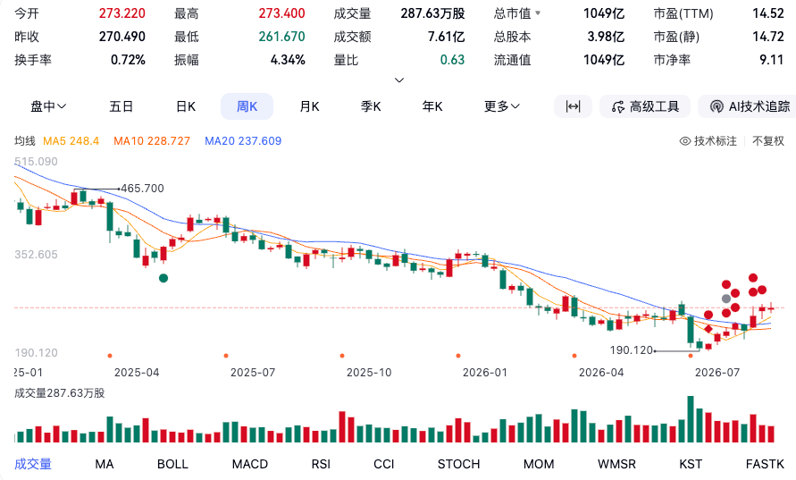

# Adobe（ADBE）研究笔记

> 整合自 6 篇原始笔记：《Adobe 美股分享 0729》《Adobe（ADBE）最新基本面数据整理》《Adobe 用户数据》《Adobe 的竞争对手》《领导层》《回购情况》。
> 2026-08-13 首次整合；同日已用 stock_data 库核实财务口径并修正（见末节核实记录）。
> 财报数据截至 Q2 FY2026（截至 2026-05-29）；行情/估值已更新至 2026-08-12/13。
> 标注【库核实】的数据以 stock_data 库为准；其余来自 AI 二手整理（ChatGPT/DeepSeek），未逐条核实。
> 另：同目录《视频工作流调研.md》为独立调研文档（视频后期工具链），未并入本笔记。

## 目录

1. [公司概览](#1-公司概览)
2. [业务模块](#2-业务模块)
3. [营收情况](#3-营收情况)
4. [盈利与负债](#4-盈利与负债)
5. [竞争对手](#5-竞争对手)
6. [专题：AI 冲击与用户数据](#6-专题ai-冲击与用户数据)
7. [专题：Adobe 的 AI 产品与市场空间](#7-专题adobe-的-ai-产品与市场空间)
8. [专题：回购与现金流估值](#8-专题回购与现金流估值)
9. [专题：管理层变动](#9-专题管理层变动)
10. [我的看法](#10-我的看法)
11. [跳过的模块及原因](#11-跳过的模块及原因)
12. [后续研究方向](#12-后续研究方向)
13. [数据来源与核实记录](#13-数据来源与核实记录)

---

## 1. 公司概览

Adobe 是典型的「高毛利 + 低资本需求 + 订阅模式」软件公司。订阅收入占总营收的 **97%**（Q2 FY2026 订阅收入 64.16 亿美元，同比 +13.7%），服务及其他业务仅 1.13 亿美元且持续萎缩（同比 -21.5%）。

财报披露口径分为两大板块：

| 业务板块 | Q2 FY2026 订阅收入 | 同比增长 | 说明 |
|---|---|---|---|
| **创意与营销专业人士**（Creative & Marketing Professionals） | **45.40 亿美元** | +13% | Photoshop、Premiere、Illustrator 等创意云产品，以及营销云（Experience Cloud） |
| **商业专业人士与消费者**（Business Professionals & Consumers） | **18.50 亿美元** | +16% | Acrobat、PDF 服务、Adobe Express 为主 |

财报只披露到板块层，未再细分到单产品营收。大头仍是 ToC 的创意业务（Ps 等），但增长最快的板块是商业专业人士与消费者（+16%）。

传统三条业务线视角（竞争分析时更有用）：

- **创意云（Creative Cloud）**：营收占比约 68%，核心命脉
- **文档云（Document Cloud）**：Acrobat / PDF，地位相对稳固
- **体验云（Experience Cloud）**：营销与 CDP，占比较小、增速较慢

公司特征正从「成长型软件公司」转向「**成熟现金牛 + 大规模回购**」（详见专题 8）。

---

## 2. 业务模块

### 2.1 创意与营销专业人士（最大金主，增速稍慢）

- **创意专业人士**：Photoshop、Illustrator、Premiere Pro、After Effects 等 Creative Cloud 全套工具
- **营销专业人士**：GenStudio（内容供应链解决方案，ARR 同比增长超 25%）、Experience Cloud（营销自动化、数据分析）
- 群体特点：付费能力强、粘性高、切换成本高（文件格式深度绑定）

### 2.2 商业专业人士与消费者（增长最快）

- **商业专业人士**：Acrobat Pro、Acrobat AI Assistant、PDF 协作工具
- **消费者**：Adobe Express（网页/移动端轻量设计工具）、Firefly 生成式 AI
- Acrobat 月活用户（含免费）已超 8.5 亿，同比增长约 20%——Adobe 最大的用户池，向付费转化的基础

### 2.3 三条业务线的工作流与粘性来源

| 业务线 | 核心工作流 | 付费用户画像 | 订阅粘性来源 |
|---|---|---|---|
| **创意云** | 设计 → 编辑 → 排版 → 输出 | 设计师、视频剪辑师、摄影师 | 文件格式深度绑定、技能沉淀 |
| **文档云** | 创建 → 协作 → 签署 → 归档 | 企业员工、行政、法务、HR | 企业合规要求、签署法律效力 |
| **体验云** | 策划 → 分群 → 投放 → 归因 | CMO、营销团队、数据分析师 | 数据资产积累、跨系统整合成本 |

---

## 3. 营收情况

### 3.1 最近 3 财年 + 当年指引【库核实】

单位：亿美元

| 财年 | 营收 | 同比 | 净利润 | 摊薄 EPS | FCF |
|---|---|---|---|---|---|
| **FY2023** | 194.09 | +10.2% | 54.28 | $11.82 | 69.42 |
| **FY2024** | 215.05 | +10.8% | 55.60 | $12.36 | 78.73 |
| **FY2025** | 237.69 | +10.5% | 71.30 | $16.70 | 98.52 |
| **FY2026*** | 265.0~266.0（已上调指引） | 约 +11.5% | — | Non-GAAP $24.35~24.45 | — |

注：净利润 3 年增长约 **31%**（54.28 → 71.30 亿美元），原笔记"增长约 50%"与库口径不符（可能用了 Non-GAAP 口径），已按库修正。FY2025 净利润同比大增 28%，主因 FY2024 计提了 Figma 收购终止相关费用。

### 3.2 最新季报（Q2 FY2026，截至 2026-05-29）【库核实 GAAP 部分】

单位：亿美元

| 指标 | 数据 | 同比/备注 |
|---|---|---|
| 总营收 | **66.18** | +12.7%（对比 Q2 FY2025 的 58.73；公司披露口径 +13%，固定汇率 +11%） |
| GAAP 净利润 | 17.12 | 净利率 25.9% |
| GAAP 摊薄 EPS | **$4.25** | — |
| GAAP 运营利润 | 22.38 | 运营利润率 33.8% |
| Non-GAAP 净利润 | 24.00 | 未在库中，来自 DeepSeek 整理 |
| Non-GAAP 摊薄 EPS | **$5.96** | 超预期（预期 $5.82），同上 |
| 运营现金流 | 21.70 | 同上 |
| ARR | **271.0** | 含 Semrush 约 4.8 亿，同上 |
| RPO | 222.7（$22.27B） | 同比 +13%；单位争议已按量级裁决，见核实记录 |

Q1 FY2026 单季营收 63.98 亿【库核实】，H1 合计 130.16 亿；对照全年指引 265~266 亿，下半年需约 135 亿，隐含增速与指引一致。

### 3.3 FY2026 全年指引（已上调）

| 指标 | 指引区间 |
|---|---|
| 全年总营收 | **265 亿 – 266 亿美元** |
| GAAP EPS | $17.90 – $18.00 |
| Non-GAAP EPS | **$24.35 – $24.45** |
| 年末 ARR 增长 | 10.2%（同比） |

---

## 4. 盈利与负债

### 4.1 盈利能力与财务效率

TTM 口径（DeepSeek 整理）：

| 指标 | 数值 | 库交叉验证 |
|---|---|---|
| 毛利率 | **89.40%** | FY2025 毛利率 89.3%【库核实】✓ |
| 营业利润率 | 35.33% | FY2025 为 36.6%【库核实】，基本吻合 |
| 净利润率 | **28.69%** | TTM 净利润 72.29 亿 / TTM 营收 251.98 亿 ≈ 28.7% ✓ |
| ROE | **62.95%** | TTM 净利 / 净资产 115.18 亿 ≈ 62.8% ✓ |
| ROA | 19.93% | — |
| ROIC | 60.74% | — |

FY2025 派生指标【库核实】：FCF margin **41.5%**；Rule of 40 = 10.5%（收入增速）+ 41.5%（FCF margin）= **52**。

3 年观察（FY2023→FY2025）【库核实】：营收 +22.4%，净利润 +31.4%，摊薄股数从 4.59 亿股降至 4.27 亿股（回购持续缩股），FCF 从 69.42 亿增至 98.52 亿，利润率没有被 AI 投入拖累。

### 4.2 资产负债表（Q2 FY2026，截至 2026-05-29）【库核实】

单位：亿美元

| 指标 | 数值 | 备注 |
|---|---|---|
| 总资产 | 299.33 | ✓ 与原笔记一致 |
| 现金及等价物 + 短期投资 | 49.19 + 7.07 = **56.26** | ✓ 与原笔记一致 |
| 长期债务 | 48.02 | 库中无短期债务值 |
| 商誉 | 140.41 | 占总资产 47% |
| 总负债 | 184.15 | |
| 净资产 | 115.18 | |

口径说明：原笔记"总债务 70.8 亿、债务/权益比 61.44%"——库中长期债务仅 48.02 亿，70.8 亿应含经营租赁负债等（70.8/115.18 ≈ 61.5%，与笔记比值自洽）。两个口径并存，引用时注意区分。原笔记"流动比率 0.75"未核实（未取流动负债）。

### 4.3 资本分配

Adobe 的现金主要流向：① **大规模回购**（FY2025 回购 112.81 亿，超过当年 FCF，三年明细见 [专题：回购与现金流估值](#8-专题回购与现金流估值)）；② 偿还债务；③ 收购（FY2025 仅 0.17 亿，近年大额收购为 2018 年 Marketo/Magento 的 63.14 亿）。几乎不分红。FY2025 SBC 为 19.42 亿美元【库核实】。

### 4.4 估值指标（已更新至 2026-08-12/13）

| 指标 | 数值 | 口径 |
|---|---|---|
| 收盘价（2026-08-12） | **$258.75**（8/13 约 $260.47） | stock_data daily_quote【库核实】 |
| 市值 | **1,028.5 亿**（8/12，库）；约 **1,048 亿**（8/13，外部） | — |
| PE TTM | **14.80** | 库口径（TTM 净利 72.29 亿测算 ≈14.2，库口径略高，可能含更新数据） |
| **P/FCF（TTM）** | **≈10.2×** | TTM FCF 102.8 亿 / 市值 1,048 亿（SEC 披露拼算，见专题 8.4） |
| **FCF Yield（TTM）** | **≈9.8%** | 对 10Y 美债 4.68%（2026-08-12），利差约 **5.1 个百分点** |
| 远期 PE（按 Non-GAAP 指引 $24.4） | **≈10.6** | 258.75 / 24.4 |
| PB | 库字段显示 1.04，**异常** | 库市值/净资产 = 8.93，股价/每股账面 $28.87 ≈ 8.96；库 pb 字段口径存疑，实际 PB 应在 **9 倍**左右 |
| 52 周区间 | $190.12 – $376.16 | 截至 7/29 的外部数据 |

注：7/29 时点的旧估值（PEG 0.62、EV/EBITDA ~9、P/FCF 9.24 等）已被上表取代。PEG/EV-EBITDA/PS 等库外指标未更新。

管理层变动：CFO Dan Durn 已于 2026-06-15 离任，CEO Narayen 已宣布换代计划——详见 [专题：管理层变动](#9-专题管理层变动)。

---

## 5. 竞争对手

按三大业务线分别看，每条赛道对手完全不同。

### 5.1 创意云 —— 竞争最激烈

**Canva —— 大众市场最大威胁**
- 月活用户超 **2.65 亿**，全球使用最广泛的设计工具
- 基础功能免费（永久免费版），Pro 版约 $10~18/月——对比 Photoshop 无免费版、订阅 $20.99/月（单月更贵）
- 以模板驱动、极低学习门槛和亲民定价，从「非专业设计」市场向上侵蚀 Adobe 领地；Teams 定价 2024 年暴涨 300% 后仍比 Adobe 便宜得多
- 与 Adobe Express 正面交锋，同时蚕食中小企业对 Photoshop/Illustrator 的需求

**Figma —— 专业设计领域的「未竟之敌」**
- 占据 UI/UX 设计市场 **80~90%** 份额，超 5.1 万家公司使用
- Adobe 2022 年曾试图以 **200 亿美元** 收购，因反垄断监管被迫放弃
- Figma 是 Adobe XD 的终结者，并通过 Figma Slides、设计系统等向 Adobe 其他领地渗透

**生成式 AI 公司（OpenAI、Midjourney、Runway 等）—— 结构性颠覆者**
- Midjourney（图像生成）、Runway 等让「零技能创作」成为可能，直接冲击 Photoshop、Premiere、After Effects 的专业护城河
- 这是 Adobe 股价 2026 年一度暴跌约 38% 的核心原因——投资者担心 AI 会**替代**而非**增强** Adobe 的工具
- 相关工具动态：FLUX.1 编辑、FLUX.2 生成

### 5.2 文档云 —— 地位稳固但面临价格战

| 竞争对手 | 定位 | 威胁程度 |
|---|---|---|
| **Nitro** | 功能与 Acrobat 接近，价格更低，含 Admin Portal 和 Analytics | ⭐⭐⭐⭐ |
| **Foxit** | 老牌 PDF 工具，定价灵活 | ⭐⭐⭐ |
| **DocuSign** | 电子签名领域绝对龙头，与 Acrobat Sign 直接竞争 | ⭐⭐⭐ |
| **Smallpdf** | 轻量在线工具，每座每月比 Adobe 便宜约 $12 | ⭐⭐⭐ |

### 5.3 体验云 —— 份额较小

| 竞争对手 | CRM/营销市场份额 | 定位 |
|---|---|---|
| **Salesforce** | **20.7%**（全球第一） | Adobe 营销云最大对手，客户数远超 Adobe Campaign |
| **Oracle** | ~4.4% | 企业级营销自动化，与 Adobe Experience Platform 正面竞争 |
| **SAP (Emarsys)** | ~3.5% | 电商和零售行业强势 |
| **HubSpot** | 中小市场 | 易用性和低价切入，错位竞争 |
| **Bloomreach / Braze** | 新兴力量 | AI 原生、移动优先，增长迅速 |

据 IDC，Adobe 在 CRM 市场份额仅约 **3.4%**，远低于 Salesforce 的 20.7%。

### 5.4 总结：谁是最大竞争对手

| 维度 | 最大竞争对手 | 原因 |
|---|---|---|
| 对营收增长的直接威胁 | **Canva** | 正在抢夺 Adobe 增长最快的「商业专业人士与消费者」板块 |
| 对专业设计地盘的威胁 | **Figma** | Adobe 花 200 亿都买不到的 UI/UX 行业标准 |
| 对长期商业模式的威胁 | **OpenAI / Midjourney / Runway** | 生成式 AI 可能让「专业设计软件」本身变得不再必要 |
| 营销云领域 | **Salesforce** | 市场份额是 Adobe 的 6 倍以上 |

---

## 6. 专题：AI 冲击与用户数据

### 6.1 市场担忧与股价反应

AI 降低了创作门槛：以前做一张营销海报可能要 Photoshop 几小时，现在一句话就能生成。市场担心 Photoshop 被淘汰、Adobe 被 AI 颠覆。股价承压两年，2026-06-18 创近几年新低（最低 $190.12），年内一度跌约 38%；8 月中旬回升至 $260 上方（周 K 见下图，2026-08-17 更新）。

### 6.2 用户数据（Q2 FY2026 财报及电话会披露）

**月活跃用户（MAU）**

| 产品/业务线 | 最新数据 | 同比变化 |
|---|---|---|
| **Acrobat + Express** 月活 | **超过 8.5 亿** | 从约 7 亿增长，净增约 1.5 亿，同比约 +20% |
| **创意类免费增值产品** 月活 | **超过 9,000 万** | 从 5,000 万增长，**同比接近翻倍**（Q1 FY2026 已破 8,000 万，同比 +50%） |
| Acrobat AI Assistant 月活 | — | **同比暴增超 150%** |

**付费用户：未直接披露绝对数量**，间接观察维度：

| 维度 | 数据 |
|---|---|
| ARR | **271 亿美元**（含 Semrush 约 4.8 亿），同比 +12.5% |
| AI-first ARR | **突破 5 亿美元**，同比增长超 3 倍（另一来源表述为「同比增长两倍」，增速口径待核） |
| Firefly ARR | **接近 3 亿美元**，环比增长约 50% |

管理层明确表示：优先通过免费增值模式扩张用户规模，暂不追求短期营收增长；免费用户后续通过试用到期后的付费墙（paywall）转化。CEO 纳拉扬称，Acrobat 和 Express 有机会积累**数十亿用户**，创意类产品坐拥数亿用户。

**其他用户相关数据**

| 指标 | 数据 |
|---|---|
| Document Cloud（含 Acrobat）订阅收入 | 18.5 亿美元，同比 +15% |
| Creative Cloud 订阅收入 | 45.4 亿美元，同比 +11% |
| RPO | 222.7 亿美元（$22.27B），同比 +13% |

### 6.3 用户增长很猛，付费用户数据存疑

Adobe 用户增长很夸张，却没有披露付费用户的具体数据。【尚无法验证】如果付费用户数据很好，为什么不披露？可能付费用户增长非常缓慢，无法确认付费用户是否在撤离。但从营收情况看，并没有出现想象中的撤离（从 Adobe 软件转向 AI 工具）。

---

## 7. 专题：Adobe 的 AI 产品与市场空间

### 7.1 Adobe Firefly：统一创意 AI 工作室

Firefly 是 Adobe 的生成式 AI 核心平台，定位「All-in-one」创意 AI 工作室，是独立 Web 应用，可直接在浏览器中使用其生成能力。

**流量对比**：Firefly 月访问量约千万级别，Canva 月访问量数亿——Canva 是 Firefly 的几十倍。Firefly 如果是独立团队产品算很强，但作为 Adobe 的 AI 核心平台，流量数据明显不够看。

### 7.2 市场空间：快速膨胀的「大蛋糕」

- **「创意软件」市场**：全球规模预计从 2025 年约 152.9 亿 – 168.2 亿美元增至 2030 年 232.4 亿美元，CAGR 8.4% – 10%。与 Creative Cloud 业务最接近
- **「数字内容创作」市场**：更广阔口径，预计从 2025 年约 316.8 亿 – 318.1 亿美元增至 2032 年 634.8 亿美元，CAGR 高达 10.43%
- **「创意应用」市场**：据 IDC，2025 年已达 220 亿美元，年增长率 17.2%

结论：全球对创意内容的需求正急剧增长，整个蛋糕在持续做大。更有可能的图景是：大量原本不做创意的用户因 AI 涌入，其中一部分人进入行业后遇到 AI 目前处理不了的精细化修图需求，转化为 Adobe 用户。

### 7.3 AI 到底能不能做精细化修图

目前确实不能，但迟早能达到；至于做得好不好，以后才知道。类比 AI 改代码：改得好不好取决于①模型能力、②对意图的描述是否足够清楚；但「能不能用」取决于验收标准——代码只要最终能运行、没 bug 即可，产物形态不重要；而产品图、海报的**产物本身就是最终产品**，验收标准高得多。

---

## 8. 专题：回购与现金流估值

> 年度回购/SBC/OCF/CapEx 数据已与 stock_data 库核对一致【库核实】；FY2026 季度拆分与 TTM 拼算来自 SEC 披露（10-Q、8-K），未经库核实。

### 8.1 三年回购力度：明显增强【库核实】

单位：亿美元

| 财年 | 回购金额 | 回购股数 | 净利润 | FCF | 回购/FCF | 回购/净利润 |
|---|---|---|---|---|---|---|
| **FY2023** | **44.0** | 1,150 万股 | 54.3 | 69.4 | **63%** | 81% |
| **FY2024** | **95.0** | 1,750 万股 | 55.6 | 78.7 | **121%** | 171% |
| **FY2025** | **112.81** | 3,080 万股 | 71.3 | 98.5 | **115%** | 158% |

- 两年间年度回购额增长约 **156%**（44 → 95 → 112.81 亿）
- FY2024、FY2025 回购规模**超过当年 FCF**——不只是把当年自由现金流拿来回购，还动用了现金储备/其他资金来源
- 依据：Adobe FY2025 10-K；库中 share_buyback 字段三年为 44.0 / 95.0 / 112.81 亿，完全一致

### 8.2 回购真实缩股，不是只对冲 SBC

基本平均股数（EPS 计算用）：

| 财年 | 基本平均股数 | YoY |
|---|---|---|
| FY2023 | 4.571 亿股 | — |
| FY2024 | 4.471 亿股 | **-2.2%** |
| FY2025 | 4.262 亿股 | **-4.7%** |

同期 SBC 分别约 **17.2 / 18.3 / 19.4 亿**美元【库核实】——即便有大量股权激励，净股份数仍明显下降，说明回购远超 SBC 稀释。（库中摊薄股数 4.591 / 4.497 / 4.270 亿股，方向一致。）

### 8.3 FY2026 最新情况

- H1（截至 2026-05-29）已支付 **45.9 亿美元**回购；Q2 单季回购约 **850 万股**
- 2026 年 4 月董事会新增 **250 亿美元**回购授权；截至 Q2 末总剩余授权约 **267.8 亿美元**
- 若下半年维持上半年节奏，全年回购约 **90 亿美元**——比 FY2025 的 112.81 亿温和，但力度仍高

### 8.4 FCF Yield 估值视角（2026-08-13）

TTM 经营现金流按「FY2025 下半年 + FY2026 上半年」拼算（SEC 披露）：Q3 FY2025 CFO 21.98 亿、Q4 31.60 亿、FY2026 H1 51.23 亿；同期 CapEx 约 0.72 / 0.34 / 0.95 亿。

| 指标 | 数值 |
|---|---|
| TTM CFO | **104.8 亿美元** |
| TTM CapEx | ~2.0 亿美元 |
| **TTM FCF** | **102.8 亿美元** |
| 市值（8/13） | ~1,048 亿美元 |
| **FCF Yield** | **≈9.8%** |
| **P/FCF** | **≈10.2×** |
| 10Y 美债收益率（2026-08-12） | **4.68%** |
| **FCF Yield − 10Y 利差** | **≈5.1 个百分点** |

**利差含义**：即使 Adobe 完全不增长，9.8% 的 FCF Yield 相对 4.68% 的无风险利率仍有约 5.1% 的风险补偿；而 Adobe 实际还在增长（Q2 营收 +13%，H1 CFO +10%）。市场定价隐含的显然不是「长期稳定增长 10% 的优质软件公司」，而是「**当前现金流很好，但 AI 会导致未来增速显著下降，所以给很低的倍数**」。

**简单情景分析**（未来 FCF 长期增速）：

| 情景 | 判断 |
|---|---|
| FCF 每年增长 **8%–10%** | 现在明显便宜 |
| 增长 **4%–6%** | 仍然有吸引力 |
| 增长 **0%–3%** | 大致合理，靠高 FCF Yield 支撑 |
| FCF 长期下降 | 当前低估值可能是价值陷阱 |

**回购加成**：假设全年回购 90 亿、市值约 1,048 亿，Gross Buyback Yield ≈ **8.6%**。注意不能与 FCF Yield 相加（回购的钱本身就来自 FCF/资产负债表，只是资本配置方式）。但它的效果是：**即使业务 FCF 零增长，只要股份每年净减少 5%，每股 FCF 仍能增长约 5%**。

### 8.5 值得继续追的问题

> **Adobe 到底是在低价回购创造价值，还是因为业务增长放缓、只能把大量现金拿回来维持 EPS 增长？**

这个问题比「回购金额大不大」更重要。答案取决于前面的研究主线：PSD/AI/AEP 文件格式与工作流护城河能否守住现金流——即估值里最关键的变量。

---

## 9. 专题：管理层变动

> 来源：Adobe 新闻中心（2026-03 leadership update）、SEC 8-K（2026-06-08）、Reuters（2026-06-11）、MarketWatch。判断部分属推演。

### 9.1 现状

| 职位 | 人 | 当前状态 |
|---|---|---|
| CEO | Shantanu Narayen | **仍在任**，已宣布将在继任者确定后卸任，之后继续担任董事长 |
| CFO | Daniel Durn | **已离职**（2026-06-15 生效，8-K 披露），后赴 Marvell Technology 任 CFO（Reuters） |
| Interim CFO | Steve Day | 临时 CFO |

注意口径：CEO 是「宣布换代计划」而非「已离职」——寻找继任者 → Narayen 继续管理 → 完成交接 → 留任董事长。

### 9.2 Narayen 的历史成绩

自 2007 年任 CEO 至今近 20 年，两大成绩：

1. **主导 SaaS 转型**：Photoshop 买断授权 → Creative Cloud 月订阅，Adobe 最大的一次商业模式转型
2. **建立三大业务**：Creative Cloud / Document Cloud / Experience Cloud

官方离任理由是 succession planning（继任计划）——任职 18 年+，寻找下一代领导者。

### 9.3 市场为什么敏感

时点特殊：Adobe 正面临 AI 改变创作软件、Canva 与 Figma 竞争、市场质疑增速——投资者会问「公司经历最大一次行业变化时，CEO 为什么这个时候走」，股价反应较大（MarketWatch）。

### 9.4 判断（推演）

- **CEO 离开更像「换代」，不是危机信号**。若是董事会逼宫/财务造假/战略失败，通常立即离任；Adobe 的安排是有序接班，类似 Ballmer → Nadella、乔布斯 → Tim Cook 的模式。
- **CFO 离职更值得关注**：发生在 CEO 宣布过渡后约 3 个月。官方说法是 "pursue a different professional opportunity"。三种可能：
  1. 正常职业选择（中性）——阶段任务已完成，且新 CEO 上任后通常会换自己的 CFO；
  2. 为新 CEO 留位置（偏正面）——董事会准备换一整套管理团队；
  3. 战略分歧（负面）——如 AI 投资方向意见不一致，**目前无公开证据支持**。
- **结合财务看不像经营危机**：最新季度收入 +13%、AI ARR >5 亿美元、FCF 强劲，没有出现管理层逃离前常见的财务恶化信号（收入下降、FCF 崩溃、用户流失）。
- **真正关键的问题**不是「老 CEO 为什么走」，而是**下一任 CEO 会不会改变公司战略**，尤其三个方向：① AI 继续作为 Creative Cloud 的增强功能？② 还是大规模转型成 AI 平台？③ 是否愿意牺牲短期 ARR 换 AI 用户增长？新 CEO 人选类型能推测未来 5 年 Adobe 的战略方向。

投资者标记：CEO 离职 ⚠️ 观察（无被赶走证据）；CFO 离职 ⚠️ 短期不确定；公司财务 ✅ 健康；AI 转型 = 最大挑战；新 CEO 选择 = 关键变量。

---

## 10. 我的看法

> 整篇【我的推演】，是被事实纠正的对象。

- **第一印象被事实修正**：本来对 Adobe 兴趣不大，第一印象是要被 AI 冲击的公司，股价一路下跌。但看到营收后觉得跟想象不一样——营收保持双位数增长、利润率没被 AI 投入拖累，所以深入研究。
- **AI 冲击被夸大**：创意云（营收占比约 68.6%）是直接受 AI 冲击的业务，但冲击程度可能没有股价体现得那么夸张。文档云核心是工作流而非创意，不会受 AI 冲击；体验云占比小，不看。
- **Adobe 的护城河**：过去靠两条护城河撑起高估值——①极高的学习成本（设计师数年练熟的 PS 技能形成迁移壁垒）；②不可替代的工具地位（创作流程离不开 Adobe）。
- **关键未知**：AI 冲击的主要是初中级设计师，他们占多大份额、贡献多少营收，目前无数据回答。
- **付费用户不透明存疑**：用户 MAU 增长夸张却不披露付费用户绝对数量，可疑；但营收上没有出现用户撤离的迹象。
- **竞争对手也很强大**：竞争激烈，Canva 的永久免费模式 + 低价 Pro 对 Adobe 的下沉市场构成实质威胁；Firefly 流量与 Canva 差几十倍，作为 AI 核心平台数据不够看。
- **管理层变动（2026-08-13 补充）**：CEO 换代 + CFO 离职叠加，但财务端没有恶化信号，初步判断是有序换代而非危机。真正要盯的是新 CEO 的战略取向（AI 平台化 vs 增强现有产品线），详见专题。
- **估值观感（2026-08-13 补充）**：当前 PE TTM 14.8、远期 PE 约 10.6、FY2025 Rule of 40 达 52——市场对 AI 颠覆的定价已经很悲观，财务端却还在双位数增长。悲观预期 vs 稳健基本面的裂口，是这个标的最值得跟踪的东西。
- **回购视角（2026-08-14 补充）**：10× FCF + 9.8% FCF Yield + 8.6% 回购收益率的组合，意味着即使 FCF 零增长，靠缩股每股 FCF 仍能年增约 5%。投资命题可以压缩成一句话：**只要核心 Creative/Document 生态没被 AI 结构性摧毁，即使增长明显低于过去，现在的价格也已留下相当大的容错空间**。需要警惕的反面：若 FCF 长期结构性下降，低估值就是价值陷阱——所以要盯死「回购是低价创造价值还是强撑 EPS」这个问题。
- **投资视角一句话**：Adobe 目前最大的矛盾不是财务，而是——一家过去非常优秀的软件公司，未来还能不能保持 10% 增长，以及 AI 能否成为增长动力而不是替代风险。

---

## 11. 跳过的模块及原因

- **同行对比**：半跳过。竞争对手篇已含定性分析，但无量化的同行财务对比（如与 Salesforce、Canva 估值/增速对比），需要时单独成篇。
- **护城河（独立模块）**：半跳过。护城河讨论已散见于《我的看法》与专题篇，未独立成篇。

---

## 12. 后续研究方向

- [x] **用 stock_data 库核实财务口径**：已完成（2026-08-13），3 年营收/利润/FCF、Q2 单季、资产负债表均已核实并修正
- [x] **RPO 口径核实**：库中无 RPO 数据；按量级裁决为 $22.27B（222.7 亿美元），DeepSeek 篇的「22.27 亿美元」为单位笔误。最终仍以财报原文为准
- [x] **估值更新**：已用 daily_quote 更新至 2026-08-12（收盘 $258.75、市值 1,028.5 亿、PE TTM 14.80）
- [x] **CFO 变动**：已整合（2026-08-13）——Durn 2026-06-15 离任赴 Marvell，官方口径为个人职业选择，无负面证据
- [x] **回购情况**：已整合（2026-08-14）——三年回购明细、缩股效果、FY2026 授权与节奏、FCF Yield 估值视角，年度数据与库核对一致
- [ ] **回购质量**：低价回购创造价值 vs 增长放缓下用现金维持 EPS——跟踪回购均价与后续 FCF 增速的关系
- [ ] **新 CEO 人选**：董事会会选什么类型的新 CEO（产品派/AI 派/财务派）——直接决定未来 5 年战略方向，是当下最关键变量
- [ ] **付费用户数据**：Adobe 不披露付费用户绝对数量，寻找间接证据（第三方调研、渠道数据、付费转化率估计）
- [ ] **初中级设计师占比**：AI 主要冲击的初中级设计师占创意云用户/营收的份额——这是判断 AI 冲击真实程度的关键
- [ ] **AI-first ARR 增速口径**：「同比增长两倍」vs「同比增长超 3 倍」，以财报电话会原文为准
- [ ] **库 pb 字段异常**：daily_quote 的 pb=1.04 与库内市值/净资产（8.93）矛盾，需向数据管道确认 pb 口径
- [ ] **FY2024 净利润低基数原因**：FY2024 净利仅 +2.4%，疑似 Figma 终止费用影响，查证 10-K
- [ ] **Firefly 独立流量 vs Canva** 的趋势跟踪：AI 平台之争的关键观察指标
- [ ] **Semrush 收购**：ARR 中含 Semrush 约 4.8 亿美元，收购背景与整合进展待补

相关但独立的调研：《视频工作流调研.md》（视频后期工具链：教程固定样本 + 招聘岗位，2026-08-17 整合为独立文档），其后续跟踪事项记录在该文档内。

---

## 13. 数据来源与核实记录

### 来源清单

| 来源 | 内容 | 可信度备注 |
|---|---|---|
| 《Adobe 美股分享 0729》（原 larksuite 文档，已删） | 业务拆解、营收、AI 影响分析、AI 产品、市场空间 | 用户本人撰写，含外部引用 |
| 《Adobe（ADBE）最新基本面数据整理》（已删） | 3 年核心数据（ChatGPT 整理，源自年报）；Q2 FY2026 季报及估值（DeepSeek 整理，截至 2026-07-29 市场数据） | AI 二手整理；GAAP 核心数据已经库核实 |
| 《Adobe 用户数据》（原 larksuite 文档，已删） | MAU、免费增值用户、ARR、Firefly ARR | 基于 Q2 FY2026 财报及电话会 |
| 《Adobe 的竞争对手》（原 larksuite 文档，已删） | 三条业务线竞争格局 | 含 Canva/Figma/Salesforce 等第三方数据 |
| 《领导层》（已删） | CEO 换代计划、CFO 离任分析 | ChatGPT 整理；含 Adobe 新闻中心、SEC 8-K（2026-06-08）、Reuters（2026-06-11）、MarketWatch 链接 |
| 《回购情况》（已删） | 三年回购明细、缩股效果、FY2026 授权、FCF Yield 估值分析 | ChatGPT 整理；含 FY2025 10-K、SEC 10-Q/8-K、美国财政部收益率链接；年度数据已经库核实 |
| **stock_data 数据库**（us_income_statement / us_cash_flow_statement / us_balance_sheet / daily_quote） | 3 年年度财务、近 8 个季度单季、资产负债表、最新行情 | **本文档财务数据的最终口径** |

### 核实/整合记录

- **2026-08-13（首次整合）**：将 4 篇原始笔记合并为本文档；发现 RPO 单位、AI-first ARR 增速两处冲突，暂列待核。
- **2026-08-13（数据库核实）**：连 stock_data 库核实，改动点：
  1. **修正**：原笔记「净利润 3 年增长约 50%」与库不符，实际 +31.4%（GAAP 口径），可能原笔记用了 Non-GAAP；
  2. **裁决**：RPO 按量级确认为 $22.27B（222.7 亿美元），DeepSeek 篇「22.27 亿美元」系单位笔误；
  3. **裁决**：总债务口径——库中长期债务 48.02 亿，原笔记 70.8 亿应含经营租赁等，两口径并存注明；
  4. **更新**：行情/估值从 7/29 更新至 2026-08-12（$258.75、市值 1,028.5 亿、PE TTM 14.80）；
  5. **发现异常**：daily_quote 的 pb 字段（1.04）与库内市值/净资产（8.93）矛盾，列入待核；
  6. **补充**：FY2025 FCF 98.52 亿、FCF margin 41.5%、Rule of 40 = 52、回购 112.81 亿、SBC 19.42 亿、摊薄股数 4.27 亿股等库数据。
- **2026-08-13（整合《领导层》）**：新增「专题：管理层变动」章节（CEO Narayen 宣布继任者确定后卸任、留任董事长；CFO Durn 2026-06-15 离任赴 Marvell，Steve Day 任临时 CFO）；《我的看法》补充管理层判断；待办清单更新。全部原始笔记（含本篇）整合完毕后按用户要求删除，仅保留本文档与图片附件。
- **2026-08-14（整合《回购情况》）**：新增「专题：回购与现金流估值」章节。年度回购额（44.0/95.0/112.81 亿）、SBC（17.2/18.3/19.4 亿）、经营现金流（73.0/80.6/100.3 亿）、CapEx（3.6/1.83/1.79 亿）与 stock_data 库逐一核对一致，标【库核实】；FY2026 季度拆分（H1 回购 45.9 亿、新增 250 亿授权、剩余 267.8 亿）及 TTM 拼算（CFO 104.8 亿、FCF 102.8 亿）来自 SEC 披露，未经库核实。估值表（4.4）补充 P/FCF ≈10.2×、FCF Yield ≈9.8%、对 10Y 美债利差 ≈5.1pct。《我的看法》新增回购视角；待办清单新增「回购质量」一项。原文整合后删除。
- **2026-08-17（《视频工作流调研》处理更正）**：该文档曾误并入本笔记，按用户要求拆出——其 4 轮回答整合为**独立文档**《视频工作流调研.md》（与本笔记同级），数据底稿仍在 图片和附件/*.xlsx；本笔记相关章节已移除，仅在 6.1 节保留用户更新的 8/17 股价截图引用说明。
