# Nebius Group (NBIS) 深度研究报告：AI 云新贵的商业模式、财务全景与核心矛盾

数据截至 2026-08-16 | 基于 SEC 20-F/6-K 原始文件与多源交叉验证

> **标注说明**：本报告事实性数据均标注来源（`[^N^]` 编号溯源见文末参考文献；`[Source: ...]` 为 SEC EDGAR / Yahoo Finance 插件直接查询）。非事实内容分两类标注：**【推断】**＝基于披露数据的本报告推算；**【判断】**＝定性观点或解读，供参考而非投资结论。

# Executive Summary

### 核心结论

Nebius Group（NASDAQ: NBIS）是从 Yandex 遗产中重生的全栈 AI 云基础设施商：2024 年 7 月以约 54 亿美元对价完成俄罗斯业务剥离、同年 10 月以 NBIS 复牌纳斯达克后，公司将几乎全部资本投入 GPU 数据中心建设，并以自有土地与电力（芬兰旗舰站）、全栈自研软硬件和净现金起步的资产负债表为差异化支点，在 18 个月内把营收从千万级拉升至单季 $582.3M（2026Q2，同比 +454%）、年化运行率收入（ARR）$3.0B（同比 +598%），市值达 $75.5B（2026-08-14）[^17^][^4^] [Source: Yahoo Finance — get_stock_info, as of 2026-08-14]。集团收入 98.7% 来自 Nebius AI cloud 单一分部，实质上已是一家纯 AI 基础设施公司 [^17^]。

**判断一：需求是真实的，且有定价权佐证。** 产能基本售罄之外，三个市场化信号难以伪造：capacity auction（产能拍卖）出清价较此前 Blackwell 最高要价高 15%；GPU 租赁合约价格自 2025 年 10 月低点反弹约 40%；短期溢价合同单价达 $40–50M/MW，为中期合同（$20–25M/MW）的 1.6–2.5 倍 [^2^][^3^]。订单层面，剩余履约义务（RPO）达 $37.5B、客户承诺总额超 $40B，资本开支回收期从 2–3 年缩短至约 22 个月 [^17^][^10^]。

**判断二：商业模式的本质是"客户出资的基础设施代建"。** 经营现金流的高增长并非利润驱动：资产负债表递延收入从 2025 年末 $1.58B 暴增至 2026Q2 末 $5.98B，H1'26 经营现金流 +$4.5B 几乎全部来自客户预付款；2026Q2 新签合同的 70% 含预付款条款，覆盖对应资本开支的 50–60% [^17^][^10^]。换言之，Microsoft（预付款约 $6.96B）与 Meta 以预付款为 Nebius 的建设买单，Nebius 出让的是股权稀释与资产负债表——评估该公司不能用常规盈利框架，关键指标是单位 capex 签约收益率与预付款覆盖率 [^2^]。

**判断三：最大风险是"股价–融资–交付"飞轮的双向脆弱性。** $20–25B 的年度 capex 依赖 ATM 股权发行（Q2 以均价 $223.6 募 $2.85B）与可转债，融资成本依赖高股价，股价依赖增长叙事，叙事依赖交付——正反馈在牛市放大上行，也在利空时放大回撤（2026 年 7 月 Meta 转售算力传闻曾致单日 -17%）[^11^][^4^]。市场已为此定价出 EV/2026E 营收约 23x（CoreWeave 约 8.3x）的质量溢价与 27.6% 的极端空头占比，多空分歧的实质不是"增长还是泡沫"，而是"执行速度对资本耐心"的计时问题 [^18^] [Source: Yahoo Finance — get_stock_info, as of 2026-08-14]。

### 关键指标速览

| 指标 | 数值 | 口径/日期 |
|---|---|---|
| 市值 | $75.5B（股价 $277.68，EV $78.3B） | 2026-08-14 收盘 [Source: Yahoo Finance] |
| 2026Q2 营收 | $582.3M，同比 +454%、环比 +46% | 持续经营重述口径，6-K [^17^] |
| ARR | $3.0B，同比 +598% | 2026-06-30，核心 AI 云口径 [^4^] |
| Adj. EBITDA（调整后 EBITDA）/ margin | $236.2M / 41%（AI 云分部 $285.7M / 49.7%） | 2026Q2，集团/分部双口径 [^1^] |
| GAAP 净亏损 | -$190.4M（含 D&A $259.7M、利息 $119.1M、SBC $102.5M） | 2026Q2 持续经营 [^1^] |
| 现金及等价物 | $8.04B | 2026-06-30 [Source: SEC EDGAR — Form 6-K Q2 2026] |
| 总债务 | 账面 $8.55B；增值后本金 $10.04B（公允价值 $20.8B，深度价内） | 2026-06-30，六系列可转债为主 [Source: SEC EDGAR — Form 6-K Q2 2026, Note 12] |
| 递延收入（客户预付款） | $5.98B（2025 年末仅 $1.58B） | 2026-06-30 [^17^] |
| 客户承诺 | >$40B（RPO $37.5B；MSFT+Meta 约占 80%，推断口径） | 2026Q2 [^10^] |
| 2026 全年指引 | 营收 $3.0–3.4B；年末 ARR $7–9B；adj. EBITDA margin ~40%；capex $20–25B | 2026-08-12 重申 [^4^] |
| EV/2026E 营收 | ~23x（CoreWeave ~8.3x） | 2026E 一致预期 $3.39B [^18^] |
| Short interest | 60.2M 股，占流通股 27.6%（short ratio 2.78 天） | 2026-07-31 [Source: Yahoo Finance] |

速览表揭示的三组张力构成本报告的主线。第一组是增长与盈利的口径张力：adj. EBITDA margin 41% 与 GAAP 净亏 $190.4M 之间隔着单季 $259.7M 折旧与 $102.5M 股权激励，真实经营层面（adj. EBITDA − D&A − SBC）约为 -$126M/季，盈亏平衡取决于 H2'26 新产能的利用率 [^1^]。第二组是资产与负债的结构张力：$8.04B 现金对 $10.04B 增值后债务本金，公司已从净现金转为小幅净债务，而 $5.98B 递延收入是"以未来交付结清"的准股权负债——负债端的约三分之一由客户预付构成 [^17^]。第三组是估值与共识的张力：23x EV/2026E 营收隐含市场对 $7–9B 年末 ARR 指引的高度信任，而 27.6% 的空头占比意味着同等规模的资金在押注交付或融资环节断裂 [^18^]。

### 报告结构导引

本报告以十二章回答关于 Nebius 的十一组问题：第 1 章拆解业务构成与从 Yandex 重生的沿革；第 2 章分析营收总量、业务线与收入质量（ARR/递延收入/RPO）；第 3、4、5 章分别回答盈利能力、资产负债与现金流/capex 效率，构成财务全景；第 6 章拆解客户集中度与合同条款质量；第 7、8 章回答竞争格局与"行业在增长还是萎缩"；第 9 章进行估值分析；第 10 章回答分红与资本分配政策；第 11 章审视管理层与治理结构；第 12 章收束全书，给出核心矛盾、风险全景与监测框架。

## 1. 公司概览与业务拆解

### 1.1 公司沿革与定位

#### 1.1.1 从 Yandex N.V. 到 Nebius：剥离、复牌与更名

Nebius Group N.V. 的前身是俄罗斯科技公司 Yandex 的荷兰控股公司 Yandex N.V.。2022 年 2 月 28 日俄乌冲突爆发后，其股票在纳斯达克停牌，停牌时间长达两年半以上 [^35^][^36^]。2024 年 7 月，公司完成俄罗斯业务出售，总对价约 54 亿美元，剥离后保留四类非俄资产——芬兰数据中心与 Nebius AI 云业务、Toloka、TripleTen、Avride——账面现金约 22 亿美元；2024 年 8 月更名为 Nebius Group N.V.，2024 年 10 月 21 日以 NBIS 代码恢复纳斯达克交易，复牌开盘区间 14–20 美元 [^36^]。复牌后公司迅速重构股东基础：2024 年 12 月以每股 21.00 美元向 NVIDIA、Accel 及 Orbis 管理的账户私募配售 3,333 万股、募资 7 亿美元，同时主动放弃了同年 8 月股东大会授权的回购计划，将全部资本投入 AI 基础设施。

这条重生路径对理解公司现状有三点含义。其一，公司自始即为"净现金起步"的资产负债表，无需像 CoreWeave 等同行那样以高息债务滚动融资，这构成其估值溢价的基础之一。其二，保留资产中除 AI 云外的三项业务（Toloka、TripleTen、Avride）均为 Yandex 时代的存量资产，后续一一被置于"引入外部资本、逐步去合并"的轨道上，集团资源持续向 AI 云收敛。其三，停牌两年半的历史意味着现有股东结构几乎完全在 2024 年 10 月之后重建，筹码结构与治理预期均带有"新公司"特征。

#### 1.1.2 当前定位：全栈自研 AI 云基础设施公司

更名后的 Nebius 定位为"from silicon to software"的全栈 AI 云基础设施公司：自建或租赁数据中心、自研服务器与机柜设计、自研云软件栈（Aether），向 AI 原生公司、企业客户与超大规模云厂商出售 GPU 算力与托管服务 [Source: SEC EDGAR — Form 20-F FY2025, Item 4]。法律结构上，公司为荷兰注册的外国私人发行人（FPI），总部阿姆斯特丹，不提交 10-K/10-Q，定期披露体系为 Form 20-F 年报加 Form 6-K 季度业绩 [Source: SEC EDGAR — Form 20-F FY2025]。运营重心在欧美：FY2025 收入中美国占 3.401 亿美元、英国 1.375 亿美元；2025 年末长期资产主要分布于美国（30.0 亿美元）、荷兰（25.6 亿美元）与芬兰（2.5 亿美元）[Source: SEC EDGAR — Form 20-F FY2025, Note 15]。

截至 2025 年末，公司约 1,500 名员工、多数为工程师 [Source: SEC EDGAR — Form 20-F FY2025, Item 4]。竞争对手分层明确：上层是 AWS、Azure、GCP、Oracle 等超大规模云，同层是 CoreWeave、Crusoe、Lambda 等 AI 算力专营厂商（neocloud）；Nebius 的差异化在于自有土地与电力（芬兰旗舰站）、全栈自研软硬件，以及净现金起步的资产负债表 [Source: SEC EDGAR — Form 20-F FY2025, Item 4 "Competition"]。

### 1.2 业务分部拆解

自 2025Q2 起，集团报告分部收缩为三个：Nebius AI cloud、Avride、TripleTen；原第四分部 Toloka 于 2025 年 5 月去合并转为权益法投资，公司另持有 ClickHouse 重大少数股权 [Source: SEC EDGAR — Form 20-F FY2025, Note 15]。分部结构与经营数据如下：

| 分部/资产 | 业务内容 | FY2025 收入（$M） | FY2025 Adj. EBITDA（$M） | Q2'26 收入（$M） | Q2'26 收入占比 | 战略状态 |
|---|---|---|---|---|---|---|
| Nebius AI cloud | 全栈 AI 云：GPU 集群+IaaS+推理平台 | 480.3 [Source: SEC 20-F Note 15] | +59.0 | 574.9 | 98.7% | 核心主业，唯一盈利分部 |
| Avride | 自动驾驶 robotaxi 与配送机器人 | 1.3 | −82.7 | 1.0 | 0.2% | 期权型资产，探索第三方引资（或让渡控制权） |
| TripleTen | 在线职业再培训（B2C）+ 企业 AI 培训（B2B） | 54.1 | −41.2 | 10.0 | 1.7% | 收入萎缩，转向 B2B 与降本 |
| Toloka（2025-05 去合并） | LLM/GenAI 数据服务 | —（权益法） | — | — | — | Bezos Expeditions 领投，表决权降至 49% |
| ClickHouse（少数股权） | 开源列式数据库 | —（不并表） | — | — | — | 2026-01 D 轮估值约 $15B |

数据来源：SEC Form 20-F FY2025 Note 15（FY2025）、Form 6-K（2026-08-12）分部附注（Q2'26）；占比为抵销后集团收入 $582.3M 口径。

表格揭示的核心事实是集团已实质单一业务化：Q2'26 Nebius AI cloud 占集团收入 98.7%，且为唯一 Adj. EBITDA（adjusted EBITDA，公司定义的调整后息税折旧摊销前利润，剔除股权激励、折旧摊销及一次性项）为正的分部（分部口径 +$285.7M、margin 49.7%），Avride 与 TripleTen 合计每季拖累约 5,000 万美元 [Source: SEC EDGAR — Form 6-K（2026-08-12）Ex-99.2]。两个亏损分部的存在价值不在于当期损益，而在于"可复制 Toloka 路径"的期权——公司已在 20-F 中明示正为 Avride 探索"包括可能放弃控制权"的第三方投资交易。此外，ClickHouse 股权虽不并表，但其重估收益对报表利润影响巨大（FY2025 贡献 5.989 亿美元非现金收益），阅读集团 GAAP 利润时必须予以还原。

#### 1.2.1 Nebius AI cloud（核心分部）

**商业模式**。全球多租户全栈 AI 云平台，收入确认分为按需付费（pay-as-you-go）与预留容量（reserved capacity）两类合同 [Source: SEC EDGAR — Form 20-F FY2025]。2026Q2 起合同组合明确分为三层：长期合同（投资级客户、5 年期，如 Microsoft/Meta 合同，用于抵押融资）、中期合同（1–3 年期，面向 AI 原生公司，为核心主业，单价 20–25M 美元/MW）、短期溢价合同（3–6 个月，40–50M 美元/MW，Q3 已签首单）[Source: SEC EDGAR — Form 6-K（2026-08-12）Ex-99.2；[^3^]]。三层结构使公司同时获得"可抵押的长期现金流"与"现货市场的定价弹性"。

**产品栈**。按 20-F 官方分层共五层 [Source: SEC EDGAR — Form 20-F FY2025, Item 4]：硬件层（NVIDIA GB300/GB200 NVL72、HGX B200/B300、H100 等机型，InfiniBand 互联，2026 年 1 月宣布成为首批部署 Vera Rubin NVL72 的云厂商之一）；IaaS 层（虚拟机、托管 Kubernetes、VPC、存储与数据传输）；MLOps 层（MLflow、JupyterLab、vLLM 应用目录，自研开源 Slurm-on-Kubernetes 编排器 Soperator）；AIOps 层（Token Factory 按 token 计费的托管推理服务——2025 年 11 月发布，区别于传统 GPU/小时计价，Q2'26 生产推理负载环比增长超 3 倍；NVIDIA NIM Model Hub；以及整合 Tavily 的 agentic 搜索服务）；企业平台层（SOC 2、HIPAA、ISO 27001 合规，自助开通与 FinOps 成本治理，Q2'26 发布 Aether 3.6 及自然语言管理 agent Nebius Echo）。需要说明的是，市场材料中偶见的"AI Studio"并无独立产品公告佐证，开发者与推理能力实际由 Token Factory、Tavily 与 Tendem（Toloka 的人工专家层，经 MCP 调用）承载 [^1^][^17^]。

**产能布局**。四种建设模式并行：Greenfield（自有土地自建，如芬兰 Mäntsälä、密苏里、阿拉巴马）、Brownfield、Build-to-suit（新泽西 Vineland）与 Co-location（巴黎、冰岛 Keflavik、伦敦、堪萨斯城等），已运营或已签约站点超过 16 个 [Source: SEC EDGAR — Form 20-F FY2025, Item 4]。产能口径分三级：2025 年末在运电力约 170MW；2026 年 2 月签约电力（contracted power）超 2GW；年末签约目标则连续上调——2.5GW（2025-08）→3GW（2025-11）→>4GW（2026-05）→5GW（2026-08），并计划 2027 年起每年新增部署超 1GW [^9^][^10^]。规模指标上，AI 云 ARR 从 2025 年末 12.5 亿美元升至 2026Q2 末 30 亿美元（同比 +598%），客户承诺总额超 400 亿美元 [Source: SEC EDGAR — Form 6-K（2026-08-12）Ex-99.2]。

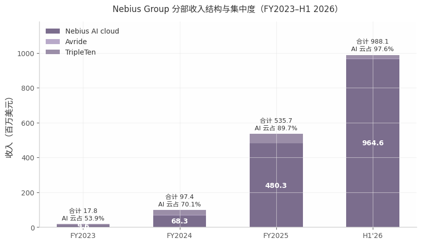

*数据来源：SEC Form 20-F FY2025 Note 15、Form 6-K（2026-05-20/2026-08-12）分部附注；图中合计为分部收入简单加总（未含分部间抵销，FY2025 抵销后 $529.8M、H1'26 抵销后 $981.3M），单位百万美元。*

上图显示集团收入结构在 30 个月内完成了从"多元小业务组合"到"单一 AI 云公司"的切换：AI 云收入占比从 FY2023 的 53.9% 升至 H1'26 的 97.6%，且增长几乎全部由 2025Q3 之后的 hyperscaler 合同与产能投放驱动——FY2025 全年 AI 云收入 4.803 亿美元，仅 H1'26 半年即达 9.646 亿美元。这一集中度的另一面是风险的同步集中：集团的估值、融资能力与增长叙事已完全绑定于 AI 云分部的产能交付节奏，Avride 与 TripleTen 的收入贡献已降至统计噪音水平。

#### 1.2.2 非核心业务：三个"期权型"资产与一项股权重估

**Avride（自动驾驶）**。robotaxi 与人行道配送机器人双线运营，以合作网络分销：2024 年与 Uber 签多年期合作，配送机器人落地奥斯汀、达拉斯与泽西城，2025 年 12 月自动驾驶车辆在达拉斯 Uber 平台商业化上线，截至 Q2'26 完成超 6 万次商业载客；2025 年 3 月与现代汽车合作部署 100 辆改装 Ioniq 5，2026 年 5 月自动驾驶车队超 200 辆 [Source: SEC EDGAR — Form 20-F FY2025, Item 4；Form 6-K（2026-08-12）Ex-99.2]。2025 年 10 月 Uber 与 Nebius 承诺对 Avride 合计至多 3.75 亿美元战略投资，公司在 20-F 中明示"正积极探索引入第三方投资，包括可能放弃控制权的交易"——即复制 Toloka 引资路径的意愿明确。财务上该分部仍处投入期：FY2025 收入仅 130 万美元、Adj. EBITDA 亏损 8,270 万美元 [Source: SEC EDGAR — Form 20-F FY2025, Note 15]。

**TripleTen（教育科技）**。B2C 在线职业再培训平台，FY2025 收入 5,410 万美元（+88%），但 2026 年转入收缩：Q2'26 收入 1,000 万美元、同比下滑 19%，原因是美国学员减少叠加公司主动淘汰旧产品线，部分被拉美增长抵销；转型方向是 B2B 企业 AI 技能培训（Nebius Academy，2025 年 9 月扩展），并以降本增效改善分部亏损 [Source: SEC EDGAR — Form 6-K（2026-05-20、2026-08-12）分部附注与 MD&A]。

**Toloka（已去合并）**。LLM/GenAI 数据服务商，2025 年 5 月 7 日宣布由 Bezos Expeditions 领投、Shopify CTO Mikhail Parakhin 跟投的战略投资，交易后 Nebius 表决权降至 49%、失去控制权，自 2025Q2 起去合并并按权益法列报，历史业绩重述入终止经营 [Source: SEC EDGAR — Form 20-F FY2025, Note 1/Note 3][^53^]。需要澄清的是，市场曾流传所谓"Toloka–Beeline 交易"，经多轮交叉检索无任何公开证据，应为误传，不予采信。

**ClickHouse（少数股权）**。开源列式数据库，2021 年 9 月自集团分拆，Nebius 保留重大少数股权。2026 年 1 月 ClickHouse 完成 4 亿美元 D 轮融资、估值约 150 亿美元，由此产生的股权重估为集团贡献大额非现金收益：FY2025 5.989 亿美元、2026Q1 +7.806 亿美元 [Source: SEC EDGAR — Form 20-F FY2025, Note 17；Form 6-K（2026-08-12）Ex-99.1]。该股权是集团资产负债表上一项易被低估的隐性价值，但也构成 GAAP 利润的噪音来源。

### 1.3 2025-2026 业务演变

#### 1.3.1 战略演变时间线

| 时间 | 事件 | 战略意义 |
|---|---|---|
| 2025-05 | Toloka 去合并（Bezos Expeditions 领投） [^53^] | 集团收缩为 3 个报告分部，确立"非核心资产引资退出"模板 |
| 2025-09-08 | Microsoft 5 年期 $17.4B（可扩至 $19.4B）GPU 基础设施合同，Vineland 交付 [^4^] | 首个 hyperscaler 锚定单，商业模式获投资级客户验证 |
| 2025-11-05 | Token Factory 发布 [^1^] | 从 GPU 租赁延伸至按 token 计费的托管推理，向软件层要毛利 |
| 2025-11 | Meta 第一份约 $3B、5 年期合同 [^6^] | hyperscaler 客户多元化 |
| 2026-01 | ClickHouse D 轮 $400M、估值约 $15B [Source: SEC 20-F Note 17] | 股权资产价值显性化 |
| 2026-02-19 | 收购 Tavily（对价公允价值 $189.4M） [Source: SEC 20-F Note 17] | 补齐 agentic 搜索能力 |
| 2026-03-11 | NVIDIA $20 亿预付权证战略投资 [Source: SEC 20-F Note 17] | 绑定上游算力供给方 |
| 2026-03-16 | Meta 第二份：$12B 专属产能（Vera Rubin，2027 年初交付）+ 至多 $15B 期权式承诺 [^20^] | 客户承诺总额跃升，锁定 2027–28 产能 |
| 2026-05-12 | 收购 Clarifai（对价 $97.4M） [Source: SEC 6-K Ex-99.2 Note 3] | 内化推理与算力编排技术 |
| 2026-06-16 | 完成 Eigen AI 收购（对价 $331.4M 含股票） [Source: SEC 6-K Ex-99.2 Note 3] | 内化推理优化/压缩/微调能力，强化 Token Factory |
| 2026-07-15 | 发布 asset-light 基础设施伙伴模式 [^2^] | 以伙伴资本扩产能，把资产负债表约束转化为高毛利收入分成 |
| 2026-08-12 | Q2'26 财报：首次 capacity auction（较 Blackwell 历史最高价 +15%）、年末签约电力目标上调至 5GW [^3^][^10^] | 从"以产定销"转向"以销定价"，产能成为可拍卖的稀缺资产 |

上表呈现三段清晰的战略递进。第一段（2025-05 至 2025-11）是"资产收敛+锚定客户"：剥离 Toloka 后，公司以 Microsoft、Meta 两笔长期合同把收入基础切换至投资级客户，FY2025 前两大客户已占收入 40% [Source: SEC EDGAR — Form 20-F FY2025]。第二段（2025-11 至 2026-06）是"软件内化"：Token Factory 上线后连续完成 Tavily、Clarifai、Eigen AI 三笔合计约 6.2 亿美元的收购，全部商誉分配至 AI 云分部，目标是把推理与 agentic 能力沉淀为平台毛利，Q2'26 推理负载环比增长超 3 倍初步验证了方向 [Source: SEC EDGAR — Form 6-K（2026-08-12）Ex-99.2]。第三段（2026-07 起）是"资本结构创新"：asset-light 模式把数据中心出资与运营转移给伙伴方，capacity auction 则以市场化拍卖验证产能定价权——出清价较此前 Blackwell 最高要价高 15%，短期溢价合同单价达 40–50M 美元/MW，约为中期合同的 1.6–2.5 倍 [^2^][^3^]。管理层明确表示短期合同与 asset-light 产能不影响 2026 年指引、但将显著作用于 2027 年及以后收入，这意味着当前业务结构仍处于向"轻资产+高定价"模式切换的中段，2026 下半年至 2027 年的产能上线节奏是下一阶段观察重点 [^3^]。

## 2. 营收分析：总量与业务线拆分

本章拆解 Nebius Group（NASDAQ: NBIS）的营收总量轨迹与业务线结构。阅读本章数据前需先明确两层口径：其一，Nebius 是荷兰注册的外国私人发行人（FPI），定期报告体系为 Form 20-F 年报与 Form 6-K 季度申报，不提交 10-K/10-Q，故季度数据均取自 6-K 所附未经审计财务报表与股东信；其二，2025 年 5 月 Toloka 完成第三方增资后 Nebius 失去多数表决权，Toloka 自 Q2 2025 起重分类为终止经营（discontinued operations）并追溯重述，因此 2022–2024 年期间同时存在"含 Toloka 的原报告口径"与"剔除 Toloka 的持续经营重述口径"两套数字 [^2^][^17^]。

### 2.1 总营收时间序列

#### 2.1.1 年度序列：从 $20.9M 到 $3.0–3.4B 指引

Nebius 的年度营收呈现罕见的连续多倍增长。按原报告口径（含 Toloka），FY2023 营收 $20.9M，FY2024 同比增长 462% 至 $117.5M [^1^][Source: SEC EDGAR — XBRL company facts us-gaap:Revenues, CIK 1513845, as of 2026-08-16]。Toloka 出表后，FY2025 20-F 将 FY2024 重述为持续经营口径 $91.5M（对应 FY2023 重述值仅 $9.8M），FY2025 全年营收 $529.8M，同比增长 479% [^2^][Source: SEC EDGAR — XBRL company facts us-gaap:Revenues, CIK 1513845, as of 2026-08-16]。公司在 Q1、Q2 2026 连续重申 FY2026 全年营收指引 $3.0–3.4B，隐含同比增速 466%–542%，即连续第三年实现约 5–7 倍增长 [^3^][^4^]。

| 财年 | 原报告口径（含 Toloka） | 重述口径（剔除 Toloka） | 同比增速 |
|---|---|---|---|
| FY2023 | $20.9M [^1^] | $9.8M [^2^] | — |
| FY2024 | $117.5M [^1^] | $91.5M [^2^] | +462% / +834% |
| FY2025 | — | $529.8M [^2^] | +479% |
| FY2026E（指引） | — | $3,000–3,400M [^4^] | 隐含 +466%–542% |

FY2023–FY2026E 连续四年营收量级从千万级跃迁至三十亿级，累计增幅约 150–160 倍；直接原因是 2024 年俄资产剥离后 AI 云业务近乎零基数起步，叠加 2025 年起 Microsoft 与 Meta 多年期大额合同落地 [^1^][^19^][^20^]。

两套口径的差异本身就是重要的分析信息：FY2024 的 $117.5M 中有 $26.4M 来自 Toloka [^1^]，该业务在去合并前占集团营收约 22%，但其 FY2024 增速仅 +138%，远低于集团整体 +462%——剔除 Toloka 后 FY2024 的同比增速反而高达 +834%，说明集团的高增长自始由核心 AI 云业务驱动，非核心业务反而是增速的稀释项。FY2026 指引区间隐含下半年营收需达 $2.02–2.42B，即 H2 环比 H1（$981.3M）再增长约 106%–147%，这一陡峭的斜率假设高度依赖新建数据中心产能的集中投产（见 2.3.1 节）。

#### 2.1.2 季度序列：十个季度增长 60 倍

季度颗粒度更能刻画增长曲线的形态。按重述口径，集团营收从 Q1 2024 的约 $9.7M 增至 Q2 2026 的 $582.3M，十个季度累计增长约 60 倍；其中 2026 年上半年合计 $981.3M，同比增长 529%，仅半年即达到 FY2025 全年（$529.8M）的 1.85 倍 [^17^]。

| 季度 | 营收（百万美元，重述口径） | 同比 | 环比 |
|---|---|---|---|
| Q1 2024 | ~9.7（推算）[^10^][^11^] | — | — |
| Q2 2024 | 14.5 [^11^] | — | +49% |
| Q3 2024 | 32.1 [^10^] | — | +121% |
| Q4 2024 | 35.2 [^12^] | — | +10% |
| Q1 2025 | 50.9 [^13^] | ~+425%（推算） | +45% |
| Q2 2025 | 105.1 [^14^] | +625% | +106% |
| Q3 2025 | 146.1 [^10^] | +355% | +39% |
| Q4 2025 | 227.7 [^12^] | +547% | +56% |
| Q1 2026 | 399.0 [^13^] | +684% | +75% |
| Q2 2026 | 582.3 [^17^] | +454% | +46% |

序列中有两处值得注意。一是 Q4 2024 环比仅 +10%，为全序列最低，同期公司披露的 2024 年末 ARR $90M 亦低于此前指引，管理层归因于客户获取周期较长 [^8^]——这是序列中唯一一次"失速"，此后随着 Microsoft、Meta 等超大规模客户合同落地再未出现。二是同比增速自 Q2 2025 的 +625% 逐步回落至 Q2 2026 的 +454%，但这主要是基数效应：环比增速始终维持在 +39%–+106% 的高位，Q2 2026 单季环比仍达 +46%，绝对增量（Q2'26 环比 +$183.3M）已超过 FY2024 全年营收 [^17^][^4^]。

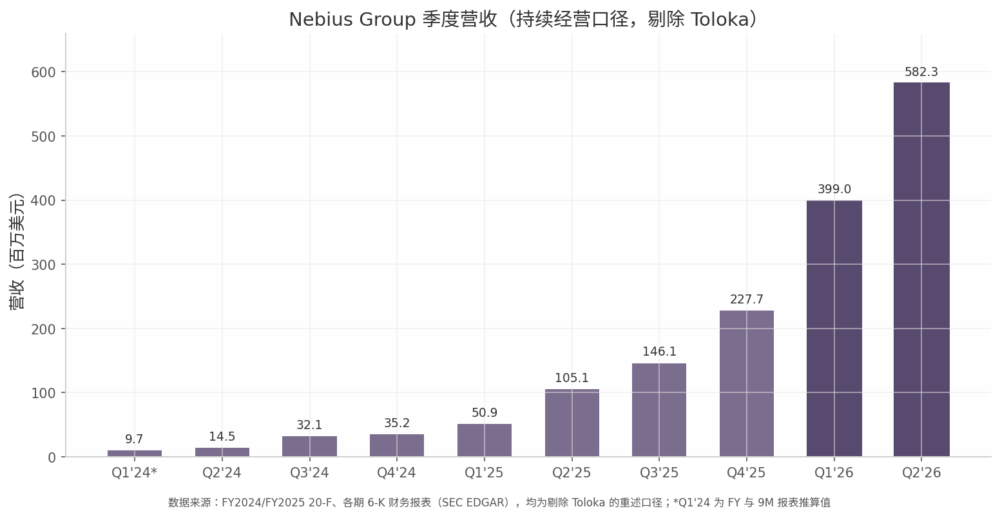

*图注：季度营收柱状图，数据来自 FY2024/FY2025 20-F 及各期 6-K 财务报表（SEC EDGAR），均为剔除 Toloka 的持续经营重述口径；Q1 2024 为 FY 减 9M 报表的推算值；深色柱为 2026 年季度。*

### 2.2 业务线营收拆分

#### 2.2.1 分部营收：Nebius AI 占比 98%，实质单一业务公司

自 Toloka 于 2025 年 5 月去合并后，集团的报告分部收缩为三个：Nebius AI cloud（核心 AI 云）、TripleTen（教育科技）、Avride（自动驾驶）。分部数据揭示的核心事实是营收结构的极度单一化：

| 分部 | FY2024 | FY2025 | Q2 2025 | Q2 2026 | Q2'26 同比 | Q2'26 占集团比 |
|---|---|---|---|---|---|---|
| Nebius AI cloud | $68.3M [^2^] | $480.3M [^2^] | $93.7M [^17^] | $574.9M [^17^] | +514% [^4^] | ~98% [^4^] |
| TripleTen | $28.8M [^2^] | $54.1M [^2^] | $12.3M [^17^] | $10.0M [^17^] | −19% [^17^] | ~1.7% |
| Avride | $0.3M [^2^] | $1.3M [^2^] | $0.2M [^17^] | $1.0M [^17^] | +400% | ~0.2% |
| 抵销 | −$5.9M [^2^] | −$5.9M [^2^] | −$1.1M [^17^] | −$3.6M [^17^] | — | — |
| 集团合计 | $91.5M [^2^] | $529.8M [^2^] | $105.1M [^17^] | $582.3M [^17^] | +454% | 100% |

三条业务线的轨迹截然分化。Nebius AI cloud 营收从 FY2023 的 $9.6M 到 FY2024 的 $68.3M 再到 FY2025 的 $480.3M，连续两年约 6–7 倍增长 [^2^]；2026 年上半年达 $964.6M，Q2'26 单季同比增长 514% [^4^][^17^]。其占集团营收的比重从 Q1 2025 的约 81% 一路升至 Q4 2025 的约 94%、2026 年起稳定在约 98% [^13^][^12^][^4^]。TripleTen 曾在 2025 年高增（FY2025 +88%，Q1'25 同比 +144%）[^2^][^9^]，但 2026 年转负：Q2'26 收入 $10.0M，同比 −19%，公司归因于美国学员下降与主动淘汰旧产品线 [^17^]。Avride 收入常年在百万美元量级，战略上已被公司明确定位为"正积极探索引入第三方投资、包括可能放弃控制权"的期权型资产 [^1^]。换言之，合并报表实质上已是纯 AI 云业务叠加两项早期投资，Toloka 的去合并正是这一聚焦战略的第一步。

从分部季度序列看，Nebius AI cloud 的环比增量在 Q4 2025（约 +$83M）与 Q1 2026（约 +$176M）出现两次台阶式跳升，分别对应 Microsoft Vineland 项目开始交付与大规模产能转固 [^13^][^17^]；TripleTen 与 Avride 合计季度收入长期停滞在 $10–17M 区间，对集团营收的解释力已不足 2%。**【判断】** 由此，跟踪 NBIS 营收实质上只需跟踪一个变量：Nebius AI cloud 的产能-签约-确认链条。

Toloka 去合并对口径的影响需要单独说明：Toloka 在去合并前的营收为 FY2023 $11.1M、FY2024 $26.4M、2025 年上半年约 $6.4M [^1^][^17^]；出表后集团以权益法核算其股权，不再确认其营收。这一重述使历史可比序列"缩小"了约 15%–22%，但也使集团报表的增长率与利润率更能反映核心业务的真实状态。

#### 2.2.2 收入质量：ARR、递延收入与 RPO 的三重印证

单看已确认收入会低估这家公司的真实经营动量，三个领先指标提供了更完整的图景。

第一是 ARR（annualized run-rate revenue，年化运行率收入，定义为季度最后一个月营收 ×12，核心 AI 云口径）。ARR 从 2024 年末的 $90M 升至 2025 年末的 $1.25B（一年内约 14 倍，超出 $0.9–1.1B 的指引），2026 年 3 月末达 $1.92B（环比 +54%），6 月末达 $3.0B（同比 +598%、环比 +56%）；公司重申 2026 年末 ARR 指引 $7–9B [^12^][^3^][^4^]。指引轨迹本身也在上移：2025 年末 ARR 指引从年初的 $0.75–1.0B 上调至 $0.9–1.1B，最终实际值 $1.25B 再超上限 [^8^][^14^][^12^]。若 2026 年末指引兑现，意味着下半年 ARR 需再增 $4.0–6.0B，是上半年增量（$1.75B）的 2.3–3.4 倍——这是判断指引可信度的关键量化锚点。

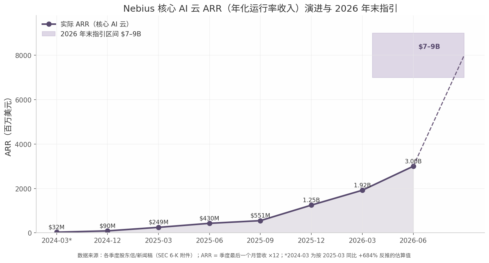

*图注：ARR 增长曲线，数据来自各季度股东信与新闻稿（SEC 6-K 附件）；2024 年 3 月末值按 2025 年 3 月末同比 +684% 反推估算；阴影区为 2026 年末指引区间。*

第二是递延收入（deferred revenue，客户预付款）。资产负债表上的递延收入从 2024 年末的 $16.3M（主要为 TripleTen 学费）暴增至 2025 年末的 $1,577.5M、2026 年 3 月末的 $4,778.1M、6 月末的 $5,975.2M，其中非流动部分达 $4,995.8M [^2^][^13^][^17^][Source: SEC EDGAR — XBRL us-gaap:ContractWithCustomerLiability, CIK 1513845, as of 2026-08-16]。FY2025 全年递延收入增加 $1,561.2M，主要来自 Microsoft、Meta 等战略客户协议的预付款 [^2^]；H1 2026 经营性现金流中递延收入变动贡献 +$4,395.0M（上年同期仅 +$3.0M）[^17^]。公司预计这些预付款将在 1–5 年内确认为收入，2026 年全年客户预付款预计超过 $9B [^13^][^4^]。

第三是剩余履约义务（RPO）。全部归属 Nebius AI cloud 的未履约 RPO 从 2025 年末的 $21.3B 增至 2026 年 3 月末的 $33.6B、6 月末的 $37.5B；其中 36% 预计在其后 24 个月内确认、40% 在第 25–48 个月确认 [^2^][^13^][^17^]。$37.5B 的 RPO 相当于 H1 2026 年化收入（约 $2.0B）的约 19 倍，且确认节奏前高后稳，意味着未来 2–4 年的收入底座已高度锁定。

三项指标合并解读：ARR 刻画"当下月度动量"，递延收入刻画"客户已付现金"，RPO 刻画"已签约未履约的合同总价"。三者同步爆发且量级依次放大（$3.0B < $5.98B < $37.5B），表明已确认营收只是合同存量的早期释放，收入增长的可见性显著高于一般成长期公司；但同时也需注意，预付款驱动的经营现金流与收入质量是两个概念——它证明需求真实，却也使公司的融资结构深度绑定于客户资本开支周期。

### 2.3 增长驱动与可持续性

#### 2.3.1 增长三引擎：产能投产、利用率与高 margin 新收入

当前营收增长由三个引擎支撑，其可持续性各不相同。

引擎一：产能上线节奏，决定 H2'26 的兑现斜率。集团营收本质上是"在运电力（active power）× 单位功率收入"的函数：2025 年末在运电力仅约 170MW，而签约电力（contracted power）2026 年 2 月已超过 2GW，年末目标在连续上调后达 5GW [^2^][^4^]。FY2026 指引隐含 H2 营收较 H1 再增 106%–147%，与产能集中投产的时间表直接对应——Microsoft Vineland 项目持续交付、Meta 基于 Vera Rubin 的 $12B 承诺产能预计 2027 年初起交付 [^2^][^19^][^20^]。该引擎的风险是执行性的：电力并网、建设与交付任何延误都会线性传导至营收确认。

引擎二：利用率与定价提升。公司披露 2026 年 Q2 平均合同价值（ACV）超过 $20M/MW，四笔标志性大单平均 TCV 超 $10 亿（$20–25M/MW 区间），预期回收期缩短至 1 年 10 个月；首次产能拍卖（capacity auction）的成交价较 Blackwell 芯片历史最高价高出 15% [^17^][^4^]。管理层明确表示"以这些条款，2027 年的产能今天即可售罄" [^4^]。拍卖溢价与合约价上行表明供不应求格局仍在加深，利用率与单价短期内同时构成营收的上行弹性。

引擎三：asset-light 与 Token Factory 构成的高 margin 收入选项。2026 年 7 月公司推出 asset-light 基础设施合作模式：合作方出资并持有数据中心，Nebius 输出系统架构、硬件设计、软件栈与销售渠道，以收入分成、许可费等形式获取"minimal capital outlay"的高 margin 收入 [^4^]。按 token 计费的托管推理服务 Token Factory（2025 年 11 月发布）生产推理工作负载 Q2'26 环比增长逾 3 倍 [^17^]。这两项业务当前收入贡献尚小，但若放量，将在不增加 capex 的前提下改善营收的边际质量——其意义在于为公司提供了一条不完全依赖资产负债表扩张的收入曲线，从而部分对冲引擎一的执行风险与资本依赖。

引擎一与引擎二已在财务报表中得到验证（营收、ARR、递延收入三线同向），引擎三目前仍属"期权"——其价值在于改变增长的资本密集度，而非当期贡献。综合看，FY2026 $3.0–3.4B 指引的可信度有递延收入与 RPO 的存量合同支撑，但其 H2 集中兑现的结构意味着营收对产能投产进度的敏感度极高；ARR $7–9B 指引能否兑现，将是第 3 章盈利分析与后续各章判断估值合理性的核心输入变量。

## 3. 盈利能力分析

第 2 章确立了营收端的事实：单季 $582.3M、ARR $3.0B 的放量曲线有递延收入与 RPO 背书。本章回答随之而来的问题——这条收入曲线的盈利质量如何。结论先行：现金运营层面（adj. EBITDA）已跨越拐点并逐季爬升，但 GAAP 层面仍被折旧、利息与股权激励三重成本压制，两个口径之间的鸿沟本身就是理解该公司商业模式的关键。

### 3.1 盈利指标全景

#### 3.1.1 adj. EBITDA 轨迹：六个季度从 -106% 到 +41%

Nebius 的盈利拐点在 adjusted EBITDA（调整后息税折旧摊销前利润）口径上已经形成清晰且连续的轨迹：FY2024 全年亏损 $266.4M（原始口径，含 Toloka；重述持续经营口径为 -$226.3M），FY2025 收窄至 -$64.9M；按季度看，集团 adj. EBITDA 于 2025Q4 首次转正（+$15.0M，margin 7%），随后 2026Q1 跳升至 $129.5M（margin 32%）、2026Q2 进一步达到 $236.2M（margin 41%），单季环比增量超过 $100M [^4^][^3^][^5^][^1^]。管理层在 Q2 财报中重申 2026 全年集团 adj. EBITDA margin 约 40% 的指引，意味着下半年预计维持在 Q2 已实现水平附近 [^7^][^16^]。

margin 修复的驱动力是收入端以远高于费用端的速度扩张：2026Q2 收入成本占收入比由上年同期的 29% 降至 23%，产品研发费用占比由 41% 降至 33%，SG&A（销售及管理费用）占比由 65% 降至 30%，总经营费用占收入比由 206% 压缩至 130% [^1^]。这一运营杠杆是真实的——但它只覆盖现金运营费用，最大的经济成本（GPU 折旧）被 adj. EBITDA 口径整体剔除，这一点在 3.2 节展开。

| 指标（百万美元） | Q1'25 | Q2'25 | Q3'25 | Q4'25 | Q1'26 | Q2'26 |
|---|---|---|---|---|---|---|
| 收入（持续经营） | 50.9 [^5^] | 105.1 [^1^] | 146.1 [^9^] | 227.7 [^3^] | 399.0 [^5^] | 582.3 [^1^] |
| 收入成本占收入 | 49% | 29% [^1^] | — | 30% [^3^] | 26% [^8^] | 23% [^1^] |
| D&A（占收入） | 49.1（96%）[^5^][^8^] | 75.2（72%）[^1^] | ~99.0（~68%） | 180.7（79%）[^3^] | 212.0（53%）[^5^][^8^] | 259.7（45%）[^1^] |
| 股权激励 SBC | 17.4 | 14.7 [^1^] | 26.2 | 24.9 [^3^] | 35.3 | 102.5 [^1^] |
| 利息费用 | 0 [^5^] | 4.8 [^1^] | — | 38.3 [^3^] | 63.7 [^5^] | 119.1 [^1^] |
| 持续经营净利润/(亏损) | (104.3) [^5^] | +502.5 [^1^] | (119.6) [^9^] | (249.6) [^3^] | +621.2 [^5^] | (190.4) [^1^] |
| **Adjusted EBITDA/(亏损)** | (53.7) [^5^] | (21.0) [^1^] | (5.2) [^9^] | +15.0 [^3^] | +129.5 [^5^] | **+236.2** [^1^] |
| Adj. EBITDA margin | -106% [^8^] | -20% [^1^] | -3.6% | +7% [^3^][^16^] | +32% [^8^] | **+41%** [^1^] |
| Adjusted net loss | (83.7) | (91.5) [^1^] | (100.4) [^9^] | (173.0) [^3^] | (100.3) | (33.2) [^1^] |

上表最突出的异常是 GAAP 净利润列的剧烈摆动：2025Q2 净赚 $502.5M、2026Q1 净赚 $621.2M，而前后季度均为大额亏损。这两个"盈利季"完全由 ClickHouse 股权投资重估收益（分别 +$597.4M 与 +$780.6M）驱动，同期营业层面均为亏损 [^1^][^5^]。因此 GAAP 净利润在该公司的单季解读中已基本失效，有效序列只有两条：adj. EBITDA（经营现金创造能力的代理）与 adjusted net loss（加回 SBC 与一次性项后的盈亏平衡距离）。后者 2026Q2 已收窄至 -$33.2M（margin -5.7%），显示集团在计入折旧后距离盈亏平衡仅一步之遥——但这一步恰恰是最大的那一步（见 3.2.1）[^1^]。

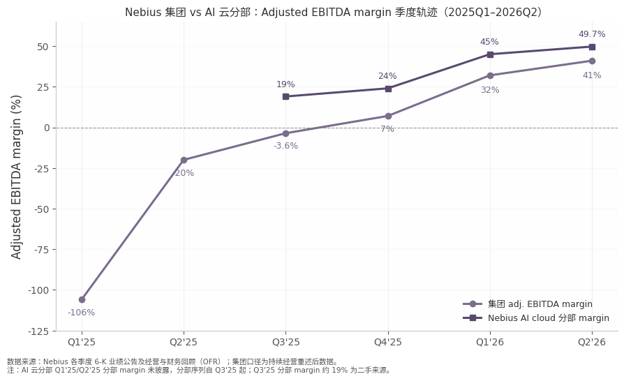

*数据来源：Nebius 各季度 6-K 业绩公告及经营与财务回顾（OFR），2025Q1–2026Q2，持续经营重述口径；AI 云分部序列自 Q3'25 起，Q3'25 分部 margin 约 19% 为二手来源。*

图中两条线的开口即 Avride 与 TripleTen 的亏损拖累：2026Q2 集团 margin（41%）与 AI 云分部 margin（49.7%）之间相差约 9 个百分点，对应两家非核心分部合计约 -$49.5M 的季度 adj. EBITDA 亏损 [^2^]。分部 margin 的爬升斜率（19%→24%→45%→49.7%）在 Q1'26 明显变陡，与 Microsoft 合同产能集中交付的节奏吻合，**【推断】** 若 H2'26 新产能按期上线且利用率维持高位，分部 margin 可能在 50% 附近企稳；公司未对分部 margin 给出正式指引。

#### 3.1.2 分部盈利：AI 云独撑全局，两个"期权型"分部每季拖累约 $50M

公司按 Nebius AI cloud、Avride（自动驾驶）、TripleTen（IT 职业教育）三个分部披露 adj. EBITDA。AI 云分部 FY2025 全年 adj. EBITDA 首次转正至 +$59.0M（FY2024 为 -$128.5M），2026Q2 单季达 +$285.7M、margin 49.7%，H1'26 合计 +$459.7M [^6^][^2^]。需要明确口径：市场报道中常见的 $236.2M 是集团整体数，分部数 $285.7M 高于集团数，差额即非核心分部的亏损。AI 云分部 Q2 收入 $574.9M，占集团收入的 98.7%，集团实质上已是一家单一业务公司附带两笔风险投资 [^2^]。

拖累端的结构在恶化而非收敛。Avride Q2'26 亏损 -$40.1M，同比多亏 $22.8M，原因是自动驾驶车队与运营区域扩张推高人员及运营费用 [^2^]；其 Q1 收入仅 $0.9M，且 2026 年 5 月起面临 NHTSA 调查（十余起碰撞记录），商业化变现时间表存在不确定性。TripleTen 相对稳定在小额亏损（Q2'26 -$9.4M），收入同比下滑 19%，公司正将重心由美国 C 端转向拉美市场 [^2^]。两分部合计每季约 -$49.5M 的拖累相当于集团 adj. EBITDA 的 21%；管理层明确表示 2026 年内 Avride 与 TripleTen 仍将亏损、仅占比缩小，集团 40% 的全年 margin 指引已内含这一假设 [^16^]。对长期盈利能力，管理层给出的锚是核心 AI 云业务 20–30% 的 EBIT margin——注意这是扣除折旧后的口径，与当前 50% 的 EBITDA margin 之间约 20–30 个百分点的落差，即 D&A 的影响 [^8^]。

### 3.2 GAAP 与 Non-GAAP 的鸿沟

#### 3.2.1 Q2'26 净亏 $190.4M 的构成：三大非现金/准现金项合计 $481M

2026Q2 持续经营净亏损 $190.4M（占收入 -33%），与 +$236.2M 的 adj. EBITDA 之间存在 $426.6M 的鸿沟，主要由三项构成：D&A $259.7M（占收入 45%）、利息费用 $119.1M（上年同期仅 $4.8M）、SBC $102.5M（同比 +597%）[^1^]。用 adj. EBITDA 倒减 D&A 与 SBC（$236.2M − $259.7M − $102.5M ≈ -$126M），才是剔除全部口径调整后的真实经营层面结果——集团距离"含折旧盈利"仍有约 $126M/季的缺口，其中 D&A 单项就超过 adj. EBITDA 总额 [^1^]。

| Q2'26 调节桥（百万美元） | 金额 | 说明 |
|---|---|---|
| 持续经营净亏损（GAAP） | (190.4) [^1^] | 每股 -$0.68 |
| + 折旧与摊销 D&A | +259.7 [^1^] | 占收入 45%，GPU/服务器为主 |
| + 股权激励 SBC | +102.5 [^1^] | 含 Eigen AI 收购相关 $74.9M |
| + 收购及公司交易费用 | +49.9 [^1^] | Tavily/Clarifai/Eigen AI 等 |
| + 利息费用 | +119.1 [^1^] | 可转债 + 预付款融资成分增值 |
| − 利息收入 | (24.1) [^1^] | 募资后现金堆息 |
| − 权益法投资收益 | (12.7) [^1^] | Toloka 等 |
| − 其他收益净额 | (81.5) [^1^] | 货基收益 $61.4M + 汇兑 $21.1M |
| + 所得税 | +13.7 [^1^] | — |
| **= Adjusted EBITDA** | **+236.2** [^1^] | margin 41% |
| 调整后净亏损（adjusted net loss） | (33.2) [^1^] | 净亏 +SBC −汇兑 +交易费 +转债摊销 −税项 |

调节桥揭示两个常被忽略的事实。其一，利息费用已是 GAAP 亏损的第二大来源：H1'26 利息费用 $182.8M，来自 2025 年 6 月/9 月及 2026 年 3 月发行的多系列可转债，以及客户预付款"重大融资成分"的利息增值；截至 2026-06-30 非流动债务 $8,499.0M，随着债务与预付款规模继续扩张，该项预计仍将走高，公司仅指引 adj. EBITDA margin，未承诺 GAAP 盈利时点 [^2^][^1^]。其二，"其他收益净额 +$81.5M + 利息收入 $24.1M"合计约 $105.6M 的非经营收益正在反向掩盖经营亏损——其中货基收益 $61.4M 本质上是融资堆出的现金生息，随 capex 消耗现金将自然衰减 [^2^]。换言之，$190.4M 的表观净亏同时高估（被利息与一次性项放大）又低估（被非经营收益掩盖）了真实的经营亏损。

#### 3.2.2 盈利质量四重扰动：读 Nebius 财报必须手工还原

对该公司盈利指标的引用需要经过四重校正，否则任何跨期或跨公司比较都会失真。

**第一重：折旧年限变更直接美化 margin。** 自 2026Q1 起，公司将服务器与网络设备使用年限由 4 年延长至 5 年，前瞻适用，公司原文承认该变更"部分抵消了折旧费用的增长" [^2^]。D&A 占收入比从 Q4'25 的 79% 降至 Q2'26 的 45%，其中既有收入摊薄的真实经营改善，也含有会计估计变更的贡献，二者无法从披露中精确拆分，外部分析者已明确注意到这一点 [^14^]。对 5 年期假设的敏感性值得警惕：GPU 实际经济寿命若更接近 4 年，当前 D&A 被系统性低估，管理层 20–30% EBIT margin 的长期目标也将同步承压。

**第二重：成本行不含 D&A，表观"毛利率"虚高约 45 个百分点。** Nebius 利润表不设 gross profit 行，收入成本（cost of revenues）不包含 GPU/服务器折旧，折旧单列一行。按收入成本口径计算的 2026Q2 表观毛利率约 77.1%；若将折旧视为收入成本还原，"真实"毛利率约为 77.1% − 45% ≈ 32%（粗算）[^1^]。这一口径差异使 Nebius 与多数将折旧计入成本的美股同行直接对比毛利率时系统性占优，是跨公司对比中最常见的陷阱，公司在非 GAAP 披露中亦提示与 CoreWeave 的调整项定义不同 [^1^]。

**第三重：ClickHouse 重估收益扭曲 GAAP 净利。** FY2025 持续经营净利润 +$29.0M 看似历史性扭亏，但当年确认的股权投资重估收益为 +$598.9M——剔除后税前仍为大额亏损，账面盈利完全由这笔非现金收益制造 [^3^]。同样的机制在季度间制造了极端波动：2025Q2 净利 +$502.5M（ClickHouse C 轮重估 +$597.4M）、2026Q1 净利 +$621.2M（D 轮重估 +$780.6M，对应约 $150 亿报道估值）[^1^][^5^]。H1'26 持续经营净利润 $430.8M 与调整后净亏损 $133.5M 的 $564M 反差，是这一扭曲的集中体现 [^1^][^5^]。公司的 adjusted 口径将其全部剔除，处理是审慎的；但任何引用 GAAP 净利/PE 的估值叙述都会继承这一失真。

**第四重：一次性收购费用与合并后补偿。** Q2'26 SBC $102.5M 中，$74.9M 股权激励加 $41.0M 合并后补偿费用（合计 $115.9M）与 Eigen AI（MagicByte AI）收购相关，计入产品研发、属一次性性质；当季收购及交易相关费用另有 $49.9M（Tavily、Clarifai、Eigen AI 及融资专业费）[^2^][^7^]。H1'26 SBC 合计 $137.8M，已超过 FY2025 全年（$83.2M）[^1^][^3^]。这意味着即使 adjusted net loss 口径，也在加回一项随并购节奏波动的费用，跨期可比性受公司并购活跃度影响。

综合四重校正后的还原公式为：真实经营盈亏 ≈ adj. EBITDA − D&A（按 4 年还原或加注）− 经常性 SBC。以 Q2'26 计，约为 -$126M 量级，对应 margin 约 -22%；若再按 4 年折旧还原，缺口更大。这不是否定 adj. EBITDA 拐点的真实性——运营杠杆与分部 margin 爬升均有现金流和合同背书——而是界定其含义边界：41%/50% 的 EBITDA margin 证明的是"单位产能的现金运营盈利"，而非"公司在为股东创造会计利润"。第 12 章关于核心矛盾的讨论将以此为基线。

### 3.3 单位经济学与同行对比

#### 3.3.1 合同经济性：$20–25M/MW 定价与 22 个月回收期

Nebius 盈利前景的最终支撑不在当季报表，而在新签合同的经济条款。2026Q2 公司签订四笔平均总额超过 $10 亿的 AI 云合同，年合同额（ACV）达 $20–25M/MW（此前披露口径为 >$20M/MW）；管理层披露该批合同对应 capex 及相关运营成本的预期回收期约 1 年 10 个月（约 22 个月），较此前 2–3 年的水平明显缩短 [^7^][^12^][^13^]。回收期缩短来自两个结构性变化：一是定价上行，二是客户预付款（新签合同 50–70% 含预付款，覆盖对应 capex 的 50–60%，2026 年全年预付款预计超 $9B）将资本占用大幅前置转移给客户 [^7^][^13^]。

定价曲线的上沿仍在抬升。Q2 公司完成首次产能拍卖，出清价较此前 Blackwell 代芯片最高要价高 15%；针对 ≤6 个月的短期即时需求，公司正在洽谈 $40–50M/MW 甚至更高的溢价合同（其中一笔近期已签署），约为中期合同定价的两倍 [^7^][^2^]。管理层明确短期合同与资产轻模式产能"不影响 2026 年指引，但将显著影响 2027 年及以后收入" [^2^]。**【推断】** 粗算单位回报：按 $22.5M/MW 的 ACV 中值与约 22 个月回收期，隐含项目层面年化现金回报率约 50% 量级，这与 AI 云分部 49.7% 的 adj. EBITDA margin 相互印证——前提是利用率维持满载。该模型最敏感的变量是 2027 年后 hyperscaler 自建产能投放对合约价的冲击，当前 +40% 的 GPU 合约价涨幅与高定价均建立在供不应求的行业阶段之上 [^9^]。

#### 3.3.2 vs CoreWeave：EBITDA margin 落后 18 个点，亏损质量反而更优

将 Nebius 与最直接的可比公司 CoreWeave（CRWV）放在同一季度（2026Q2）对比，呈现一组方向相反的结论：

| 指标（2026Q2） | **Nebius (NBIS)** | **CoreWeave (CRWV)** |
|---|---|---|
| 收入 | $582.3M（+454%）[^1^] | $2,575M（+112%）[^10^] |
| Adjusted EBITDA / margin | $236.2M / 41%（AI 云分部 49.7%）[^1^][^2^] | $1,510M / 59%（上年同期 62%）[^10^] |
| GAAP 营业利润 | -$175.9M（-30%）[^1^] | -$49M（-2%）[^10^] |
| GAAP 净利润 | -$190.4M（-33%）[^1^] | -$626M（-24%）[^10^] |
| Adjusted net loss / margin | -$33.2M / **-5.7%** [^1^] | -$567M / **-22%** [^10^] |
| 单季利息负担 | 利息费用 $119.1M [^1^] | 净利息支出约 $640M（占收入 24.9%）[^10^][^11^] |
| 债务规模 | 非流动债务 $8.5B（2026-06-30）[^1^] | 总债务约 $35.1B（含追索权 $31.4B）[^11^] |
| 订单/积压 | 客户承诺 >$40B；ARR $3.0B [^7^] | Backlog ~$104B [^10^] |

CoreWeave 营收体量约为 Nebius 的 4.4 倍，adj. EBITDA margin（59%）高出 Nebius 集团口径 18 个百分点、高出分部口径约 9 个百分点，规模效应在现金运营层面仍然成立；但需注意两家调整项定义不同，margin 差不能全部归因于经营效率 [^1^][^10^]。结论在净利层完全反转：Nebius 调整后净亏 margin 为 -5.7%，CoreWeave 为 -22%，差距约 16 个百分点，核心解释变量是债务结构——CoreWeave 约 $35.1B 总债务带来单季约 $640M 的净利息支出（相当于其 adj. EBITDA 的 42%），而 Nebius 以净现金起步、依靠客户预付款与股权融资为主，利息负担仅为收入的 20% 且部分源于预付款融资成分的会计增值而非现金票息 [^10^][^11^][^1^]。**【判断】** 两家的共性问题是同一句话："EBITDA 盈利、扣除折旧与利息后亏损"——CoreWeave 卡在利息，Nebius 卡在折旧；前者是融资结构选择的结果，后者是商业模式的内在成本，也决定了 Nebius 若要实现 GAAP 盈亏平衡，路径只能依赖收入继续摊薄 D&A，而非费用端的边际操作。

## 4. 资产负债表与融资结构

Nebius 的资产负债表在 18 个月内完成了从"剥离后净现金壳"到"高周转 AI 基础设施开发商"的彻底重构：总资产扩张 7.9 倍至 $27.96B，债务从零增至账面 $8.55B，而融资结构中股权、准股权（低票息可转债、预付权证）与客户预付款的组合，使其在温和净杠杆下支撑了 $20–25B 的年度资本开支计划。本章从存量角度拆解这一结构及其风险点，现金流与 capex 效率的动态分析留待第 5 章。

### 4.1 资产负债表演变

#### 4.1.1 总资产 18 个月膨胀 7.9 倍：从 $3.5B 到 $27.96B

2024 年末至 2026 年 6 月末，Nebius 总资产从 $3,548.6M 增至 $27,961.5M，其中固定资产净额（PP&E，GPU 与数据中心）从 $847.0M 增至 $13,045.2M，贡献了增量的约一半；股东权益从 $3,253.7M 增至 $10,340.5M，主要靠 2025 年 9 月增发、2026 年 NVIDIA 预付权证与 ATM 出售库存股充实 [Source: SEC EDGAR — XBRL facts, CIK 1513845；Form 6-K Q2 2026 (acc. 0001104659-26-094844) Ex-99.2]。

**表 4-1 资产负债摘要（近四期，单位：百万美元）**

| 项目 | FY2024（2024-12-31） | FY2025（2025-12-31） | Q1 2026（2026-03-31） | Q2 2026（2026-06-30） |
|---|---|---|---|---|
| 现金及现金等价物 | 2,449.6 | 3,678.1 | 9,298.2 | 8,042.1 |
| 固定资产净额（PP&E） | 847.0 | 5,553.3 | 7,131.7 | 13,045.2 |
| 经营租赁使用权资产 | n/a | 918.8 | 1,266.0 | 1,855.1 |
| 非流通股权投资 | n/a | 836.6 | 1,614.1 | 1,606.7 |
| **总资产** | 3,548.6 | 12,430.6 | 22,303.3 | 27,961.5 |
| 递延收入合计（流动+非流动） | 16.5 | 1,577.5 | 4,778.1 | 5,975.2 |
| 债务—非流动（可转债，摊余成本） | 0 | 4,103.2 | 8,432.0 | 8,499.0 |
| 经营租赁负债—非流动 | 43.6 | 760.5 | 1,045.8 | 1,510.4 |
| **总负债** | 294.9 | 7,836.6 | 15,061.4 | 17,621.0 |
| **股东权益合计** | 3,253.7 | 4,594.0 | 7,241.9 | 10,340.5 |
| 总债务（账面） | ~0 | 4,127.7 | 8,450.4 | 8,545.7 |
| 净现金/(净债务)（账面） | +2,449.6 | (449.6) | +847.8 | (503.6) |
| 流动比率 | 9.6x | 3.1x | 8.3x | 4.0x |

[Source: SEC EDGAR — XBRL facts, CIK 1513845（FY2024/FY2025）；Form 6-K Q1 2026 (acc. 0001104659-26-064092) Ex-99.2；Form 6-K Q2 2026 (acc. 0001104659-26-094844) Ex-99.2]

表的结构性信息在于负债端的"三支柱"构成。Q2 2026 末 $17.6B 总负债中，可转债账面 $8.5B（48%）、递延收入（客户预付款）$6.0B（34%）、经营租赁负债 $1.6B（9%），传统的应付与有息流动负债合计不足 $1.4B。这一结构的含义有二：其一，真正需要以现金偿还的金融债务仅占负债的一半左右，递延收入以未来算力交付而非现金结清，实质是"客户为 capex 买单"的负债化凭证；其二，负债增速（FY2024 末 $0.3B → Q2'26 $17.6B）快于权益增速，总负债/股东权益从 0.09x 升至 1.70x，但流动比率仍维持 4.0x、现金占总资产 28.8%，短期偿付指标尚未恶化。需要警惕的是递延收入中"含可能可退还款项"的表述——预付款是对未来交付的负债，建设延期将同时冲击该项负债与经营现金流 [Source: SEC EDGAR — Form 6-K Q2 2026 Ex-99.2, Note 4]。

#### 4.1.2 从净现金到净债务：口径、路径与驱动因素

以账面口径计，Nebius 的净现金/(净债务）轨迹为：FY2024 末 **+$2,449.6M**（零债务）→ FY2025 末 **-$449.6M**（首批两期可转债到账）→ Q1 2026 末 **+$847.8M**（$4.34B 可转债 + $2.0B NVIDIA 权证集中到账）→ Q2 2026 末 **-$503.6M**。若按到期增值后本金（$10,041.8M）计量，Q2 末净债务约为 **-$2,046M** [Source: SEC EDGAR — Form 6-K Q2 2026 Ex-99.2, Note 12]。

需要说明的是，市场上"Nebius 仍为净现金公司"的表述（如部分第三方研究引用的 +$0.9B）对应的是 2026 年 3 月末时点；Q2 单季 capex 达 $5,657.4M，消耗了 Q1 融资沉淀的现金，使公司重新转入温和净债务状态——两个口径并不矛盾，只是时点不同。与同业相比，这一杠杆水平依然温和：同期 CoreWeave 净债务约 $22.6B，而 Nebius 的债务票息仅 1.00%–3.00%、首个到期日在 2029 年 6 月，H1 2026 合同票息支出 $64.0M，相对 $8.0B 现金储备负担很轻 [Source: SEC EDGAR — Form 6-K Q2 2026 Ex-99.1 "Liquidity and Capital Resources"]。

从半年度现金流视角可以更清楚地看到这一转换的资金力学：H1 2026 经营现金流 +$4,504.1M（几乎全部由递延收入增加 $4,395.0M 即客户预付款贡献），投资现金流 -$8,288.8M（其中 PP&E/无形资产采购 $8,130.3M），缺口由筹资现金流 +$9,160.4M 弥合——其构成为可转债毛额 $4,337.5M + 出售库存股（ATM）$2,846.7M + NVIDIA 预付权证 $2,000.0M − 发行费用 $79.4M [Source: SEC EDGAR — Form 6-K Q2 2026 Ex-99.1]。即公司当前的资产负债表扩张模式是"股权/准股权融资 + 客户预付款"双轮驱动，自身盈利对资金供给的贡献尚为零。股权侧的代价可量化：流通股（Class A+B）从 2024 年末 235.75M 股增至 2026 年 6 月末 271.86M 股（+15.3%），若计入 NVIDIA 权证 21.07M 股（行权价 $0.0001，经济实质等同已发行），隐含股本约 292.9M 股，较 2024 年末摊薄约 24% [^8^][^9^]。

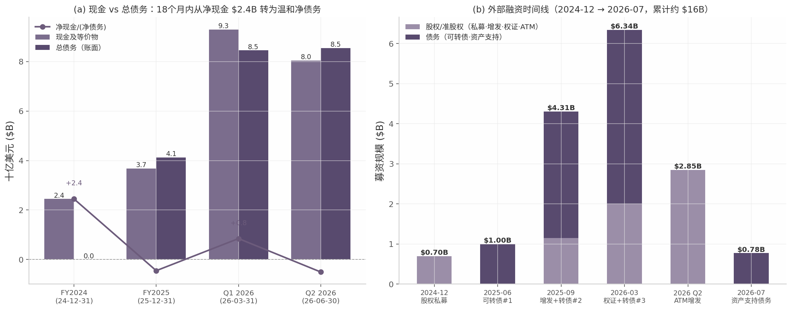

*图 4-1 左：现金、总债务（账面）与净现金/(净债务）的季度演变；右：2024-12 至 2026-07 外部融资时间线（按股权/准股权与债务拆分）。数据来源：SEC EDGAR XBRL facts（CIK 1513845）、Form 6-K Q1/Q2 2026 Ex-99.2、各次发行定价公告；金额单位 $B。*

右图概括了公司的外部融资路径：公司通过私募、增发、六系列可转债、NVIDIA 权证、ATM 与 ABS 累计外部融资约 $16B，融资明细与时间线见第 10 章；就本章关注的债务存量结构而言，股权/准股权与债务比例大致 4:6，与管理层"保持债务与股权均衡组合"的表述一致 [^11^]。

### 4.2 债务结构详解

#### 4.2.1 六系列可转债：账面 $8.5B、公允价值 $20.8B 的"隐性股权"

截至 2026-06-30，公司存续六系列高级无抵押可转债（均 Rule 144A 私募发行、受托人 U.S. Bank Trust），账面合计 $8,499.0M，到期增值后本金合计 $10,041.8M，公允价值合计 $20,823.7M [Source: SEC EDGAR — Form 6-K Q2 2026 Ex-99.2, Note 12]。

**表 4-2 可转换债券明细（截至 2026-06-30，金额单位：百万美元）**

| 系列 | 发行日 | 票息 | 实际利率 | 到期增值后本金 | 账面值 | 公允价值 | 转股价 |
|---|---|---|---|---|---|---|---|
| 2029 年 6 月到期 | 2025-06-05 | 2.00% | 7.06% | 587.5 | 504.1 | 2,928.7 | $51.45（初始）[^5^] |
| 2031 年 6 月到期 | 2025-06-05 | 3.00% | 6.87% | 612.5 | 498.4 | 2,908.4 | $51.45（初始）[^5^] |
| 2030 年 9 月到期 | 2025-09-15 | 1.00% | 4.15% | 1,818.4 | 1,588.2 | 3,555.5 | $138.75 [^1^] |
| 2032 年 9 月到期 | 2025-09-15 | 2.75% | 4.88% | 1,818.4 | 1,575.0 | 3,488.0 | $138.75 [^1^] |
| 2031 年 3 月到期 | 2026-03-20 | 1.25% | 4.98% | 3,105.0 | 2,588.6 | 4,696.5 | $183.22 [^2^][^3^] |
| 2033 年 3 月到期 | 2026-03-20 | 2.63% | 5.20% | 2,100.0 | 1,744.7 | 3,246.6 | $180.31 [^2^][^3^] |
| **合计** | | | | **10,041.8** | **8,499.0** | **20,823.7** | |

[Source: SEC EDGAR — Form 6-K Q2 2026 Ex-99.2, Note 12 "Convertible Debt"（本金、账面、公允价值、利率）；转股价见各次定价公告]

这组债券的结构设计包含三个值得注意的要点。第一，**增值型本金（accreting principal）**：所有票据按面值发行，到期偿还原始本金的 120%（2025 年 9 月系列为 115%），即每 $1,000 发行额到期偿还 $1,150–1,200；低票息（1.00%–3.00%）叠加本金增值后，实际利率落在 4.15%–7.06% 区间——对一家无公开信用评级的高增长公司而言，这是明显偏低的融资成本，代价是转股权让渡 [Source: SEC EDGAR — Form 6-K Q2 2026 Ex-99.2, Note 12]。第二，**深度价内等于隐性股权**：公允价值 $20.8B 为账面值的 2.45 倍，反映股价（2026 年 8 月约 $220–278）已远超全部转股价；若全部转股，按初始转股率粗估将新增约 50–66M 股（占现有流通股 271.86M 的 18–24%），公司保留现金结算选择权以控制稀释。换言之，账面 $8.5B 债务在经济实质上大概率不会以现金偿还，资产负债表的真实杠杆低于表观值。第三，**偿付墙集中于 2029–2033**：若股价大幅回落至转股价下方，增值后 $10.04B 本金将形成集中到期墙（2030 与 2032 年各有 $1.82B 同年到期），且基本变更条款赋予持有人 100% 增值本金回售权——这是"隐性股权"叙事失效情形下的尾部风险。

发行节奏上，三次发行分别为 2025 年 6 月 $1.0B（转股价 $51.45，较当时股价溢价 40%）[^5^]、2025 年 9 月 $2.75B 上调至含绿鞋 $3.16B（转股价 $138.75，溢价 50%）[^1^]、2026 年 3 月 $3.75B 上调至 $4.34B（转股价 $183.22/$180.31，溢价 55.0%–57.5%，净募资约 $4.29B）[^2^][^3^]。三次发行连续上调规模且转股溢价逐次走高，显示债市对其股权故事的承接力持续增强。

利息负担方面，H1 2026 合同票息 $64.0M、折让与发行费用摊销 $102.1M，资本化 $59.6M 后计入损益的利息费用为 $106.5M，同期利息收入 $38.3M；按存续债务年化粗算，现金票息支出约 $180–200M/年，相对 $8.0B 现金储备与 H1 $4.5B 经营现金流，付息压力尚不构成约束——债务风险的主要形态是到期集中度与转股稀释，而非当期利息 [Source: SEC EDGAR — Form 6-K Q2 2026 Ex-99.2]。

#### 4.2.2 $775M 资产支持债务：以积压合同证券化的融资范式

2026 年 7 月 17 日（期后事项），公司完成首笔高级有抵押债务工具，规模约 $775M，期限至 2030-10-31，定价 SOFR + 2.50%，以已部署 GPU 基础设施及某投资级客户合同现金流作抵押；客户合同现金流与该融资合计覆盖底层 GPU 部署 capex 的 100% 以上。该交易获显著超额认购，MUFG 任结构代理与独家簿记行，银团包括 ABN AMRO、BofA、德银、汇丰、花旗、法农、ING、摩根士丹利、高盛 [^4^]。

**【判断】** 这笔交易的意义大于其规模：它验证了"以已签约客户合同现金流为信用支点"的资产层融资路径——由于公司自身无公开信用评级，抵押融资的定价实质上锚定合同对手方（投资级 hyperscaler）的信用而非 Nebius 主体信用。管理层将其定位为"可复制框架"，称背后有超过 $40B 已签约客户承诺可供类似证券化 [^4^]。若该路径通畅，公司可在不增加公司层无抵押杠杆、不稀释股权的前提下，将积压合同直接转化为建设资金；其隐含风险则是融资能力与 Microsoft、Meta 等少数对手方的信用和合同存续深度绑定。

#### 4.2.3 表外承诺：$12.05B 未生效租赁与 2029–2033 到期墙

表外最重大的类债务承诺为**已签约未生效经营租赁 $12,054.1M**（未折现），主要为 co-location 数据中心机房，预计 2026–2027 年陆续生效、租期最长 12 年，公司已就此预付 $612.4M；生效后将转化为表内租赁负债与等额使用权资产，并对应未来现金流出。作为参照，表内经营租赁负债已从 2024 年末的 $43.6M 增至 2026 年 6 月末的 $1,625.3M（未折现付款总额 $2,175.1M，加权平均剩余租期 8.7 年、折现率 6.3%）[Source: SEC EDGAR — Form 6-K Q2 2026 Ex-99.2, Note 8 "Leases"]。

此外，公司另有能源/电力长期采购承诺合计约 $5.3B（2026 剩余 $81.7M、2027 年 $541.8M、2030 年后 $3,082.3M），与 5GW 签约电力目标配套 [Source: SEC EDGAR — Form 6-K Q2 2026 Ex-99.2]。综合表内外口径，公司在 2029–2033 年面对的确定性偿付/付款墙包括：可转债增值后本金 $10.04B（2029 年 6 月首个到期）、资产支持债务 $775M（2030 年 10 月）、未生效租赁 $12.05B（2026–2027 起表内化）与电力承诺 $5.3B——中长期偿付能力完全取决于 capex 向收入的转化执行，而非现有现金储备。

### 4.3 流动性与资金缺口

#### 4.3.1 $20–25B capex 的资金拼图：下限覆盖、上限缓冲极薄

截至 2026-06-30，公司持有现金 $8,042.1M、流动比率 4.0x、流动债务不足 $50M，短期流动性充裕。真正的约束在于 2026 全年 capex 指引 $20–25B（2026 年 5 月自 $16–20B 上调）对应的 H2 资金需求约 $11.9–16.9B [^13^][^14^]。资金拼图如下（深入的单位经济性分析见第 5 章）：

**表 4-3 H2 2026 资金需求与来源拼图（单位：$B）**

| 资金需求 | 金额 | 资金来源 | 金额 |
|---|---|---|---|
| FY2026 capex 指引 [^13^][^14^] | 20–25 | 期末现金（2026-06-30） | 8.0 |
| 其中 H1 已投 | 8.1 | H2 预期客户预付款（全年 >$9B，H1 已收约 $4.4B）[^10^][^12^] | ~4.5–5.0 |
| **H2 隐含 capex 需求** | **11.9–16.9** | ATM 剩余额度（12.3M 股，按 ~$220 估算）[^10^] | ~2.7 |
| | | 资产支持债务工具（2026-07 已关闭）[^4^] | 0.78 |
| | | 计划新增债务（管理层口径 "mid-single-digit billions"）| ~3–5 |

基准情形（capex 取下限 $20B）下，已落实与半落实来源合计约 $16B，覆盖 H2 需求 $11.9B 后尚有富余，预计无需大额新债；上限情形（$25B）下需求达 $16.9B，上述来源仅能勉强覆盖，缓冲极薄，且依赖两个前提同时成立——客户预付款按全年 >$9B 如期到账（Q2 签约交易约 70% 含预付款、覆盖对应 capex 的 50–60%，趋势支持该假设）[^12^]，以及债务与股权市场持续对其开放。结构性脆弱点在于拼图各组件之间的隐性相关性：ATM 融资效率依赖高股价，股价依赖增长叙事，增长叙事依赖 capex 按期交付，而 capex 交付又依赖融资到账——任一环节断裂会同时抽紧多个资金来源。管理层已表示将以"资产支持结构 + 公司层债务 + 客户预付款 + 其他渠道"组合追加融资 [^14^]，并称 $40B+ 客户承诺可支撑更多同条款资产层融资 [^4^]；在无公开信用评级、预付款集中于 Microsoft（合同总额 $17.4–19.4B [^1^]）与 Meta（最高 $27B [^13^]）等少数投资级对手方的条件下，资产负债表的安全垫本质上由客户信用与股权市场窗口共同构成，而非自身盈利。

## 5. 现金流、资本开支与资金效率

第 4 章显示 Nebius 的资产负债表在 18 个月内从"净现金 $2.45B、零债务"重构为总资产 $28.0B、总负债 $17.6B。本章从现金流量表切入回答一个更尖锐的问题：市场广泛引用的"经营现金流强劲"（Q2'26 单季 +$2.25B）究竟有多少来自经营利润？结论是：几乎为零——2026 年以来的经营现金流几乎全部来自客户预付款这一"对未来交付的负债"，而同期自由现金流深度为负。Nebius 的资金效率必须放在"预付款模式 + 极高 capex 强度"的框架下评估，而非传统的利润—现金流框架。

### 5.1 现金流三表

#### 5.1.1 OCF：FY2024 $245.6M → FY2025 $384.8M → 2026Q1 $2.26B / Q2 $2.25B——几乎全部由客户预付款驱动（非利润）

年度维度上，Nebius 持续经营口径的经营现金流（OCF）从 FY2024 的 $245.6M 增至 FY2025 的 $384.8M，表面稳健 [Source: SEC EDGAR — XBRL facts, CIK 1513845, as of 2026-08-16]。进入 2026 年，OCF 出现数量级跃升：Q1 达 $2,258.0M、Q2 约 $2.25B（公司电话会口径 $2.3B），单季即超过此前全部历史累计 [Source: SEC EDGAR — 8-K EX-99.1, accession 0001104659-26-059872, filed 2026-05-13] [^2^][^7^]。

但拆解 OCF 的构成后，"强劲"二字需要打上引号。Q1'26 现金流量表中，递延收入（deferred revenue）变动一项即贡献 +$3,198.0M——超过当季 OCF 总额本身，意味着剔除预付款后其余经营项目合计为净流出 [Source: SEC EDGAR — 8-K EX-99.1, 2026-05-13]。H1'26 口径同样如此：经营现金流 +$4,504.1M 中，递延收入增加贡献 $4,395.0M，占比约 98% [Source: SEC EDGAR — Form 6-K Q2 2026 Ex-99.2, as of 2026-06-30]。资产负债表端可交叉印证：合同负债从 FY2024 末的 $16.3M 暴增至 FY2025 末的 $1,577.5M，再到 2026Q1 末约 $4.78B、Q2 末 $5.98B [Source: SEC EDGAR — XBRL ContractWithCustomerLiability；Form 6-K Q2 2026 Ex-99.2, Note 4]。

换言之，这笔 OCF 的经济实质是客户为锁定未来产能而预先支付的现金，在会计上是负债而非利润。同期损益表提供了反差证据：Q2'26 GAAP 持续经营净亏损 $190.4M，其中折旧摊销 $259.7M（约占营收 45%）、利息费用 $119.1M [^1^][^2^]。用"OCF 强劲"论证 Nebius 盈利质量，在方法论上不成立；预付款模式的正面意义在于融资结构（见 5.2.2），而非当期盈利能力。

#### 5.1.2 Capex：$0.81B → $4.07B → H1'26 $8.13B；FCF 深度为负（Q2 约 -$3.4B）

与 OCF 的"虚胖"相对照，资本开支的扩张是真实的：购置 PP&E 从 FY2024 的 $807.7M 增至 FY2025 的 $4,066.0M（同比 +403%），2026 年上半年进一步达到 $8,133M（Q1 $2,472.9M、Q2 $5,657.4M），仅半年即接近 FY2025 全年的两倍 [Source: SEC EDGAR — XBRL PaymentsToAcquirePropertyPlantAndEquipment；Form 6-K Q2 2026 Ex-99.2] [^1^]。

自由现金流（FCF = OCF − Capex）因此深度为负：FY2024 为 -$562.1M，FY2025 扩大至 -$3,681.2M；2026 年 Q1 为 -$214.9M、Q2 约 -$3,410M，H1 合计约 -$3.6B。缺口完全由融资现金流填补：FY2025 融资净流入 +$5,125.5M（可转债启动）；Q1'26 单季 +$6,295.5M（可转债毛额 $4,337.5M + NVIDIA 预付认股权证 $2,000M）；H1'26 合计 +$9,160.4M [Source: SEC EDGAR — XBRL facts；8-K EX-99.1, 2026-05-13；Form 6-K Q2 2026 Ex-99.1]。这是典型的"以融资现金流养投资现金流"的扩张期现金结构。

从时间序列看，FY2024 是最后一个"安静"的年份：当年 ICF 为正（+$311.6M），系俄业务剥离对价与理财赎回对冲了 $807.7M capex，期末现金 $2,449.6M、合同负债仅 $16.3M。FY2025 是转折年——capex 同比 +403% 至 $4.07B、ICF 转为 -$4,229.3M、递延收入从 $16.3M 跳升至 $1,577.5M，预付款模式正式启动；到 2026 年上半年，capex 节奏进一步加速至每季 $2.5–5.7B，公司进入"边收预付款、边融资、边建设"的三线并行状态 [Source: SEC EDGAR — XBRL facts, CIK 1513845, as of 2026-08-16]。

| 指标（$M） | FY2024 | FY2025 | Q1 2026 | Q2 2026 |
|---|---|---|---|---|
| 营收 | 117.5 | 529.8 | 399.0 | 582.3 |
| 经营现金流（OCF） | +245.6 | +384.8 | +2,258.0 | +2,250（约） |
| 其中：递延收入变动 | n/d | +1,561（推算） | +3,198.0 | 预付款驱动（n/d） |
| 资本开支（Capex） | 807.7 | 4,066.0 | 2,472.9 | 5,657.4 |
| 自由现金流（OCF−Capex） | −562.1 | −3,681.2 | −214.9 | ≈ −3,410 |
| 投资现金流（ICF） | +311.6 | −4,229.3 | −2,643.1 | ≈ −5.7B |
| 融资现金流 | +825.5 | +5,125.5 | +6,295.5 | ATM +2,800（毛额） |
| 期末现金及等价物 | 2,449.6 | 3,678.1 | 9,298.2 | 8,042.1 |
| 合同负债（递延收入） | 16.3 | 1,577.5 | 4,778.1 | 5,975.2 |

[Source: SEC EDGAR — XBRL facts CIK 1513845（FY2024/FY2025）, as of 2026-08-16；8-K EX-99.1（Q1'26）, filed 2026-05-13；Form 6-K Q2 2026 Ex-99.1/99.2, as of 2026-06-30；Q2'26 股东信 [^1^]、Futuriom [^2^]]

上表揭示了三条结构性趋势。第一，OCF 与营收在 2026 年彻底"脱钩"：Q2 营收 $582.3M 而 OCF 达 $2.25B，比值约 3.9 倍，这一背离的唯一解释是递延收入科目——H1'26 合同负债净增约 $4.4B，与 OCF 增量几乎一一对应。第二，capex 的斜率远陡于 OCF：从 FY2024 的 $0.81B 到 Q2'26 单季 $5.66B，两年半扩大约 7 倍，导致 FCF 缺口逐季加深，Q2 单季 -$3.4B 已相当于 FY2025 全年缺口的 93%。第三，现金余额的波动（Q1 末 $9.3B → Q2 末 $8.0B）说明即便单季融资 $2.8B（ATM）加 $2.25B OCF，仍无法完全覆盖 $5.66B 的 capex 节奏——公司对持续外部融资的依赖是结构性的，而非过渡性的。

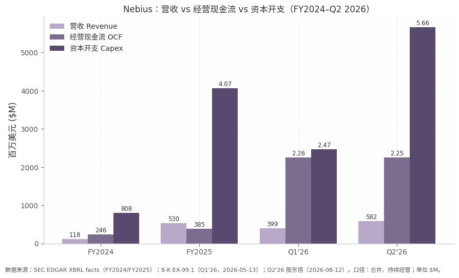

*图 5-1：Nebius 营收 vs 经营现金流 vs 资本开支。数据来源：SEC EDGAR XBRL facts（FY2024/FY2025 年度合并口径）；8-K EX-99.1（Q1 2026，2026-05-13 备案）；Q2 2026 股东信（2026-08-12）。单位：百万美元。图中 OCF 自 2026 年起为客户预付款驱动，不可与营收直接比较为"造血能力"。*

### 5.2 资金效率指标

#### 5.2.1 Capex 强度：7–9.7x 营收，远高于 CoreWeave ~2.9x 与 hyperscaler 0.25–0.86x

以 capex/营收衡量资本强度，Nebius 处于公开 AI 基础设施公司的最高一档：FY2024 为 6.9x，FY2025 为 7.7x，Q2'26 单季达 9.7x，FY2026 指引中值（capex $22.5B / 营收 $3.2B）约 7.0x。对照之下，CoreWeave FY2026E 约 2.9x，hyperscaler 2026E 仅 0.25–0.86x [^3^][^9^]。

| 公司（FY2026E 口径） | Capex 指引 | 营收指引 | Capex/营收 |
|---|---|---|---|
| Nebius (NBIS) | $20–25B | $3.0–3.4B | **~7.0x** |
| CoreWeave (CRWV) | $35–39B | $12.4–13.2B | **~2.9x** |
| Hyperscalers（五大参考区间） | 合计 ~$650–725B | — | **0.25–0.86x** |

[^3^][^9^][^11^]

这一差距需要作归因拆解，而非直接读作"效率低下"。其一，营收确认时点差异：Nebius 在 2026 年签约的大额合同对应产能多数于 2026 年末至 2027 年才上线，当期分母被人为压小，capex 领先收入的"先投资、后确认"特征显著 [^1^]。其二，资产模式差异：Nebius 超过 75% 的产能为自建数据中心（前置资本重、长期毛利高），CoreWeave 几乎全部为托管租赁（前置资本低，但成本中含房东毛利），两者 capex 强度天然不可比 [^4^]。其三，基数效应：CoreWeave 营收体量约为 Nebius 的 4–5 倍（Q2'26 $2.58B vs $0.58B），规模摊薄了强度指标 [^2^]。**【判断】** 合理的读法是：Nebius 选择了三种模式中资本最重的路径，其回报兑现完全押注于 2027 年后的收入爬坡。

#### 5.2.2 预付款模式 = 负现金转换周期：70% 新签含预付款、覆盖 50–60% capex；增量 ARR/capex 稳态约 $0.55/年

"现金转换周期"（cash conversion cycle, CCC）衡量企业从投入现金到收回现金的时间长度；Nebius 的预付款模式使其 CCC 实质为负——即**在确认收入之前 6–18 个月就已收到客户现金**，把重资产行业惯常的"先建后收"反转为"边收边建"。Q2'26 签约交易中约 70% 含预付款条款，预付款覆盖对应 capex 的 50–60%；管理层指引 2026 全年客户预付款将超过 $9B，CFO Dado Alonso 明确表示这"directly reduces our need for debt and equity financing" [^1^][^7^]。H1'26 递延收入现金流入 $4,395M 已经验证了这一节奏 [Source: SEC EDGAR — Form 6-K Q2 2026 Ex-99.2]。

与负 CCC 配套的另一个关键指标是"增量 ARR/capex"——每投入 $1 资本开支，能新增多少年化经常性收入。当年表观口径下，2026 年 ARR 预计从 ~$1.2B 升至指引中值 $8B，增量 $6.8B ÷ capex $22.5B ≈ $0.30，这一数字被建设周期压低（Q2 签约产能主要贡献 2027 年收入）[^1^]。更能反映合同经济学的是稳态口径：Q2 新签交易 ACV 达 $20–25M/MW，管理层披露含运维成本的 capex 回收期已缩短至 1 年 10 个月（此前为 2–3 年），隐含稳态下每 $1 capex 对应年化收入约 $0.55（12/22），即 capex 年化收益率超过 50% [^1^]。短期溢价合同（3–6 个月）定价已达 $40–50M/MW，首次产能拍卖成交价较此前 Blackwell 最高定价高 15% [^1^][^5^]。若该合同经济学在 2027 年兑现，当前看似极端的 capex 强度将被收入快速摊薄；反之，若回收期假设建立在当前卖方市场的定价高点上，则稳态 $0.55 的测算存在周期性高估风险。

预付款模式的代价同样需要计入：预付款是对未来交付的负债，公司披露其中"含可能可退还款项"，并对大额客户预付款确认利息费用（视同含融资成分）[Source: SEC EDGAR — Form 6-K Q2 2026 Ex-99.2, Note 4]。一旦建设延期或客户行使合同中的退出/重谈条款，负 CCC 会瞬间反转为退款压力，且收入确认后置会持续放大报表亏损。

#### 5.2.3 与 CoreWeave 对比：Nebius 低杠杆高 capex 强度 vs CRWV 高杠杆（$35B 债务）——两种风险形态

Nebius 与 CoreWeave 代表了 neocloud 行业融资的两种极端形态。CoreWeave 走的是债务驱动路径：上市以来发债 $18.8B（vs 股权融资仅 $3.5B），Q1'26 净债务达 $22.6B，总债务约 $32–35B，Q2'26 单季净利息支出 $640M、占营收 24.9%——利息负担已实质吞噬经营利润 [^9^][^11^]。Nebius 走的是"客户现金 + 准股权"路径：以预付款覆盖 50–60% capex，辅以低票息可转债（票息 1.00%–3.00%）、NVIDIA 预付权证与 ATM 增发；Q1'26 末仍为净现金约 +$0.9B（现金 $9.3B vs 总债务 $8.47B），Q2 末因单季 capex $5.66B 才转为温和净债务（账面约 -$0.5B），单季利息费用 $119.1M，仅为 CoreWeave 的约 1/5 [Source: SEC EDGAR — Form 6-K Q2 2026 Ex-99.2] [^4^][^9^]。

两种形态的风险性质截然不同。CoreWeave 的风险是**杠杆风险**：capex/营收仅 2.9x 看似高效，但高固定利息支出使其在需求下行或再融资环境收紧时缺乏缓冲，且几乎全租赁的轻资产模式不留有硬资产抵押余量。Nebius 的风险是**执行与稀释风险**：capex 强度约 7x、FY2026 指引 $20–25B，要求公司在股价高位持续动用 ATM（Q2 已发 12.7M 股、均价 $223.6、募资 $2.8B，余量约 12.3M 股）、并指望 >$9B 预付款如期到账 [^1^][^9^]。io-fund 在 Q1 时点测算，中值 capex 下 Nebius 尚有约 $6.3B 增量融资缺口，主要靠 ATM（全部用完摊薄约 8%）与资产支持/公司债弥合 [^9^]。公司 7 月完成的首笔 $775M 资产支持融资（SOFR+2.50%，以已部署 GPU 与投资级客户合同现金流作保）验证了"以 $40B+ 客户承诺为信用支点"的可复制债务框架 [Source: SEC EDGAR — Form 6-K, acc. 0001104659-26-084452, Ex-99.1, 2026-07-17] [^1^]。

**【判断】** 市场定价已体现两种形态的差异：Nebius 以约 CoreWeave 1/5.6 的营收获得更高的市值（$75.5B vs ~$58B），EV/2026E 营收约 23x vs 约 8x——溢价的核心正是"净现金起步 + 客户预付"的资产负债表质量。但这一溢价的反面是：Nebius 模式对"股价—融资能力"正反馈的依赖远深于 CoreWeave 对债务市场的依赖；一旦 capex 交付或预付款到账不及预期，其资金拼图的收缩速度也会更快。这一现金流结构层面的矛盾，将在第 12 章的核心矛盾分析中进一步展开。

## 6. 客户分析

Nebius 的客户结构呈现清晰的三层金字塔：塔尖是 Microsoft 与 Meta 两家投资级 hyperscaler 锚定客户，中层是 2026 年起快速放量的 AI 原生模型公司与垂直行业客户，底层是企业与初创长尾。截至 2026Q2，公司口径的客户承诺（customer commitments）总额已超过 $40B[^10^]，这一积压的规模、期限与条款质量构成公司估值叙事的核心支撑。本章逐一拆解锚定合同条款、集中度事实与合同质量，集中度风险的估值含义留待第 12 章讨论。

### 6.1 锚定客户合同

#### 6.1.1 Microsoft：$17.4-19.4B 的五年期锚定合同

2025 年 9 月 8 日，Nebius 与 Microsoft 签订五年期 AI 基础设施协议，基础合同额约 $17.4B，若 Microsoft 行使增购选项可扩至约 $19.4B，收入以月度计费方式确认至 2031 年 10 月[^1^][^3^]。合同标的为 Vineland（新泽西州）300MW 数据中心的专属算力产能，供 Microsoft 内部大模型与消费级 AI 助手团队使用。GPU 型号与数量公司公告及 6-K 均未披露；Bloomberg 援引知情人士称规模超过 10 万块 NVIDIA GB300 GPU，约 1,400 个 NVL72 机架则为媒体按每机架 72 卡的推算（二手转述/媒体推算，未经公司确认）[^4^]。

该合同的条款设计有三点值得拆解。第一，付款义务为 take-or-pay 性质（与实际使用率无关），且包含合计约 $6.96B 的预付款——约占基础合同额的 40%——但预付款与部署里程碑和可用性达标挂钩，而非签约时一次性支付[^2^]。第二，交付分为 9 个 tranche（批次）于 2025-2026 年滚动进行，首批已于 2025 年 11 月交付、第二批于 2026 年 2 月交付；若 Nebius 延误或达不到 uptime 承诺，Microsoft 可获得服务抵扣乃至终止单个 tranche 的权利[^2^][^3^]。这意味着合同总额并非无条件锁定：执行风险被结构化地保留在 Nebius 一侧，任一 tranche 的交付失败都可能触发局部终止而非整体违约。第三，合同现金流被明确用于为对应 capex 融资——Microsoft 实质上以预付款形式为 Nebius 的数据中心建设提供了"客户出资"的表外资金[^2^]。截至 2026Q2 财报电话会，管理层确认已向 Microsoft 交付截至当季末的全部承诺批次[^26^]。

#### 6.1.2 Meta：从 ~$3B 首单到最高 $27B 的期权式扩容

Meta 的合作分两步演进。2025 年 11 月 11 日，双方签订首份约 $3B、五年期合同，要求签约后 3 个月内完成容量部署；CEO Volozh 在当季电话会上披露，该合同需求"overwhelming"，规模受限于当时可用产能——"if we had more, we could have sold more"[^5^][^13^]。

2026 年 3 月 16 日，双方签订第二份五年期协议，名义价值最高约 $27B，结构上分为性质迥异的两部分[^7^]：(a) $12B 专属容量承诺，基于 NVIDIA Vera Rubin 平台的全球首批大规模部署之一，多地交付、2027 年初开始上线[^7^]；(b) Meta 承诺购买最高 $15B 的"溢出"容量——Nebius 有权先将这些集群转售给第三方 AI 云客户，剩余部分由 Meta 兜底购买。CRO Boroditsky 在 Q1'26 电话会上明确，该结构可支持资产抵押融资，且"若市场保持强劲，这份协议实际产生的收入有望超过 $27B"[^8^]。叠加首份合同，Meta 对 Nebius 的名义承诺合计约 $30B[^22^]。

需要强调 $15B 部分的期权属性：它不是无条件采购承诺，而是 Meta 以兜底义务换取对 2027-2028 年紧缺产能的优先锁定权。对 Nebius 而言，该条款在执行中反而降低了对 Meta 的实际依赖——公司可优先以更高市价将产能售予第三方[^8^][^9^]；但其代价是这部分"承诺"的收入确定性显著低于 take-or-pay 条款。

#### 6.1.3 2026Q2 四笔 >$1B 大单与垂直客户

2026Q2，公司签下四笔平均 TCV 超过 $1B 的里程碑合同，收益率 $20-25M/MW，以 1-3 年中期合同为主，针对 2026 年底上线的产能签约、主要贡献 2027 年收入[^10^]。客户全部来自非 hyperscaler 群体：**Reflection AI**（前 DeepMind 研究员创立的开放权重模型公司，多年期协议、金额超 $1B、GB300 算力供应至 2029 年）；**Cohere**（企业级 agentic AI）；一家未具名的美国前沿模型"neolab"；以及一家美国大型量化交易公司——公司在金融服务领域的首个大规模客户[^10^][^12^]。

垂直行业方面，标杆客户包括 Yann LeCun 联合创立的 world-model 公司 AMI，以及在 Nebius 上训练 280 亿参数生物基础模型 EDEN 的 Basecamp Research（训练速度较其原内部环境快 20 倍）[^10^]；此前电话会还点名 Black Forest Labs、Courser 等 AI 原生客户[^13^]。

对手方信用须在此提示：Reflection AI 签订 >$1B 合同时尚未发布任何公开模型，同期还向 SpaceX 承诺最高约 $6.3B 的算力采购，且其 SpaceX 合同据报道在 3 个月后任一方可提前 90 天解约[^12^]。此类 neolab 客户的偿付能力依赖一级市场持续融资，信用质量与投资级的 Microsoft/Meta 存在量级差距，四笔大单中至少两笔（Reflection 与未具名 neolab）属于此类高风险对手方。

**表 6-1：Nebius 大客户合同明细（截至 2026Q2）**

| 合同 | 公告日 | 金额 | 期限 | 关键条款 | GPU/地点 | 来源 |
|---|---|---|---|---|---|---|
| Microsoft | 2025-09-08 | $17.4B，可扩至 ~$19.4B | 5 年，月度计费至 2031-10 | take-or-pay；预付款 ~$6.96B（挂钩部署里程碑）；9 个 tranche 交付，延误/不达 uptime 可获抵扣或终止单个 tranche | GPU 数量/型号公司未披露；媒体转述 >10 万块 GB300（机架数为媒体推算）；新泽西 Vineland 300MW | [^1^][^2^][^3^][^4^] |
| Meta（首份） | 2025-11-11 | ~$3B | 5 年 | 签约后 3 个月内部署；规模受限于当时可用产能 | 未披露 | [^5^][^6^] |
| Meta（扩容） | 2026-03-16 | 最高 ~$27B | 5 年 | $12B 专属容量（2027 年初起交付）+ $15B 溢出容量兜底承诺（Nebius 可优先转售第三方）；可支持资产抵押融资 | NVIDIA Vera Rubin 首批大规模部署；多地 | [^7^][^8^][^9^] |
| Q2'26 四笔大单 | 2026Q2 | 平均 TCV >$1B/笔 | 1-3 年为主 | 收益率 $20-25M/MW；~70% 含预付款，覆盖关联 capex 50-60%；回收期约 22 个月 | Reflection AI（供至 2029）、Cohere、未具名前沿实验室、量化交易公司 | [^10^][^11^][^12^] |

四份合同的条款梯度揭示了 Nebius 对不同信用层级客户的定价与风险分配逻辑：信用最好的 Microsoft 获得最长账期（月度计费至 2031 年）与最强的履约保护（逐 tranche 终止权），但以 40% 预付款补偿 Nebius 的资本开支；Meta 的 $15B 兜底条款本质是信用增级工具，使对应集群可获得资产抵押融资；而信用最弱的 AI 原生客户则被要求以 1-3 年短约、含预付款的形式签约，将融资风险前置转移。换言之，合同条款的严苛程度与客户信用质量精确反向相关——这既是对集中度风险的部分结构性对冲，也意味着金字塔中层的收入可持续性天然弱于塔尖。

### 6.2 客户结构与集中度

#### 6.2.1 集中度事实：收入、应收款与承诺三个口径

SEC 20-F（FY2025）披露，Customer A 占 FY2025 收入 25%、Customer B 占 15%，前两大客户合计 40%（FY2024 为 A 27%、C 11%）[^14^]。应收账款口径更为极端：截至 2025 年 12 月 31 日，对 Customer D 的应收款 $597.0M，占全部应收账款的 83%——结合 Vineland 首批 tranche 于 2025 年 11 月起交付的时间线，推断 Customer D 为 Microsoft（推断，公司未明示）[^14^]。

承诺积压口径下，Microsoft 已签约部分 ~$17.4B 加 Meta 首份 ~$3B 与扩容专属部分 $12B 合计约 $32.4B，约占公司 >$40B 客户承诺的 80%（本章推算，公司未披露分客户拆分）[^10^]；若再计入 Microsoft $2B 扩容选项与 Meta $15B 兜底承诺，两大 hyperscaler 的名义风险敞口可达约 $49B。第三方分析一致将"Microsoft + Meta 占积压绝大部分"列为头号熊市论点[^19^][^20^]，GuruFocus 对 Q1'26 的负面要点亦明确点名该集中度[^21^]。

**表 6-2：Nebius 客户集中度三口径对比**

| 口径 | 指标 | 数值 | 时点 | 性质 |
|---|---|---|---|---|
| 收入 | 前两大客户（A+B）收入占比 | 40%（25% + 15%）[^14^] | FY2025 | SEC 20-F 披露 |
| 应收账款 | 单一客户（D）应收款占比 | 83%（$597.0M）[^14^] | 2025-12-31 | 披露；对应 Microsoft 为推断 |
| 客户承诺 | MSFT + Meta 已签约部分 / 总承诺 | $32.4B / >$40B，~80%（推断）[^10^] | 2026Q2 | 本章推算 |
| 客户承诺 | MSFT + Meta 名义敞口（含期权式条款） | ~$49B（推断）[^10^][^22^] | 2026Q2 | 本章推算 |

三个口径呈现一致的集中方向，但含义层次不同。收入口径的 40% 反映的是 FY2025 历史交付，随着 2026 年四笔非 hyperscaler 大单及长尾客户放量，该比例预计将被稀释——Q2'26 新客户 TCV 环比增长超 9 倍即为此趋势的量化佐证[^10^]。应收款口径的 83% 则是时点性指标，反映 Microsoft 合同月度计费模式下的未收敞口，其信用风险因对手方为投资级而相对可控。真正具有前瞻意义的是承诺口径的 ~80%：公司未来五年收入的兑现路径在签订层面已绑定两家 hyperscaler 的资本开支周期。缓和因素同样存在：Meta $15B 的可转售设计使 Nebius 可主动以第三方客户替换 Meta 的兜底敞口，客户结构正从"双锚"向"双锚 + AI 原生中层"演变[^8^][^10^]。

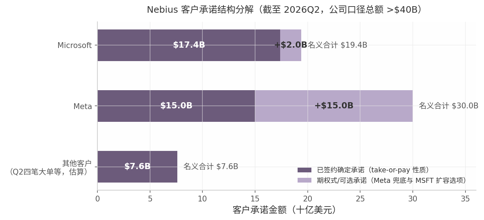

*图 6-1：Nebius 客户承诺结构分解。数据来源：公司公告、Q2'26 股东信[^7^][^10^]；"其他客户"为总额 >$40B 扣除已披露双锚已签约部分后的估算余量。深色段为已签约确定承诺，浅色段为期权式/可选承诺。*

#### 6.2.2 合同质量：预付款驱动的现金流 vs 期权式条款的口径折扣

合同质量最强的证据是预付款渗透率。Q2'26 新签交易中约 70% 含客户预付款（历史新高），预付款覆盖关联 capex 的 50-60%，管理层称"prepayment has become the market standard"[^10^]；公司重申 2026 全年预计收到超过 $9B 客户预付款[^10^]。资产负债表同步验证：递延收入从 2025 年末的 $1.58B 激增至 2026 年 6 月 30 日的 $5.98B，H1'26 经营现金流达 +$4.50B[^25^]。合同还已成为融资抵押品：2026 年 7 月，公司以某投资级客户合同的已部署 GPU 与合同现金流为支持，获得 $775M 担保债务融资（SOFR + 2.50%），覆盖底层 capex 的 100% 以上[^10^]。

但 $40B+ 承诺并非全部为不可撤销的 take-or-pay：Meta $15B 为 Nebius 酌情分配、Meta 兜底购买的混合结构，Microsoft $19.4B 中 $2B 为可选增购。剔除这两部分后，纯不可撤销承诺估计在 $32-35B 量级（第三方估算，推断口径）[^10^][^19^]。期限结构上，公司官方框架将合同分为三层：3-6 个月短期紧急需求合同（溢价定价 $40-50M/MW 甚至更高，首笔已于 Q3 初签署）、1-3 年中期核心合同（$20-25M/MW）、以及 5 年以上投资级长约（Microsoft/Meta，用于低成本融资）[^10^]。三层组合在锁定长期现金流的同时保留了捕捉现货溢价的上行弹性，代价是短约占比上升会缩短整体收入可见期。

### 6.3 需求信号

#### 6.3.1 售罄状态与定价权的量化证据

需求强度有五个相互独立的量化信号。其一，持续售罄：Q3'25 公司披露"所有可用产能售罄"[^6^]；Q2'26 CEO Volozh 进一步称"我们今天就可以按这些条款卖掉全部 2027 年产能，但我们刻意不卖"——保留产能以博取更高价格[^10^][^11^]。其二，首次产能拍卖（capacity auction）于 2026Q3 初完成，Blackwell 成交价比公司历史最高价高 15%、比 pipeline 价格高 20%[^10^][^11^]。其三，Q1'26 管理层称每块上线 GPU 有 4 家以上客户争抢[^27^]。其四，旧一代 GPU 定价环比 Q1 上涨超 30%，说明紧缺已从新一代芯片外溢至存量产能[^10^]。其五，Q2 最强交易来自"competitive displacements"——已在使用 hyperscaler 的客户基于规模、集群性能与支持转投 Nebius[^11^]。

**【判断】** 综合看，这些信号指向一个卖方市场：Nebius 当前的核心约束是产能而非需求，管理层"刻意保留 2027 产能"的表态可解读为以收入可见期换取定价权的主动策略。需要对冲指出的是，拍卖溢价 15%、旧卡涨价 30%、短约溢价至 $40-50M/MW 均具有周期顶部特征，若 2027 年后 hyperscaler 自建产能集中投放，当前签约价格水平在到期续约时存在重定价下行风险；该情景对估值的传导路径将在第 12 章展开。

## 7. 竞争格局

AI 云（neocloud）行业当前的竞争结构可分为四层：规模化 neocloud（CoreWeave、Nebius、IREN）、私募 neocloud（Lambda、Crusoe）、由矿企转型的数据中心"房东"（Applied Digital、Core Scientific 等），以及同时扮演最大客户与潜在竞争者双重角色的超大云厂商（Oracle OCI、AWS、Azure、GCP）。一个凸显行业格局特殊性的事实是：Microsoft 同时是 CoreWeave、Nebius、IREN 三家的 anchor（锚定）客户[^15^][^21^][^53^]——超大云厂商的产能缺口是整层 neocloud 需求的共同来源，这也意味着竞争格局与第 8 章讨论的宏观供需周期深度耦合。Gartner 预计到 2030 年 neocloud 厂商将占据 $2,670 亿 AI 云市场的 20%（约 $530 亿），份额之争才刚刚开始[^3^]。

### 7.1 主要竞争对手

#### 7.1.1 CoreWeave：营收 5.6 倍于 Nebius 但市值更低（$58B vs $75.5B）、$35B 债务软肋、backlog $104B

CoreWeave（NASDAQ: CRWV）是 Nebius 最直接的可比公司，也是 neocloud 行业的绝对规模龙头。2026Q2 营收 $2.575B（同比 +112%），TTM 约 $7.6B，约为 Nebius TTM 营收（$1.36B）的 5.6 倍；公司将 2026 全年指引上调至 $124–134 亿，并维持 2026 年底年化收入 run-rate $180–190 亿的目标[^9^][^10^][^11^]。需求可见性方面，其收入 backlog 达 $1,042 亿（同比 +246%），且尚未计入 Q3 初新增的逾 $250 亿承诺[^9^][^12^]。产能上，CoreWeave 活跃电力已达 1.5GW（Q2 单季新增近 500MW，为历史最高，共 51 座数据中心），签约电力约 3.7–4.2GW，目标 2030 年至少 8GW[^13^][^12^][^14^]。客户结构覆盖 Microsoft（anchor）、OpenAI（合同累计 $224 亿）、Meta（两份协议累计 $350 亿）、Anthropic、Jane Street（另有 $10 亿战略投资）等[^15^][^10^][^16^]；技术上完成了业内首个 NVIDIA Vera Rubin NVL72 上线验证[^12^]。

CoreWeave 的软肋在资产负债表。Q2 GAAP 净亏损 $626M，单季净利息支出高达 $640M——占营收的 24.9%（同比 +140%），总债务约 $320–350 亿；尽管调整后 EBITDA 利润率达 59%，利息支出已超过经营层面的造血能力[^10^][^17^][^12^]。其市值约 $570–590 亿，P/S 约 9.2x、EV/S 约 12.9x[^18^][^19^]。由此形成本章最具信息量的现象：CoreWeave 营收 5.6 倍于 Nebius，市值却比 Nebius（$75.5B）低约 23%——市场对两者的定价逻辑截然相反，其解释详见 7.2.2。

#### 7.1.2 IREN（电力资源最强，5GW+，MSFT $9.7B 合同）、Lambda（2026H2 IPO 候选）、Crusoe（Stargate 承建商）、APLD（房东模式）、Oracle OCI（超大云反扑样本）

**IREN（NASDAQ: IREN）** 由比特币矿企转型，是同梯队中电力资源最雄厚的玩家：已锁定电力逾 4.5–5GW（全球最大组合之一），当前运营 810MW，2026 年底目标 480MW AI 云产能、15 万块 GPU[^21^][^24^][^26^]。其核心合同为 Microsoft $97 亿多年期 AI 云合同（满产后年化约 $19 亿、EBITDA 利润率约 85%、含 20% 预付款）与 NVIDIA 五年期 $34 亿合同，另向 NVIDIA 发行最多 $21 亿认股权证；签约 ARR $31 亿，7 月再签 $28 亿新合同后将 2026 年 ARR 目标上调至逾 $40 亿[^23^][^24^][^25^]。IREN 市值约 $156 亿，P/S（TTM）约 27x[^29^][^20^]；主要短板是 Bernstein 指出其在企业级业务建设上"落后于 CoreWeave 和 Nebius"，AI 云收入基数小、确认后置[^30^]。

**Lambda（私有）** 走开发者品牌与低价路线（H100 PCIe 约 $2.49/hr，低于 CoreWeave 的 $4.25/hr），客户集中度低于 CoreWeave[^31^][^33^]。2025 年年化收入约 $760M（同比 +79%），云业务毛利率约 61%，净亏损约 $24M[^31^]。其 E 轮估值 $59 亿（2025-11），2026 年二级市场隐含估值 $90–115 亿，已聘请 Morgan Stanley/JPM/Citi，是 2026 下半年 IPO 的热门候选[^31^][^32^]。

**Crusoe（私有）** 是唯一以"能源"（而非 GPU）为核心资产的玩家，自建发电、土地与并网，"speed-to-power"（电力交付速度）构成护城河[^34^]。其为 OpenAI 首个 Stargate 园区（德州 Abilene，1.2GW，造价 $120 亿，Oracle 为算力对手方）的承建商，2026 年 3 月再获 Microsoft 900MW AI 园区订单，电力管线达 45GW[^34^][^36^]。营收从 2024 年约 $276M 增至 2025E 约 $500M，2026 年指引约 $20 亿（一年 4 倍）；E 轮估值 $100 亿，二级市场隐含约 $236 亿[^34^][^35^]。风险信号是 2026 年 6 月因未能锁定 anchor 客户而失去怀俄明园区[^34^]——承建商模式对客户绑定的依赖可见一斑。

**Applied Digital（NASDAQ: APLD）** 并非直接的 GPU 云竞争者，而是"卖铲子"的房东模式可比公司：FY2026（截至 2026-05）营收 $611.3M（+167%），已签长期租约约 1,410MW 关键 IT 负载，对应 15 年基础租约总额约 $360 亿（含续约期权可达 $860 亿），NOI 利润率高达 91%[^37^]。云服务业务已分拆为 ChronoScale 上市，自身转型为纯数据中心 REIT 化平台，市值约 $86 亿、P/S 约 14x[^37^][^38^][^39^]。

**Oracle OCI** 是超大云厂商中最激进的 GPU 云玩家，也是"超大云反扑"的最佳样本：FY2026 Q4 OCI 营收 $58 亿（同比 +93%），单季签 $670 亿 AI 基础设施合同，RPO（剩余履约义务）达 $6,380 亿（同比 +363%），全球 GPU 利用率 97.5%，H100 定价 $5.12/hr 比 AWS 低 58%[^40^][^41^]。但资本市场对其 $430 亿举债与负自由现金流投下不信任票——Oracle 市值约 $4,330 亿，股价一年内下跌约 37%[^42^][^40^]。OCI 的样本意义在于：超大云厂商有能力在 GPU 云上做到 neocloud 数倍体量，但重资产扩张对资产负债表的侵蚀是悬在全行业头上的共同问题。

下表汇总六家主要可比公司的关键指标（数据截至 2026-08-14/16）：

| 公司 | 营收（TTM/最新年化） | 增速 | 产能（电力） | 市值/估值 | 估值倍数 | 主要客户 | 核心差异化 |
|---|---|---|---|---|---|---|---|
| **Nebius (NBIS)** | TTM ~$1.36B；Q2'26 $582M；ARR $3.0B | Q2 +454% YoY；ARR +598% | 签约电力目标 5GW；2026 并网 0.8–1GW | $75.5B | P/S ~56x [^2^]；现金 $8B | Microsoft（$17B+）、Meta（最高 ~$27B）、Reflection、Cohere | 全栈自研、定制 ODM 机箱 TCO 最低、欧洲主权布局、NVIDIA 持股 9.3% [^1^][^49^][^50^] |
| **CoreWeave (CRWV)** | TTM ~$7.6B；Q2'26 $2.58B | Q2 +112% YoY | 活跃 1.5GW；签约 ~3.7–4.2GW；2030 目标 8GW | ~$57–59B | P/S ~9.2x；EV/S ~12.9x [^18^]；债务 ~$35B | Microsoft、OpenAI（$22.4B）、Meta（$35B）、Anthropic | 规模最大、backlog $104B、首个上线 Vera Rubin NVL72；利息吞噬利润 [^9^][^12^][^15^] |
| **IREN (IREN)** | TTM ~$757M；签约 ARR $3.1B→目标 >$4B | 转型期波动；FY26 预测 +158% | 锁定 >5GW（运营 810MW）；2026 底 480MW/15 万 GPU | ~$15.6B | P/S ~27x [^29^] | Microsoft（$9.7B）、NVIDIA（$3.4B+权证） | 自有土地+电力+100% 可再生，垂直一体；企业软件能力弱 [^20^][^21^][^24^] |
| **Lambda（私有）** | 2025 年化 ~$760M | +79% YoY | 未披露（万卡级集群） | E 轮 $5.9B；二级 $9–11.5B | 二级约 12–15x 年化收入 | 开发者、AI 实验室、企业 | 开发者品牌+激进低价；2026H2 IPO 候选 [^31^][^32^] |
| **Crusoe（私有）** | 2025E ~$500M；2026 指引 ~$2B | +81% YoY；2026 指引 4x | Abilene 1.2GW；45GW 管线 | E 轮 $10B；二级 ~$23.6B | 二级 ~12x 2026 指引 | OpenAI/Oracle（Stargate）、Microsoft（900MW） | 能源垂直整合（自建发电），speed-to-power [^34^] |
| **Applied Digital (APLD)** | FY26（5 月止）$611M | +167% YoY | 已租 1,410MW IT 负载（$36B 合同额） | ~$8.6B | P/S ~14x [^39^]；NOI 利润率 91% | 投资级超大云客户（未具名） | 数据中心包租/REIT 化，15 年长约 [^37^] |
| **Oracle OCI (ORCL)** | OCI 年化 ~$23B（Q4 $5.8B） | OCI +93% YoY | FY26 交付 1.2GW；FY27Q1 近 1GW | ~$433B（集团） | RPO $638B；GPU 利用率 97.5% | OpenAI（Stargate）、xAI、Meta | 超大云规模 + BYO GPU/预付模式转移资本压力 [^40^][^42^] |

*注：私有公司（Lambda、Crusoe）数字来自融资文件与媒体报道，未经审计；Nebius TTM 营收为 Yahoo Finance 口径。*

表格揭示的第一个异常值是 Nebius 的估值列：其 P/S（约 56x）是 CoreWeave 的 6 倍、IREN 的 2 倍，而其营收体量在五家 neocloud 中仅列第三。第二个结构性特征是分化出的两条产能路线——CoreWeave 以"活跃电力"（1.5GW）领先兑现收入，而 IREN、Crusoe、Nebius 以"签约/锁定电力"（各 5GW 量级）储备未来，当前收入与远期产能的错位正是估值分歧的来源。第三，客户列显示 Microsoft 出现在四家公司（CoreWeave、Nebius、IREN、Crusoe）的客户名单中，表明 neocloud 之间的竞争本质上是对同一批 hyperscaler 外溢产能需求的分配之争，谁的资产负债表能撑到 2027–2028 年交付高峰，谁才能把签约电力转化为收入。

### 7.2 Nebius 的相对位置

#### 7.2.1 优势：全栈自研（SemiAnalysis 认证 TCO 最低）、50% 分部 margin、净现金起步、NVIDIA 持股 9.3%、欧洲主权 AI 卡位

**全栈自研与 TCO（总拥有成本）**。Nebius AI Cloud 3.6 "Aether" 为全栈自研，向上延伸至推理平台 Token Factory（支持 60+ 开源模型，推理成本/延迟最高降 70%，Q2 推理负载增长 3 倍）[^48^][^50^]。SemiAnalysis 首席分析师 Dylan Patel 公开表示："Nebius 是唯一使用定制 ODM 机箱的 neocloud，这转化为大幅更低的 TCO"[^50^]；其 MLPerf Training v5.1 在 Blackwell/Blackwell Ultra 上取得领先成绩[^49^]。

**利润率**。成本优势直接兑现为利润率：AI 云分部调整后 EBITDA 利润率达 50%（Q2 口径 $285.7M），而 CoreWeave 调整后经营利润率仅低个位数（2026Q1 约 1%）[^53^][^12^]。支撑因素是自有产能占签约电力逾 75%（免去向"房东"支付利差）与芬兰旗舰 AI 工厂的北欧廉价低碳电力、自然冷却[^51^][^52^]。

**资产负债表质量**。Nebius 以净现金状态起步扩张：Q2 末现金 $8.04B，单季利息支出仅 $119M（CoreWeave 为 $640M）；70% 新签合同含客户预付款，可覆盖对应 capex 的 50–60%，2026 年预期预付款逾 $90 亿；并以逾 $400 亿客户承诺为支撑完成首笔 $775M 资产担保融资（SOFR+2.5%）——融资成本远低于 CoreWeave 的高息债务结构[^1^][^53^][^54^]。

**NVIDIA 深度绑定**。NVIDIA 披露持有 Nebius 9.3% 被动股权（2,226 万股，其中约 2,100 万股为 2026 年 9 月 11 日前不可行权的 $2B 预付权证），双方计划到 2030 年部署超 5GW NVIDIA 系统[^7^][^55^][^56^]——这既保障 GPU 分配，也构成供给端的单点绑定。

**欧洲主权 AI 卡位**。Nebius 是欧洲最大 neocloud，数据中心遍布芬兰、英国、冰岛、法国、西班牙、爱沙尼亚；GDPR 与 EU AI Act 驱动的主权云需求被 Gartner 列为 neocloud 的关键差异化维度[^57^][^3^]。

#### 7.2.2 劣势：估值溢价 2.8x vs CRWV、并网产能落后（YE26 0.8–1GW vs CRWV 1.5GW）、融资依赖股价

**估值溢价与"估值倒挂"**。截至 2026-08-14，Nebius 市值（$75.5B）已反超 CoreWeave（约 $58B）约 30%，尽管其 TTM 营收仅为后者的约 1/5.6，形成显著的"估值倒挂"[^2^][^18^] [Source: Yahoo Finance — get_stock_info (NBIS & CRWV), as of 2026-08-14]。其竞争含义在于：市场在为资产负债表质量与增长确定性支付溢价——Nebius 净现金起步加客户预付款模式、自有数据中心占比逾 75%（分部 EBITDA 利润率 50% 且扩张中，vs CoreWeave 调整后经营利润率仅低个位数（2026Q1 约 1%））、增速快 4 倍（+454% vs +112%）；空头则将溢价归因于动量与空头挤压（空头占流通股 27.6%）而非价值，7 月中"Meta 转售算力"传闻即令 Nebius 单日下跌 17%[^53^][^5^][^58^] [Source: Yahoo Finance — get_stock_info, as of 2026-08-14]。详细估值倍数拆解（P/S、EV/2026E 营收口径及 Daloopa 第三方测算）见第 9 章。

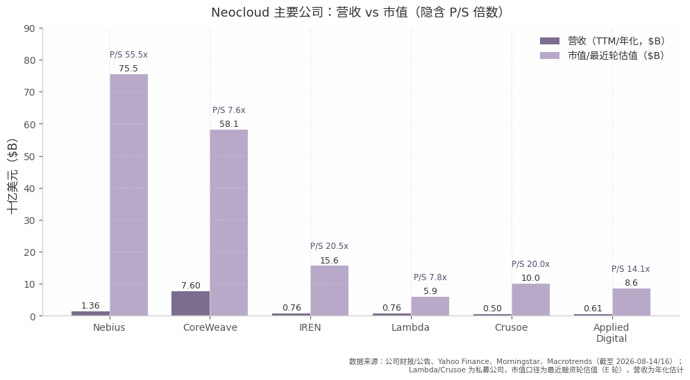

*图：neocloud 主要公司营收 vs 市值对比。数据来源：公司财报/公告、Yahoo Finance、Morningstar、Macrotrends（截至 2026-08-14/16）；营收为 TTM 或最新年化口径，Lambda/Crusoe 为私募公司，"市值"采用最近融资轮估值（E 轮）；P/S 为图内自算口径。*

图中 Nebius 与 CoreWeave 的"市值柱反超、营收柱仅为后者 1/5.6"的镜像关系是全表最突出的对比（**【判断】**）；IREN、Crusoe 约 20x 的隐含 P/S 介于两者之间，市场对"电力资源型"玩家同样给予期权式定价，而 CoreWeave 因债务负担未获板块溢价。

**并网产能落后**。Nebius 2026 年底并网电力预计仅 0.8–1GW，而 CoreWeave 活跃电力已达 1.5GW、年底目标 1.85GW；Nebius 大部分 2026 年签约产能下半年才上线，收入贡献主要集中在 2027 年[^59^][^14^]。

**融资依赖股价**。2026 年 capex 指引 $200–250 亿（2025 年为约 $41 亿），管理层称约 60% 可由现有资源覆盖，其余依赖 ATM 增发（Q2 已发行 1,270 万股、均价 $223.6、募资 $28 亿）与债务[^60^][^61^][^53^]。这意味着融资成本与股价互为因果：股价越高，单位融资的稀释越少；一旦股价因交付延误或需求质疑大幅下跌（如 7 月单日 -17%），融资飞轮的效率将急剧恶化[^58^]。

**客户集中**。Microsoft 与 Meta 合计占逾 $400 亿客户承诺的大头（约 80%），与 CoreWeave 同样面对"超大云客户即潜在竞争者"的结构性风险[^53^][^30^]。

### 7.3 竞争动态

#### 7.3.1 卖方市场现状：CoreWeave 提价 25%、GPU 合约价反弹 40%；最大威胁=hyperscaler $700B capex 自建+Meta 转售算力

2026 年年中，GPU 云行业处于明确的卖方市场。价格证据链完整：CoreWeave 7 月对全线产品提价约 25% 且未出现需求破坏，Q2 新签合同的贡献利润率比近几个季度高 5–10 个百分点[^4^]；H100 一年期合约价从 2025 年 10 月低点约 $1.70/hr 反弹约 40% 至 2026 年 3 月的约 $2.35/hr（SemiAnalysis 指数）[^64^]；Blackwell（B200）现货价 2026 年 2–4 月暴涨 48%[^66^]；Nebius 首次产能拍卖成交价比 Blackwell 历史最高价还高 15%，短期溢价合同达每 MW 年化 $40–50M[^6^][^53^]。老旧硬件同样受益：CoreWeave 新签 A100 合同延至 2029 年且"价格有吸引力"，说明供不应求覆盖全部代际[^14^]。在此环境下，NVIDIA 扮演了"AI 中央银行"的角色——通过收入兜底（backstop）计划与股权投资（Nebius 9.3%、IREN 权证、CoreWeave、Crusoe）帮助二线 neocloud 获得项目融资，实质是在防止算力买家过度集中于少数 hyperscaler[^8^][^7^]。

对竞争格局的最大威胁并非来自 neocloud 内部，而是超大云厂商的自建与角色反转。四大 hyperscaler 2026 年合计 capex 指引约 $6,900–7,250 亿（同比 +75% 左右），是整个 neocloud 行业体量的数十倍[^44^][^45^]；Oracle OCI 以 +93% 的增速证明超大云可在 GPU 云上反超[^40^]。最直接的威胁信号出现在 2026 年 7 月初：Meta 释放"将对外出租过剩 AI 算力"的信号（实质上从客户变供应商），叠加 Bernstein 看空报告，neocloud 板块一周重挫——IREN 跌 23%、Nebius 单日跌 17%[^30^][^58^]。当前存在三重结构性缓冲：其一，超大云自身仍缺产能（Microsoft 公开表示产能不足，同时向 Nebius/CoreWeave/IREN 三家外购算力）；其二，超大云 GPU 挂牌价为 neocloud 的 3–5 倍（H100 按需 $11+/hr vs neocloud $2–4/hr），价格带不直接重叠；其三，Gartner 认为主权云、AI 优化与灵活部署给了 neocloud 到 2030 年 20% 份额的空间[^44^][^46^][^3^]。Nebius 管理层自身也在为周期反转做准备——联创 Roman Chernin 称应为"冬天"做好准备、发展高毛利服务，届时 Nebius 可凭借资产负债表质量充当行业整合者[^57^]。这一表态与 7.2.2 的"质量溢价"逻辑互为印证：在卖方市场阶段，竞争的胜负手是交付速度；而当周期转向时，胜负手将切换为资产负债表。

## 8. 行业市场环境：增长还是萎缩

本章直接回答这一问题：截至 2026 年中，Nebius 所处的 AI 云/GPU 云基础设施市场**明确处于增长而非萎缩状态**——主流机构对 2025–2030 年的复合增速预测落在 ~20%–58% 区间（视口径而定），2026 年四大 hyperscaler 资本开支同比 +67%~77%，GPU 租赁合约价格自 2025 年 10 月低点反弹约 40%，头部 neocloud 厂商产能基本售罄。但空头论据（循环交易、折旧口径、企业 AI ROI 缺失）真实存在，主要指向估值与融资结构风险及 2027 年后可能的周期性回调，而非当前需求萎缩。这是一个"高增长 + 高争议"的市场。

### 8.1 市场规模与增速

#### 8.1.1 TAM：多口径下的一致方向

不同机构对 AI 基础设施市场的统计口径差异极大——硬件出货、云服务收入、全栈支出不可直接相加，但没有任何主流机构预测该市场在 2025–2030 年收缩。

| 机构（日期） | 统计口径 | 基期规模 | 预测规模 | CAGR |
|---|---|---|---|---|
| IDC（2026-07） | AI 基础设施硬件（服务器/存储/网络） | 2025 实际 $318B（2024: $153B，+107.6%）[^1^] | 2026E $487–497B（+53%）；2029 超 $1.08T；2030 达 $1.21T [^1^][^2^] | ~30% [^1^] |
| Gartner（2026-06-23） | 全球 AI 云市场（服务收入） | — | 2030 年 $267B，其中 neocloud 占 20%（~$53B）[^3^] | — |
| Gartner（2026-05） | 全栈 AI 支出（硬件+软件+服务） | 2025 ~$1.5T+ | 2026E $2.59T（+47% YoY），其中 AI 基础设施子项 ~$1.37T [^2^] | — |
| Dell'Oro（2026-02-11） | 全球数据中心 capex（全部运营商） | 2025 ~$800B 量级 | 2026 接近 $1T；2030 达 $1.7T，加速服务器届时占 ~2/3 [^4^] | ~15–20% |
| McKinsey（2025，2026 引用） | 全球数据中心建设累计支出 | — | 至 2030 累计 ~$6.7T（其中 AI 设施 ~$5.2T）[^5^] | — |
| Synergy Research（2026-04-02） | Neocloud 收入（GPUaaS/GenAI 平台/高密度托管） | 2025 全年 >$25B；Q4 $9B（+223% YoY）[^6^] | 2031 接近 $400B [^6^] | 58% [^6^] |
| JLL（2026 引用） | 全球数据中心容量（GW） | ~103 GW | 2030 ~200 GW，需 ~$3T 新投资 [^7^] | 容量翻倍 |

对上表的两点解读。其一，**口径越宽增速越低、口径越聚焦 GPU 云增速越高**：宽口径基础设施支出（IDC ~30%、Dell'Oro 15–20%）反映的是包含存量数据中心改造的总量市场，而 Nebius 直接所处的 neocloud 细分是整个云行业中增速最高的板块（Synergy 58% CAGR）。其二，第三方商业研究机构（Straits/Mordor 等）给出的 GPUaaS 绝对值口径差异巨大（2025 年 $5.7B–$8.2B 不等），应以 IDC、Gartner、Dell'Oro、Synergy 四家为主锚；即便取最保守的 ~20% CAGR，结论方向也不变——市场在扩张[^8^][^9^][^11^]。

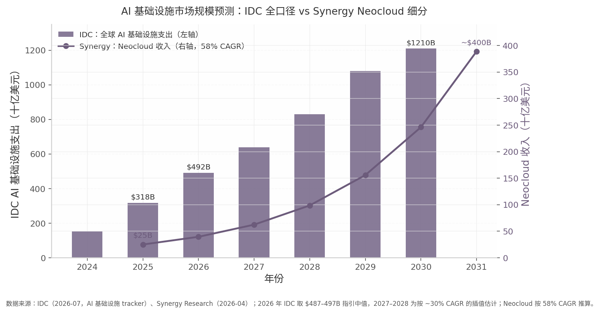

*数据来源：IDC（2026-07，AI 基础设施 tracker）[^1^]、Synergy Research（2026-04）[^6^]；2026 年 IDC 取 $487–497B 指引中值，2027–2028 为按 ~30% CAGR 的插值估计；neocloud 收入按 58% CAGR 推算。左轴为 IDC 全口径支出，右轴为 Synergy neocloud 收入。*

上图的核心信息是两条曲线的**斜率差**：IDC 口径的 AI 基础设施支出从 2025 年 $318B 增至 2030 年 $1.21T，五年约 3.8 倍；而 neocloud 细分从 2025 年约 $25B 增至 2031 年约 $400B，六年约 16 倍。这意味着即便全市场增速在 2027 年后正常化，neocloud 凭借份额抢夺（从 hyperscaler 主导的存量市场中切增量）仍有望维持显著高于行业的增速——Gartner 亦预测 2030 年 neocloud 将占 $267B AI 云市场的 20%[^3^]。

#### 8.1.2 Hyperscaler 资本开支：需求端的直接证据

需求端最硬的指标是头部云厂商的资本开支指引。四大 hyperscaler（Microsoft、Google、Amazon、Meta）2026 年合计 capex 指引约 $690–725B，中值 ~$705–710B，对比 2024 年 ~$230B、2025 年 ~$402B，两年翻三倍，2026 年同比 +67%~77%[^13^][^14^][^15^]。分项看，Amazon 指引 ~$200B、Microsoft ~$190B（FY 口径）、Alphabet $175–185B（其后传上调至 $195–205B）、Meta 已上调至 $125–145B[^14^][^16^]。Moody's 进一步将六大（含 Oracle、CoreWeave）2026 年 capex 预测上调至 $785B、2027 年接近 $1T，理由是 2026Q1 云收入增速创 2021 年以来新高、三大云两个季度新增约 $700B 剩余履约义务（RPO）[^18^]。CreditSights 则指出 top-5 hyperscaler 2026 年 capex 约 $750B，为**连续第三年增速超过 60%**[^19^]。资本开支指引的持续上修——而非下修——是当前市场处于扩张期最直接的信号。

### 8.2 供需格局

#### 8.2.1 供不应求：价格、产能与瓶颈的三重证据

供给紧张的证据在 2026 年上半年重新强化。SemiAnalysis 称 2026 年初 GPU 租赁市场"为 2023 年以来最紧"，H100/H200 一年期合约价在 2025 年 10 月至 2026 年 3 月间上涨约 40%，被跟踪的 neocloud 中有一半报告完全没有 Hopper 产能释放[^20^]。需要澄清的是，H100 现货价较 2023 年峰值下跌约 65–75% 属供给扩张与代际更替的正常化，而非需求崩塌：更能反映真实供需的一年期合约价自低点反弹 40%，且 2026 年 A100/H100/H200/B200 多代价格齐涨，说明推理需求正在为"过时"硬件托底[^27^][^28^][^32^]。

价格结构的分化同样说明问题。截至 2026 年 8 月，H100 现货约 $2.72/hr（3 个月 -10.8% 但周环比转正），H200 现货约 $4.51/hr，B200 现货约 $5.72/hr 且 3 个月上涨 9.6%；专家云的 B200 价格在 2026 年 2–4 月间上涨 48%，hyperscaler 渠道的 H100 按需价仍维持在 $6–12/hr[^28^][^30^][^31^]。新一代 GPU（B200，受 HBM 与 CoWoS 产能约束，交期 36–52 周）价格坚挺而老一代温和回落的形态，是典型的换代期市场特征，而非需求全面退潮[^25^][^26^]。

产能端，CoreWeave 2026Q2 收入 $2.58B（+112%），backlog 达 $104–108B（接近同比三倍），管理层称近期产能"实际上售罄"[^33^][^34^]；Nebius 同期营收 +454%，累计客户承诺超 $40B，Q2 连签四笔平均 TCV 各超 $10 亿（>$1B）的合约，70% 交易含预付款，Goldman Sachs 指出其 Q1 产能"提价后仍售罄"[^35^][^36^][^37^]。

行业瓶颈已从 GPU 本身转向电力与 HBM。Gartner 预测 **2027 年 40% 的 AI 数据中心将受电力限制**；美国主要市场新并网排队 24–36 个月（PJM/ERCOT/弗吉尼亚 4–7 年），大型变压器交期 3–5 年、开关柜售罄至 2028 年[^21^][^22^]。Sightline Climate 追踪显示，2026 年美国宣布的 12GW 数据中心中仅约 5GW 真正开工，30–50% 项目面临延期或取消[^23^]。这一瓶颈结构对已经锁定电力的厂商构成护城河，对后来者构成准入壁垒（详见 8.3 及洞察报告相关分析）。

#### 8.2.2 空头证据：需求质量与融资结构的质疑

空头论据不应被回避，其指向的是**周期顶部风险**而非当下萎缩。第一，循环交易质疑：Nvidia 向 OpenAI 投资 $100B，OpenAI 向 Oracle/CoreWeave 购买算力，后者再向 Nvidia 采购 GPU，Nvidia 同时持有 CoreWeave 约 6–11.5% 股权并承担 $6.3B 产能兜底义务；Jim Chanos、Michael Burry 等指其"制造需求"。OpenAI 累计算力承诺约 $1.15T（2025–2035），而 OpenAI 与 Anthropic 年化收入合计仅 ~$44B，约相当于一年 hyperscaler capex 的 6%[^46^][^47^][^48^]。第二，融资结构脆弱：PIMCO 估计 capex 将消耗 hyperscaler 2026–27 年经营现金流的约 94%（三年前仅 ~40%），缺口靠债务与 SPV/ABS 结构填补[^46^][^48^]。第三，企业 AI ROI 缺失：MIT NANDA 研究显示 95% 的企业 GenAI 试点无可衡量的损益表回报；S&P Global 统计 2025 年 42% 的企业放弃了大部分 AI 项目（2024 年为 17%）[^49^][^50^]。第四，折旧口径争议：Burry 估算五大 hyperscaler 通过将 GPU 折旧年限拉长至 5–6 年（经济现实约 2–3 年），2026–28 年累计虚增利润约 $176B[^45^]。市场已在为这种不确定性定价：2026 年 6 月 hyperscaler 股票集体下跌 18%，Google 财报超预期仍因 capex 指引盘后跌 4%[^42^]。

### 8.3 结构趋势及其对 Nebius 的含义

**推理取代训练成为主导负载。** 2026 年推理约占全部 AI 算力的三分之二（2023 年仅三分之一）；Gartner 预计 2026 年 55% 的 AI 优化 IaaS 支出用于推理、2029 年超 65%；推理市场规模有望从 2025 年 $106B 增至 2030 年 $255B[^12^][^38^][^39^]。算力建设正从少数巨型训练园区转向"更小、低延迟、地理分散"的推理设施，这对具备训练-推理一体化平台（Nebius Token Factory Q2 推理负载增长超 3 倍）的厂商有利[^53^]。

**欧洲主权 AI 打开结构性窗口。** Gartner 预测 2026 年全球主权云支出 $80B（+35.6%），其中欧洲主权云 IaaS 支出 $12.6B、同比 +83%，2027 年 $23.1B 并首次超过北美[^40^][^41^]。EU AI Act 核心义务 2026 年 8 月生效强化本地化需求，而欧洲 GPU 供给显著落后于美东区域，为 Nebius（芬兰/爱沙尼亚/英国/法国/西班牙布局）等欧洲本土 neocloud 留出时间窗口[^24^][^52^][^3^]。

**行业整合预期指向 2027–2030。** 目前前五大 neocloud 占该板块 55–65% 收入，市场预期 2027–2030 年二三线厂商被整合，头部向"多元化 AI 云平台"演进[^54^]。同时 hyperscaler 开始反噬：2026 年 Google 与 Blackstone 推出 compute-as-a-service 合资，Meta 公开表示"完全可以"对外出租算力；McKinsey 以 Cloud 1.0 时代为鉴，指出当年填补算力缺口的独立厂商最终多被"收购、边缘化或逼入利基"[^51^]。

**【判断】对 Nebius 的含义可以归纳为一句话：当前需求证据全面支持其扩张叙事，核心不确定性在 2027 年之后。** 顺风方面，其所处细分是云行业增速最高的板块（58% CAGR），供不应求与卖方定价权直接兑现为 $40B+ 客户承诺、约 $40M/MW 的年化合约价值和缩至 1 年 10 个月的回本周期；5GW 签约电力在"电力为王"的瓶颈结构下相当于稀缺期权；欧洲主权 AI 与推理浪潮均与其资产布局精准契合[^6^][^35^][^36^][^53^]。风险方面，若 AI 资本开支周期在 2027 年见顶回调、循环交易退潮，neocloud 作为高杠杆、高折旧、客户集中的二阶衍生敞口，回撤弹性将大于 hyperscaler；GPU 现货价格的长期通缩趋势意味着其重资产模式依赖合约锁定与利用率，Burry 式折旧质疑同样适用于其资产负债表[^48^][^54^][^45^][^29^]。因此本章的净判断是：问题不在于"市场是否增长"——答案明确是增长——而在于增长能否持续到足以消化全行业每年 $700B+ 的资本开支，以及 Nebius 能否在 hyperscaler 反扑与行业整合到来之前建立平台级护城河。

## 9. 估值分析

截至 2026-08-14，Nebius (NBIS) 的定价已经脱离常规盈利估值框架——TTM P/E 为负（TTM EPS -$0.08），市场实际交易的标的不是当期利润，而是「ARR 从 $3.0B 向 $7–9B 年末指引的交付概率」。本章先给出市场数据快照，再建立「TTM 失真 → 2026E → 2027E」的倍数阶梯与 ARR 口径锚，随后用一张核心表格完成与 CoreWeave (CRWV) 的相对估值（详细竞争论证见第 7 章），最后归纳一致预期、目标价分化与多空论点。

### 9.1 市场数据快照

#### 9.1.1 2026-08-14：高beta、高空头、高动量的三重结构

2026-08-14 NBIS 收盘 $277.68（当日 +8.88%，Q2 财报周累计约 +48%），市值 $75.49B，企业价值（EV）$78.27B [Source: Yahoo Finance — get_stock_info, as of 2026-08-14] [^1^]。52 周区间 $62.01–$299.86，52 周涨幅 +282.8%；行情隐含股本 271.9M 股（与 6-K 法定流通股 271.86M 口径一致），其中自由流通约 238.4M 股 [Source: Yahoo Finance — get_stock_info, as of 2026-08-14]。需要注意两点口径：其一，市值略低于 EV，因为总债务 $10.2B（Yahoo 口径，接近可转债增值本金 $10.04B；账面口径为 $8.55B）略高于现金 $8.0B——Q2 末因单季资本开支 $5.66B，公司已从 2026Q1 末的净现金约 +$0.85B 转为小幅净债务（口径差异见交叉验证报告）；其二，TTM 营收 $1.355B 对应 TTM P/S 55.7x、EV/Sales 57.8x，P/B 9.82x（每股净资产 $28.27）[Source: Yahoo Finance — get_stock_info, as of 2026-08-14]。

交易结构指标解释了该股的波动弹性。Beta 为 1.434，三个月日均成交 20.8M 股；空头头寸 60.2M 股，占流通股比例 27.6%、占股本 23.7%（Yahoo 原始口径；按 6-K 法定流通股本计算约为 22%，按自由流通股约 25%，不同分母导致区间 22-28%），short ratio 2.78 天[Source: Yahoo Finance — get_stock_info, 空头数据日 2026-07-31]；Fintel 8 月中旬口径进一步升至 61.07M 股、占流通股 28.25%[^19^]。机构持股 69.1%，内部人持股仅 3.4% [Source: Yahoo Finance — get_holder_info, as of 2026-08-14]。27.6% 的空头占比在大盘股中属极端水平，意味着估值分歧本身是双向的：任何利空会放大回撤，任何利好（如 Q2 财报）则触发挤压式上涨——财报后单日 +34% 即部分由此驱动[^19^]。

股本口径值得单独说明：$75.49B 市值对应股本 271.9M 股（$277.68 × 271.9M ≈ $75.5B），即行情口径与 Q2 6-K 的法定流通股 271.86M 一致；NVIDIA 权证（21.07M 股，行权价 $0.0001，经济实质等同已发行）尚未计入法定股本，含权证等稀释项的完全稀释股本（约 292.9M 股，见第 4、10 章）更高 [Source: Yahoo Finance — get_stock_info, as of 2026-08-14]。而稀释远未终结：可转债增值后本金 $10.04B、公允价值 $20.8B（深度价内），Q2 末 ATM 额度内尚余约 1,230 万股可用，且 2026–2027 年融资缺口意味着后续增发概率高——空头测算「真实远期倍数」时通常在此之上再假设股本增长，这是其倍数显著高于行情软件显示值的原因之一[^4^][^12^]。

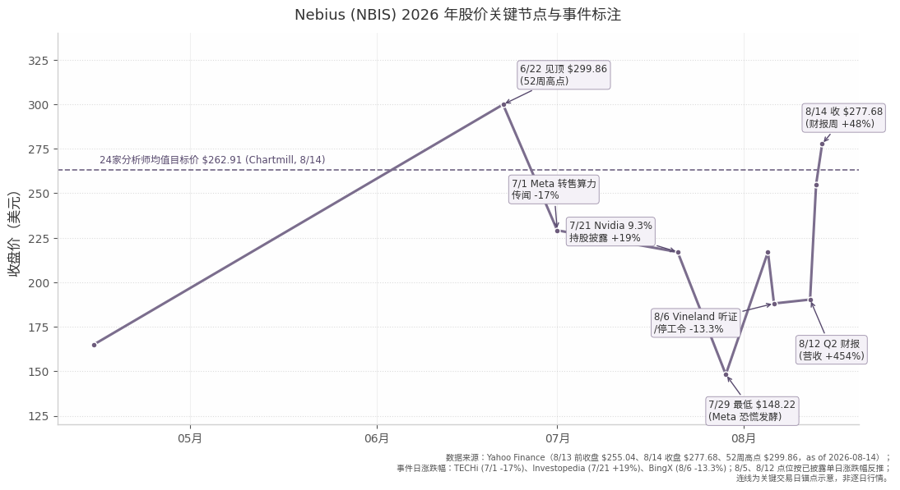

*数据来源：Yahoo Finance（52 周高点 $299.86、8/13 前收盘 $255.04、8/14 收盘 $277.68，as of 2026-08-14）；事件日涨跌幅见 TECHi（7/1 -17%）、Investopedia（7/21 +19%）、BingX（8/6 -13.3%）报道；8/5、8/12 点位按已披露单日涨跌幅反推，连线为关键交易日锚点示意，非逐日行情；均值目标价来自 Chartmill 24 家汇总（2026-08-14）[^8^]。*

上图揭示的定价行为比任何静态倍数都更能说明估值性质：股价从 6/22 见顶 $299.86 到 7/29 最低 $148.22，五周回撤约 51%，期间没有任何合同取消或指引下调——7/1 单日 -17%（蒸发约 $11.9B 市值）仅由「Meta 计划对外转售算力」的传闻触发[^14^]；8/6 Vineland 站点听证与停工令报道再致 -13.3%[^25^][^26^]。而 8/12 Q2 财报（营收 $582.3M、+454%，超一致预期约 $570M）后一周内反弹 48% 至 $277.68[^2^][^3^][^1^]。**【判断】** 这一「传闻 -51%、业绩 +48%」的对称性表明：当前估值对**叙事与交付事件**的敏感度远高于对财务变量的敏感度，可理解为一份高波动率的产能交付期权。

### 9.2 估值倍数

#### 9.2.1 绝对估值：从失真的TTM到交付型远期

TTM 口径的倍数——P/S 55.7x、EV/Sales 57.8x、EV/EBITDA 303x（未调整口径）[Source: Yahoo Finance — get_stock_info, as of 2026-08-14]——存在严重的基数失真：TTM 营收 $1.355B 中约 57% 来自 2026 年上半年（H1 $981M），而 ARR 在 6 月末已达 $3.0B（+598% YoY），即年化收入已是 TTM 的 2.2 倍[^2^][^3^]。用滞后四个季度的爬坡基数去除以前瞻交付定价的市值，得到的 55.7x 既不代表历史也不代表预期，参考意义有限；EV/EBITDA 303x 同理失真（TTM EBITDA 仅 $258M，未调整口径）。

有意义的估值锚在前向口径。以市值 $75.49B、EV $78.27B 计算 [Source: Yahoo Finance — get_stock_info, as of 2026-08-14]：2026E 一致预期营收 $3.389B 对应 P/S 22.3x、EV/S 23.1x；2027E $11.452B 对应 P/S 6.6x、EV/S 6.8x；2028E $21.56B 对应 P/S 3.5x[^7^]。ARR 口径下，EV/当前 ARR（$3.0B）为 26.1x，EV/2026 年末 ARR 指引（$7–9B）为 8.7x–11.2x、中值 9.8x[^2^]。EBITDA 口径的前向倍数（EV/2026E 调整后 EBITDA ≈ 61x，按指引约 40% 利润率 × $3.2B 中值估算）在此阶段参考意义有限，原因有二：调整后 EBITDA 剔除了 Q2 单季 $260M 折旧与 $103M 股权激励[^11^]；且公司 2026Q1 起将服务器折旧年限从 4 年改为 5 年，直接压低了 D&A 基数，使 EBITDA 与 EV/EBITDA 的可比性在年内被人为打断[^31^]。因此本章以 EV/Sales 与 EV/ARR 为主锚。

倍数从 55.7x（TTM）→ 22.3x（2026E）→ 6.6x（2027E）的陡峭阶梯说明：当前估值成立的前提不是「贵不贵」，而是 H2'26 交付——一致预期要求 H2 营收约 $2.4B，为 H1（$981M）的约 2.4 倍，对应公司「2026 年大部分产能 H2 才上线」的表述[^2^][^7^]。若年末 ARR 落在指引下沿 $7B，EV/ARR 升至 11.2x，溢价缓冲显著收窄；若落在 $9B 上沿，则降至 8.7x，相当于为 2027 年 +238% 的一致预期增速支付不足 9 倍年化收入，多头的「不贵」论证即建立在这一端[^2^][^7^]。

#### 9.2.2 相对估值：对CRWV约2.8倍溢价的构成

| 指标（TTM，除标注外） | **NBIS** | **CRWV** |
|---|---|---|
| 股价 / 市值 / EV | $277.68 / $75.5B / $78.3B | $105.26 / $58.1B / $104.1B |
| TTM 营收 / 同比增速 | $1.36B / +454% | $7.59B / +112.5% |
| P/S（TTM） | 55.7x | 7.6x |
| EV/Sales（TTM） | 57.8x | 13.7x |
| EV/2026E 营收 | ~23x（2026E $3.39B） | ~8.3x（2026E ~$12.5B） |
| EV/EBITDA（TTM，未调整） | 303x（基数失真） | 27.5x |
| P/B | 9.8x | 11.5x |
| 现金 / 总债务 | $8.0B / $10.2B（低杠杆） | $5.5B / $51.6B（重杠杆） |
| 2026E / 2027E 营收增速 | +547% / +238% [^6^] | +147% / +98% [^6^] |
| 分析师评级 / 目标价中位 | Strong Buy（1.4）/ $300（Yahoo 5 家） | Buy（1.84）/ $150（Yahoo 35 家） |

[Source: Yahoo Finance — get_stock_info (NBIS & CRWV), as of 2026-08-14]

*口径注：CRWV 总债务 $51.6B 为 Yahoo 行情口径（含租赁等负债项），公司/财报口径约 $35B（第 3、5、7 章采用后者）；NBIS 总债务 $10.2B 为 Yahoo 口径，接近可转债增值后本金 $10.04B，账面口径为 $8.55B。*

这张表的核心异常值是：NBIS 市值（$75.5B）已反超营收 5.6 倍于己的 CRWV（$58.1B），EV/2026E 营收约为后者的 2.8 倍。溢价的构成可以拆为三层。其一，资产负债表质量：NBIS 低杠杆（Q1 末净现金约 $0.85B，Q2 末因资本开支转为小幅净债务），而 CRWV 背负约 $46B 净债务、单季净利息支出 $640M（占营收 24.9%）——在资本密集行业，融资结构直接决定谁能扛过下行周期[^5^]。其二，增速差约 4 倍（+454% vs +112.5%；2026E +547% vs +147%）[^6^]，按 PEG 式逻辑可消化相当一部分倍数差。其三，结构性利润率：NBIS 自有数据中心占签约电力 >75%，AI 核心业务调整后 EBITDA 利润率已达 50%，而 CRWV 调整后经营利润率从 2024 年的 19% 压缩至 2026Q1 的约 1%（折旧拖累）[^5^][^2^]。第三方测算提供了收敛方向的佐证：Daloopa 在 2026 年 6 月（暴涨前价格口径）测算 NBIS 约 17x EV/2026E 营收、约 7x EV/退出 ARR，vs CRWV 约 6.5x、约 4.3x，并指出「估值差距反映资产负债表构成与利润率轨迹差异」[^5^]——8 月财报周 +48% 之后，NBIS 各口径倍数进一步拉宽，意味着溢价的安全边际较 6 月已被明显消耗。

### 9.3 一致预期与多空论点

#### 9.3.1 盈利路径、目标价分化与多空框架

一致预期（约 12–18 家分析师，as of 2026-08-13）隐含一条「营收陡增、亏损延续、2028 年转正」的路径：2026E 营收 $3.389B（≈ 指引 $3.0–3.4B 上沿）、净亏损 $576M；2027E 营收 $11.452B（+238%）、净亏损 $739M；2028E 营收 $21.56B、净利润 +$184M 转正[^7^]。亏损在 2027 年反而扩大，主因折旧与利息随资本开支放量——同期自由现金流一致预期为 2026E -$18.7B、2027E -$21.4B，即市场共识是该模式在 2028 年前持续消耗外部资金[^7^]。下一校验点为 2026-11-09 Q3 财报：营收一致预期 $900.8M（环比 +55%）、EPS -$0.82（16 家）[^8^]。

目标价呈极端分化且整体上修速度落后于股价。Q2 财报后口径：Citigroup 8/14 上调至 $324（前 $278）、Baird 8/13 上调至 $340、Northland 7/20 上调至 $410（华尔街最高）；低端为 Morgan Stanley 5/14 的 $144（Equal-Weight）与 DA Davidson 8/13 的 $175（Neutral，8/7 曾从 $250 下调）[Source: Yahoo Finance — get_recommendations, as of 2026-08-14] [^10^]。聚合口径上，Chartmill 24 家均值 $262.91，较现价隐含 -5.3%，目标价中位 $265.20、区间 $79.12–$430.50，且均值三个月内已上调 51.8%[^8^]；Yahoo 5 家（偏近期）评级 Strong Buy（均值 1.4）、目标价中位 $300 [Source: Yahoo Finance — get_stock_info, as of 2026-08-14]。作为参照，财报周之前的 8 月 8 日旧口径（9 家）均值仅 $217.13、中位 $199.5——一周内目标价中枢被财报强行上移约 21%，说明卖方模型对交付事件的被动跟随特征明显[^9^]。更激进的独立测算也存在：SimplyWall.st 汇总的分析师公允价值达 $402[^7^]。即现价已站上 24 家均值目标价——最高目标价（$410）与最低大行目标价（$144）相差 2.8 倍，恰好等于 NBIS 对 CRWV 的估值溢价倍数，折射出市场对「质量溢价应给多少」没有共识。

多头论点的估值锚是「退出 ARR 倍数 + 合同经济性」：年末 ARR 指引中值对应 EV/ARR 约 9.8x、2027E 营收 P/S 6.6x，对一家增速 +238% 的基础设施公司并非极端；支撑交付的是 >$40B 合同积压（Microsoft $17–19B + Meta 最高 $27B 双锚）、Q2 70% 新签合约含预付款（覆盖 50–60% 对应资本开支、全年预付款预期 >$9B）、资本开支回收期缩至 22 个月，以及长期合约 >$20M/MW、现货 $40–50M/MW 的定价权[^2^][^3^][^11^][^12^]。空头论点则指向同一组数据的另一面：41% 调整后 EBITDA 利润率剔除了 Q2 约 $260M 折旧与 $103M 股权激励，GAAP 净亏损 $190.4M；FY26 资本开支 $20–25B 对应估算 $10–15B 融资缺口，复牌以来法定股本摊薄约 +37%（含权证等完全稀释口径更高），Q2 ATM 以均价 $224 增发 1,270 万股只是开始；内部人 6–7 月密集减持（CEO Volozh 7/1 以 $235.45 出售 46,627 股）；Microsoft + Meta 占积压订单绝大部分，单一 AI 资本开支周期逆转将双击估值与营收[^11^][^12^][^4^] [Source: Yahoo Finance — insider_transactions, as of 2026-08-14]。

**【判断】** 多空分歧的最终落点是一个时间题而非方向题：多头定价的是 2026 年末 ARR $7–9B 的兑现，空头定价的是兑现路径上每一环（H2 产能上线、预付款持续流入、高位再融资）都不能断。27.6% 的空头占比与 2.8 天的回补周期意味着，在 2026-11-09 Q3 财报（营收门槛 $900.8M）之前，短期定价权很大程度上掌握在动量与空头挤压手中，而非 DCF 模型手中[^8^][^19^]。

还需指出估值与基本面之间的一层反身性：FY26 资本开支 $20–25B 的资金拼图部分依赖 ATM 股权发行（Q2 已以均价 $224 增发募资 $2.8B），而 ATM 的融资效率直接取决于股价高度；股价又依赖 ARR 交付叙事；交付又依赖资本开支到位[^4^][^12^]。牛市中这一飞轮放大上行（Q2 财报周 +48% 后高位融资的成本显著下降），但一旦交付延误或需求质疑触发股价深度回撤——7 月已经演示过传闻即可造成 -17% 单日波动[^14^]——股权融资成本将同步抬升，使估值折价自我实现。对投资者而言，这意味着 NBIS 的估值下行风险不是线性的倍数压缩，而是「股价—融资能力—交付能力」三环联动的非线性重估。

## 10. 分红、资本分配与股东回报

第 4、5 章已分别展示融资结构的存量（资产负债表）与流量（现金流）事实；本章从资本分配政策的角度收束这一线索：公司如何取得资本、把资本花向何处、以及股东以何种形式获得回报。答案可以一句话概括——100% 再投资，股东回报完全依赖股价增值。

### 10.1 分红与回购

#### 10.1.1 从未派息、回购授权已放弃：100% 再投资政策

Nebius 自 Yandex N.V. 时代延续至今从未宣派任何现金股息。FY2024 20-F 的 SBC 假设注释明确记载，公司 2022、2023、2024 年均未宣派股息，期权定价模型采用预期股息率为零的假设；SEC XBRL 申报数据中所有分红类科目无任何数据点，与零分红记录一致。[^24^][^18^] 对于未来分红，20-F Item 8 的表述是"近期无任何支付现金股息的计划"（"We do not have any present plan to pay cash dividends on our shares in the near term"），是否派息完全由董事会酌情决定。[^18^] 公司章程层面，董事会甚至拥有不经股东大会宣派中期股息的权限，但从未行使；C 类股名义上享有最高 1% 面值股息，公司通过承诺即时回购全部 C 类股使其在实践中等同于零。[^2^]

回购方面，公司历史上唯一的回购授权也已被主动放弃。2024 年 8 月 AGM 曾授权以不超过 $10.50/股 的价格回购最多 81M 股 Class A——该授权定价依据是俄资产剥离后的每股净现金，目的是在停牌两年半后为希望退出的老股东提供流动性出口。[^6^] 然而 2024 年 12 月 2 日，即复牌仅六周后，董事会正式决定不再执行回购，董事长 John Boynton 给出的理由是复牌后股价已高于授权回购上限，"希望退出的股东已有机会以更高价格离场"。[^7^] 资产负债表上的库藏股（2025 年末 -$1,075.7M、2026Q2 末 -$782.1M）为 Yandex 时代遗留，2026 年上半年仍在净减少（用于股权激励与并购对价），无任何新增回购。[^8^]

由此，Nebius 的资本分配政策可以概括为一条规则：全部再投资。管理层口径始终是"低利息负担与强劲资产负债表使收入增长能高效转化为利润并再投资于核心业务"（CEO Volozh，2025-06-02 可转债公告）。[^5^] 股东回报的唯一来源是股价增值。这一政策在财务上具有刚性约束：Q2 2026 单季经营现金流 +$2,246M（几乎全部来自客户预付款而非利润），相对 $5.66B 单季资本开支仍存在约 $3.4B 缺口，自由现金流深度为负，分红在可见未来不具备财务可行性。[^8^][^4^]

### 10.2 融资与稀释

#### 10.2.1 融资时间线：18 个月累计外部融资约 $16B

为支撑 $20–25B 的 2026 年资本开支指引，Nebius 在 2024 年 12 月至 2026 年 7 月间完成七笔外部融资，累计约 $15.9B，融资工具的演进路径清晰反映了公司信用叙事的升级：

| 日期 | 工具 | 金额 | 价格/条款 | 主要参与方 |
|---|---|---|---|---|
| 2024-12-02 | 股权私募 | $700M | 33,333,334 股 Class A @ $21.00（较复牌 VWAP 溢价约 3%，超额认购） | NVIDIA、Accel、Orbis；Accel 合伙人 Matt Weigand 获董事会观察员席位 [^1^][^7^] |
| 2025-06-02 | 可转债私募（144A） | $1.0B | 2.00% 2029 / 3.00% 2031；初始转股价 $51.45（溢价 40%）；到期本金增值至 120% | 未披露（Rule 144A 机构配售） [^5^] |
| 2025-09-10/15 | 公开增发 | 约 $1.15B | 12,432,432 股 @ $92.50（含绿鞋） | 公开簿记，紧随 Microsoft $17.4B 合同公告 [^2^][^10^] |
| 2025-09-10/15 | 可转债（与增发同日交割） | $3.1625B（含绿鞋） | 1.00% 2030 / 2.75% 2032；转股价 $138.75（溢价 50%）；到期增值至 115% 本金 | 144A 机构配售 [^2^][^3^] |
| 2026-03-11 | NVIDIA 预注资证（pre-funded warrants） | $2.0B | 21.07M 股，行权价 $0.0001/股，隐含约 $94.94/股；2026-09-11 前不得行权/转让 | NVIDIA（合计持股 9.3%） [^11^][^12^] |
| 2026-03-18/20 | 可转债私募（144A） | $4.3375B（自 $3.75B 上调） | 1.250% 2031 / 2.625% 2033；转股价 $183.22/$180.31（溢价 57.5%/55.0%）；到期增值至 120% | 144A 机构配售，绿鞋全额行使 [^13^][^14^] |
| 2026Q2 | ATM 市价增发 | 约 $2.84B 毛额 | 12.7M 股 Class A，加权均价 $223.6；季末尚余 12.3M 股额度 | 公开市场（首次动用 ATM） [^4^][^15^] |
| 2026-07-10/17 | 首笔资产担保债务（senior secured） | 约 $775M | SOFR + 2.50%，2030-10-31 到期；以已部署 GPU + 投资级客户合同现金流抵押 | MUFG 牵头，银团含 ABN AMRO、BofA、德银、汇丰、花旗、法农、ING、大摩、高盛；超额认购 [^16^][^17^] |

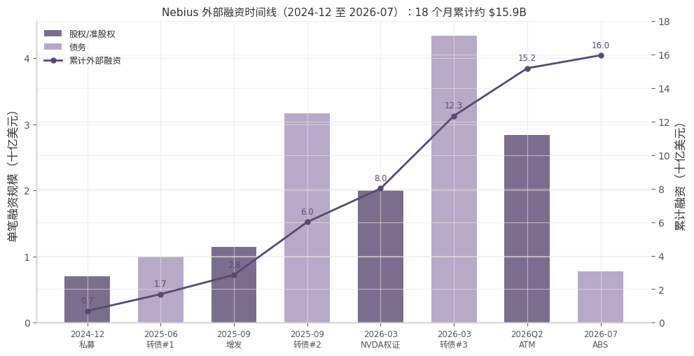

*数据来源：SEC EDGAR 6-K/424B5 申报文件与公司公告（[^1^][^2^][^5^][^13^][^16^]）；金额口径为毛募资额，不含客户预付款；时间范围 2024-12 至 2026-07。*

从表格与图中可以读出三层含义。其一，融资定价逐笔抬升——股权发行价格从 $21.00 到 $92.50 再到 ATM 的 $223.6，18 个月内提高逾 10 倍，而可转债转股价溢价率始终维持在 40%–57.5% 的高位，说明每一轮融资都未以折让换取资金，需求端持续超额认购。其二，融资结构从"纯股权/准股权"向"低票息转债 + 资产级担保债务"迁移，票息区间仅 1.00%–3.00%，代价是接受到期本金增值 115%–120% 的或有偿付义务——这是用未来稀释风险换取当下现金利息最小化的典型高增长公司选择。其三，2026 年 7 月的 ABS 标志着融资信用支点从公司主体转向底层资产（GPU + 投资级客户合同），管理层将其定位为覆盖 >$40B 客户承诺的"可复制框架"，意味着后续融资对股价的依赖有望边际下降，但对少数大客户合同履约的依赖相应上升。[^16^][^17^]

#### 10.2.2 稀释：流通股 +37%，完全稀释悬顶再增约三成

持续融资的直接代价是股本扩张。法定流通股本（Class A+B）从 2024 年 7 月复牌前的约 199.0M 股增至 2026-06-30 的 271.86M 股，累计摊薄约 +37%；其中直接融资贡献约 58M 股（私募 33.3M + 增发 12.4M + ATM 12.7M），其余来自 RSU/期权归属与并购对价。[Source: SEC EDGAR — 2024 AGM 通知 6-K, as of 2024-07-18；Form 6-K Q2 2026 Ex-99.2, as of 2026-06-30] 若计入 NVIDIA 预注资证 21.07M 股（行权价 $0.0001，2026-09-11 起可行权，经济实质等同已发行），隐含股本约 292.9M 股。[^12^]

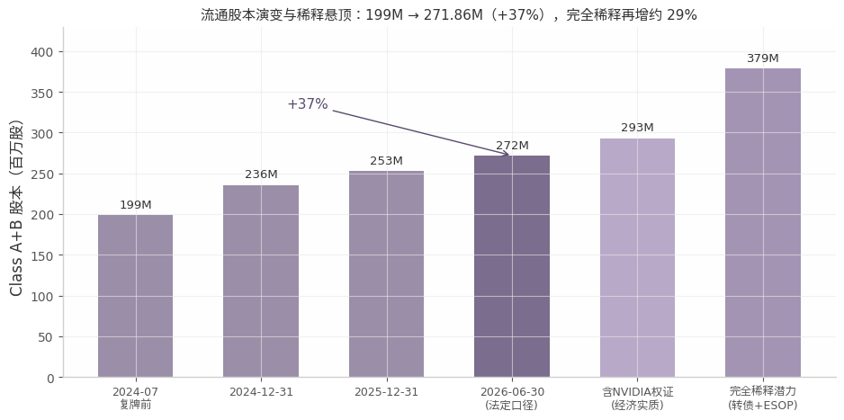

*数据来源：SEC EDGAR XBRL CommonStockSharesOutstanding、Q2 2026 6-K；完全稀释潜力 = 当前法定股本 + 权证 21.07M + 可转债按初始转股率折算约 66M 股 + 股权激励预留约 20M 股。*

悬顶的潜在稀释规模同样可观：六系列可转债合计本金 $8.5B，按初始转股率折算最大约 66M 股，叠加权证与股权激励预留，完全稀释增量约 105–110M 股，相对当前法定股本约 +37–40%。[^8^] 值得注意的是，2026 年 8 月股价（$220–278 区间）已高于全部批次转债的初始转股价（$51.45–$183.22），2025 年发行的两批转债已深度价内，转股或对冲套利造成的实际稀释大概率发生；可转债公允价值 $20.8B 对账面 $8.5B 的巨大裂口正是这一价内状态的直接计量。[^8^]

每股视角下，稀释与回报呈现出鲜明的代际差异。2024 年 12 月以 $21.00 参与私募的 NVIDIA、Accel、Orbis，至 2026-08-14 收盘价 $277.68，账面回报约 13 倍——即便承受了 37% 的摊薄，每股价值仍被算力资产的重估完全覆盖。而 2026Q2 通过 ATM 以均价 $223.6 入场的资金，其回报前景不再取决于"从废墟中重估"，而取决于公司能否把 $20–25B 资本开支按时转化为收入；**【判断】** 早期股东赚的是估值修复的钱，后来者承担的是执行风险的钱。管理层在 2025-06 公告中承诺"最小化股东稀释"（minimizing shareholder dilution），但 18 个月 +37% 的实际摊薄速度与这一承诺之间的张力，是评估其资本纪律时不可回避的事实。[^5^]

### 10.3 支出结构

#### 10.3.1 Capex、SBC、利息、研发四大支出项

Nebius 的资金去向高度集中：资本开支是绝对主导项，且呈指数级放量。购置固定资产与无形资产的现金支出从 FY2024 的 $807.7M 增至 FY2025 的 $4,066M（同比 ×5），H1 2026 已达 $8.1B（其中 Q2 单季 $5,657M，为上年同期的 11 倍），全年指引 $20–25B。[Source: SEC EDGAR — XBRL PaymentsToAcquirePropertyPlantAndEquipment, FY2024/FY2025][^19^][^4^] 投向以 GPU 硬件为主，辅以美国自建 AI factory 及英国、爱沙尼亚、芬兰站点扩建。[^15^]

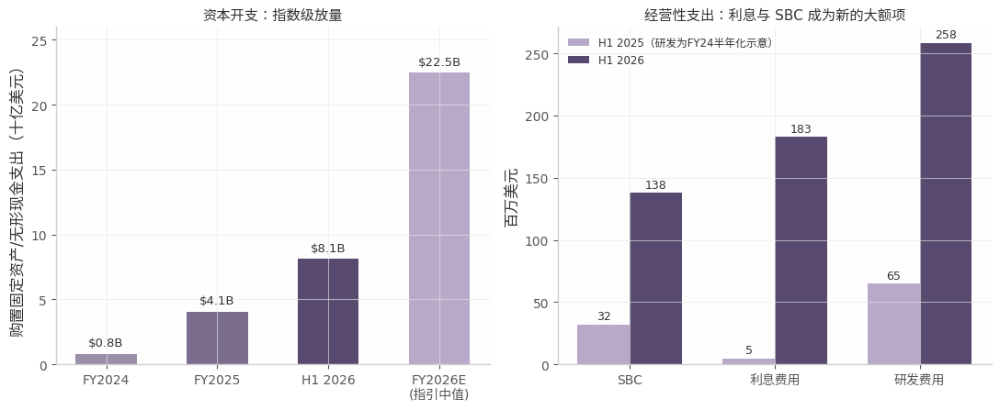

*数据来源：SEC EDGAR XBRL（FY2024/FY2025 capex、SBC、研发）、Q2 2026 6-K 业绩新闻稿（H1 2026 各项）；H1 2025 研发费用未单独披露，图中以 FY2024 半年化示意；FY2026E capex 取指引 $20–25B 中值。*

资本开支之外，三项经营性支出正在重塑损益表结构。其一，利息费用从零基数跃升为大额常规项：H1 2025 仅 $4.8M，H1 2026 已达 $182.8M（Q2 单季 $119.1M），对应 $8.5B 转债票息（1.00%–3.00% 票面）加折价与发行费摊销（H1 摊销 $42.5M）及担保债务利息；粗略年化现金票息约 $180–200M，GAAP 口径更高，公司同时持有 $8.04B 现金产生利息收入（Q2 $24.1M）部分对冲。[^8^] 其二，SBC 从 H1 2025 的 $32.1M 增至 H1 2026 的 $137.8M（×4.3），Q2 单季 $102.5M、占经营费用 14%，其中包含与 Eigen AI 收购相关的一次性 SBC 及合并后费用 $115.9M——SBC 已成为除融资增发外的"隐形稀释"通道。[^8^][^4^] 其三，产品研发费用 FY2024 $129.7M、FY2025 $177.3M（+37%）、H1 2026 达 $258.4M，已超过 FY2025 全年水平，但占收入比从上年同期 41% 降至 26%，显示收入放量对研发杠杆的摊薄效应开始显现。[Source: SEC EDGAR — XBRL ResearchAndDevelopmentExpense, FY2024/FY2025][^8^]

四项支出合观，Nebius 的财务支出结构呈现"一个巨型资本项 + 三个快速抬升的经营项"的格局：capex 决定融资需求的量级（FY2026 指引相当于 FY2025 收入的约 40 倍），利息与 SBC 则分别把债务融资与股权激励的隐性成本逐步显性化到损益表中。在 100% 再投资政策下，这四项支出没有一项为股东回报预留空间——它们的全部意义在于把 >$40B 的客户承诺转化为上线产能，而股东回报的实现时点被整体推迟至这一转化完成之后。

## 11. 管理层与公司治理

### 11.1 管理层

#### 11.1.1 CEO Arkady Volozh 与"Yandex 旧部"团队

Arkady Volozh 于 1997 年联合创立 Yandex，2000–2022 年担任 CEO，是俄罗斯互联网行业最具资历的连续创业者之一[^8^][^12^]。2022 年 6 月 3 日，欧盟以"物质或财务上支持俄罗斯"为由将其个人列入制裁名单（Yandex 公司本身从未被制裁），他当日辞去 Yandex 一切职务，并将家族信托（当时持股 8.6%、握有 45.3% 投票权）的投票安排交由受托人跟随董事会建议；2022 年 9 月，芬兰当局查封其在芬资产[^8^][^9^]。

制裁的解除有完整的因果链，需完整呈现：2023 年 8 月，Volozh 公开发表反战声明（"我理解我同样分担对国家行为的责任"），成为极少数公开批评战争的俄罗斯富豪，并正式申请解除制裁[^6^][^7^]；2024 年 3 月 13 日，欧盟理事会以"行为改变"及剥离俄罗斯业务的进展为由，将其移出制裁名单[^7^][^9^]。2024 年 7 月俄业务出售交割完成后，他回归出任 Nebius CEO[^8^][^12^]。身份层面，他自 2017 年起持以色列国籍，2026 年 1 月宣布放弃俄罗斯国籍，以"全力专注于荷兰公司 Nebius"[^9^][^37^]。复牌时其约 90% 的个人净资产集中于 NBIS，当时持股约 13%[^44^]——创始人利益与公司高度绑定，但如 11.2 节所示，绑定的"经济浓度"正被持续稀释。

CFO Dado Alonso（全名 Maria del Dado Alonso Sanchez）于 2025 年 6 月上任，曾任 Berlin Brands Group 集团 CFO（2022–2024）、Azerion 集团 CFO 兼董事，更早先后在 Booking.com、亚马逊任财务及财务控制高管[^11^][^12^]。其上任时点恰在公司进入"股权+可转债+ATM+资产担保债务"多轨融资阶段之前，财务负责人配置与资本密集型扩张节奏相匹配。COO Ophir Nave 为以色列并购律师出身，曾任 Arnon 律所公司与并购业务主管合伙人，更早任职于 Wachtell, Lipton, Rosen & Katz 及以色列最高法院[^12^]，法律背景与该公司高频交易（俄资产剥离、多轮融资、Eigen AI 等并购）的特征吻合。

技术与业务核心层则是典型的 Yandex 旧部：CTO Danila Shtan 曾任 Yandex 开发者基础设施 VP，CBO Roman Chernin 曾任 Yandex 搜索负责人，首席基础设施与产品官 Andrey Korolenko、董事 Elena Bunina 同样出自 Yandex 体系[^1^][^12^]。团队延续性是 Nebius 全栈自研工程能力的组织基础，但也意味着公司治理文化带有明显的"创始人+元老"色彩——外部职业经理人主要占据 CFO、法务等职能岗，经营权高度集中于创始团队。

### 11.2 治理结构

#### 11.2.1 双重股权与"受控公司"：52% 投票权对应约 11% 经济权益

Nebius 采用三层股权结构：Class A（1 票/股，纳斯达克上市）、Class B（10 票/股，不公开交易）、Class C（9 票/股，2026 年 AGM 议程含注销 224 万股）[^3^][^4^]。截至 2026 年 3 月 31 日，流通 Class A 为 2.204 亿股（2.204 亿票），Class B 为 3,349 万股（3.349 亿票）——即 Class B 以约 13% 的股数掌握约 60% 的投票权[^4^]。Volozh 家族信托（LASTAR Trust，受托人 Highvern Cayman Limited）持有 3,079 万股 Class B，占 B 类股的 86.24%；FY2025 20-F 风险因素披露，截至 2026 年 3 月 31 日其实益投票权约 52%、经济权益仅约 11%（FY2024 口径为 55.04%/12.94%，随增发稀释缓慢下降）[^10^][^18^]。公司因此在纳斯达克 5615 规则下构成"受控公司"（Controlled Company），可选择不遵守董事会多数独立等若干公司治理要求[^10^]。20-F 的原文表述为："Because Mr. Volozh beneficially holds approximately 52% of the voting control as of March 31, 2026 and holds greater than 50% of the voting power for election of directors, Nebius is a 'Controlled Company' as defined by Rule 5615..."[^10^]

董事会共 8 人，其中 5 人独立：非执行董事长 John Boynton（独立）、Arne Grimme、Kira Radinsky、Charles Ryan、Matthew Weigand 为独立董事，Volozh、Nave、Bunina 三人为非独立董事[^2^]。2025 年 8 月 AGM 上全部董事高票连任（Volozh 获 4.15 亿票赞成、仅 87 万票反对）[^5^]——但在创始人握有过半投票权的结构下，该表决结果由超级投票权决定，不能解读为中小股东的独立背书。

**表 11-1 Nebius 治理结构要点（截至 2026 年中）**

| 维度 | 要点 | 关键数据 |
|---|---|---|
| 股权结构 | 三层股权 A/B/C | A 类 1 票/股（上市流通 2.20 亿股）；B 类 10 票/股（3,349 万股，不公开交易）；C 类 9 票/股（拟注销）[^3^][^4^] |
| 创始人控制 | Volozh 家族信托持 B 类 86.24% | 投票权约 52% vs 经济权益约 11% [^10^][^18^] |
| 受控公司地位 | 纳斯达克 Rule 5615 豁免 | 可不遵守董事会多数独立等治理要求 [^10^] |
| 董事会 | 8 人，5 人独立 | 董事长 Boynton 独立；3 名非独立董事均为 Yandex 系 [^2^] |
| 战略股东：NVIDIA | 持股 9.3% | 119 万股直接持有 + 2,107 万股预注资证（2026-09-11 起可行权）[^11^][^12^] |
| 战略股东：Accel | 董事席位 | 合伙人 Matthew Weigand 经 2024-12 私募获观察员席位、后任董事 [^1^] |
| 长线机构退出 | Orbis 减持至 1.5% | 轨迹：2024 年末 7.9% → 2025 年末 1.5% [^22^] |
| 主题资金进入 | Situational Awareness 5.6%；Goldman Sachs 10.5% | 后者 2026 年 6–7 月间由 7.2% 增至 10.5%，大概率为承销/做市便利持仓而非单一长线基金 [^22^][^23^] |
| 稀释轨迹 | 复牌以来股本持续扩张 | 2024-07 约 1.99 亿股 → 2026-06-30 法定流通 2.72 亿股，累计约 +37%；另有 NVIDIA 权证 2,107 万股及可转债潜在转股悬顶 [^17^] |

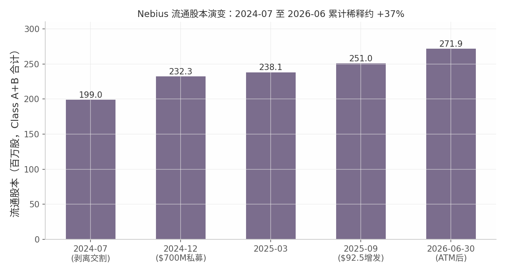

*数据来源：公司 6-K/20-F 披露及 Q2 2026 业绩文件；口径为 Class A+B 合计流通股（2026-06-30 为法定流通 271.86M，不含未行权权证与转债潜在转股）[^4^][^17^]*

表 11-1 揭示的结构性事实有三层含义。其一，制衡机制是"事实性"而非"制度性"的：外部股东中唯一具备实质影响力的是 NVIDIA（9.3% 股权+供应链绑定）与 Accel（董事席位），二者对 Volozh 的约束依赖商业关系而非投票权。其二，股东名册在 18 个月内快速换手——Orbis 等传统长线机构在 $36–90 区间获利离场，接棒的是 AI 主题基金与战略产业资本，股东基础的"耐心资本"属性下降、动量属性上升[^22^][^23^]。其三，投票权与经济利益的错配（52% vs 11%）意味着 Volozh 个人承担的稀释成本仅约为其控制权的五分之一，**【推断】** 这从结构上使管理层对股权融资的容忍度高于中小股东——该推断是理解第 12 章核心矛盾（持续稀释 vs 每股价值）的治理前提。

#### 11.2.2 利益对齐问题：内部人持股 3.4%，2026 年 19 卖 1 买

内部人交易数据与管理层公开叙事存在方向性背离。2026 年以来，内部人交易约 20 笔：19 笔卖出、仅 1 笔买入（总法律顾问 Yael Almog 7 月 22 日买入 170 万美元），净卖出约 1.39 亿美元[^20^]。大额减持者包括：首席基础设施官 Andrey Korolenko 5 月 13 日单日卖出约 1.016 亿美元（年内累计逾 2.17 亿美元）；CEO Volozh 3 月卖出 350 万美元、7 月 1 日卖出 1,100 万美元（年内合计约 1,400 万美元）；CTO Shtan、CRO Boroditsky、CFO Alonso、董事 Bunina、董事长 Boynton 均在持续卖出；过去两年内部人净卖出合计约 2.58 亿美元[^21^][^22^][^23^]。剔除创始人信托的 B 类股后，内部人合计持股仅约 3.4%[^20^]。

对冲性解释需要并列呈现：多数交易据报属于 10b5-1 预设交易计划内或股票增值权（SAR）到期的例行处置，且内部人仍持有大量头寸；在股价复牌后上涨逾十倍的背景下，部分减持属"获利了结"范畴，单独不足以构成看空论据[^21^]。但三点结构性观察仍然成立：第一，减持在时间上集中于 2026 年 5–7 月股价高位，与公司首次启用 ATM 增发（1,270 万股、加权均价 223.6 美元、募资约 28 亿美元）处于同一窗口[^27^][^28^]，即公司与内部人在同一价格区间同步"卖出股票"。第二，Volozh 的经济权益仅约 11%，其个人财富对每股价值的敏感度结构性低于外部流通股东，叠加"受控公司"地位，管理层在"规模扩张 vs 每股稀释"的权衡中天然偏向规模。第三，管理层公开表态极度乐观（如"2027 年产能今天即可售罄"）的同时内部人持续净卖出，二者方向的背离削弱了叙事的可信度。这三点共同指向本章的核心治理结论（**【判断】**）：在"受控公司+低经济暴露+持续外部融资需求"的组合下，中小股东对稀释节奏缺乏制度性制衡，实际保护主要来自创始人的自我约束与 NVIDIA、Accel 等战略股东的事实性监督。

### 11.3 遗产与地缘风险

#### 11.3.1 俄罗斯遗产：停牌 2.5 年、人民币对价与长期声誉敏感性

Nebius 股东曾真实承受过极端治理事件：2022 年 2 月 28 日起纳斯达克停牌，直至 2024 年 10 月 21 日复牌，历时逾两年半，期间股东无法交易、无法定价[^36^][^37^]。俄罗斯业务剥离于 2024 年 2 月签约、5 月首次交割、7 月 15 日最终交割，以约 4,750 亿卢布（约 52–54 亿美元）售予俄资财团；对价含 28 亿美元现金（部分以人民币在俄境外支付）及 1.625 亿股 YNV Class A 股票（作为库存股回收），2024 年 7 月 10 日完成莫斯科交易所退市[^35^][^482^]。

该遗产的残余风险可分三层评估。其一，人事与品牌层面：核心工程师团队、CTO、CBO 及董事 Bunina 均出自 Yandex，"俄罗斯出身"的认知折价预计长期存在[^1^][^12^]。其二，结构层面："俄裔创始人+荷兰壳"的组合对地缘政治高度敏感——2022 年"制裁—辞职—资产查封"的链条证明这不是理论风险，若俄乌局势或二级制裁框架变化，该结构可能再度成为监管与声誉焦点[^8^][^9^]。其三，交易痕迹层面：剥离对价部分以人民币支付、交易对手为俄资财团，资金流向曾受舆论审视[^35^]。

缓释因素同样需要完整呈现：Volozh 的制裁解除以"公开反战+彻底剥离俄业务"为因果前提，是欧盟对俄制裁中罕见的"行为改变"解除案例[^7^][^9^]；其 2026 年 1 月放弃俄罗斯国籍、持以色列国籍，在法律身份层面完成进一步切割[^9^][^37^]。**【判断】** 综合看，俄罗斯遗产对公司的影响已从 2022 年的"生存性风险"降级为"声誉折价+尾部风险"，但它解释了 Nebius 为何承受高于美国本土同业（如 CoreWeave）的治理审视强度——做空机构对该股的持续关注（空头比例约 28%）部分正是建立在这一叙事素材之上[^19^]。

## 12. 核心矛盾、风险全景与监测框架

### 12.1 核心矛盾

#### 12.1.1 本质判断：Nebius 已成为"用客户的钱加杠杆的 AI 基础设施开发商"——预付款驱动的负现金转换周期模式

前 11 章的分项证据汇合后指向同一结论：Nebius 的经济实质已不是一家靠经营利润自我造血的云公司，而是 Microsoft 与 Meta 的"表外数据中心代建方"——客户出预付款，Nebius 出股权稀释与资产负债表。三组数字定义这一模式：其一，Q2'26 经营现金流 +$2.25B 几乎全部来自客户预付款，H1'26 经营现金流 +$4.50B 中递延收入增加贡献 $4.40B、占比约 98%（详见第 5 章）[^25^] [Source: SEC EDGAR — Form 6-K Q2 2026 Ex-99.2, as of 2026-06-30]；其二，资产负债表上的合同负债从 FY2024 末的 $16.3M 膨胀至 Q2'26 末的 $5.98B，约 18 个月增长 366 倍，而同期单季营收仅 $582.3M [^25^] [Source: SEC EDGAR — XBRL ContractWithCustomerLiability]；其三，Q2 新签交易中约 70% 含预付款、覆盖对应 capex 的 50–60%，2026 全年预付款预计超 $9B[^10^]。客户在产能交付前 6–18 个月注入现金，现金转换周期（CCC）实质为负——这是重资产行业中极为罕见的融资结构，使 Nebius 能以 Q1 末净现金约 $0.9B 的姿态（Q2 末因 $5.66B capex 转为净债务）推进 $20–25B 的年度 capex[^9^]。

但负 CCC 的另一面是负债属性：预付款是"对未来交付的欠条"。该模式的偿付不依赖利润表而依赖交付表——每一笔递延收入都对应一批必须在约定时点点亮的数据中心产能。由此，评估 Nebius 的正确框架不是 P/E 或 P/S，而是两个工程-金融混合指标：单位 capex 的签约收益率（Q2 新签 $20–25M/MW、回收期约 22 个月）与预付款/capex 覆盖率（50–60%）[^10^][^1^]。前者决定商业模式是否成立，后者决定对外部融资的依赖程度。第 3 章的会计分析同时提示：在这两个指标改善的同时，GAAP 层面亏损仍在扩大（Q2'26 持续经营净亏 $190.4M，D&A 占营收 45%）[^29^]——盈利质量的最终判断必须等到产能上线、收入确认之后。

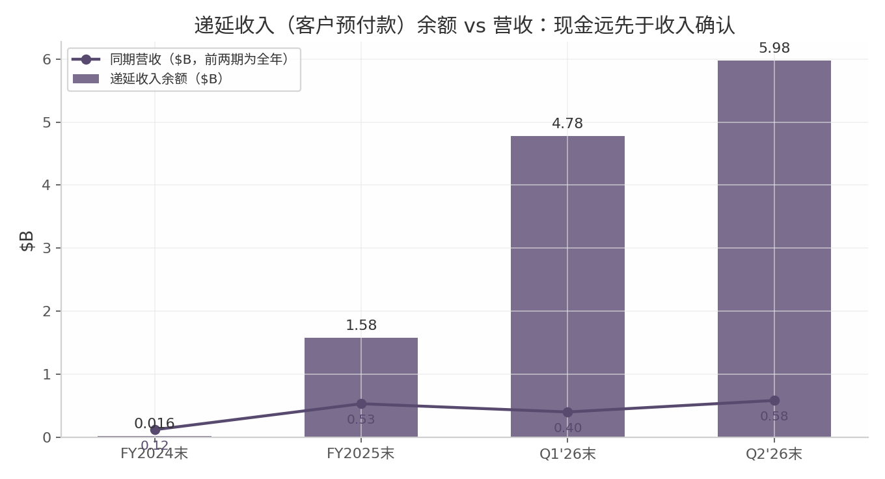

*数据来源：SEC XBRL（ContractWithCustomerLiability）、Q1'26 8-K EX-99.1、Q2'26 Form 6-K；口径为期末递延收入余额（$B）与对应期间营收（前两期为全年、后两期为单季）。递延收入余额已达单季营收的 10 倍以上，直观呈现"现金远先于收入确认"的负现金转换周期结构。*

#### 12.1.2 最大结构性风险："股价→ATM 融资→capex 交付→增长叙事→股价"正反馈飞轮，跌起来是双杀

全书最重要的单一结论是估值与基本面之间的"双重依赖"。Nebius 的 $20–25B capex 资金拼图中，ATM 股权发行（Q2 以均价 $223.60 售出 12.7M 股、募资约 $2.84B）与预付款同样关键[^7^][^28^]；ATM 的融资效率直接依赖股价高度，股价依赖增长叙事，增长依赖 capex 按期交付，交付又依赖融资到位——闭环构成正反馈飞轮。牛市中该飞轮放大上行：2026 年上半年股价涨约 +230% 至 $299.86，公司恰在高位启动 ATM，单季摊薄成本最小化[^62^][^28^]。但飞轮没有方向选择器：一旦股价因交付延误或需求质疑大幅下跌，同等融资额需要发行更多股票，稀释加速、融资成本上升，反过来加剧下跌。第三方测算显示，中值 capex 情形下公司仍需约 $6.3B 增量融资，而未动用的 25M 股 ATM 若全部用完将摊薄约 8%——该测算本身即以股价维持在 ~$200 为前提[^9^]。

2026 年 6–8 月的行情为该机制提供了完整实证：7 月 1 日彭博报道 Meta 计划将自有富余算力商业化，NBIS 单日 -17%、蒸发约 $11.9B 市值——没有任何合同取消或指引下调，仅是"客户意图"的预期变化[^14^]；7 月 29 日盘中最低 $148.22，较 6 月高点回撤约 50%[^31^][^32^]；8 月 6 日 Vineland 听证未表决单日 -13.29%[^26^]；Q2 财报后一周又自低点反弹约 +48% 至 $277.68[^55^]。六周内两次 ±13% 以上的单日波动与一次约 50% 的盘中回撤，发生在经营数据全部向好的同一时期——**【判断】** 这正是反身性资产的定价特征：边际定价者是叙事而非现金流。28.25% 的做空比例（Fintel 口径，Yahoo 口径 27.6%）与 2.78 天的回补周期意味着该结构双向放大波动[^19^]。

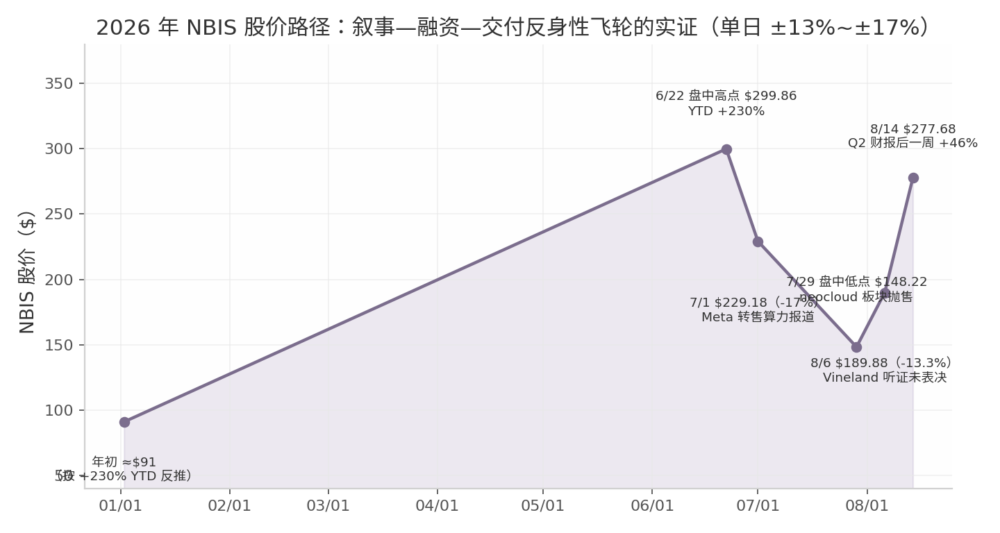

*数据来源：dim12 大事记（2026-01 至 2026-08）[^31^][^32^][^55^][^62^]；口径为关键事件日收盘价/盘中价，年初值按 6/22 盘中高点对应 +230% YTD 反推，非逐日行情。*

#### 12.1.3 客户集中度的本质：命运绑定 2-3 家 hyperscaler 的 capex 周期；Meta $15B 期权条款揭示其"锁产能期权"意图

第 7 章给出的集中度数字——FY2025 前两大客户占收入 40%、单一客户应收款占 83%、MSFT+Meta 约占 $40B+ 客户承诺的 ~80%（推断口径）——在结构上比表面更极端[^14^] [Source: SEC EDGAR — Form 20-F FY2025, filed 2026-04-30]。关键在合同设计细节：Meta 2026 年 3 月协议中的 $15B 并非刚性采购，而是"Nebius 可先将产能转售第三方、Meta 兜底购买剩余部分"的期权式承诺，管理层明言该结构旨在支持资产抵押融资、市场强劲时实际收入可超 $27B[^7^][^8^]；Microsoft 合同则含逐 tranche 终止权与延误服务抵扣条款，约 $6.96B 预付款与部署里程碑挂钩而非一次性支付[^2^]。两项条款共同揭示 hyperscaler 的真实意图：以最小刚性承诺锁定 2027–2028 年紧缺产能的购买期权，同时将交付风险保留在 Nebius 一侧。对 Nebius 而言，这既是融资抵押品（$775M 担保融资即以投资级客户合同现金流为依托，SOFR+2.50%）[^10^]，也是软负债——若超大云自建产能集中投放或 capex 指引下修，期权部分的经济价值将首先重估。当前周期仍在扩张：Moody's 已将六大厂商 2026 年 capex 预测上调至 $785B、2027 年近 $1T[^18^]；但 PIMCO 估计 capex 将消耗 hyperscaler 2026–27 年经营现金流的约 94%（三年前仅约 40%）[^46^]——外溢需求的持续性取决于客户自身的资本耐心。**【判断】** 因此，跟踪 MSFT/Meta 的 capex 指引与自建进度，比跟踪 Nebius 自身季报更能预判拐点。

### 12.2 风险矩阵

#### 12.2.1 执行风险：Vineland 停工令争议（做空方指控 vs 公司"on track"）、H2'26 产能集中上线的交付压力

Vineland（新泽西 300MW，Microsoft $17.4B 合同的交付载体）是执行风险的集中样本，事实链按交叉验证裁定并列呈现：做空关联方 Hunterbrook 于 8 月 13 日发布现场调查，称 Bloom Energy 燃料电池与 LNG 储罐在未获许可情况下进场安装，Vineland 市于 8 月 6 日与 8 月 10 日发出两道停工令；公司未对此置评，8 月 12 日财报电话会上管理层称交付"总体在轨（on track）"、"有信心布局符合所有法律法规"，未提及两天前已签发的停工令[^25^]。公司/开发商 DataOne 的既有口径是设备摆放"仅限于已批准场地规划内，预计临时暂停不影响建设与交付时间表"[^25^]。鉴于 Hunterbrook 自曝做空链条上的 Bloom Energy，其报道属单方调查；但 8 月 6 日听证未表决当日股价 -13.29% 表明市场已开始为该风险定价[^26^]。

交付压力的算术比个案更硬：管理层确认 2026 年大部分产能在 H2 上线，而全年指引（营收 $3.0–3.4B、年末 ARR $7–9B）已包含 Vineland 产能；DA Davidson 指出即便年内投运，收入确认大概率自 2027 年开始，并据此将目标价由 $250 降至 $175、评级降至 Neutral[^36^]。H2 营收需达 $20–24 亿、为 H1 的 2.1–2.5 倍，ARR 需在六个月内再翻 2.3–3 倍——指引兑现完全取决于数据中心按期投产，容错空间接近于零[^29^]。

#### 12.2.2 会计与披露风险：折旧年限变更、重估收益、预付款包装的 OCF——手工还原真实盈利的方法

第 3 章识别的四个会计与披露选择指向同一方向——在合法范围内最大化叙事友好度：其一，2026Q1 起服务器/网络设备使用年限由 4 年延长至 5 年（前瞻适用），公司自述该变更"部分抵消了折旧费用的增长"[^31^]；其二，利润表成本行不含 D&A，表观"毛利率"约 77% 虚高，若将 GPU 折旧计入收入成本，Q2'26 真实毛利率约 32%[^30^]；其三，GAAP 净利润被股权投资重估主导——FY2025 净利 +$29.0M 全靠 ClickHouse 重估收益 $598.9M，2026Q1 净利 $621.2M 中含重估收益 $780.6M[^3^][^40^] [Source: SEC EDGAR — 6-K EX-99.1, 2026-02-12]；其四，"经营现金流强劲"实为预付款（见 12.1.1）。手工还原的方法只有一步：以 adj. EBITDA − D&A − SBC 逼近真实经营盈利能力。Q2'26 该口径为 $236.2M − $259.7M − $102.5M ≈ **-$126M**，即剔除会计估计与预付款噪音后经营层面仍在烧钱；H1'26 持续经营净利 $430.8M 与调整后净亏损 $133.5M 的落差同源于此[^29^][^42^]。任何以表观毛利率、GAAP 净利或 OCF 论证 Nebius"已盈利"的分析在方法论上均不成立。

#### 12.2.3 治理风险：52%/11% 投票权-经济利益错配、内部人减持、稀释容忍度高

第 11 章的治理分析为本章提供最后一个结构性变量：Volozh 家族信托握有约 52% 投票权而经济权益仅约 11%，公司构成纳斯达克 5615 规则下的"受控公司"[^10^]。该错配的直接后果是管理层承担的稀释成本仅约为其控制权的五分之一，股权融资容忍度结构性高于中小股东——复牌以来法定股本已从约 1.99 亿股扩张至 2.72 亿股（法定口径约 +37%，含权证等完全稀释口径更高），另有 NVIDIA 权证 2,107 万股与可转债潜在转股悬顶[^17^][^4^]。行为证据与结构一致：2026 年以来内部人交易 19 卖 1 买、净卖出约 $1.39 亿，CEO 本人 7 月 1 日减持 $1,100 万，且减持窗口与公司首次启用 ATM 增发（均价 $223.60）高度重叠——公司与内部人在同一价格区间同步卖出股票[^20^][^21^]。多数减持据报属 10b5-1 计划内处置，单独不足以构成看空论据；但"公开表态极度乐观 + 内部人持续净卖出 + 低经济暴露"的组合意味着小股东利益与管理层并不完全对齐，实际制衡依赖 NVIDIA（9.3% 股权+供应链绑定）与 Accel（董事席位）的事实性监督而非投票权[^20^]。

**表 12-1 Nebius 风险矩阵（截至 2026-08-16）**

| 风险 | 严重度 | 概率 | 领先指标 | 多方证据 | 空方证据 |
|---|---|---|---|---|---|
| 融资飞轮逆转（股价↓→稀释↑→融资成本↑） | 极高 | 中 | ATM 使用节奏与价格；股价 vs ~$200 融资假设 | 净现金起步；可转债票息 1.25–2.625%；ABS SOFR+2.50% [^18^] | 中值 capex 仍需 ~$6.3B 增量融资；ATM 用满摊薄 ~8% [^9^] |
| 客户集中 / hyperscaler capex 转向 | 极高 | 中 | MSFT/Meta capex 指引与自建进度 | $32B+ 刚性承诺含预付款；MSFT 预付 ~$6.96B [^2^][^14^] | Meta $15B 为兜底期权；7/1 单日 -17% 实证 [^7^][^14^] |
| H2'26 交付延误（Vineland 式审批风险） | 高 | 中高 | 8/17 听证结果；月度并网 MW | 已向 MSFT 交付全部承诺批次；Meta 产能 2027 初 on track [^47^][^60^] | 两道停工令（单方报道）；全年指引已含该产能 [^25^][^36^] |
| 会计与披露质量 | 中 | 高（已发生） | D&A/营收比；重估收益占净利比 | 5 年折旧仍短于 CoreWeave 的 6 年；非 GAAP 桥披露完整 [^32^] | adj. EBITDA−D&A−SBC ≈ -$126M；"on track"未提停工令 [^25^][^31^] |
| 治理与稀释 | 中高 | 高（结构性） | 季度股本增量；内部人 Form 4 | 多数减持为 10b5-1 计划内；CFO 称对稀释"敏感且有纪律" [^18^][^21^] | 19 卖 1 买、净卖出 ~$1.39 亿；52%/11% 错配 [^10^][^20^] |
| 需求周期逆转（2027 年后） | 高 | 低-中 | GPU 合约价；拍卖溢价；到期续约价 | 拍卖溢价 +15%；旧卡提价 30%；合约价自低点 +40% [^11^][^20^] | 短约占比上升缩短收入可见期；企业 AI ROI 证据薄弱 [^49^] |

表 12-1 的分层含义有三点（**【判断】**）。第一，真正具备"本金永久损失"潜质的只有前两类——融资飞轮逆转与 hyperscaler capex 转向，二者共享同一触发器（增长叙事破裂）且互为放大器，这是本章将其定义为核心矛盾的原因。第二，交付与会计风险属"估值折价型"：Vineland 若延期一个季度，直接冲击的是 H2 指引算术与管理层可信度，而非商业模式本身；但在 28% 做空比例的结构中，折价会被交易机制放大（8 月 6 日 -13.29% 即为例证）[^19^][^26^]。第三，概率列中会计与治理两项标注"已发生/结构性"，意味着它们不是尾部风险而是持有该股的持续性成本，应在估值中常态化扣减而非作为情景假设。

### 12.3 监测框架

#### 12.3.1 五个领先指标：H2 产能上线进度、季度递延收入增量、ATM 使用节奏、MSFT/Meta capex 指引、2026-11-09 Q3 财报

将核心矛盾转化为可操作的监测清单，按信号时滞由短到长排列：

1. **H2'26 产能上线进度（月度颗粒度）**：最直接验证"以交付表偿付预付款"的假设。观察点为 Vineland 8 月 17 日规划委员会特别听证结果、Bloom 328MW 燃料电池首个项目年内投运、爱沙尼亚 22MW 首期投产；任何关键项目延期超过一个季度即构成对年末 ARR $7–9B 指引的实质威胁[^34^][^36^]。
2. **季度递延收入增量**：预付款模式的心跳。递延收入由 Q1 末 $4.78B 增至 Q2 末 $5.98B，单季增量 $1.2B，较 Q1 单季的 +$3.2B 明显放缓；若 Q3 增量继续低于 $1B，说明新签预付款速度开始落后于交付确认速度，负 CCC 的融资红利衰减[^25^]。
3. **ATM 使用节奏与价格（实时信号）**：飞轮方向的温度计。Q2 公司以 $223.60 均价募资 $2.84B、额度内尚余 12.3M 股；若公司在股价显著低于 ~$180 时仍密集使用 ATM，表明预付款与债务渠道边际收紧，飞轮开始向不利方向转动[^7^][^28^]。
4. **MSFT/Meta capex 指引与自建进度（季度财报季）**：比 Nebius 自身季报更早的需求拐点信号。当前六大厂商 2026 capex 预测 $785B、2027 近 $1T（Moody's）[^18^]；任何一家的指引下修，或"富余算力商业化"从传闻走向实质（7 月 1 日已预演 -17%），都应视为 NBIS 的先行指标[^14^]。
5. **2026-11-09 Q3 财报（事件节点）**：卖方一致预期营收约 $901M、EPS -$0.82[^55^]。除数字外三个非财务项更关键：管理层对 Vineland 的披露口径是否变化、H2 产能上线的 MW 级明细、以及 2027 年指引框架——卖方一致预期 2027 年营收约 $11.5B（同比 +238%），预期差容错极低[^54^]。

#### 12.3.2 多空情景：基准/乐观/悲观三情景的关键假设与触发条件

**基准情景（概率最高）：交付基本按期、融资窗口维持开放。** 关键假设：H2'26 产能大体按期上线（Vineland 延期不超过一个季度），年末 ARR 落于指引区间下半段（$7–8B），2027 年营收向一致预期 ~$11.5B 靠拢；全年预付款 >$9B 到账，增量融资以"ABS+可转债为主、ATM 为辅"完成，股本增速控制在年化 10–15%。该情景下股价由"每股 ARR 增速 vs 股本增速"的赛跑决定，估值在 EV/2026E 营收 ~23x 向 CoreWeave ~8.3x 的收敛压力与 50% 分部 EBITDA margin 的质量溢价之间拉锯 [^5^] [Source: Yahoo Finance — get_stock_info (NBIS & CRWV), as of 2026-08-14]。

**乐观情景：飞轮正转加速。** 触发条件：拍卖与短约定价（$40–50M/MW）在 2027 年续约中兑现，asset-light 伙伴模式贡献表外产能，MSFT/Meta 再度上调 capex。验证信号为 Q3 递延收入增量重回 $2B 以上、新签 ACV 维持 $25M/MW 附近。该情景下年末 ARR 触及 $9B 上限、2027 年营收超一致预期，Northland $410 的目标价路径成立[^32^]。

**悲观情景：飞轮逆转、双杀兑现。** 触发条件（任一即可启动）：关键项目延期超一个季度导致全年指引下调；MSFT/Meta 任一下修 capex 或推进富余算力商业化；股价跌破 ~$180 后公司为完成 capex 被迫在低位加速 ATM。传导链为：交付/需求质疑 → 股价下跌 → 单位融资稀释加剧 → 市场对 $20–25B capex 完成度产生怀疑 → 增长叙事破裂 → 估值与融资能力同时收缩。参照系：7 月 29 日盘中低点 $148.22 仅是"预期层面"冲击的结果，若叠加实质指引下调与稀释加速，回撤深度预计超过该水平；DA Davidson $175 的目标价构成悲观情景下的卖方定价参考[^31^][^36^]。

# 参考文献

## 引用编号说明

本报告正文（nebius_sec00.md ~ nebius_sec12.md）中的 `[^N^]` 引用编号沿用各研究维度报告（dim01 ~ dim12）的原始编号体系，即同一编号在不同章节中指向不同来源清单。各章节正文引用按下表溯源到对应 dim 的来源清单：

| 章节 | 主要来源清单 | 章节内混用的其他 dim 编号 |
| --- | --- | --- |
| sec00（摘要） | 综合各章，无独立编号体系 | — |
| sec01（公司与沿革） | dim01 | 沿革段引 dim11 [^35^][^36^] |
| sec02 | dim02 | — |
| sec03 | dim03 | 少量 dim08、dim12 |
| sec04 | dim04 | 少量 dim10、dim05 |
| sec05 | dim05 | 少量 dim04、dim08 |
| sec06 | dim07 | 少量 dim12 |
| sec07 | dim08 | 少量 dim06 |
| sec08 | dim09 | — |
| sec09 | dim06 | 少量 dim11 |
| sec10 | dim10 | 少量 dim04 |
| sec11 | dim11 | 少量 dim10 |
| sec12 | dim11、dim12、dim05、dim07、dim09 | — |

此外，正文中以 `[Source: ...]` 形式标注的数据来自 SEC EDGAR 与 Yahoo Finance 插件的直接查询结果，以正文标注为准，不再列入下方编号清单。涉及数据集：SEC 20-F 年报 FY2025（2026-04-30 提交）、2026Q1/Q2 Form 6-K 季度报告、XBRL company facts；Yahoo Finance 行情与估值数据（as of 2026-08-14）。

---

## dim01 来源清单（12 条）

[1] Nebius 官方新闻稿《Nebius launches Nebius Token Factory…》，2025-11-05[EB/OL]. https://nebius.com/newsroom/nebius-launches-nebius-token-factory-to-deliver-production-ai-inference-at-scale
[2] Nebius 官方新闻稿《Nebius introduces business model to scale AI cloud globally through infrastructure partnerships》，2026-07-15[EB/OL]. https://nebius.com/newsroom/nebius-introduces-business-model-to-scale-ai-cloud-globally-through-infrastructure-partnerships
[3] StockAnalysis，Nebius Q2 2026 Earnings Call Transcript，2026-08-13[EB/OL]. https://stockanalysis.com/stocks/nbis/transcripts/655490-q2-2026/
[4] Nebius 官方新闻稿《Nebius announces multi-billion dollar agreement with Microsoft for AI infrastructure》，2025-09-08[EB/OL]. https://nebius.com/newsroom/nebius-announces-multi-billion-dollar-agreement-with-microsoft-for-ai-infrastructure
[5] Motley Fool Community，Nebius Q3 2025 业绩纪要，2025-11-11[EB/OL]. https://discussion.fool.com/t/nebius-earnings-q3-2025/122088
[6] AI Business《Nebius Reveals $3B Deal With Meta》，2025-11-12[EB/OL]. https://aibusiness.com/data-centers/nebius-reveals-meta-deal
[7] GuruFocus，Nebius Q2 2026 Earnings Call Highlights，2026-08-14[EB/OL]. https://www.gurufocus.com/news/9033418/
[8] Dealroom/Investing.com，Nebius Q2'26 重申 FY2026 指引（收入 $3–3.4B、ARR $7–9B），2026-08-12[EB/OL]. https://za.investing.com/news/transcripts/earnings-call-transcript-nebius-beats-q2-2026-forecasts-shares-jump-165-93CH-4424564
[9] Nebius Group Letter to shareholders Q1 2026（PDF），2026-05-13[EB/OL]. https://assets.nebius.com/assets/aa1bc2e6-df83-40cd-a6a2-95e7cda3d16c/Nebius%20SHL_Q1%202026.pdf
[10] FactorsToday《Nebius Group — Everything They Build, They Sell — and Dilute》（对 Avride/TripleTen 引入战投的解读），2026-06-10[EB/OL]. https://www.factorstoday.com/research/NBIS
[11] Futurum Group《Nebius Q1 FY 2026 Earnings Show AI Cloud Capacity Scaling》（FY26 capex 上调至 $20–25B），2026-05-26[EB/OL]. https://futurumgroup.com/insights/nebius-q1-fy-2026-earnings-show-ai-cloud-capacity-scaling/
[12] The Data Center Engineer《Nebius launches asset-light AI cloud model for partner data centers》，2026-07-20[EB/OL]. https://thedatacenterengineer.com/news/nebius-launches-asset-light-ai-cloud-model-for-partner-data-centers/

## dim02 来源清单（23 条）

[1] Nebius Group FY2024 Form 20-F（2025-04-30 提交），SEC EDGAR[EB/OL]. https://www.sec.gov/Archives/edgar/data/1513845/000155837025005991/nbis-20241231x20f.htm
[2] Nebius Group FY2025 Form 20-F（2026-04-30 提交），SEC EDGAR[EB/OL]. https://www.sec.gov/Archives/edgar/data/1513845/000110465926052948/nbis-20251231x20f.htm
[3] Nebius Group Letter to shareholders Q1 2026（2026-05-13）[EB/OL]. https://assets.nebius.com/assets/aa1bc2e6-df83-40cd-a6a2-95e7cda3d16c/Nebius%20SHL_Q1%202026.pdf
[4] Nebius Group Letter to shareholders Q2 2026（2026-08-12）[EB/OL]. https://assets.nebius.com/assets/a6ecfd85-a6cb-4967-8ef7-9a25bd261f9c/SHLQ226.pdf
[5] Yandex N.V. Q1 2024 results 6-K EX-99.1（2024-04-26）[EB/OL]. https://www.sec.gov/Archives/edgar/data/1513845/000151384524000012/yndx-20240331xex99d1.htm
[6] Nebius Group Q2 2024 results 6-K EX-99.1（2024-08-01）[EB/OL]. https://www.sec.gov/Archives/edgar/data/1513845/000151384524000024/tmb-20240630xex99d1.htm
[7] Nebius Group Q3 2024 results 6-K EX-99.1（2024-10-31）[EB/OL]. https://www.sec.gov/Archives/edgar/data/1513845/000110465924112875/tm2427209d1_ex99-1.htm
[8] Nebius Group Q4/FY2024 results 6-K EX-99.1（2025-02-20）[EB/OL]. https://www.sec.gov/Archives/edgar/data/1513845/000110465925015480/tm257185d1_ex99-1.htm
[9] Nebius Group Q1 2025 Letter to Shareholders 6-K EX-99.2（2025-05-20）[EB/OL]. https://www.sec.gov/Archives/edgar/data/1513845/000110465925050975/tm2515580d1_ex99-2.htm
[10] Nebius Group Q3 2025 财务报表 6-K EX-99.2（2025-11-13）[EB/OL]. https://www.sec.gov/Archives/edgar/data/1513845/000110465925110831/tm2531034d1_ex99-2.htm
[11] Nebius Group Q2 2025 Shareholder Letter 6-K EX-99.2（2025-08-07）[EB/OL]. https://www.sec.gov/Archives/edgar/data/1513845/000110465925075028/tm2522866d1_ex99-2.htm
[12] Nebius Group Q4/FY2025 Shareholder Letter 6-K EX-99.2（2026-02-12）[EB/OL]. https://www.sec.gov/Archives/edgar/data/1513845/000110465926013946/tm266173d1_ex99-2.htm
[13] Nebius Group Q1 2026 财务报表 6-K EX-99.2（2026-05-20）[EB/OL]. https://www.sec.gov/Archives/edgar/data/1513845/000110465926064092/nbis-20260331xex99d2.htm
[14] Nebius Group Q2 2025 press release 6-K EX-99.1（2025-08-07）[EB/OL]. https://www.sec.gov/Archives/edgar/data/1513845/000110465925075028/tm2522866d1_ex99-1.htm
[15] Nebius Group Q3 2025 Shareholder Letter 6-K EX-99.2（2025-11-12）[EB/OL]. https://www.sec.gov/Archives/edgar/data/1513845/000110465925109806/tm2530882d1_ex99-2.htm
[16] GuruFocus, "NBIS Q1 2026 Earnings Call Highlights"（2026-05-14）[EB/OL]. https://www.gurufocus.com/news/8860930/nebius-group-nv-nbis-q1-2026-earnings-call-highlights-record-revenue-surge-and-strategic-investments
[17] Nebius Group Q2 2026 财务报表 6-K EX-99.2（2026-08-12）[EB/OL]. https://www.sec.gov/Archives/edgar/data/1513845/000110465926094844/nbis-20260812xex99d2.htm
[18] 247wallst, "Nebius Group Q2 2026: $3B Run-Rate"（2026-08-12）[EB/OL]. https://247wallst.com/cards/nebius-group-n-v-q2-2026-earnings-nbis-01kzv29zjcz6d00azj6m859h38
[19] Nebius Group Q3 2025 press release 6-K EX-99.1（2025-11-11，Meta ~$3B/5 年协议）[EB/OL]. https://www.sec.gov/Archives/edgar/data/1513845/000110465925109806/tm2530882d1_ex99-1.htm
[20] TIKR blog（2026-06-28，Meta 最高 $27B/5 年协议、NVIDIA $2B 入股）[EB/OL]. https://www.tikr.com/blog/nbis-has-gained-167-in-2026-the-revenue-chart-explains-why
[21] TipRanks NBIS Q1 2026 Earnings Report[EB/OL]. https://www.tipranks.com/stocks/nbis/earnings/q1-2026-report
[22] Quartr, Nebius Q1 2026 event summary（2026-05-13）[EB/OL]. https://quartr.com/events/nebius-group-n-v-nbis-q1-2026_ozKE0SCN
[23] Saul's Investing Discussions, "My Nebius Q2 2026 Notes"（2026-08-13）[EB/OL]. https://discussion.fool.com/t/my-nebius-q2-2026-notes/125967

## dim03 来源清单（18 条）

[1] Nebius Q2 2026 业绩新闻稿（6-K EX-99.1, 2026-08-12）[EB/OL]. https://www.sec.gov/Archives/edgar/data/1513845/000110465926094568/tm2622968d1_ex99-1.htm
[2] Nebius Q2 2026 Operating and Financial Review（6-K EX-99.1, 2026-08-12）[EB/OL]. https://www.sec.gov/Archives/edgar/data/1513845/000110465926094844/nbis-20260812xex99d1.htm
[3] Nebius Q4/FY2025 业绩新闻稿（6-K EX-99.1, 2026-02-12）[EB/OL]. https://www.sec.gov/Archives/edgar/data/1513845/000110465926013946/tm266173d1_ex99-1.htm
[4] Nebius Q4/FY2024 业绩新闻稿（6-K EX-99.1, 2025-02-20）[EB/OL]. https://www.sec.gov/Archives/edgar/data/1513845/000110465925015480/tm257185d1_ex99-1.htm
[5] Nebius Q1 2026 OFR（6-K, 2026-05-20）[EB/OL]. https://www.sec.gov/Archives/edgar/data/1513845/000110465926064092/nbis-20260331xex99d1.htm
[6] Nebius FY2025 Form 20-F（2026-04-30；经 MarketScreener 转录）[EB/OL]. https://www.marketscreener.com/news/nebius-annual-report-for-fiscal-year-ending-december-31-2025-form-20-f-ce7f58d8de8ef221
[7] Nebius Q2 2026 股东信（2026-08-12）[EB/OL]. https://assets.nebius.com/assets/a6ecfd85-a6cb-4967-8ef7-9a25bd261f9c/SHLQ226.pdf
[8] Nebius Q1 2026 股东信（2026-05-13）[EB/OL]. https://assets.nebius.com/assets/11f7d99a-6dc6-4032-82bc-de3f141cb708/SHLQ1_26.pdf
[9] Nebius Q3 2025 业绩新闻稿（2025-11-11）[EB/OL]. https://www.eqs-news.com/news/corporate-news/nebius-reports-third-quarter-2025-financial-results/8ef59520-e098-48a6-9c75-d032f50e396c
[10] CoreWeave Q2 2026 业绩新闻稿（2026-08-11）[EB/OL]. https://investors.coreweave.com/news/news-details/2026/CoreWeave-Reports-Strong-Second-Quarter-2026-Results/default.aspx
[11] Capital & Compute — AI Data Center Stocks（2026-08-13）[EB/OL]. https://capitalandcompute.net/blog/ai-data-center-stocks/
[12] DataCenterDynamics — Neocloud results Q2 2026（2026-08-14）[EB/OL]. https://www.datacenterdynamics.com/en/news/neocloud-results-q2-2026-coreweave-nebius-cerebras/
[13] Reuters（经 WMBD 转载）— Nebius beats estimates（2026-08-12）[EB/OL]. https://wmbdradio.com/2026/08/12/nebius-beats-quarterly-revenue-estimates-as-ai-demand-fuels-growth/
[14] r40.io — Nebius Q2 2026 分析（2026-08-13）[EB/OL]. https://r40.io/news/nbis-q2-2026-earnings-analysis/
[15] Intellectia/CNBC — BofA、Morningstar 上调目标价（2026-08-14）[EB/OL]. https://intellectia.ai/news/stock/nebius-seeks-partners-to-fund-data-centers
[16] MLQ.ai — Q4 2025 电话会摘录（40% margin 指引）[EB/OL]. https://mlq.ai/earnings/highlight/NBIS-nebius-projects-a-40-adjusted-ebitda-ma-44ad69/
[17] Morningstar/Dow Jones — Nebius-Meta 交易与 Q3'25 数据（2025-11-11）[EB/OL]. https://www.morningstar.com/news/dow-jones/202511114028/nebius-meta-agree-to-3-billion-ai-infrastructure-deal-update
[18] Saul's Investing Discussions — Q2 2026 电话会纪要（2026-08-13，论坛来源，置信度较低）[EB/OL]. https://discussion.fool.com/t/my-nebius-q2-2026-notes/125967

## dim04 来源清单（14 条）

[1] SEC 424B5, 2025-11-12[EB/OL]. https://www.sec.gov/Archives/edgar/data/1513845/000110465925110025/tm2530771-1_424b5.htm
[2] SEC 6-K Ex-99.1, 2026-03-17（定价公告）[EB/OL]. https://www.sec.gov/Archives/edgar/data/1513845/000110465926029863/tm268409d3_ex99-1.htm
[3] Morningstar/Business Wire, 2026-03-23（交割公告）[EB/OL]. https://www.morningstar.com/news/business-wire/20260323990249/nebius-group-announces-closing-of-private-offering-of-convertible-senior-notes-with-aggregate-gross-proceeds-of-approximately-43-billion
[4] SEC 6-K Ex-99.1, 2026-07-17[EB/OL]. https://www.sec.gov/Archives/edgar/data/1513845/000110465926084452/tm2620683d1_ex99-1.htm
[5] CCIR Research, 2026-07-20[EB/OL]. https://ccir.io/research/nebius-first-secured-debt
[6] CCIR Compute Credit Tracker[EB/OL]. https://ccir.io/credit
[7] SEC 6-K Ex-99.1, 2025-06-02[EB/OL]. https://www.sec.gov/Archives/edgar/data/1513845/000110465925055197/tm2516825d1_ex99-1.htm
[8] SEC 6-K, 2026-03-11（NVIDIA 预付权证）[EB/OL]. https://www.sec.gov/Archives/edgar/data/1513845/000110465926026163/tm268532d1_6k.htm
[9] Proactive Investors, 2026-07-21[EB/OL]. https://www.proactiveinvestors.com/companies/news/1095789/nebius-soars-as-nvidia-stake-signals-deepening-ai-ties-1095789.html
[10] Nebius Q2 2026 股东信[EB/OL]. https://assets.nebius.com/assets/a6ecfd85-a6cb-4967-8ef7-9a25bd261f9c/SHLQ226.pdf
[11] mlq.ai, 2026-08-13[EB/OL]. https://mlq.ai/news/nebius-raises-contracted-power-target-to-5gw-plans-1gw-annual-deployments/
[12] Constellation Research, 2026-08-12[EB/OL]. https://www.constellationr.com/insights/news/nebius-q2-revenue-boom-what-you-need-know
[13] TIKR, 2026-06-07[EB/OL]. https://www.tikr.com/blog/nebius-grew-revenue-684-in-q1-sold-out-its-entire-capacity-and-raised-its-capex-target-to-25-billion
[14] Zacks, 2026-07-06[EB/OL]. https://www.zacks.com/stock/news/2948624/nebius-stock-jumps-124-in-6-months-time-to-buy-hold-or-sell

## dim05 来源清单（13 条）

[1] Nebius Group Letter to Shareholders Q2 2026 (2026-08-12)[EB/OL]. https://assets.nebius.com/assets/a6ecfd85-a6cb-4967-8ef7-9a25bd261f9c/SHLQ226.pdf
[2] Futuriom, "CoreWeave, Nebius Shares Rise on Reports, But Questions Persist" (2026-08-12)[EB/OL]. https://www.futuriom.com/articles/news/coreweave-nebius-shares-rise-on-reports-but-questions-persist/2026/08
[3] tooldirectory.ai, "The AI capex bubble in 2026" (2026-05-30)[EB/OL]. https://tooldirectory.ai/blog/ai-capex-bubble-2026-where-the-revenue-actually-is
[4] Daloopa, "Nebius vs. CoreWeave: Two Neoclouds, Two Reporting Frameworks" (2026-06-03)[EB/OL]. https://daloopa.com/blog/analyst-pov/nebius-vs-coreweave-neoclouds-financial-analysis-daloopa-mcp-sourced
[5] Global Equity Briefing, "Nebius Q2 2026: Arkady Delivers Again!" (2026-08-13)[EB/OL]. https://www.globalequitybriefing.com/p/nebius-q2-2026-arkady-delivers-again
[6] investreport.ai, NBIS Stock Analysis (2026-05-13)[EB/OL]. https://investreport.ai/stocks/NBIS-stock-analysis.html
[7] Futubull, NEBIUS 2026Q2 业绩电话会纪要 (2026-08-12)[EB/OL]. https://q.futunn.com/nnq/detail?id=117082403701144
[8] Nebius Group Letter to Shareholders Q1 2026 (2026-05-13)[EB/OL]. https://assets.nebius.com/assets/aa1bc2e6-df83-40cd-a6a2-95e7cda3d16c/Nebius%20SHL_Q1%202026.pdf
[9] io-fund, "Nvidia, CoreWeave, and Nebius: Inside the Circular Financing of the GPU Boom" (2026-06-12)[EB/OL]. https://io-fund.com/ai-stocks/nvidia-coreweave-nebius-circular-financing-gpu-boom
[10] finsee.ai, Nebius Q1 2026 Earnings Review (2026-05-13)[EB/OL]. https://finsee.ai/earnings/nbis/2026/q1/en/
[11] Channelchek, "CoreWeave Q2 2026 Earnings" (2026-08-13)[EB/OL]. https://www.channelchek.com/news-channel/coreweave-q2-2026-earnings-crwv-stock-jumps-14-on-record-revenue-and-raised-ai-capex-guidance
[12] finsee.ai, Nebius Q2 2026 Earnings Review (2026-08-12)[EB/OL]. https://finsee.ai/earnings/nbis/2026/q2/en/
[13] Motley Fool Discussion, "CoreWeave, Nebius, Iren comparison?" (2026-02-15)[EB/OL]. https://discussion.fool.com/t/coreweave-nebius-iren-comparison/123402

## dim06 来源清单（12 条）

[1] Yahoo Finance — NBIS 新闻流（"Nebius (NBIS) Soared 48% Last Week"），[EB/OL]. https://finance.yahoo.com/markets/stocks/articles/nebius-nbis-soared-48-last-121036478.html
[2] GuruFocus — Nebius Q2 2026 Earnings Call Highlights，2026-08-13，[EB/OL]. https://www.gurufocus.com/news/9033418/nebius-group-nv-nbis-q2-2026-earnings-call-highlights-revenue-surges-454-as-ai-capacity-demand-soars
[3] Tickeron — Nebius Posts +454% Revenue Growth in Q2 2026，2026-08-13，[EB/OL]. https://tickeron.com/blogs/nebius-group-nbis-posts-454-revenue-growth-in-q2-2026-earnings-15665/
[4] Motley Fool 社区财报笔记（含 ATM 增发与 ACV 细节），2026-08-13，[EB/OL]. https://discussion.fool.com/t/my-nebius-q2-2026-notes/125967
[5] Daloopa — Nebius vs. CoreWeave: Two Neoclouds, Two Reporting Frameworks，2026-06-03，[EB/OL]. https://daloopa.com/blog/analyst-pov/nebius-vs-coreweave-neoclouds-financial-analysis-daloopa-mcp-sourced
[6] Dealroom — Nebius and CoreWeave: Nvidia-backed neocloud stocks，2026-07-04，[EB/OL]. https://app.dealroom.co/news/feed/nebius-and-coreweave-nvidia-backed-neocloud-stocks-growing-547-and-147-in-2026
[7] SimplyWall.st — Nebius Group Future Growth（一致预期表），2026-08-13，[EB/OL]. https://simplywall.st/stocks/us/software/nasdaq-nbis/nebius-group/future
[8] Chartmill — NBIS Forecast, Price Target & Analyst Ratings，2026-08-14，[EB/OL]. https://www.chartmill.com/stock/quote/NBIS/analyst-ratings
[9] VCPScanner — NBIS Price Target: $217 (9 analysts)，2026-08-08，[EB/OL]. https://vcpscanner.com/stock/nbis/price-target
[10] Intellectia — NBIS 分析师行动（DA Davidson $250→$175; Citi $287→$278），2026-08-08，[EB/OL]. https://intellectia.ai/news/stock/nebius-group-to-release-q2-2026-financial-results
[11] Finsee.ai — Nebius Q2 2026 Earnings Review（多空框架），2026-08-12，[EB/OL]. https://finsee.ai/earnings/nbis/2026/q2/en/
[12] Plisio — Nebius Group NBIS Stock 2026: Yandex Exit, $44B AI Backlog，2026-05-28，[EB/OL]. https://plisio.net/stocks/nbis

## dim07 来源清单（31 条）

[1] Reuters / TS2.Tech 综述 — "Nebius Group N.V. (NBIS) Stock: Latest News…" (2025-12-15)[EB/OL]. https://ts2.tech/en/nebius-group-n-v-nbis-stock-latest-news-analyst-targets-and-2026-outlook-as-ai-infrastructure-demand-collides-with-heavy-capex-dec-15-2025/
[2] The Energy Mag — "Microsoft Committed $7 Billion Upfront in Nebius AI Deal" (2026-05-04)[EB/OL]. https://theenergymag.com/news/market-news/microsoft-nebius-ai
[3] Motley Fool 讨论区转引 Nebius 6-K (2025-09-09)[EB/OL]. https://discussion.fool.com/t/nebius-to-deliver-ai-infrastructure-to-microsoft/121158
[4] Tom's Hardware — "Microsoft inks $33 billion in deals with 'neoclouds'… 100,000 Nvidia GB300 chips" (2025-10-02)[EB/OL]. https://www.tomshardware.com/tech-industry/artificial-intelligence/microsoft-inks-usd33-billion-in-deals-with-neoclouds-like-nebius-coreweave-nebius-deal-alone-secures-100-000-nvidia-gb300-chips-for-internal-use
[5] DataCenterDynamics — "Nebius signs $3bn deal with Meta…" (2025-11-11)[EB/OL]. https://www.datacenterdynamics.com/en/news/nebius-signs-3bn-deal-with-meta-says-current-available-capacity-is-sold-out-as-it-targets-25gw-by-end-of-2026/
[6] Nebius 官方博客 — "Nebius November digest: A new $3B agreement with Meta…" (2025-12-05)[EB/OL]. https://nebius.com/blog/posts/digest-november-2025
[7] Nebius Newsroom（官方）— "Nebius signs new AI infrastructure agreement with Meta" (2026-03-16)[EB/OL]. https://nebius.com/newsroom/nebius-signs-new-ai-infrastructure-agreement-with-meta
[8] EarningsLabs — Nebius Q1 2026 Earnings Call Transcript (2026-05-13)[EB/OL]. https://www.earningslabs.com/stock/NBIS/2026/Q1
[9] TipRanks — Nebius Q1 2026 Earnings Report Summary (2026-07-30)[EB/OL]. https://www.tipranks.com/stocks/nbis/earnings/q1-2026-report
[10] Nebius Group Letter to Shareholders Q2 2026（官方 PDF）(2026-08-12)[EB/OL]. https://assets.nebius.com/assets/a6ecfd85-a6cb-4967-8ef7-9a25bd261f9c/SHLQ226.pdf
[11] Constellation Research — "Nebius' Q2 revenue boom: What you need to know" (2026-08-12)[EB/OL]. https://www.constellationr.com/insights/news/nebius-q2-revenue-boom-what-you-need-know
[12] Startup Fortune — "Reflection AI Secures Over $1 Billion in Nvidia Compute From Nebius" (2026-07-14)[EB/OL]. https://startupfortune.com/reflection-ai-secures-over-1-billion-in-nvidia-compute-from-nebius/
[13] mlq.ai — Nebius Q3 2025 电话会转录 (2025-11-11)[EB/OL]. https://mlq.ai/earnings/highlight/NBIS-nebius-accelerates-capacity-growth-to-2-75644d/
[14] SEC — Nebius Group N.V. Form 20-F FY2025 (filed 2026-04-30)[EB/OL]. https://www.sec.gov/Archives/edgar/data/1513845/000110465926052948/nbis-20251231x20f.htm
[15] Macroplane（低可信度）— "Nebius Stock ($NBIS): The Neocloud Scaling Into the AI Compute Shortage" (2026-06-09)[EB/OL]. https://macroplane.com/blog/nebius-stock
[16] SEC — Nebius 6-K Exhibit 99.2 (Q1 2025 shareholder letter) (2025-05)[EB/OL]. https://www.sec.gov/Archives/edgar/data/1513845/000110465925050975/tm2515580d1_ex99-2.htm
[17] Nebius Newsroom（官方）— "Avride secures strategic investment… up to $375 million, backed by Uber and Nebius" (2025-10-22)[EB/OL]. https://nebius.com/newsroom/avride-secures-strategic-investment-and-other-commitments-of-up-to-375-million-backed-by-uber-and-nebius
[18] Zacks — "Can Nebius Monetize Its Bets on ClickHouse, Avride and Toloka" (2025-07-15)[EB/OL]. https://www.zacks.com/stock/news/2582585/can-nebius-monetize-its-bets-on-clickhouse-avride-and-toloka
[19] Plisio — "Nebius Group NBIS Stock 2026: …$44B AI Backlog" (2026-05-28)[EB/OL]. https://plisio.net/stocks/nbis
[20] HyperStocks — "Nebius. A $50 Billion Backlog and Big Plans for 2026" (2026-05-12)[EB/OL]. https://hyperstocks.io/blogs/chart-analyses/nebius-a-50-billion-backlog-and-big-plans-for-2026-is-it-enough
[21] GuruFocus — "Nebius Group NV (NBIS) Q1 2026 Earnings Call Highlights" (2026-05-15)[EB/OL]. https://www.gurufocus.com/news/8860930/nebius-group-nv-nbis-q1-2026-earnings-call-highlights-record-revenue-surge-and-strategic-investments
[22] TrendingTopics.eu — "Neoclouds Challenge the Hyperscalers…" (2026-07-06)[EB/OL]. https://www.trendingtopics.eu/neoclouds-challenge-the-hyperscalers-in-big-bets-on-ai-infrastructure/
[23] Pomegra（低可信度）— "Nebius Group Q1 2026: Revenue Soars 684%…" (2026-05-13)[EB/OL]. https://pomegra.io/news/nebius-group-q1-2026-revenue-soars-684-on-ai-data-center-demand
[24] mlq.ai — "Nebius Group: Q2 2026 Earnings Analysis" (2026-08-15)[EB/OL]. https://mlq.ai/research/nebius-group-q2-2026-earnings-analysis/
[25] Business Wire / Morningstar — "Nebius reports second quarter 2026 financial results" (2026-08-12)[EB/OL]. https://www.morningstar.com/news/business-wire/20260812963359/nebius-reports-second-quarter-2026-financial-results
[26] GuruFocus — "Nebius Group NV (NBIS) Q2 2026 Earnings Call Highlights" (2026-08-14)[EB/OL]. https://www.gurufocus.com/news/9033418/nebius-group-nv-nbis-q2-2026-earnings-call-highlights-revenue-surges-454-as-ai-capacity-demand-soars
[27] Dealroom — "Nebius hikes 2026 capex guidance to $25B, signs $27B Meta deal" (2026-05-17)[EB/OL]. https://app.dealroom.co/news/feed/nebius-hikes-2026-capex-guidance-to-25b-signs-27b-meta-deal
[28] Futunn/Earnings Call Summary — Nebius Q1 2026 (2026-05-14)[EB/OL]. https://news.futunn.com/en/post/73039758/earnings-call-summary-nebius-nbisus-q1-2026-earnings-conference
[29] IO Fund — "Nvidia, CoreWeave, and Nebius: Inside the Circular Financing of the GPU Boom" (2026-06-12)[EB/OL]. https://io-fund.com/ai-stocks/nvidia-coreweave-nebius-circular-financing-gpu-boom
[30] Signisys — "The Neocloud Revolution…" (2026-04-10)[EB/OL]. https://www.signisys.com/blog/the-neocloud-revolution-how-20-billion-in-gpu-focused-providers-are-reshaping-the-cloud-market/
[31] DataCenterDynamics / Bloomberg — "Microsoft to get 100,000 Nvidia GB300s under Nebius deal…" (2025-10-02)[EB/OL]. https://www.datacenterdynamics.com/en/news/microsoft-to-get-100000-nvidia-gb300s-under-nebius-deal-has-signed-more-than-33bn-in-capacity-agreements-with-neoclouds/

## dim08 来源清单（68 条）

[1] Quartr – Nebius Q2 2026 earnings summary, 2026-08-14[EB/OL]. https://quartr.com/companies/nebius-group-n-v_10634
[2] Morningstar – NBIS Quote（市值 $75.49B、P/S 56.73）, 2026-08-14[EB/OL]. https://www.morningstar.com/stocks/xnas/nbis/quote
[3] Gartner 新闻稿 – Neocloud 2030 占 $267B AI 云市场 20%, 2026-06-23[EB/OL]. https://www.gartner.com/en/newsroom/press-releases/2026-06-23-gartner-predicts-neocloud-providers-will-capture-20-percent-of-the-267-billion-dollar-ai-cloud-market-by-2030
[4] TrendSpider – CoreWeave Stock Jumps After Q2 Earnings Beat, 2026-08-12[EB/OL]. https://trendspider.com/blog/coreweave-stock-q2-earnings-guidance-2026/
[5] DCD – Nebius Q1 2026 / Pennsylvania 1.2GW 园区（每 GPU 4+ 客户竞争）, 2026-08-05[EB/OL]. https://www.datacenterdynamics.com/en/news/nebius-plans-second-us-gigawatt-scale-data-center-campus-in-pennsylvania/
[6] Constellation Research – Nebius' Q2 revenue boom, 2026-08-12[EB/OL]. https://www.constellationr.com/insights/news/nebius-q2-revenue-boom-what-you-need-know
[7] Investopedia – Nvidia Reveals 9.3% Stake in Nebius, 2026-07-21[EB/OL]. https://www.investopedia.com/nvidia-reveals-a-big-stake-in-this-ai-cloud-company-sending-its-stock-soaring-nebius-nbis-update-12023486
[8] SemiAnalysis – Nvidia GPU Debt Backstop Unleashes the AI Project Trinity, 2026-07-06[EB/OL]. https://newsletter.semianalysis.com/p/nvidia-gpu-debt-backstop-unleashes
[9] Futu News – CoreWeave Q2 2026 业绩, 2026-08-12[EB/OL]. https://news.futunn.com/en/post/77504597/
[10] Ticker-Brief – CoreWeave Q2 2026 earnings, 2026-08-11[EB/OL]. https://ticker-brief.com/stocks/crwv/2026-08-11-earnings
[11] Dealroom – CoreWeave raises 2026 revenue outlook to $13.2B, 2026-08-12[EB/OL]. https://app.dealroom.co/news/feed/coreweave-raises-2026-revenue-outlook-to-13-2b-as-q2-capacity-ramps-drive-margin-gains
[12] MarketScreener – CoreWeave Q2'26 Earnings Presentation, 2026-08-11[EB/OL]. https://www.marketscreener.com/news/coreweave-second-quarter-2026-q2a-26-earnings-presentation-ce7859dbdf80f520
[13] StockAnalysis – CoreWeave Q2 2026 Earnings Call Transcript, 2026-08-13[EB/OL]. https://stockanalysis.com/stocks/crwv/transcripts/662772-q2-2026/
[14] DataCenterDynamics – Neocloud results Q2 2026: CoreWeave, Nebius, Cerebras, 2026-08-05[EB/OL]. https://www.datacenterdynamics.com/en/news/neocloud-results-q2-2026-coreweave-nebius-cerebras/
[15] DeepResearchGlobal – CoreWeave Fundamental Analysis（OpenAI $22.4B、Meta $35B）, 2026-08-13[EB/OL]. https://www.deepresearchglobal.com/p/coreweave-crwv-fundamental-analysis-report
[16] Tradune – CoreWeave Q2 2026: the interest bill is larger than the loss, 2026-08-12[EB/OL]. https://tradune.com/earnings/coreweave-q2-2026/
[17] TheEnergyMag – CoreWeave Reports $2.58B Q2 2026 Revenue, 2026-08-11[EB/OL]. https://www.theenergymag.com/news/market-news/coreweave-reports-2-58-billion-q2-2026-revenue-amid-infrastructure-expansion
[18] Chartloom – CRWV 估值（市值 $58.77B、P/S 9.21x、EV/S 12.87x）, 2026-08-12[EB/OL]. https://www.chartloom.com/c/ticker/CRWV/valuation/forward-pe-ratio
[19] Robinhood – CRWV Quote, 2026-08-16[EB/OL]. https://robinhood.com/us/en/stocks/CRWV/
[20] Merlin Trader – IREN Stock Hub（TTM $757M、Meta 威胁、Bernstein）, 2026-07-15[EB/OL]. https://merlintrader.eu/iren-limited-stock-hub/
[21] GlobeNewswire – IREN Business Update and Q3 FY26 Results, 2026-05-07[EB/OL]. https://www.globenewswire.com/news-release/2026/05/07/3290719/0/en/iren-business-update-and-q3-fy26-results.html
[22] EarningsLabs – IREN Q3 2026 Call Takeaways, 2026-05-07[EB/OL]. https://earningslabs.com/stock/IREN/2026/Q3
[23] MLQ.ai – IREN Q1 FY26 + $9.7B Microsoft 合同, 2025-11-07[EB/OL]. https://mlq.ai/news/iren-reports-record-q1-fy26-revenue-announces-97-billion-multi-year-ai-cloud-contract-with-microsoft/
[24] StockAnalysis – IREN Earnings Call Transcripts 汇总（NVIDIA $3.4B、Mirantis/Nostrum）, 2026-05-07[EB/OL]. https://stockanalysis.com/stocks/iren/transcripts/
[25] IREN Investors – 新闻列表（$2.8B 新合同、ARR 目标 >$4B、Horizon 1 交付）, 2026-08-13[EB/OL]. https://iren.com/investors/news
[26] Ziven – IREN 公司资料（5.3GW 组合、15 万 GPU、$9.3B 融资）, 2026-07-24[EB/OL]. https://ziven.io/company/iren
[27] TickerNerd – IREN Forecast（Horizon 1 交付、NVIDIA Exemplar Cloud、分析师目标 $81）, 2026-08-13[EB/OL]. https://tickernerd.com/stock/iren-forecast/
[28] 247wallst – Nebius Sinks 13% as the Neocloud Trade Unravels, 2026-07-16[EB/OL]. https://247wallst.com/investing/2026/07/16/
[29] Macrotrends – IREN Market Cap（$15.61B）, 2026-08-13[EB/OL]. https://www.macrotrends.net/stocks/charts/IREN/iris-energy/market-cap
[30] 同 [^20^]（Meta 转售算力 + Bernstein 报告）；另见 WallStreetZen IREN（P/S 27.39x）, 2026-08-14[EB/OL]. https://www.wallstreetzen.com/how-to-buy-iren-stock
[31] Sacra – Lambda Labs revenue, valuation & funding, 2026-08-10[EB/OL]. https://sacra.com/c/lambda-labs/
[32] CurvedTrading – Lambda IPO: The Neocloud Racing for a 2026 Bell, 2026-07-19[EB/OL]. https://curvedtrading.com/articles/en/investing/lambda-ipo/
[33] Spheron – NVIDIA B200 Cloud Pricing 2026, 2026-06-20[EB/OL]. https://www.spheron.network/blog/nvidia-b200-cloud-pricing-2026/
[34] QuantLogix – Crusoe IPO Brief 2026, 2026-07-06[EB/OL]. https://quantlogix.ai/briefing/quantlogix-ipo-brief-crusoe-2026-07-06
[35] The Information – Crusoe Talks to Raise Money at $10B Valuation, 2025-08-21[EB/OL]. https://www.theinformation.com/articles/crusoe-talks-raise-money-10-billion-valuation
[36] RCR Wireless – Crusoe in talks for $10B valuation（Atero 收购、3.4GW）, 2025-08-25[EB/OL]. https://www.rcrwireless.com/20250825/ai-infrastructure/crusoe-valuation
[37] Applied Digital IR – FY2026 Q4 & Full Year Results, 2026-07-27[EB/OL]. https://ir.applieddigital.com/news-events/press-releases/detail/159/
[38] TIKR – Applied Digital $36B Contracted Revenue（市值 ~$11.7B @2026-06-09）, 2026-06-09[EB/OL]. https://www.tikr.com/blog/applied-digital-grew-revenue-139-in-q3-and-now-has-36-billion-in-contracted-ai-data-center-revenue
[39] Morningstar – APLD Quote（市值 $8.6B、P/S 14.08）, 2026-08-14[EB/OL]. https://www.morningstar.com/stocks/xnas/apld/quote
[40] ERP Today – Oracle's Q4 2026 Earnings: $638B Backlog, 2026-06-11[EB/OL]. https://erp.today/oracle-q4-2026-earnings-ai-cloud-backlog-funding/
[41] Appstek – What Is OCI? 2026 Guide（131,072 GPU 超算、H100 $5.12/hr）, 2026-07-15[EB/OL]. https://appstekcorp.com/blog/what-is-oracle-cloud-infrastructure/
[42] Robinhood – ORCL Quote（市值 $433B）, 2026-08-15[EB/OL]. https://robinhood.com/us/en/stocks/ORCL/
[43] Core Scientific 10-Q（AMD 530MW/2.5GW、$3.3B 债）, 2026-07-28[EB/OL]. https://investors.corescientific.com/sec-filings/all-sec-filings/content/0001839341-26-000014/core-20260630.htm
[44] YieldTheory – 2026 Hyperscaler AI Capex Tracker: $690–720B, 2026-07-27[EB/OL]. https://www.yieldtheory.app/blog/hyperscaler-ai-capex-tracker-2026
[45] Ajussi Guide – Hyperscaler Capex Tracker 2026, 2026-07-18[EB/OL]. https://ajussiguide.com/hyperscaler-capex-tracker/
[46] AIMultiple – Cloud GPU Rental Price Index, 2026-07-16[EB/OL]. https://aimultiple.com/gpu-index
[47] Futurum – QumulusAI Lists on Nasdaq（CoreWeave/Nebius GW 对比）, 2026-08-07[EB/OL]. https://futurumgroup.com/insights/qumulusai-lists-on-nasdaq-the-speed-advantage-of-a-distributed-path-to-multi-gigawatt-scale/
[48] Nebius Blog – November 2025 digest（Meta ~$3B、MLPerf v5.1）, 2025-12-05[EB/OL]. https://nebius.com/blog/posts/digest-november-2025
[49] MLQ.ai – Nebius Raises Contracted Power Target to 5GW（Reflection、Cohere、Meta $27B）, 2026-08-13[EB/OL]. https://mlq.ai/news/nebius-raises-contracted-power-target-to-5gw-plans-1gw-annual-deployments/
[50] EQS News – Nebius launches Token Factory（Dylan Patel 引语）, 2026-08-12[EB/OL]. https://www.eqs-news.com/news/corporate/nebius-launches-nebius-token-factory-to-deliver-production-ai-inference-at-scale/
[51] Converge Digest – Nebius Targets 4 GW（自有 >75%、芬兰 310MW、Meta $27B 结构）, 2026-07-18[EB/OL]. https://convergedigest.com/nebius-targets-4-gw-of-ai-infrastructure-capacity/
[52] Techzine – Nebius expands AI through billion-dollar deals（欧洲布局、Chernin "consolidator" 引语）, 2025-12-03[EB/OL]. https://www.techzine.eu/news/infrastructure/136967/
[53] Nebius Group – Q2 2026 Letter to Shareholders (PDF), 2026-08-12[EB/OL]. https://assets.nebius.com/assets/a6ecfd85-a6cb-4967-8ef7-9a25bd261f9c/SHLQ226.pdf
[54] TheEnergyMag – Nebius Revenue Jumps Fivefold（$775M 融资、5GW、$40B 承诺）, 2026-08-12[EB/OL]. https://www.theenergymag.com/news/market-news/nebius-group-reports-454-revenue-growth-in-q2-2026-raises-power-guidance-to-5-gw
[55] StocksDownUnder – Nebius Surges 13% as Nvidia Reveals 9.3% Stake（权证细节）, 2026-07-22[EB/OL]. https://staging.stocksdownunder.com/nebius-nbis-surges-nvidia-stake/
[56] Pluang – Nvidia 9.3% stake（2030 年 5GW Nvidia 系统部署）, 2026-07-21[EB/OL]. https://pluang.com/en/news-feed/
[57] 同 [^52^]
[58] 同 [^28^]
[59] Futurum – CoreWeave Q2 FY 2026, 2026-08-13[EB/OL]. https://futurumgroup.com/insights/coreweave-q2-fy-2026-ai-demand-drives-pricing-and-capacity-growth/
[60] Motley Fool 讨论版 – CoreWeave, Nebius, Iren comparison（capex 融资缺口、折旧变更）, 2026-02-15[EB/OL]. https://discussion.fool.com/t/coreweave-nebius-iren-comparison/123402
[61] Motley Fool 讨论版 – My Nebius Q2 2026 Notes（ATM 增发细节、ACV）, 2026-08-13[EB/OL]. https://discussion.fool.com/t/my-nebius-q2-2026-notes/125967
[62] 同 [^60^]
[63] GuruFocus – Nebius Q2 2026 Earnings Call Highlights（Vineland 风险）, 2026-08-14[EB/OL]. https://www.gurufocus.com/news/9033418/
[64] Coloprice – H100 Rental Prices in 2026, 2026-08-02[EB/OL]. https://coloprice.com/guides/h100-rental-prices/
[65] SemiAnalysis – GPU Pricing Index（B200 2026-04 $5.44）[EB/OL]. https://semianalysis.com/gpu-pricing-index/
[66] Tech-Insider – Nvidia Blackwell GPU Rental Hits $4.08/hr: 48% Surge（Ornn 指数）, 2026-06-04[EB/OL]. https://tech-insider.org/nvidia-blackwell-gpu-rental-price-surge-ornn-index-2026/
[67] Coloprice – GPU rental prices, 2026-08-05[EB/OL]. https://coloprice.com/gpu/
[68] Silicon Analysts – GPU-Hour 溢价分解 2026（每 PFLOP 定价两体制）, 2026-07-10[EB/OL]. https://siliconanalysts.com/analysis/gpu-rental-premium-decomposition-2026

## dim09 来源清单（52 条）

[1] InfoTechLead — "IDC: Global AI Infrastructure Spending Hits $89.7 Billion in Q1 2026… Toward $1.21 Trillion by 2030"，2026-07-22[EB/OL]. https://infotechlead.com/artificial-intelligence/idc-global-ai-infrastructure-spending-hits-89-7-billion-in-q1-2026-arm-servers-overtake-x86-as-market-heads-toward-1-21-trillion-by-2030-97217
[2] Digital Applied — "AI Spending Forecasts 2026: Gartner, IDC & Stanford"，2026-06-12[EB/OL]. https://www.digitalapplied.com/blog/ai-spending-forecasts-2026-gartner-idc-stanford-compiled
[3] Gartner 新闻稿 — "Gartner Predicts Neocloud Providers Will Capture 20% of the $267 Billion AI Cloud Market by 2030"，2026-06-23[EB/OL]. https://www.gartner.com/en/newsroom/press-releases/2026-06-23-gartner-predicts-neocloud-providers-will-capture-20-percent-of-the-267-billion-dollar-ai-cloud-market-by-2030
[4] Dell'Oro Group 新闻稿 — "AI Boom Drives Data Center Capex to $1.7 Trillion by 2030"，2026-02-11[EB/OL]. https://www.delloro.com/news/ai-boom-drives-data-center-capex-to-1-7-trillion-by-2030/
[5] Financial Express — "Jensen Huang assures $6.7 trillion AI infrastructure boom by 2030"（引 McKinsey），2026-03-12[EB/OL]. https://www.financialexpress.com/life/technology-ai-job-fears-are-exaggerated-says-jensen-huang-assures-6-7-trillion-ai-infrastructure-boom-by-2030-4170497/
[6] Synergy Research Group — "Neocloud Market Forecast to Approach $400B by 2031"，2026-04-02[EB/OL]. https://www.srgresearch.com/articles/neocloud-market-forecast-to-approach-400b-by-2031-driven-by-surging-ai-infrastructure-demand
[7] PRNewswire — "AI's Trillion-Dollar Infrastructure Buildout…"（引 JLL、McKinsey），2026-07-29[EB/OL]. https://www.prnewswire.com/news-releases/ais-trillion-dollar-infrastructure-buildout-is-fueling-the-next-wave-of-data-center-investment-opportunities-302837080.html
[8] Straits Research — "GPU as a Service Market Report"，2026-08-13 更新[EB/OL]. https://straitsresearch.com/report/gpu-as-a-service-market
[9] Mordor Intelligence — "GPU As A Service Market"，2026-03-13[EB/OL]. https://www.mordorintelligence.com/industry-reports/gpu-as-a-service-market
[10] Marqstats — "GPU-as-a-Service (GPUaaS) Market 2026–2030"，2026-04-07[EB/OL]. https://marqstats.com/reports/gpu-as-a-service-gpuaas-market/
[11] Precedence Research — "AI Infrastructure Market"，2026-07-15[EB/OL]. https://www.precedenceresearch.com/artificial-intelligence-infrastructure-market
[12] Introl — "AI Inference vs Training Infrastructure Economics"，2026-04-07[EB/OL]. https://introl.com/blog/ai-inference-vs-training-infrastructure-economics-diverging
[13] YieldTheory — "2026 Hyperscaler AI Capex Tracker: $690B–$720B"，2026-07-27[EB/OL]. https://www.yieldtheory.app/blog/hyperscaler-ai-capex-tracker-2026
[14] ValueAddVC — "Big Tech's $725B AI Capex in 2026"，2026-05-08[EB/OL]. https://valueaddvc.com/blog/big-tech-ai-capex-in-2025-microsoft-google-meta-amazon-and-the-spending-race
[15] Analysis Atlas — "Hyperscaler AI Capex 2026: The $710 Billion Year"，2026-05-16[EB/OL]. https://analysis-atlas.com/research/hyperscaler-ai-capex-2026/
[16] 247WallSt — "XOVR ETF: Watch Hyperscaler AI Capex"，2026-05-24[EB/OL]. https://247wallst.com/investing/2026/05/24/xovr-etf-watch-hyperscaler-ai-capex-before-summer-2026-earnings-season/
[18] ComputeForecast — "Hyperscaler Capex Forecast 2026 Raised to $785 Billion (Moody's)"，2026-05-18[EB/OL]. https://www.computeforecast.com/news/hyperscaler-capex-forecast-2026-moody-785-billion-trillion-2027/
[19] CreditSights — "Tech: Raising Hyperscaler Capex 2026 Estimates"，2026-02-09[EB/OL]. https://know.creditsights.com/insights/tech-raising-hyperscaler-capex-2026-estimates/
[20] GPUaaS.com — "H100 vs H200 vs B200: Which NVIDIA GPU Should You Rent in 2026"，2026-06-02[EB/OL]. https://gpuaas.com/blog/h100-vs-h200-vs-b200-which-gpu-to-rent-2026
[21] Spheron — "Power-Bound, Not GPU-Bound: AI Data Center Power Constraints 2026"，2026-06-24[EB/OL]. https://www.spheron.network/blog/ai-data-center-power-constraints-2026/
[22] ChargedUp — "Data Center Transformer Shortage: $750B AI Capex Hits a Power Bottleneck"，2026-07-01[EB/OL]. https://chargeduppro.com/post/data-center-transformer-shortage-power-bottleneck-industrial-property-2026
[23] TechInvestments.io — "Power Bottlenecks & The AI Data Center"，2026-05-09[EB/OL]. https://www.techinvestments.io/p/power-bottlenecks-and-the-ai-data
[24] AliceLabs — "EU AI Infrastructure and Compute Capacity Report 2026"，2026-04-23/06-26[EB/OL]. https://alicelabs.ai/reports/eu-ai-infrastructure-compute-capacity-2026
[25] GPUaaS.com — "The GPU Capacity You Need Exists Right Now"，2026-06-29[EB/OL]. https://gpuaas.com/blog/gpu-capacity-window-2026
[26] BlockEden — "The DeepSeek Shock One Year Later"，2026-01-26[EB/OL]. https://blockeden.xyz/blog/2026/01/26/deepseek-shock-one-year-later-ai-crypto-jevons-paradox/
[27] Coloprice — "H100 Rental Prices in 2026: History, Benchmarks"，2026-08-02[EB/OL]. https://coloprice.com/guides/h100-rental-prices/
[28] Sikuli Research — "GPU Rental Rates Dashboard"，2026-08-13[EB/OL]. https://www.sikuliresearch.com/dashboard/gpu
[29] ValueAddVC — "Is the AI Chip Shortage Over in 2026?"，2026-08-02[EB/OL]. https://valueaddvc.com/blog/the-ai-chip-shortage-is-over-what-comes-next-for-gpu-pricing-and-availability
[30] DigitalCitizen — "NVIDIA A100, H100, and B200 Rental Prices Rise"，2026-08-07[EB/OL]. https://www.digitalcitizen.life/nvidia-a100-h100-and-b200-rental-prices-rise-as-ai-demand-stays-strong/
[31] CallMissed — "GPU Supply & Pricing 2026: H100 vs H200 vs B200"，2026-07-23[EB/OL]. https://www.callmissed.com/en/blog/gpu-scarcity-h100-h200-b200
[32] DataCenterDynamics — "Neocloud results Q2 2026: CoreWeave, Nebius, Cerebras"，2026-08-14[EB/OL]. https://www.datacenterdynamics.com/en/news/neocloud-results-q2-2026-coreweave-nebius-cerebras/
[33] Benzinga — "Neocloud Stocks Catch Fire As CoreWeave Doubles Revenue"，2026-08-12[EB/OL]. https://www.benzinga.com/trading-ideas/movers/26/08/61143384/neocloud-stocks-catch-fire-as-coreweave-doubles-revenue
[34] Futuriom — "CoreWeave, Nebius Shares Rise on Reports, But Questions Persist"，2026-08-12[EB/OL]. https://www.futuriom.com/articles/news/coreweave-nebius-shares-rise-on-reports-but-questions-persist/2026/08
[35] Morningstar/MarketWatch — "Nebius adds to the excitement around neocloud stocks"，2026-08-12[EB/OL]. https://www.morningstar.com/news/marketwatch/20260812123/nebius-adds-to-the-excitement-around-neocloud-stocks-with-upbeat-earnings-of-its-own
[36] Futu News/智通财经 — "Nebius Q2 Earnings Call: $40 Billion Order Backlog…"，2026-08-13[EB/OL]. https://news.futunn.com/en/post/77610557/nebius-nbisus-q2-earnings-call-holding-40-billion-in-orders
[37] TipRanks — "Why Nebius Stock Price Is Rising Ahead of Q2 Earnings (Goldman)"，2026-08-11[EB/OL]. https://www.tipranks.com/news/why-nebius-stock-price-is-rising-ahead-of-q2-earnings-and-what-goldman-sachs-expects-next-8-11-26
[38] Vast.ai — "The Future of AI Inference in 2026"，2026-06-18[EB/OL]. https://vast.ai/article/the-future-of-ai-inference-in-2026
[39] TheBriefScript — "Training vs Inference: Where AI Power Actually Goes in 2026"，2026-06-17[EB/OL]. https://thebriefscript.com/training-vs-inference-ai-power/
[40] HostRunway — "Sovereign AI Explained: Why Own Cloud GPUs in 2026?"，2026-06-19[EB/OL]. https://www.hostrunway.com/blog/sovereign-ai-in-2026-why-countries-and-companies-are-building-their-own-cloud-gpus/
[41] Spheron — "OVHcloud GPU Pricing 2026: H100 Cost and Sovereign AI"，2026-07-27[EB/OL]. https://www.spheron.network/blog/ovhcloud-gpu-pricing-2026-h100-cost-and-sovereign-ai/
[42] Pandaily — "From DeepSeek to Kimi K3"，2026-08-05[EB/OL]. https://pandaily.com/deepseek-to-kimi-ai-investment-logic-jul2026
[44] VPSMac — "2026 CoreWeave Decoded"，2026-05-25[EB/OL]. https://vpsmac.com/en/blog/coreweave-ai-compute-rental-king-neocloud-decision-matrix-2026.html
[45] Luminix — "Deep Dive on the Neocloud GPU Rental Industry (CoreWeave, Lambda, Crusoe)"，2026-06-28[EB/OL]. https://www.useluminix.com/reports/industry-analysis/deep-dive-on-the-neocloud-gpu-rental-industry-coreweave-lambda-crusoe/source/1
[46] Rework — "What is Project Stargate?"，2026-07-20[EB/OL]. https://resources.rework.com/libraries/ai-terms/what-is-project-stargate
[47] Inkeep GitHub KB — "OpenAI research（$1.15T compute commitments）"，2026-06-02[EB/OL]. https://github.com/inkeep/tech-ipos-kb-example/blob/main/research/openai.md
[48] Opus.pro — "AI Infrastructure News: April 2026 Update"，2026-04-27[EB/OL]. https://www.opus.pro/blog/ai-infrastructure-news-april-2026
[49] NeuralWired — "Enterprise AI Failure Rate 2026: MIT Says 95% Miss ROI"，2026-06-19[EB/OL]. https://neuralwired.com/2026/06/19/enterprise-ai-failure-rate-mit-roi-2026/
[50] ValueAddVC — "AI Productivity Paradox 2026"，2026-07-27[EB/OL]. https://valueaddvc.com/blog/the-productivity-paradox-of-ai-why-knowing-more-hasnt-made-us-act-faster
[51] The Daily Upside — "Neocloud Competition Heats Up As Nebius' Market Value Rivals CoreWeave's"，2026-06-01[EB/OL]. https://www.thedailyupside.com/technology/artificial-intelligence/burgeoning-neocloud-competition-heats-up-as-nebius-market-cap-approaches-coreweave/
[52] Spheron — "GPU Cloud Providers in Europe 2026"，2026-06-20[EB/OL]. https://www.spheron.network/blog/gpu-cloud-providers-europe-2026/
[53] Nebius Group — "Letter to shareholders Q2 2026"（一手 PDF），2026-08-12[EB/OL]. https://assets.nebius.com/assets/a6ecfd85-a6cb-4967-8ef7-9a25bd261f9c/SHLQ226.pdf
[54] MarketIntelo — "Neocloud GPU-as-a-Service Market Research Report 2034"，2026-07-05[EB/OL]. https://marketintelo.com/report/neocloud-gpu-as-a-service-market

## dim10 来源清单（24 条）

[1] SEC EDGAR, Nebius FY2024 业绩 6-K Ex-99.1（含 $700M 私募、8.9M RSU 授予细节）[EB/OL]. https://www.sec.gov/Archives/edgar/data/1513845/000110465925015480/tm257185d1_ex99-1.htm
[2] SEC EDGAR, 2025-09 424B5 招股书（Microsoft 合同、股权增发、2030/2032 转债）[EB/OL]. https://www.sec.gov/Archives/edgar/data/1513845/000110465925110025/tm2530771-1_424b5.htm
[3] SEC EDGAR, 2025-09-10 转债定价公告 Ex-99.2（$2.75B upsized、$138.75 转股价、115% 增值）[EB/OL]. https://www.sec.gov/Archives/edgar/data/1513845/000141057825002149/tm2525503d8_ex99-2.htm
[4] Nebius Group, Letter to shareholders Q2 2026（2026-08-12）[EB/OL]. https://assets.nebius.com/assets/a6ecfd85-a6cb-4967-8ef7-9a25bd261f9c/SHLQ226.pdf
[5] SEC EDGAR, 2025-06-02 6-K Ex-99.1（$1B 可转债，2.00% 2029 / 3.00% 2031，转股价 $51.45）[EB/OL]. https://www.sec.gov/Archives/edgar/data/1513845/000110465925055197/tm2516825d1_ex99-1.htm
[6] tech.eu, 2024-12-02（81M 股回购授权细节与放弃）[EB/OL]. https://tech.eu/2024/12/02/700m-infusion-powers-nebius-full-stack-ai-ambitions/
[7] Reuters/US News, 2024-12-02（Boynton 声明、$700M 私募条款）[EB/OL]. https://money.usnews.com/investing/news/articles/2024-12-02/nvidia-among-investors-in-700-million-capital-raise-by-ai-firm-nebius-group
[8] Nebius Group, Q2 2026 业绩新闻稿（财务报表全文，2026-08-12；SEC 6-K 同步备案）[EB/OL]. https://assets.nebius.com/assets/dfe7a7f3-771e-4653-94e8-8f86bf126b1d/PR.pdf
[9] Follow the Watts — Nebius/Yandex 拆分时间线[EB/OL]. https://followthewatts.com/timeline
[10] Nebius 新闻室, 2025-09-15 交割公告（合计约 $4.2B）[EB/OL]. https://nebius.com/newsroom/
[11] noqta/13G 报道, 2026-07-21（NVIDIA 9.3%、22.25M 股、权证 2026-09-11 可行权）[EB/OL]. https://noqta.tn/en/news/nvidia-9-3-percent-stake-nebius-gpu-backed-debt-2026
[12] Trustwave/SEC 13G 报道, 2026-07-26[EB/OL]. https://support.trustwave.com/expert-time/Nebius-Group-Surges-18-After-Nvidia-Discloses-2-Billion-Stake-in-AI-Cloud-Venture-46-17797
[13] SEC EDGAR, 2026-03-17 6-K Ex-99.1（$4.0B 转债定价，1.250% 2031 / 2.625% 2033，$183.22/$180.31）[EB/OL]. https://www.sec.gov/Archives/edgar/data/1513845/000110465926029863/tm268409d3_ex99-1.htm
[14] Nebius 新闻室, 2026-03-20 交割公告（总额 $4.3375B）[EB/OL]. https://nebius.com/newsroom/nebius-group-announces-closing-of-private-offering-of-convertible-senior-notes-with-aggregate-gross-proceeds-of-approximately-4-3-billion
[15] MLQ.ai, 2026-08-13（5GW 目标、Q2 capex $5.657B、预付款 >$9B、ATM 明细）[EB/OL]. https://mlq.ai/news/nebius-raises-contracted-power-target-to-5gw-plans-1gw-annual-deployments/
[16] SEC EDGAR, 2026-07-17 6-K Ex-99.1（$775M 担保债务，SOFR+2.50%，2030-10-31 到期）[EB/OL]. https://www.sec.gov/Archives/edgar/data/1513845/000110465926084606/tm2620779d1_ex99-1.htm
[17] CCIR Research, 2026-07-20（银团构成、首笔担保债务分析）[EB/OL]. https://ccir.io/research/nebius-first-secured-debt
[18] SEC EDGAR, Nebius FY2024 Form 20-F（Item 7 主要股东表、Item 8 分红政策）[EB/OL]. https://www.sec.gov/Archives/edgar/data/1513845/000155837025005991/nbis-20241231x20f.htm
[19] pomegra.io, Q2 2026 财报分析（Q1 capex $2.47B、指引上调至 $20–25B）[EB/OL]. https://pomegra.io/news/nebius-q2-2026-revenue-surges-454-ebitda-turns-positive
[20] Quartr, Nebius Q2 2026 摘要（H1 capex >$8.1B）[EB/OL]. https://quartr.com/events/nebius-group-n-v-nbis-q2-2026_ozKEzQzr
[21] TickerGuard（引 FY2025 20-F Item 3.D 原文及经济权益 ~11%）[EB/OL]. https://tickerguard.com/articles/nebius-stock-analysis
[22] SECForm4 13D/13G 历史（Goldman 10.5%、Orbis 减持轨迹、FMR/Invesco 退出）[EB/OL]. https://www.secform4.com/13dg-history/1513845.html
[23] Futu 牛牛/SEC 13G, 2026-05-28（Situational Awareness LP 5.6%）[EB/OL]. https://news.futunn.com/hk/notice/307405221/nebius-schedule-13g-others
[24] Edgar-Online, FY2024 20-F 全文镜像（分红历史与零股息假设）[EB/OL]. https://content.edgar-online.com/ExternalLink/EDGAR/0001558370-25-005991.html

## dim11 来源清单（51 条）

[1] Nebius 官网 Leadership — nebius.com/about（2025-12）
[2] Nebius 官网 Board of Directors — nebius.com/board-of-directors（2026-06）
[3] SEC 20-F Exhibit 2.1（股本结构描述）— sec.gov（2024 年报）
[4] Nebius 6-K（2026 AGM 通知，otcmarkets 镜像）（2026-07-27）
[5] EQS News：2025 AGM 投票结果（2025-08-22）
[6] The Moscow Times：Volozh 将被移出制裁（Reuters）（2024-02-21）
[7] The Moscow Times：EU Lifts Sanctions on Yandex Co-Founder Volozh（2024-03-13）
[8] DataCenterDynamics：Yandex CEO Arkady Volozh resigns after facing EU sanctions（2022-06）
[9] TAdviser：Volozh Arkady 人物条目（含 2026-01 放弃俄籍）
[10] Tickerguard：Nebius 20-F 分析——"one man controls roughly half the votes"（2026-08-04）
[11] Morningstar：NBIS Executives（2026-05）
[12] GlobalData：Nebius Group NV Executives
[13] 24/7 Wall St：Nebius Has 40% Upside…（2026-06-22）
[14] TECHi：Nebius Lost $12 Billion in a Day. Meta's Cloud Plan Explains Why（2026-07-01）
[15] GuruFocus：Q1 2026 Earnings Call Highlights（2026-05-15）
[16] Futunn：Q1 2026 Earnings Conference Summary（2026-05-14）
[17] Plisio：Nebius Group NBIS Stock 2026（2026-05-28）
[18] TradingNews：NBIS at $165: The $40B Deal Stack（2026-04-15）
[19] Fintel：NBIS Short Interest（2026-08-13）
[20] WallStreetBuys：NBIS 分析（short 28%、内部人数据）（2026-08-10）
[21] TrendSpider：Nebius Stock Jumps After Q2 Beat（smart money 部分）（2026-08-14）
[22] SECForm4：NBIS Form 4 汇总（2026-08 更新）
[23] AltIndex：NBIS Insider Transactions（2026-07-17 更新）
[24] NJ.com：Developer of huge AI data center delays crucial hearing（2026-03-27）
[25] Hunterbrook：Nebius Told Investors Vineland Data Center Was "On Track" Days After Undisclosed Stop Orders（2026-08-13）
[26] BingX：Why Is NBIS Down 13.29% Today, August 6?（2026-08-07）
[27] GuruFocus：Q2 2026 Earnings Call Highlights（2026-08-13）
[28] Nebius Q2 2026 股东信（assets.nebius.com，2026-08-12）
[29] Tradune：Nebius Q2 2026: revenue grew 454%, and capital spending was ten times revenue（2026-08-12）
[30] Finsee：Nebius Q1 2026 Earnings Review（2026-05-13）
[31] SEC 6-K：Q1 2026 Operating and Financial Review（sec.gov）
[32] The Cube Research：Resetting GPU Depreciation（2025-11-22）
[33] Investopedia：Why Wall Street Analysts Say We're Not in an AI Bubble… Yet（2025-10-09）
[34] TS2.tech：NBIS Stock Nov 24 2025（skeptic case）（2025-11-24）
[35] Nebius 新闻稿：Completion of divestment of Russia-based businesses（2024-07-15）
[36] Nebius 新闻稿：Planned resumption of trading on Nasdaq（2024-10-17）
[37] Calcalist/CTech：Nebius eyes $1 billion in AI revenue as Nasdaq trading resumes（2024-10-21）
[40] InvestReport.ai：NBIS Stock Analysis 2026（2026-05-13）
[42] MarketChameleon：Nebius Q2 2026 Revenue and Cash Flow（2026-08-12）
[44] Hedge Fund Alpha：From Russia With Cash: Nebius Group（2024-12-08）
[45] DataCenterDynamics：Neocloud results Q2 2026（2026-08-05）
[55] 同 [^17^]
[83] Motley Fool 社区：My Nebius Q2 2026 Notes（2026-08-13）
[266] EQS/Boersennews：Nebius reports Q2 2026 financial results（2026-08-12）
[286] 同 [^40^]
[287] Global Equity Briefing：Nebius Q2 2026: Arkady Delivers Again!（2026-08-13）
[376] dbl.fund：NBIS Analysis（管理层评估）
[386] Futunn：CoreWeave/Nvidia 6.3B 兜底协议报道（2025-10-21）
[431] Newsquawk：Hunterbrook Vineland 照片报道（2026-08-05）
[444] Nebius Q1 2026 股东信（assets.nebius.com，2026-05-13）
[482] EQS News：Yandex N.V. initial closing of divestment（2024-05-17）

## dim12 来源清单（65 条）

[1] GuruFocus — "Nebius Q2 2026 Earnings Call Highlights" (2026-08-14)[EB/OL]. https://www.gurufocus.com/news/9033418/nebius-group-nv-nbis-q2-2026-earnings-call-highlights-revenue-surges-454-as-ai-capacity-demand-soars
[2] StockAnalysis — Nebius Q2 2026 Earnings Call Transcript (2026-08-13)[EB/OL]. https://stockanalysis.com/stocks/nbis/transcripts/655490-q2-2026/
[3] BingX — "Q2 2026 Earnings Overview: $582.3M Revenue Beat Drives a 34.14% Price Rally" (2026-08-14)[EB/OL]. https://bingx.com/en/news/post/nebius-group-nbis-q-earnings-overview-m-revenue-beat-drives-a-price-rally
[4] Finsee — Nebius Q2 2026 Earnings Review (2026-08-12)[EB/OL]. https://finsee.ai/earnings/nbis/2026/q2/en/
[5] TipRanks — "Will Nebius (NBIS) Stock Rise or Fall After Q2 2026 Earnings?" (2026-08-11)[EB/OL]. https://www.tipranks.com/news/will-nebius-nbis-stock-rise-or-fall-after-q2-2026-earnings
[6] DataCenterDynamics — "Neocloud results Q2 2026: CoreWeave, Nebius, Cerebras" (2026-08)[EB/OL]. https://www.datacenterdynamics.com/en/news/neocloud-results-q2-2026-coreweave-nebius-cerebras/
[7] Tickeron — "Nebius Posts +454% Revenue Growth in Q2 2026" (2026-08-13)[EB/OL]. https://tickeron.com/blogs/nebius-group-nbis-posts-454-revenue-growth-in-q2-2026-earnings-15665/
[8] BusinessWire — "Nebius reports second quarter 2026 financial results" (2026-08-12)[EB/OL]. https://www.businesswire.com/news/home/20260812963359/en/
[9] Quartr — Nebius Q2 2026 event summary (2026-08-12)[EB/OL]. https://quartr.com/events/nebius-group-n-v-nbis-q2-2026_ozKEzQzr
[10] Nebius — Letter to Shareholders Q2 2026 (PDF, 2026-08-12)[EB/OL]. https://assets.nebius.com/assets/a6ecfd85-a6cb-4967-8ef7-9a25bd261f9c/SHLQ226.pdf
[11] Intellectia — "Nebius Reports 684% Revenue Surge in Q1 2026" (2026-05)[EB/OL]. https://intellectia.ai/news/stock/nebius-group-reports-684-revenue-surge-in-q1-2026
[12] Benzinga — "Nebius Group Reports Q1 2026 Results: Full Earnings Call Transcript" (2026-05-13)[EB/OL]. https://www.benzinga.com/news/26/07/60237384/
[13] Futurum — "Nebius Q1 FY 2026 Earnings Show AI Cloud Capacity Scaling" (2026-05-26)[EB/OL]. https://futurumgroup.com/insights/nebius-q1-fy-2026-earnings-show-ai-cloud-capacity-scaling/
[14] GuruFocus — Nebius Q1 2026 Earnings Call Highlights (2026-05-14)[EB/OL]. https://www.gurufocus.com/news/8860930/
[15] Futu News — Nebius Q1 2026 Earnings Conference Summary (2026-05-14)[EB/OL]. https://news.futunn.com/en/post/73039758/
[16] W.Media — "Nebius Q1 2026 revenue soars on AI and cloud demand" (2026-05)[EB/OL]. https://w.media/nebius-q1-2026-revenue-soars-on-ai-and-cloud-demand/
[17] Nebius Newsroom（官方公告索引，2026 各日期）[EB/OL]. https://nebius.com/newsroom
[18] Nebius — Letter to Shareholders Q1 2026 (PDF, 2026-05-13)[EB/OL]. https://assets.nebius.com/assets/11f7d99a-6dc6-4032-82bc-de3f141cb708/SHLQ1_26.pdf
[19] Nebius — Letter to Shareholders Q4 2025 (PDF, 2026-02-12)[EB/OL]. https://assets.nebius.com/assets/85571bd2-050b-468c-954c-42e9d24e4cd2/Letter%20to%20Shareholders%20Q4%202025.pdf
[20] Nebius — "Nebius signs new AI infrastructure agreement with Meta" (2026-03-16)[EB/OL]. https://nebius.com/newsroom/nebius-signs-new-ai-infrastructure-agreement-with-meta
[21] TheNextWeb — "Meta commits up to $27 billion to Nebius" (2026-03-16)[EB/OL]. https://thenextweb.com/news/meta-nebius-27-billion-ai-infrastructure-deal
[22] Serrari Group — "Nvidia Bets $2 Billion on Nebius" (2026-03-28)[EB/OL]. https://serrarigroup.com/nvidia-bets-2-billion-on-nebius-as-the-race-to-build-the-ai-cloud-infrastructure-of-the-future-heats-up/
[23] TechCrunch — "Reflection inks $1B compute deal with Nebius" (2026-07-14)[EB/OL]. https://techcrunch.com/2026/07/14/reflection-inks-1b-compute-deal-with-nebius/
[24] Nebius — "Nebius introduces business model to scale AI cloud globally through infrastructure partnerships" (2026-07-15)[EB/OL]. https://nebius.com/newsroom/nebius-introduces-business-model-to-scale-ai-cloud-globally-through-infrastructure-partnerships
[25] MLQ.ai — "Nebius Closes $775M Secured Debt Facility" (2026-07-23)[EB/OL]. https://mlq.ai/news/nebius-closes-775m-secured-debt-facility-to-fund-ai-cloud-buildout/
[26] EQS/BusinessWire — "Nebius raises $775 million in first secured debt financing" (2026-07-17)[EB/OL]. https://www.eqs-news.com/news/corporate/nebius-raises-775-million-in-first-secured-debt-financing-to-accelerate-global-buildout/74055aab-9f9b-4b9f-bed7-e570769a3df2_en
[27] CCIR Research — "Nebius's First Secured Debt: A $775M GPU-Backed Facility" (2026-07-20)[EB/OL]. https://ccir.io/research/nebius-first-secured-debt
[28] Morningstar/Dow Jones — "Nebius Group Shares Climb After Nvidia Discloses 9.3% Stake" (2026-07-21)[EB/OL]. https://www.morningstar.com/news/dow-jones/202607214291/
[29] Noqta — "Nvidia Discloses 9.3% Stake in Nebius" (2026-07-21)[EB/OL]. https://noqta.tn/en/news/nvidia-9-3-percent-stake-nebius-gpu-backed-debt-2026
[30] StocksDownUnder — "Nebius Surges 13% as Nvidia Reveals a 9.3% Stake" (2026-07-22)[EB/OL]. https://stocksdownunder.com/nebius-nbis-surges-nvidia-stake/
[31] Tickeron — "Nebius Declines -27.7% in 30 Days" (2026-07-29)[EB/OL]. https://tickeron.com/blogs/nebius-group-nbis-declines-27-7-in-30-days-key-factors-behind-the-move-15124/
[32] Tickeron — "Nebius: Volatility and Momentum in the AI Infrastructure Space" (2026-08-04)[EB/OL]. https://tickeron.com/blogs/nebius-group-nbis-volatility-and-momentum-in-the-ai-infrastructure-space-15306/
[33] AgenticBrew — "Nebius Asset-Light AI Cloud Partnership Model" (2026-08-03)[EB/OL]. https://www.agenticbrew.ai/news/d9904d75-119f-4586-a0b4-c72c107420ad/nebius-asset-light-ai-cloud-partnership-model
[34] Hunterbrook — "Nebius Told Investors Vineland Data Center Was 'On Track' Days After Undisclosed Stop Orders" (2026-08-13)[EB/OL]. https://hntrbrk.com/breaking-news/vineland
[35] BingX — "Why Is Nebius Stock Price Down 13.29% Today, August 6?" (2026-08-07)[EB/OL]. https://bingx.com/en/news/post/why-is-nebius-group-nbis-stock-price-down-today-august-vineland-data-center-hearing-raises-expansion-risk
[36] Benzinga — "Nebius Posts 454% Revenue Growth, FY Guidance Reflects Controversial Vineland Project" (2026-08-13)[EB/OL]. https://www.benzinga.com/analyst-stock-ratings/analyst-color/26/08/61185945/
[37] FOX29 — "Vineland Planning Board weighs AI data center expansion" (2026-08-05)[EB/OL]. https://www.fox29.com/news/vineland-planning-board-weighs-ai-data-center-expansion-packed-landis-theatre-meeting
[38] NJ.com — "Developer of huge AI data center delays crucial hearing" (2026-03-27)[EB/OL]. https://www.nj.com/news/2026/03/developer-of-huge-ai-data-center-delays-crucial-hearing-days-after-nj-residents-protest.html
[39] DataCenterDynamics — "Nebius expands European presence… Estonia and second data center in Mäntsälä, Finland" (2026-08-13)[EB/OL]. https://www.datacenterdynamics.com/en/news/nebius-expands-european-presence-announces-deployment-in-estonia-and-second-data-center-in-m%C3%A4nts%C3%A4l%C3%A4-finland/
[40] IDCNova — "Nebius expands European footprint with Estonia deployment and second Finland data center" (2026-08-14)[EB/OL]. https://idcnova.com/news/Nebius-expands-European-footprint-with-Estonia-deployment-and-second-Finland-data-center
[41] EQS — "Nebius launches Nebius Token Factory to deliver production AI inference at scale"（原始发布 2025-11，页面访问于 2026-08）[EB/OL]. https://www.eqs-news.com/news/corporate/nebius-launches-nebius-token-factory-to-deliver-production-ai-inference-at-scale/5ba2328c-6da3-4244-8e35-b044dafa1e81_en
[42] Rafay — "Nebius Token Factory vs. Rafay" (2026-08-13)[EB/OL]. https://rafay.co/ai-and-cloud-native-blog/nebius-token-factory-vs-rafay-buying-inference-vs-building-an-inference-business
[43] EQS — "Nebius to offer NVIDIA Vera Rubin NVL72 in US and Europe from H2 2026" (2026-01-05)[EB/OL]. https://www.eqs-news.com/news/corporate/nebius-to-offer-nvidia-vera-rubin-nvl72-in-us-and-europe-from-h2-2026/61774ebe-7965-40d5-8570-c553333a1ec8_en
[44] Enterprise Times — "Nebius to roll out NVIDIA Vera Rubin NVL72 in H2 2026" (2026-01-07)[EB/OL]. https://www.enterprisetimes.co.uk/2026/01/07/nebius-to-roll-out-nvidia-vera-rubin-nvl72-in-h2-2026/
[45] Nebius — "Nebius and Bloom Energy partner to power AI infrastructure build-out" (2026-05-20)[EB/OL]. https://nebius.com/newsroom/nebius-and-bloom-energy-partner-to-power-ai-infrastructure-build-out
[46] DataCenterDynamics — "Nebius to deploy Bloom Energy fuel cells to power its US data centers" (2026-05-21)[EB/OL]. https://www.datacenterdynamics.com/en/news/nebius-to-deploy-bloom-energy-fuel-cells-to-power-its-us-data-centers/
[47] 247WallSt — "Bloom Energy Jumps 13% as Nebius Picks Its Fuel Cells for AI Data Center" (2026-08-12)[EB/OL]. https://247wallst.com/investing/2026/08/12/
[48] DecarbonFuse — "Why $1.7B is betting on fuel cells over nuclear for AI"（2026-07 事件）[EB/OL]. https://decarbonfuse.com/posts/why-1-7b-is-betting-on-fuel-cells-over-nuclear-for-ai
[49] TechCrunch — "Uber's autonomous vehicle deal tracker" (2026-08-03)[EB/OL]. https://techcrunch.com/2026/08/01/ubers-autonomous-vehicle-deal-tracker/
[50] AVFleetTech — "What Avride tells us about the AV+operator hybrid model" (2026-06-10)[EB/OL]. https://avfleettech.com/avride-av-operator-hybrid-uber-dallas/
[51] Pulse 2.0 — "Toloka: Interview With CEO Olga Megorskaya" (2026-06-11)[EB/OL]. https://pulse2.com/toloka-profile-olga-megorskaya-interview/
[52] EvrimAgaci — "Nebius Stock Soars After Billion Dollar AI Deal" (2026-07-30)[EB/OL]. https://evrimagaci.org/gpt/nebius-stock-soars-after-billion-dollar-ai-deal-543376
[53] Nebius — "Nebius welcomes Bezos Expeditions as lead investor in Toloka" (2025-05-07)[EB/OL]. https://nebius.com/newsroom/nebius-welcomes-bezos-expeditions-as-lead-investor-in-ai-data-business-toloka
[54] SimplyWallSt — "Nebius Group Future Growth"（页面数据更新至 2026-07-29/08-13）[EB/OL]. https://simplywall.st/stocks/us/software/nasdaq-nbis/nebius-group/future
[55] Chartmill — NBIS Forecast, Price Target & Analyst Ratings (2026-08-14)[EB/OL]. https://www.chartmill.com/stock/quote/NBIS/analyst-ratings
[56] StockAnalysis — Nebius (NBIS) Stock Overview (2026-08-15)[EB/OL]. https://stockanalysis.com/stocks/nbis/
[57] TickerLeague — NBIS estimates & analyst actions (2026-08-12)[EB/OL]. https://tickerleague.com/companies/NBIS/estimates
[58] Intellectia — "Nebius Group to Release Q2 2026 Financial Results"（含 DA Davidson/Citi 评级变动，2026-08-08）[EB/OL]. https://intellectia.ai/news/stock/nebius-group-to-release-q2-2026-financial-results
[59] Morgan Lewis — "Advises Nebius on $775M First Secured Debt Financing"（提及曾服务 Tavily 收购与 NVIDIA 合作，2026-07-20）[EB/OL]. https://www.morganlewis.com/news/2026/07/morgan-lewis-advises-nebius-group-on-775m-first-secured-debt-financing
[60] MLQ.ai — "Nebius Raises Contracted Power Target to 5GW, Plans 1GW Annual Deployments" (2026-08-13)[EB/OL]. https://mlq.ai/news/nebius-raises-contracted-power-target-to-5gw-plans-1gw-annual-deployments/
[61] Blockspace — "Nebius Q2 revenue jumps 454%" (2026-08-12)[EB/OL]. https://blockspace.media/insight/nebius-revenue-surges-ai-cloud-margins-q2-2026/
[62] Pomegra — "Nebius Stock Surges 230% in 2026 on Compute Crisis" (2026-07-13)[EB/OL]. https://pomegra.io/news/nebius-nbis-stock-surges-230-in-2026-on-compute-crisis
[63] Intellectia — "Nebius Shares Surge 28% in 2026 Amid Strong AI Data Center Demand" (2026-07-23)[EB/OL]. https://intellectia.ai/news/stock/nebius-group-shares-surge-28-in-2026-amid-strong-ai-data-center-demand
[64] InvestReport — NBIS Stock Analysis 2026 (2026-05-13)[EB/OL]. https://investreport.ai/stocks/NBIS-stock-analysis.html
[65] Nebius Q1 2026 Form 6-K 分部数据（BoardroomAlpha 镜像，2026-05）[EB/OL]. https://app.boardroomalpha.com/sec_feed/2026/QTR2/0001104659-26-064092/nbis-20260331xex99d2.htm
