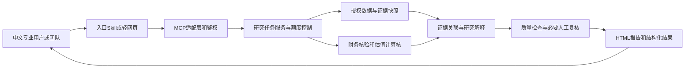

# 投资研究 Skill 与 MCP 产品：市场调研及商业化方案

整理/核对日期：2026-11-16（Asia/Shanghai）。状态：待审核，尚未实施。

用户已确认：首批服务**中文专业投资者与小型投研团队**；团队及预算未确定，允许按创始人主导、2—3人、90天试点测算。测算不是预算拨款或营收承诺。

本轮只联网调研、只读核对本地SOP，并创建本方案；未拆改SOP、开发或安装产品、注册账号、购买数据、联系外部人员或提交上架申请。沿用[内部模块化方案](2026-11-16-研究SOP模块化与Skill落地方案.md)的规则归属原则，但本方案将目标升级为可独立交付、收费、维护的商业产品。旧方案的本机安装路径和个人工作区引用不能直接作为对外产品架构。

## 1. 背景、目标与决策摘要

**建议做“有证据链的基本面研究与估值预期分析产品”，采用免费/开放 Skill 获客＋付费研究服务＋MCP接口，先从估值隐含预期与财报更新切入。** Skill、MCP是分发与接入形态，客户购买的是省下核验时间、可复算模型、可信更新和可阅读的HTML成果。

初期候选主张：“当前股价已经要求公司在哪几年做到什么业绩？下一份财报有没有改变这些条件？”

关键判断【我的推演】：

1. 通用股票分析Skill、DCF提示词和金融数据MCP已有供给，不宜把“SOP很长/覆盖十一项”作为卖点。
2. 我们的潜在优势是中文解释、业务假设到具体兑现年份、季度连续核验、异常桥、更新后结论联动，以及精确表与图同源的HTML报告；这些是候选优势，必须经过对照测试与付费验证，尚不能称为护城河。
3. 市场目录并不等于结算市场。上架/下载量不能直接换算收入，获客不能只依赖平台自然流量。
4. 商业核心应留在可维护的计算、证据、版本和交付服务里；可复制的Skill可做入口，不依赖隐藏提示词赚钱。
5. 90天目标是证明一个窄场景的质量、复购与单位经济性，先不承诺做全球金融终端或自动交易产品。

## 2. 范围、非目标与调研边界

### 2.1 范围与非目标

范围：主要Skill/MCP市场及投资竞品调研、现有SOP产品化路径、产品/API设计、商业试价、数据/业务边界、90天实施与验证规划。

非目标：本轮不实施SOP迁移或产品开发，不修改公司报告，不批量转HTML，不采购/安装/注册/支付/上架，不代表用户联系客户，不作个股投资建议或为公司确定法律资格。

现状分析：本库已经有研究内容标准、九章阅读模板、验收清单与HTML展示规则，详细模块化与两项Skill还停留在待审方案；现有财务脚本多为公司专项，尚未证明可跨客户稳定运行。对外收费服务、统一账户/计量、可授权数据合同与对照评测均尚未落地。

### 2.2 调研方法与证据边界

本轮查阅平台主页、官方文档、发布者协议、官方GitHub和具体竞品页。平台数据仅为2026-11-16浏览快照或页面自述，未审计用户、交易与收入，也未安装或实跑竞争产品。技术能力另通过Context7核对MCP官方规范；实施时须重新锁定版本并做客户端兼容测试。

区分：**【已核实】**页面/文档实际出现；**【平台自述】**数量、准确率、成交展示等营销指标；**【我的推演】**定位、优先级和收益模型；**【待验证】**流量、转化、付费与合同适用性。

“比较大”无法给可信的统一排名：收录文件数、去重技能数、安装遥测、月活、服务器数和GMV完全不同。下面列的是有规模信号、生态地位或明确商业化机制的主要渠道，不宣称按真实活跃买家排序。

## 3. 主要 Skill / MCP 市场与渠道

### 3.1 Skill分发与商业市场

| 平台 | 本轮核对到的规模/形态 | 投资相关供给 | 上架与收费判断 | 我们的优先级 |
|---|---|---|---|---|
| **skills.sh（Vercel）** | 主页All Time括号显示1,435,279；不将其擅自解释为活跃用户。FAQ明确排行榜来自安装遥测 | 有stock-analysis，详见竞品表 | 通过公开仓库与安装进入发现机制；本轮未核实创作者付费结算机制，按分发渠道规划 | P0：免费入口和可公开验证样例 |
| **SkillsMP** | 首页自述收集4,136,145份SKILL.md，并说明目录快照/收录不代表真实采用 | 已找到股票基本面、预测指标、异常费用分析类Skill | 聚合发现渠道；其网站订阅价格不等于给Skill作者的交易结算 | P1：可发现性与搜索长尾 |
| **腾讯 SkillHub** | 官方仓库自述13万+Skills、2万+企业发布、500+商家；支持本土上传、组织发布与私有库 | 本轮未从官方可读页面取得足够具体的股票研究商品样本，需进入后台核查 | 与中文首客匹配；官方仓库可核对发布与API能力。关于SkillPay的线索尚未取得正式完整费率/结算条款，不按已确认支付渠道测算 | P0：验证中文分发和企业发布；收费条款待查 |
| **ClawHub / OpenClaw生态** | 官方站有skills/plugins及下载栏目；本轮不报未经核验的总量排名 | 已找到Finance类Skill；金融管理不等同深度证券研究 | 可做生态分发；本轮未核实统一的创作者收款机制 | P2：视客户实际宿主比例决定 |
| **Claude Marketplace** | 官方2026-09-23文章称统一连接器/插件、产品/Agent和服务伙伴，发布时称2000+连接器与插件 | 官方金融插件及多家金融数据商 | 连接器/插件目录与企业产品采购是不同路径；Claude驱动的软件可申请伙伴上架，部分企业承诺消费可用于采购；不是传仓库即自动获得销售资格 | P1：产品成熟后申请，不作90天营收前提 |
| **Capafy** | 官方定位领域专家Agent商店，未取得独立规模审计 | Alpha Consensus、Serenity Stock Tracker等公开市场研究商品 | 明确支持订阅、按小时和一次性下载；发布者协议有20%平台费，订阅另有沙箱费及结算条件 | P1小实验：先验证真实流量、退款与结算，再放大 |

依据：[skills.sh主页](https://www.skills.sh/)、[其FAQ](https://www.skills.sh/docs/faq)、[SkillsMP主页](https://skillsmp.com/)、[腾讯官方仓库](https://github.com/Tencent/skillhub)、[ClawHub](https://clawhub.ai/)、[Claude Marketplace官方说明](https://claude.com/resources/articles/claude-marketplace)、[Capafy帮助中心](https://capafy.ai/help-center)、[发布者协议](https://capafy.ai/publisher-agreement)。所有数字保留各自统计口径；没有把GitHub stars当付费用户。

Capafy具体注意：下载模式会交付完整源码；订阅计费基数先扣沙箱费再计算平台费，净收入不能简单写成售价×80%；协议列明7天争议窗口及月度结算、最低付款条件。这里仅摘与商业选择直接相关的条款，实际支持地区、支付主体、税务与上架内容范围需实施前逐条复核。[官方协议](https://capafy.ai/publisher-agreement)

### 3.2 MCP目录、运行市场与大型宿主

| 渠道 | 当前状态与证据 | 发现/上架/交易的区别 | 决策 |
|---|---|---|---|
| **官方 MCP Registry** | 官方服务提供服务器发现；发布涉及命名空间控制验证，可登记远程服务 | 是注册/发现基础设施，不是已核实的收款或质量担保市场 | 远程MCP稳定后P0登记 |
| **Glama** | 主页快照121,867 servers、Finance标签8,297；这是其分类数，含重复或广义金融可能，未审计 | 提供目录、工具检索及托管相关能力；提交仓库/远程端点有相应流程，未确认普遍的创作者销售分成 | P0发现；不按目录数推导收入 |
| **MCP.so** | Finance & Commerce页面605项，类别含非投研；提交页当时列39美元一次性付费发布 | 付费是买目录展示，非用户购买我们的服务；页面称付费可不经审核立即发布，“verified”不能当安全/质量背书 | P2，小额获客实验，不先花钱买排名 |
| **Smithery** | 2026-10-31已关闭代理和托管身份服务，官方称保留非代理公共registry | 不能沿用历史“托管/身份/代理一体化”的旧产品假设 | P2发现，服务自行提供，不依赖旧代理 |
| **PulseMCP** | 首页当前明确暂停新server提交及列表修改 | 有目录影响力，但现在无法假设能即时上架 | 观察，恢复后再评估 |
| **Apify Store** | 官方明确可把MCP/自动化产品作为Actor发布并按事件收费 | 有运行、发现、计费与开发者分账；当前文档列20%收入佣金，平台运行成本也影响到手 | P1：适合将财务核验等确定性任务作为付费事件试点 |
| **ChatGPT公开插件目录** | 当前官方开发指南已将旧Apps链接重定向为Plugins规则 | 审核、服务可用与商业化规则需分别满足；当前禁止在插件中销售/推广数字订阅或升级，允许既有付费账号登录使用所含功能 | P2适配；不能规划为聊天内售卖研究订阅的收银台 |

依据：[官方Registry](https://registry.modelcontextprotocol.io/)、[远程发布文档](https://github.com/modelcontextprotocol/registry/blob/main/docs/modelcontextprotocol-io/remote-servers.mdx)、[Glama主页](https://glama.ai/mcp/servers)、[Glama提交说明](https://glama.ai/mcp/faq)、[MCP.so金融分类](https://mcp.so/categories/finance-commerce)、[提交页](https://mcp.so/submit)、[Smithery调整公告](https://www.smithery.ai/future)、[PulseMCP](https://www.pulsemcp.com/)、[Apify计费文档](https://docs.apify.com/actors/monetize)、[MCP商业化入口](https://apify.com/mcp/developers)、[OpenAI现行插件指南](https://developers.openai.com/plugins/plugin-guidelines)。

【我的推演】首期应争取“两条发现渠道＋自己的付费客户关系”，而非同时铺十几个适配器。先面向首客实际使用的宿主交付，再按获客数据选择平台；官网/合同收费也必须遵守引流平台规则，不能绕开平台禁止的插件内升级推广。

## 4. 有没有投资Skill/MCP？有，而且竞争已经分层

### 4.1 代表产品核对

| 对手/产品 | 已核对到的能力 | 价格/规模证据及限制 | 对我们的启示 |
|---|---|---|---|
| **Anthropic financial-services** | 开放金融分析、股票研究等插件，包含DCF/可比/三表以及earnings、initiation、thesis/catalyst跟踪；Apache-2.0仓库 | 开放代码不意味着数据连接器或宿主推理免费；未实测输出质量 | 最直接的免费方法论基线，不能把普通DCF和覆盖报告当独有功能 |
| **skills.sh：claude-office-skills/stock-analysis** | 基本面、技术面、同业、风险与结构报告，页面声明实时价格依赖外部来源 | 页面显示7.2K installs；是遥测展示，不是客户数或收入 | 通用“分析一只股票”已有分发竞争 |
| **SkillsMP：teessmartai/stock-analysis** | 历史/预测估值指标、正常化利润、异常费用、情绪和新闻 | 本轮只核对到公开描述及仓库信息，未跑模型 | 不能认为“讲异常利润”已构成差异化 |
| **Financial Datasets MCP** | 官方金融数据MCP：价格、报表、SEC文件、内幕交易、机构持仓等；有可溯源数据定位 | 直接打开当日价格页为Personal $200/月、Professional $1000/月；后者列商用及归因展示权。搜索缓存曾出现不同套餐，采用直接页面快照，不能当合同报价 | 是可接入上游，也是研究基础设施竞争者；不能做一个无授权数据转售壳 |
| **Daloopa MCP** | 官方只读远程服务，强调原始来源链接、财务/KPI/指引以及OAuth | 官网自述6500+全球股票；本轮未核实公开自助价格或准确率 | “可追溯数据”已有强供给；可考虑合作，不宣称我们独有 |
| **Alpha Vantage MCP** | 有数据商官方金融MCP入口 | 本轮只确认官方入口存在，不采用第三方文章的额度作为合同保证 | 普通行情接入不值得作为首要收费壁垒 |
| **Fiscal.ai** | 官网提供终端、数据API与MCP连接器，强调可审计数据和财报后更新 | 具体付费套餐、客户端输出与商业协议未实跑核验 | 面向用户的“报告＋数据”也有成熟对手 |
| **Rogo** | 面向金融机构的端到端金融工作流与内部知识连接 | 官网450+机构为自述，未获合同报价 | 暂不正面拼大型机构采购、安全认证和完整工作台 |
| **Capafy：Alpha Consensus / Serenity Stock Tracker** | 分别做公开市场声音汇总、特定公开账号股票观点追踪 | 主页当时显示月价$8.33及Sold计数；未核实是否年付折算、成交口径、退款或持续付费，不能计算竞品ARR | 金融专家内容已商品化；我们应卖可核验经营/估值，而非跟单或模仿名人身份 |

来源：[Anthropic官方仓库](https://github.com/anthropics/financial-services)、[stock-analysis页面](https://www.skills.sh/claude-office-skills/skills/stock-analysis)、[SkillsMP样本](https://skillsmp.com/creators/teessmartai/skills/claude-skills-stock-analysis)、[Financial Datasets MCP文档](https://docs.financialdatasets.ai/mcp-server)、[当日价格页](https://www.financialdatasets.ai/pricing)、[Daloopa MCP](https://daloopa.com/products/mcp)、[Alpha Vantage官方入口](https://mcp.alphavantage.co/)、[Fiscal.ai](https://fiscal.ai/)、[Rogo](https://rogo.com/)、[Alpha Consensus](https://capafy.ai/agent/alpha-consensus-x-s-best-traders/2987621471)、[Serenity Stock Tracker](https://capafy.ai/agent/serenity-stock-tracker/2521387714)。

### 4.2 我们怎样竞争

【我的推演】避免把“是否有某功能”的网页表格伪装性能排名。现阶段可提出以下竞争假设，再验证：

- 对免费Skill：减少季度缺失、口径混用、幻觉来源和旧数残留，提供复算/验收证据，而非让客户购买更多提示词。
- 对数据MCP：在合法授权数据之上，把事实转成“为了支撑现价要发生什么”的可修改经营模型；数据层可合作，决策过程必须透明。
- 对名人/情绪追踪：按业务、现金流和明确年份建立假设，不把公开喊单频次当公司价值。
- 对大金融工作台：中文专业解释、窄场景快上线、轻团队可负担；不假装已有机构级采购和全球覆盖能力。
- 对客户自己用大模型：证明可重复地降低核验/更新用时，且结构化模型能继续用；单次写得更漂亮并不足够。

我们的首期优势必须从“方法更完整”转成能计量的成果：复算正确率、证据可定位率、季度覆盖、更新一致性、人工返工分钟数和客户第二次付费。未验证之前不宣传胜率、收益率、行业第一或100%正确。

## 5. 首批客户、定位和产品组合

### 5.1 已确认首客与待验证需求

首客：中文专业投资者、小型投研团队。建议首期聚焦研究美股AI基础设施、半导体及大型平台公司的用户，这是基于本库已有研究的产品假设，不代表用户已承诺全部市场只做美股。

首批约10—20个覆盖主体：从MSFT、AMZN、GOOG、META、ARM、AMD、INTC、MU、ORCL等现有研究中筛选可合法取得完整资料、业务口径可解释的公司。**已有文件不是已核验产品数据**，需要重新标截止日和质量状态。暂不承诺A/H股全覆盖、金融/保险特殊模型、加密自动交易或小盘实时推荐。

待访谈：他们现在用谁/用什么表、最耗时步骤、最近一次错数带来的返工、是否会改模型、多久更新、愿意为哪项结果付费。分别访问个人专业用户与团队负责人，后者要区分使用人、预算人和合规审批人。

### 5.2 第一项付费能力

候选工作名：**“估值预期工作台”**，品牌/域名/商标未检索，不对外使用为既定名称。

用户任务示例：“给定ARM某日价格与已披露数据，哪些业务假设和具体财年业绩能支撑价格？若兑现晚两年，价值会如何变化？”这里不预先认定某个产品概念已被市场计价；产品名称、商业化阶段和证据要先核查。

交付：基准快照 → 已知/指引/推演分层 → 业务驱动与年份模型 → 支撑现价条件 → 延迟/倍数收缩情景 → HTML精确表与交互增强 → 来源、公式、限制、模型版本及跟踪清单。与监管意见相容的具体功能范围需在收费前确定，见第10节。

### 5.3 两个入口Skill，一个共享付费核心

| 包/能力 | 分发或计费角色 | MVP范围 |
|---|---|---|
| `<brand>-company-research` | 免费或开放入口Skill；按任务读标准 | 识别研究/更新/核验任务，调用有权限的服务；本地提供简版检查和合法示例，不强制付款才能看清功能 |
| `<brand>-stock-valuation` | 独立入口Skill | 组织用户已知假设，调用估值/复算服务；没有服务时如实说明缺失，不伪装完整付费研究已完成 |
| 估值预期分析 | 核心付费候选 | 反推1—2个变量、具体目标财年、延迟/终值/回报率敏感性；保留多解和适用边界 |
| 财报更新与核验 | 复购/续订候选 | 连续季度、累计勾稽、异常桥、旧数扫描、影响范围联动 |
| 全公司深研HTML | 后续高额度任务 | 在前两者质量稳定后扩到九章/十一项；MVP不把所有模块全自动完成作为上市承诺 |

Skill不是所有业务逻辑的代码容器，MCP也不是替代方法论。对外品牌命名与具体声明在验证后确定，避免使用泛化`stock-analysis`与目录里海量同名产品混淆。

## 6. SOP怎样模块化才可销售

### 6.1 从内部规定变成可执行契约

| 模块 | 对外输入 | 对外可检查产出 | 实现形态与验收 |
|---|---|---|---|
| 证据/口径 | 主体身份、基准日、来源文档/授权数据 | 带出处的指标及缺口、版本/公开日期 | 共享标准＋结构化证据层；不可靠项不提升为事实 |
| 财务核验 | 年度/季度/累计数据及原始精度 | 连续期间矩阵、拆季/利润率/现金桥、错误与限制 | 确定性计算核＋人工异常复核；EPS不累计差分 |
| 业务/客户/竞争 | 官方资料与可追溯案例 | 付费链路、客户阶段、竞争边界 | Skill执行方法＋证据服务；先保留人工研究部分 |
| 估值隐含预期 | 基准价格、财务/股本、固定/求解假设、目标年 | 所需增长/利润、具体财年、现值、敏感性 | 核心计算服务；股权/EV/稀释口径、终值依赖可检验 |
| 治理/护城河/判断 | 证据、历史轨迹及反证 | 有边界的判断和待验证问题 | 标准与研究工作流；不输出无依据主观雷达评分 |
| 更新 | 新材料、上次模型/报告版本 | 变更清单、受影响结论、重算结果 | 有状态服务；完整记录旧新快照，旧材料不冒充最新 |
| HTML交付 | 同一已核验数据与研究内容 | 九章阅读、精确表/图、核验和来源 | 渲染与验收；离线核心图表可读，报告只维护HTML |

每个模块有：适用范围、输入条件、版本、完成判据、错误/缺口状态、可追溯输出、成本与授权标签。客户市场偏好与行业例外是参数，不把全部本库个人偏好变成所有客户强制要求。

### 6.2 单一规范源与发布边界

内部SOP保留共通标准，个人工作区路径、当前证券目录、个人判断、私人材料和数据商秘钥不进入公开包。对外技能、标准模块及模板需要独立的产品发布源和版本清单，不能直接把整个stock_research仓库公开。

标准主源只维护一处；构建发布时按授权层级导出Skill引用模块、服务规则和验收标签，避免仓库规范、个人安装、SaaS服务三处手工修订。可公开方法、保留服务实现是商业选择，不能用许可限制掩饰实际采用了第三方开源代码。

建议免费Skill/示例选明确开源许可；付费服务、私有执行逻辑、客户数据、商用报告权限分别用合同界定；具体许可证取舍经第三方代码和公司权属核查后确定。下载Skill可被复制是其形态事实，不把“防复制提示词”当产品壁垒。

## 7. 数据模型、API与技术架构

本节是待实施设计，不是已存在的产品能力。技术取舍基于[Agent Skills规范](https://agentskills.io/specification)与[MCP规范](https://modelcontextprotocol.io/specification/2026-07-28)：Skill可以携带指令与支持文件，MCP暴露工具/资源等能力；两者组合，不必二选一。

### 7.1 设计原则

- Skill只负责明确任务、选择模块、组织解释和调用服务；可重复的季度拆分、反推求解、折现和加总在受版本控制的代码里执行。
- 一个服务核心，MCP与普通API/网页只是适配器，避免每个市场写一套逻辑。MVP先支持首客实际使用最多的一个宿主，再验证第二个；不写“所有MCP客户端100%兼容”。
- 模型先用于取证辅助、语义分类与解释；数字来自证据和计算。模型不能自行伪造来源、补齐公司未披露分部利润，或把反推当市场共识。
- 任务失败、缺资料、模型未收敛、权限不足和消费额度不足有不同状态，不能用一段漂亮文本掩盖失败。
- 对长任务，先返回任务句柄，提供状态/取消/取结果；不要为了MCP同步超时而强塞整份研究。Tasks、Apps及Skills over MCP等扩展需按规范状态和客户端能力另行确认，MVP不依赖可选扩展才能用；基础方式返回结构化结果与受控HTML链接。
- HTML报告本地下载后核心内容可离线阅读，在线交互为增强；付费链接需鉴权和有效期，不能靠难猜URL保护私有报告。共享必须由客户明确操作，不能目录上架时公开客户材料。

### 7.2 MVP候选工具/API契约

工具名称为设计示例，不是可直接调用的现有接口。可将已有基准包绑定在workspace里减少重复传参，不暴露几十个重叠工具。

| 候选工具 | 主要输入 | 主要输出 | 计费边界 |
|---|---|---|---|
| `audit_financials` | 数据包ID、主体、期间、检查范围 | 指标/勾稽/覆盖状态、证据ID、缺口 | 成功完成已约定核验范围的任务 |
| `solve_implied_expectations` | 基准包、模型版本、目标财年、固定假设、求解变量/区间 | 多组可行条件、现值、敏感性、限制 | 成功完成约定求解；无解返回有依据状态，不强造答案 |
| `create_research_job` | workspace、任务模式/范围、材料ID、成本上限 | job_id、预算范围、状态 | 预占额度，完成/取消后结算；不在重试中重复扣费 |
| `get_research_job` | job_id | 状态、阶段、成本、失败原因 | 状态轮询不收费 |
| `cancel_research_job` | job_id | 取消/已完成状态、实际已耗成本 | 明确取消前已发生成本政策 |
| `get_report` | report_id、版本 | HTML访问/下载位置、结构化摘要、核验及截止日 | 已结算版本的重复读取不再次按生成收费 |

已形成的合法证据包、核验结果和模型在同一租户内复用；用户改假设时先重算，不无故重新拉取全量资料或重复生成整份报告。外部成本高的任务发起前展示预算上限，区别免费状态读取与收费计算。

### 7.3 最小数据对象

| 对象 | 必需字段/语义 |
|---|---|
| Entity | 稳定主体ID、market/mic/symbol、股类/ADR关系、币种/财年/并表范围；不能只靠ticker |
| Evidence | source_id、来源URL/附件哈希、公开/取得日、页码/章节、许可/租户权限、引用片段、重述版本 |
| FinancialFact | metric、原值/原精度、币种/单位、期间起止及年度/单季/累计/TTM、主体/业务、actual/guidance/estimate、来源与公式、缺失类别 |
| ValuationScenario | 价格基准、目标财年、当前/未来股数与净债务口径、固定假设、求解变量、期间现金流、折现/终值、结果与可行性/敏感性 |
| ResearchJob | 服务端租户/用户、输入快照、状态、幂等键、额度预占/消费、所用模块/模型/代码版本、错误类别 |
| Report | 报告ID/版本、数据截止、主张→证据→公式关联、HTML与数据引用、核验状态、覆盖/缺口、访问权限 |

Evidence与FinancialFact支持“一项主张依赖哪些事实”，新财报变化时沿依赖更新摘要/估值/跟踪项。租户身份来自已验证会话，不能信任模型传入tenant_id。不同客户的数据授权和缓存分别隔离；同一公开材料是否可跨客户缓存仍按版权和数据合同处理。

### 7.4 安全与兼容基线

远程服务使用合适的OAuth授权，校验token目标受众；上游数据商凭据与MCP用户凭据分开管理，不透传，不写入Skill、日志或HTML。限制工具权限及外部材料注入，文件下载/解析有边界；财报或第三方Skill中的指令属于不可信材料，不具有产品操作权限。[MCP授权安全规范](https://modelcontextprotocol.io/specification/2026-07-28/basic/authorization/security-considerations)

首期为研究用途，不接券商下单、不持有钱包/资金权限。即使以后有交易需求，也必须单独产品与授权审核，不被已有研究Skill隐式涵盖。

## 8. 商业模式、试价与单位经济性

### 8.1 建议收费结构【待实验，不是已验证市场价】

优先“订阅含任务额度＋可预估的超额任务”，避免无限调用和按token制造不透明账单。额度与交付范围绑定，不按每次工具调用收费，防止agent循环导致意外账单。

| 档位假设 | 试价（人民币，税费口径合同确定） | 内容与限制 |
|---|---:|---|
| 免费Skill/示例 | 0 | 公开方法、合法固定示例与基础检查，不含无限联网取数 |
| 专业个人 | 399/月 | 10个基础任务额度，单人；首期不含重型完整深研或人工定制 |
| 小团队 | 1999/月 | 3席、60个基础任务额度，共享模型/版本与研究库；高级权限后续评估 |
| 深研/团队定制 | 单独报价 | 按模型/资料量/人工审阅范围明确成本，不能承诺399元内无限全研究 |
| 企业/私有部署 | 验证后谈年约 | 权限、数据接入、审计、SLA和部署单独成本核算，非首期必做 |

一个“基础任务额度”需在试点后固定：例如一个范围明确的估值重算或核验；初始证据收集、复杂文档解析和完整九章报告单独计重。不能用成本差异十倍的任务均按1额度出售。出现缺资料/验证未通过按合同交付边界处理，系统错误未交付不扣服务额度，外部已耗费用及取消规则预先说明。

### 8.2 单位经济性演算

纯假设：基础任务平均变动成本8元（推理、上游按量、运行和抽样复核分摊），支付成本3%；客户用满额度。不含平台另加的沙箱费。实际需要逐任务测量，无法维持8元时应调额度/定价，不能以减少核验维持假毛利。

- 个人贡献＝399×97%−10×8＝**307.03元/月**，贡献率76.95%。
- 团队贡献＝1999×97%−60×8＝**1459.03元/月**，贡献率72.99%。
- 若经20%平台分成且不再重复假设同项3%支付费：个人贡献＝399×80%−80＝239.20；团队＝1999×80%−480＝1119.20；另有平台运行/沙箱费时继续扣减。此为敏感性假设，不代表所有市场均同费率。
- 固定月成本暂按76,000元：两名人员全成本54,000＋基础设施6,000＋固定数据许可预算10,000＋其他6,000。实际工资、数据合同及税务待确定，创始人薪酬未计。
- 仅个人客户需约**248个**满额付费账号，或仅团队需约**53个**，才覆盖上述固定成本；混合示例100个人＋32团队月贡献77,391.96元，对应月收入103,868元。不是营收预测，也未覆盖获客投入、税费、坏账和资本成本。
- 若平均任务成本增至16元，个人贡献降至227.03、团队至979.03；用量、人工支持和数据费会实质改变模型。用客户节省的研究时间验证价格，不拿供应商API单次价格直接当全部COGS。

费用分类避免重复：上游固定许可列月固定成本，超额/按量访问计入任务变动成本；推理、存储、人工复核分别记实际账，不在固定/变动同时扣。BYOK可以降低采购量，但不免除商业处理/派生输出授权，也不免服务端推理成本。

### 8.3 90天预算假设

创始人负责产品/客户/研究验收，另配工程1人、研究/数据工程1人，设计/法务按需外包。两名员工月现金工资假设25,000＋20,000，雇佣附加按20%估计，三个月人员全成本162,000元；这是测算，不是招聘报价。

| 项目 | 90天预算假设 |
|---|---:|
| 两名人员全成本 | 162,000元 |
| 模型/云/存储与测试 | 18,000—36,000元 |
| 数据商业授权预留 | 15,000—45,000元，合同可能超出，应触发范围重估 |
| 法律/数据合同及业务分类 | 20,000—40,000元 |
| 设计、客户试点与其他工具 | 10,000—20,000元 |
| 小计＋15%机动 | **258,750—348,450元，约26—35万元** |

不含创始人工资、公司设立/税务特殊成本、年度锁定合同及额外招聘。美元供应商价另列原币，不将预算预留冒充已取得汇率换算/正式授权报价。资金若不足，缩成一工程＋创始人、用户自带合法材料的估值核验试点，明确交付范围和人工成本；不通过免费API或未经许可抓取规避必要授权。

## 9. 获客、渠道实验与竞争验证

### 9.1 首批获客路径

1. 创始人先与10—15位真实目标用户访谈，不代发消息；聚焦最近一次研究任务和替代方案，尽量观察真实使用而不是只问“你愿不愿买”。
2. 用3个经核验、可公开授权的HTML示例展示：估值预期反推、现金投入去向、新财报如何改变旧假设。公开版本必须删除私人研究和不允许外发的数据。
3. 免费Skill放公开产品仓库，逐个适配已验证宿主；skills.sh与SkillHub作为首轮发现实验，SkillsMP为补充索引。公开仓库只含获准发布内容，不公开当前研究库。
4. 先建立2—3个愿意明确任务/反馈的设计伙伴；在法律/数据边界明确后，争取实际付费试点。不要把免费用户、访谈积极反馈或口头意向当付费客户。
5. Apify或Capafy只选一个做收费试点；验证后台结算、退款、任务成本、资料隐私与渠道转化后再决定是否保留。若宿主内推广受限，产品呈现按该平台规则设计。
6. 成熟后申请Claude官方目录/伙伴采购，按客户需求适配ChatGPT；不把官方平台必然批准作为商业路径的前提。

每条渠道单独记录：展示→详情→安装→连接授权→首个合格任务→首次付费→第二次有效使用→30日留存/续费；分母和时间窗明确。服务器调用数、重复安装、免费报错重试都不算有效用户。

### 9.2 发布前必须做的对照实验

不能依据网页描述宣称胜出。至少比较通用模型直接研究、Anthropic金融参考工作流、我们的产品；锁定模型版本、同一资料快照、相同成本/时间预算与合法数据权限。竞品无法取得必要数据或不兼容时单列，不把不可比的缺权限归咎其研究质量。

先以12个任务、3种方式、一个共同可用模型、各2次运行做72次探索。再构建至少40任务、两种可用模型、各2次的480次成对评测；是否扩充由首轮失败和预算决定，不为凑数量消耗预算。开发集与留出集分开，按历史公开日控制资料，避免看未来或把人工答案泄露给模型。

任务覆盖：美股不同财年、年内连续季度、累计拆季、负FCF、毛利异常、重述/分部变化、并购净额、租赁/承诺、股本稀释、反推多解、终值依赖、兑现延迟及伪造来源。选MSFT/ARM/MU/ORCL等只是覆盖候选，不声称它们所有旧研究数据可直接作真值。

指标与首发目标（团队设定的验收门槛，非既有成绩）：

- 已知真值的关键金额/公式可复算；容差按原披露精度，不能默认允许随意1%误差。
- 样本中严重错误为0：主体/币种/期间混淆、造来源、非现金当现金、未来值未折现、越权读取等任一出现阻断相应能力上线；“样本0”不宣传“永不出错”。
- 关键定量主张来源定位覆盖率≥95%，剩余明确标推演/缺口；预期必需季度均展示或有真实例外，不用平均分掩盖关键缺季。
- 同样范围下，盲审返工时间中位数相对基线下降≥30%，质量不下降；同时报告样本量、分布和模型/数据依赖，不能从少量任务推行业领先。
- 估值情景固定假设/求解变量、具体兑现年份、现值与现价差异、延迟情景完整；无解/多解处理正确，不输出伪精确市场共识。
- 人工审稿员与模型执行分离，记录分歧及严重错误；自动格式校验不代替财务判断。

### 9.3 需求与留存门槛

第30日前：至少10次合格访谈、3位愿意提供任务的设计伙伴，其中2位表达明确付费条件；只是访谈门槛，不等于收入。

第60日前：2—3个真实付费试点或等价的已签付费服务合同，验证支持时间、使用频次和成本；若依法暂不能收费，停止收费主张，先解决业务边界，不以免费无限试用冒充验证。

第90日前：至少5个付费客户/团队中，≥3个发生第二次真实付费或按原合同续用并再次执行有效任务；完整报告、任务级产品分别看复购，不混合算。

商业拉伸目标可为30个人＋5团队，MRR＝30×399＋5×1999＝**21,965元**，仍低于示例固定月成本。达到拉伸目标证明初步需求，不证明盈利或产品市场匹配。连续两轮价格/范围实验无付费或返工优势不成立，缩范围/转向已有团队核验工具，而非扩建更多市场适配器。

## 10. 数据授权、法律与商业边界

这部分是公司业务成立的必要尽调，不是用免责声明代替合规，也不在本方案作法律适用定论。

### 10.1 数据授权影响产品和毛利

Financial Datasets当日直接价格页将个人与商用许可区分；其条款对原始/批量数据转售及替代其数据服务的产品设有限制。因此“支持展示给客户”不等于可以做转售API、下载原始数据或竞争数据产品。此次搜索缓存与直接页面套餐不一致，合同与书面授权是最终依据。[官方定价](https://www.financialdatasets.ai/pricing)、[官方条款](https://www.financialdatasets.ai/terms-of-use)

对每个供应商确认：专业身份/商业使用、展示字段、派生值、图表/HTML导出、可保留证据的期限、跨用户缓存、客户自带key、跨境处理、MCP输出、代理转交、模型输入/训练、终止后的数据删除。无明确授权不转发原始数据、不把全量文件塞进可下载报告。

公开财报可作为取证起点，但访问限制、内容权利、第三方转录稿、行情和再分发并非一概免费。原始文档保留访问控制，公开演示优先用获准引用和可复算派生值。数据库服务替换上游时做字段/质量/许可核验，不能无声切换导致模型口径改变。

### 10.2 投资研究产品的业务分类

中国证监会公开材料指出，收费提供具体证券分析、预测或建议的软件可能涉及证券投资咨询业务；软件/Skill/MCP的技术包装不自动豁免。最新江苏监管风险提示也针对“AI炒股”相关非法金融活动。美方SEC对提供电子投资建议的业务同样有监管说明。[证监会答复](https://www.csrc.gov.cn/csrc/c100028/c1002326/content.shtml)、[2026年江苏提示](https://www.csrc.gov.cn/jiangsu/c105410/c7612290/content.shtml)、[SEC电子投资建议检查说明](https://www.sec.gov/newsroom/whats-new/observations-examinations-advisers-provide-electronic-investment-advice)

建议上线前由专业顾问按实际经营主体、客户所在地、产品输出与营销方式出具范围意见。优先探索向专业团队提供内部数据核验/模型软件、用户指定假设的计算工具，或与合适持牌主体合作；**B2B、非个性化、“仅供研究”或客户自行点按钮都不能在此被认定为当然免责**。具体标的未来价格分析是核心卖点，也正是必须先明确经营边界的地方。

首期不作个性化仓位/买卖时点指导、不保证收益、不做自动下单；这既是范围选择，也不代替对估值/研究服务本身的分类判断。正式收费、公开对外宣传和发行前完成此项，不需要在本轮方案阶段购买或申请任何资质。

### 10.3 公司资产和客户材料

发布前核对SOP、脚本、模板和历史材料的公司权属；外部文章/付费研究/他人代码逐项看许可，不把“在我们仓库里”当拥有再销售权。测试集、客户研究和私密提示不默认用于模型训练。租户隔离、删除/导出、日志脱敏、跨境数据与隐私条款须匹配真实运行方式。

## 11. 实现步骤：90天阶段计划与责任

时间以**方案批准后D1**计算，不承诺从本次聊天日起自动启动。若验证或授权受阻，后续阶段顺延或缩范围，不能为守日历跳过质量门槛。

| 阶段 | 主要产物 | 负责人建议 | 继续投入条件 |
|---|---|---|---|
| D1—14：验证问题与边界 | 10—15次访谈、现有SOP规则映射、竞品样本、产品边界/数据权利问题清单、首个可售任务定义 | 创始人＋研究负责人；顾问按需 | 有明确任务痛点和初步合法可行的交付路径；否则先调整定位 |
| D15—30：离线可复算原型 | 模块化标准、估值核＋财务核验最小实现、3个合法HTML样例、72次探索评测与成本账 | 工程＋研究/数据 | 严重错误修复、证据链可复核、3个设计伙伴；不先铺大量市场 |
| D31—60：受控付费试点 | 一个宿主Skill、共享服务/MCP最小接入、账户权限/任务额度、2—3付费试点、实际支持成本 | 创始人销售/研究；工程服务 | 授权及业务边界已明确；客户完成二次任务、质量不依赖创始人逐行重写 |
| D61—90：上架与留存 | 稳定产品版本、扩展留出评测、一个发现渠道＋一个结算实验、第二宿主按需、版本/退款/支持说明 | 团队 | 真实付费/复购、任务贡献为正、无重大未修错误；满足后再增加覆盖 |

先做窄能力，后把它组装成完整公司研究。大客户定制、私有部署与全市场覆盖在90天后按真实需求决定，不能用预计大合同替代小客户验证。

## 12. 主要风险与停止/调整条件

| 风险 | 对业务的影响 | 控制与调整条件 |
|---|---|---|
| 免费官方插件持续变强 | 通用方法论难收费 | 公开同条件评测；若无核验/返工优势，转更窄更新/质检需求，不持续卖文本 |
| 模型和数据质量 | 返工吞噬毛利、客户失信 | 确定性计算＋证据链＋严重错误门禁；付费报告保留缺口，不包装成完整 |
| 数据许可/投研业务边界不成立 | 产品范围或成本需重做 | 前置取得适用意见/授权，不以改名“工具”绕过；必要时合作或缩成允许的计算/核验 |
| 免费安装多但付费少 | 把分发数据误当业务 | 渠道漏斗、付费访谈和二次使用；不按下载量招聘扩张 |
| 平台规则/服务变动 | 接入、分发或计费失效 | 核心服务独立、客户端兼容明确；发布前重查Smithery/PulseMCP等状态 |
| Skill被复制 | 单次文本销售收入弱 | 免费入口、可持续服务与数据/模型版本；版权维护不替代商业价值 |
| 大量人工兜底 | 看似AI产品，实为低毛利定制 | 记录每单复核分钟数与可复用部分；超出套餐转定制报价 |
| 同期内部研究仍变动 | 对外包混入私密内容/旧规则 | 独立产品发布源、映射审查、显式授权公开清单，不直接上传研究库 |

停止条件：两轮客户/定价实验后仍无真实付费任务；或始终不能在成本内达到核验质量；或无法获得必要数据/业务交付权利。停止扩大投入并复盘，不把“再上十个市场”当修复办法。

## 13. 验证、交付与回滚

本方案调研验收范围：主要渠道和代表竞品的公开页面、收费/分发边界、技术规范、关键授权风险、商业成本模型与阶段门槛。价格以当日直接打开页面优先，矛盾缓存单列；没有做支付/上架、合同审阅、实时客户端实跑或竞争性能评测，因此这些均为待实施验证。

实施验收分层：模块迁移映射无丢项；Skill格式/触发；计算真值/证据与期间完整性；MCP接口/认证/租户；HTML桌面/窄屏/离线/打印；预算/幂等扣费/取消退款；真实付费与复购。每层单独记录，不能因包发布成功称投研质量通过。

回滚：SOP按本轮迁移差异恢复，不全库重置；产品版本可回退规则/计算核/模板，客户报告保留原快照与版本，修订用新版本明确更正；暂停有错的能力及收费任务，按约退回未交付额度。公开Skill版本更新说明兼容/停用，市场下架和客户数据迁移按平台/合同要求办理，不静默删除客户研究或原始证据。

本轮没有实现代码，尚无运行系统需要回滚；本方案不是部署或对外发布授权。

## 14. 待确认决策与下一步

已确认：目标客户为中文专业投资者/小团队；团队预算可按本方案先估。建议用户审核以下组合，而非先挑“哪个市场最大”：

1. 首期定位采用“估值隐含预期＋财报核验/更新”，先美股AI基础设施等现有经验较强领域验证，完整研究后扩。
2. 商业形态采用两项入口Skill＋共享收费研究服务/MCP，SOP标准在内部与对外发布之间建立单一来源、授权导出和版本管理。
3. 先批准D1—14调研/原型准备范围；26—35万元是90天规划区间，不要求一次拨满，后续按验证门槛分期决定。注册地、客户法域、数据采购与收费范围须在相应外部动作前明确。
4. 对外发布、购买数据、联系客户、注册渠道、收费试点另按明确范围执行；本轮不替用户发送任何消息或提交申请。

本方案等待审核。审核通过后先按批准阶段落实内部模块化与可复算原型；市场调研表在实际提交上架前再次更新，不把今天的渠道规则当长期保证。

## 15. 关键证据索引与未解决项

为方便复核，本文各市场表/竞品表已就近附直接来源。另集中列最影响投资决策的证据：

| 关键问题 | 来源/证据 | 当前结论及缺口 |
|---|---|---|
| 免费金融方法论是否已存在 | [Anthropic官方仓库](https://github.com/anthropics/financial-services) | 存在；未做运行质量排名 |
| 平台是否真的收款分账 | [Apify](https://docs.apify.com/actors/monetize)、[Capafy](https://capafy.ai/publisher-agreement) | 机制已公开；我们未完成注册、结算或财务验证 |
| 中文渠道规模与企业发布 | [腾讯官方仓库](https://github.com/Tencent/skillhub) | 有明确自述及发布能力；付费完整条款、具体同类商品待核 |
| 接入服务有没有变 | [Smithery](https://www.smithery.ai/future)、[PulseMCP](https://www.pulsemcp.com/) | 前者保留目录但停部分服务；后者暂停新提交 |
| ChatGPT能否插件内卖数字订阅 | [现行插件指南](https://developers.openai.com/plugins/plugin-guidelines) | 当前不按可售订阅收银台规划；规则需发布前再查 |
| 数据能否合法给客户 | [Financial Datasets价格](https://www.financialdatasets.ai/pricing)、[条款](https://www.financialdatasets.ai/terms-of-use) | 个人/商用不同，原始转售与替代服务有限制；需要具体合同适配确认 |
| 投研软件是否天然豁免 | [证监会公开答复](https://www.csrc.gov.cn/csrc/c100028/c1002326/content.shtml)、[SEC说明](https://www.sec.gov/newsroom/whats-new/observations-examinations-advisers-provide-electronic-investment-advice) | 不能据技术形态认定免责；实际业务需专业分类意见 |
| 技术能否跨宿主 | [Skills规范](https://agentskills.io/specification)、[MCP规范](https://modelcontextprotocol.io/specification/2026-07-28) | 有开放标准，仍需能力/版本/权限实测；不承诺全兼容 |

未解决：客户实际付费意愿、竞品真实输出效果、我们独立获客成本、数据合同与经营法域、平台收款主体/地区限制、人工复核成本、产品商标，以及可重复达到的质量/时延。这些决定后续公司业务可行性，不能由本次桌面调研替代。
